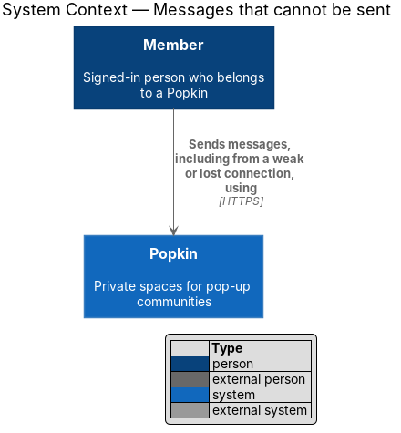
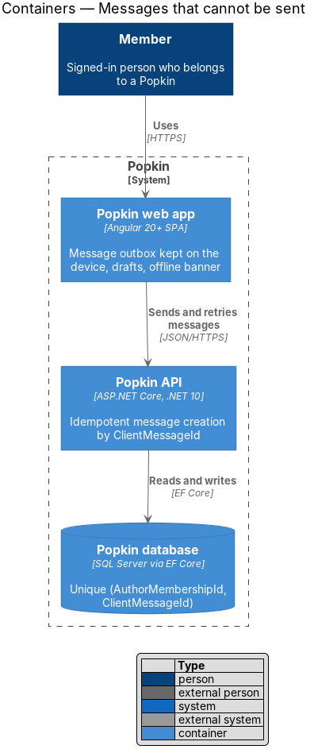
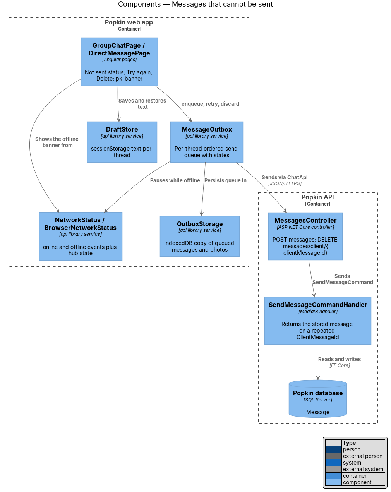
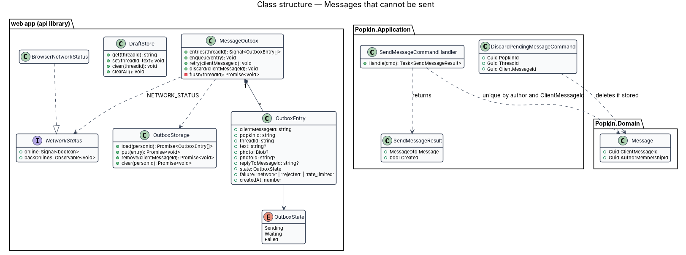
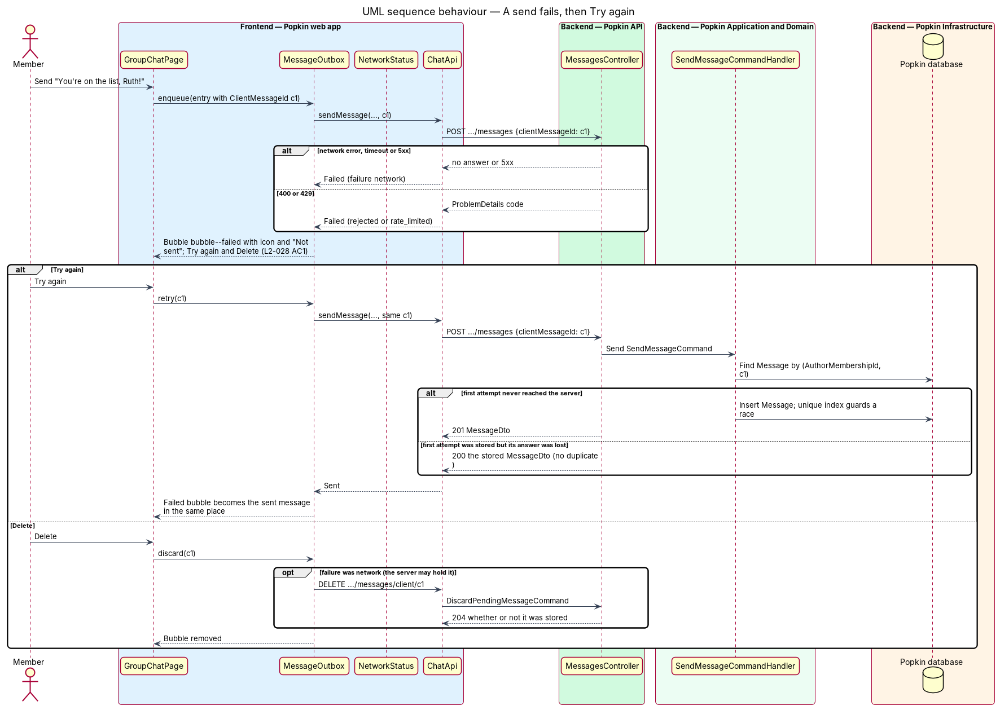
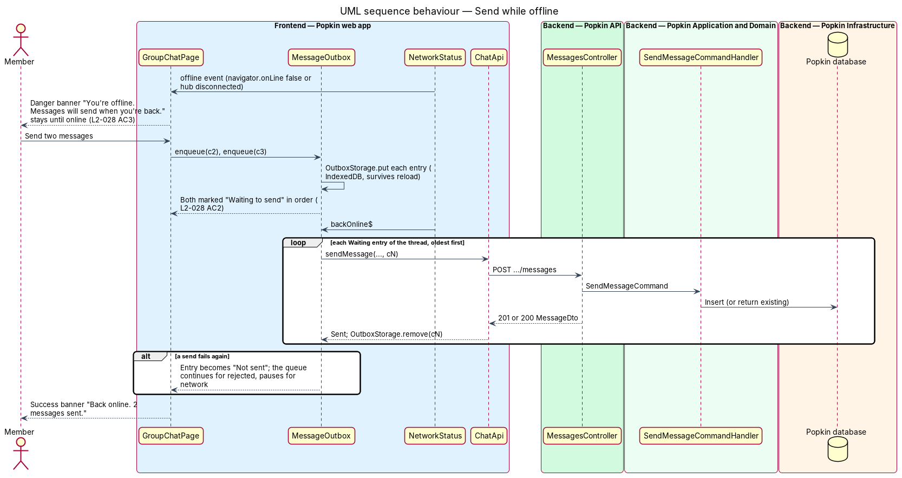
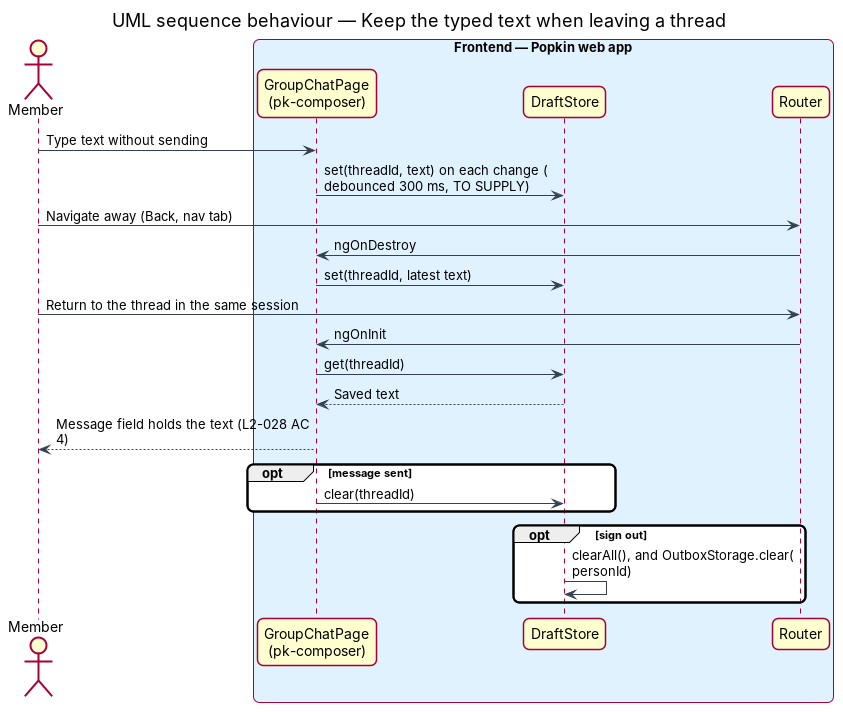

# Messages that cannot be sent

## Overview

Members of a *Popkin* often chat from a phone on a weak mobile connection: at a campsite, on a
trail, in a basement venue. The requirements say a message is never lost silently. This feature
covers what happens when a message cannot reach the server: it stays in the thread with its state,
the member may try again or delete it, messages written offline wait on the device and go out in
order, and text typed but not sent survives leaving the thread.

- **outbox** — ordered, per-thread queue on the device of messages not yet confirmed by the server
- **client message id** — identifier the device gives a message before sending it (`ClientMessageId`); the server stores each one once per author
- **idempotent retry** — a repeated send with the same client message id, which returns the stored message instead of creating a second one
- **Not sent** — state of a message whose send failed; it offers "Try again" and "Delete"
- **Waiting to send** — state of a message written while the device is offline
- **draft** — text in the message field that has not been sent

The design rests on one rule: the device names each message before it sends it. With that name, a
retry after a lost answer cannot create a duplicate, the sender's own live echo is recognised, and a
queued message keeps its place. The outbox persists on the device, so a reload does not lose a
queued message. The offline banner tells the member the connection is gone and says when it is back.

## Description

**Screens and states:**

- `docs/mocks/pages/group-chat/failed-send.html` — own message with `bubble--failed`, an icon and "Not sent", with "Try again" and "Delete" (L2-028 AC1).
- `docs/mocks/notifications/banner/danger.html` — "You're offline. Messages will send when you're back." over a thread (L2-028 AC3).
- `docs/mocks/notifications/banner/success.html` — "Back online. 2 messages sent."
- `docs/mocks/notifications/toast/warning.html` — "Slow down a little" with "You can send again in 30 seconds." for a rate-limited send (L2-053 AC2, AC4).
- No mock draws the "Waiting to send" state (L2-028 AC2) or a restored draft; the first is a `<TO SUPPLY>` mock state.

**API:**

- `POST /api/popkins/{popkinId}/threads/{threadId}/messages` — 201 when created; 200 with the stored `MessageDto` when the caller already sent this `clientMessageId`; error codes as in send-message-to-everyone.
- `DELETE /api/popkins/{popkinId}/threads/{threadId}/messages/client/{clientMessageId}` — 204 whether or not a message was stored; removes the caller's message with that client id if one exists. 404 `popkin_not_found`, `thread_not_found`.

**Frontend (Popkin web app, `api` library unless stated):**

- **`MessageOutbox`** — root service. `enqueue` assigns a `ClientMessageId` (`crypto.randomUUID()`), adds an `OutboxEntry` and writes it to `OutboxStorage` before the first attempt. Each thread has its own queue, sent one entry at a time, oldest first, so server times keep the order the member wrote (L2-028 AC2).
- **`OutboxEntry`** — `clientMessageId`, `popkinId`, `threadId`, `text`, `photo` (blob), `photoId`, `replyToMessageId`, `state` (`OutboxState` `Sending` | `Waiting` | `Failed`), `failure` (`network` | `rejected` | `rate_limited`) and `createdAt`.
- **Failure handling** —
  - A network error, a timeout or a 5xx response while online marks the entry `Failed` with failure `network`. The queue for that thread pauses behind it, so later messages cannot overtake it.
  - A 400 marks it `Failed` with failure `rejected`, and the queue continues.
  - A 429 marks it `Failed` with failure `rate_limited` and shows the warning toast with the `Retry-After` time (L2-053 AC4).
  - A 409 `popkin_wrapped_up` drops the queue for that Popkin and the page swaps in the read-only line (L2-045 AC1). How the dropped text is offered back to the member is `<TO SUPPLY>`.
  - The send timeout is `<TO SUPPLY>`.
- **Offline** — while `NetworkStatus.online` is false, `enqueue` sets `Waiting` and makes no request. On `backOnline$`, after catch-up (live-messages), the outbox sends each thread's `Waiting` entries in order. When it sends any, the page shows the success banner with the count; the banner's lifetime is `<TO SUPPLY>`.
- **Try again** — `retry(clientMessageId)` sends the same entry with the same `ClientMessageId`, reusing `photoId` when its upload completed (send-photos-in-chat).
- **Delete** — `discard(clientMessageId)` removes the entry. When its failure was `network`, the server may have stored it with the answer lost, so the outbox also calls the client-id `DELETE`, which is safe whatever the server holds.
- **`OutboxStorage`** — IndexedDB store keyed by person and client message id; it holds photo blobs too. Entries reload when the app starts, so a queued message survives a reload. Storage is cleared at sign-out and at account deletion. Encryption of this store on the device is `<TO SUPPLY>`.
- **`DraftStore`** — `sessionStorage` map of thread id to text, written as the member types and when the page is destroyed, read when the thread opens, cleared on send and at sign-out (L2-028 AC4). `sessionStorage` lasts for the browser tab's session, which matches "in the same session"; whether drafts should outlive a closed tab is `<TO SUPPLY>`.
- **`NetworkStatus` / `NETWORK_STATUS` / `BrowserNetworkStatus`** — `online` signal combining `navigator.onLine`, the `online` and `offline` events and the `PopkinRealtime` state; `backOnline$` emits on recovery. The offline screens of L2-056 AC4 should use the same service; its ownership across subsystems is `<TO SUPPLY>`.
- **`GroupChatPage`** / **`DirectMessagePage`** — render outbox entries through `ThreadStore` in the position they were written. A failed entry uses the `bubble--failed` part of `pk-message` with an icon and the words "Not sent", so colour is not the only carrier (L2-057 AC5), plus `pk-button` actions "Try again" and "Delete". The danger `pk-banner` with `role="alert"` stays under the header while offline (L2-028 AC3).

**Backend:**

- **`SendMessageCommandHandler`** — before inserting, looks up `(AuthorMembershipId, ClientMessageId)`; a hit returns `SendMessageResult { Message, Created = false }`, which the controller answers with 200 and no new event. A concurrent duplicate loses on the unique index; the handler catches the violation and returns the winner. A repeat whose content differs from the stored message still returns the stored message.
- **`DiscardPendingMessageCommand`** — soft-deletes the caller's message with that client id if one exists, and notifies `MessageDeleted`; otherwise it does nothing. In a wrapped-up Popkin it changes nothing and answers 204 (L2-045 AC2).
- **Rate limit** — retries count toward the limit of 60 messages per minute (L2-053 AC2); whether an idempotent repeat should count is `<TO SUPPLY>`.

## Requirements

| L2 ID | Refines (L1) | Requirement |
|-------|--------------|-------------|
| `L2-028` | `L1-007` | Messages that cannot be sent: A message is never lost silently. |
| `L2-053` | `L1-012` | Abuse is limited: One person cannot flood the system or another person. |
| `L2-056` | `L1-013` | Loading, failure and offline are always explained: A person is never left guessing. |

## Diagrams

### System context

A member sends messages through Popkin, including from a weak or lost connection; no external system
takes part.

### Containers

The web app keeps unsent messages on the device and sends and retries them through the Popkin API,
which stores each `ClientMessageId` once per author in the Popkin database.

### Components

The thread pages drive `MessageOutbox`, which persists its queue in `OutboxStorage`, pauses on
`NetworkStatus` and sends through `MessagesController`. `DraftStore` keeps unsent text, and
`SendMessageCommandHandler` returns the stored message on a repeated client id.

### Class structure

`MessageOutbox` composes `OutboxEntry` values, each in an `OutboxState`, and depends on
`OutboxStorage` and the `NetworkStatus` contract. On the server, `SendMessageCommandHandler`
returns a `SendMessageResult` and relies on the unique `(AuthorMembershipId, ClientMessageId)` pair
of `Message`.

### Behaviour — a send fails, then Try again

A failed send stays in place as "Not sent" (L2-028 AC1). "Try again" repeats the same client id, so
a message the server already stored is returned, not duplicated. "Delete" also clears a copy the
server may hold.

### Behaviour — send while offline

Offline, the banner stays (L2-028 AC3), and new messages are stored on the device as "Waiting to
send" (AC2). On recovery they are sent in order and a banner confirms them.

### Behaviour — keep the typed text

Unsent text is saved per thread and restored when the member returns in the same session
(L2-028 AC4).

