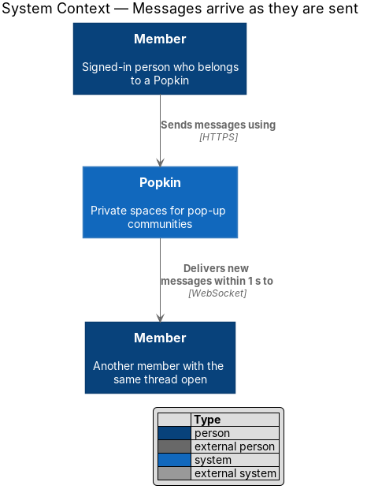
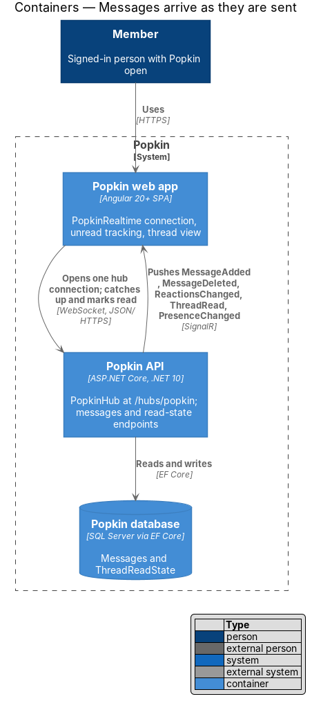
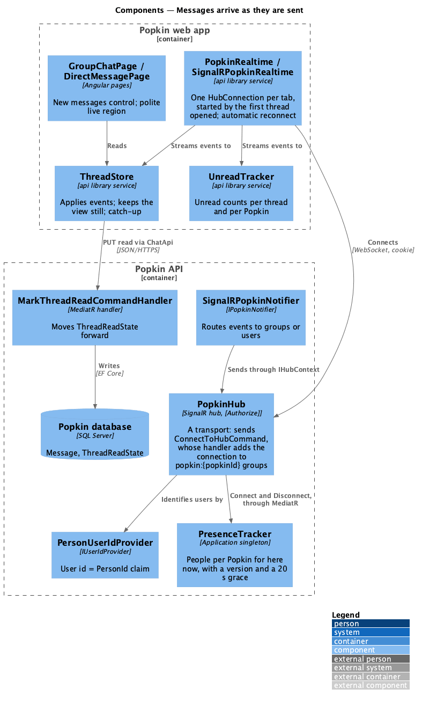
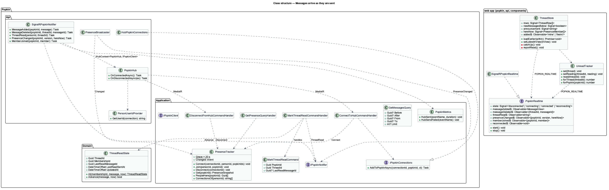
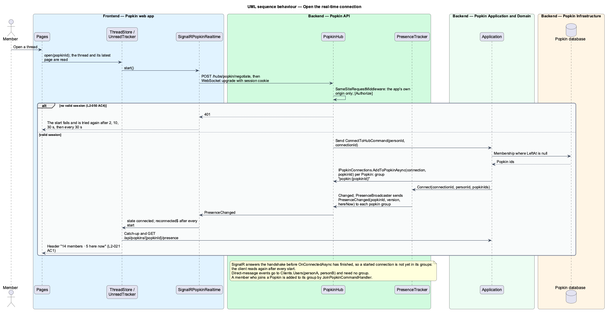
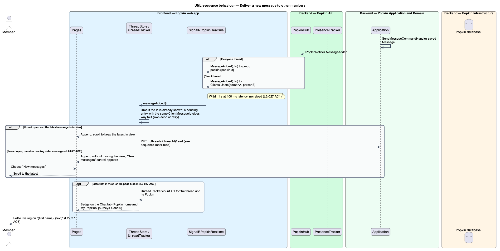
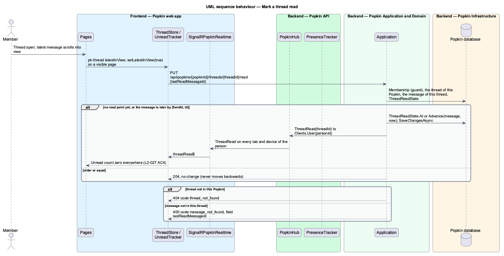
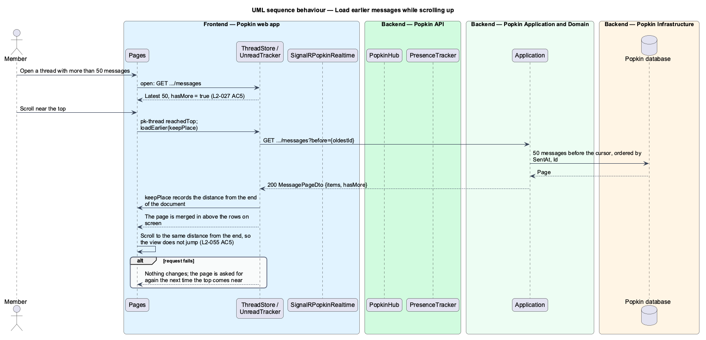
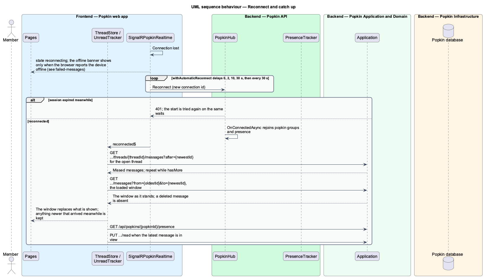

# Messages arrive as they are sent

## Overview

Members of a *Popkin* talk in the shared *Everyone* thread and in *direct messages*. The requirements
say plainly that chat is live: a message shows on every other member's screen as it is sent, without
a reload, and every place that counts unread messages keeps up. This feature is the real-time
backbone of the chat subsystem and the read-state rules that go with it.

- **hub** — the SignalR endpoint `PopkinHub` at `/hubs/popkin` that keeps one connection open per signed-in browser tab
- **group** — named set of connections that receive the same event; chat uses `popkin:{popkinId}`
- **event** — message pushed from the API to clients: `MessageAdded`, `MessageDeleted`, `ReactionsChanged`, `ThreadRead`, `PresenceChanged`, `MemberJoined`
- **state event** — event that carries the full current value and a version that only rises; an older one is dropped
- **fact event** — event that is final and idempotent: applying it twice, or before the fact it refers to, ends in the same state
- **recovery read** — HTTP read that gives a client the state an event would have given it
- **catch-up** — fetch of the messages and counts missed while a connection was down
- **unread count** — messages by others in a thread after the member's last read point (`ThreadReadState`)
- **here now** — number of members of a Popkin who hold an open connection

The send path (send-message-to-everyone) stores a message and calls `IPopkinNotifier`; this feature
carries the event to the right connections within 1 second on a connection with 100 ms latency. A
member reading the latest message sees the new one appended; a member reading older messages keeps
their place and gets a "New messages" control; a member elsewhere sees the unread count rise on the
Chat tab, the Popkin home and My Popkins. Opening a thread with its latest message in view sets its
count to zero everywhere. Long threads load the latest 50 messages and fetch earlier ones as the
member scrolls up. Assistive technology hears each arrival politely with its sender.

## Description

**Screens and states:**

- `docs/mocks/pages/group-chat/default.html` and `docs/mocks/pages/direct-message/default.html` — threads that receive live messages; the header "14 members · 5 here now".
- `docs/mocks/pages/conversations/default.html` — unread badge and dots that rise live (L2-027 AC3).
- `docs/mocks/notifications/banner/info.html` — "Chat 3 new" on the Popkin home.
- `docs/mocks/notifications/banner/danger.html` — offline banner shown while the device is offline (failed-messages).
- `docs/mocks/pages/group-chat/new-messages.html` — the "New messages" control above the composer while older messages are read (L2-027 AC2). A failed load of earlier messages has no state: nothing changes, and the page is asked for again the next time the top of the thread comes near.

**API:**

- `/hubs/popkin` (negotiate and WebSocket) — requires a session; 401 without one (L2-050 AC4). Every request under `/hubs` passes the same-site check of `SameSiteRequestMiddleware`; 403 `cross_site_request` from another origin.
- `GET /api/popkins/{popkinId}/threads/{threadId}/messages?before={id}` and `?after={id}` — 200 `MessagePageDto { items, hasMore }`, at most 50; 400 `message_not_found`, naming the cursor in `field`; 404 `popkin_not_found`, `thread_not_found`. There is no `around`.
- `PUT /api/popkins/{popkinId}/threads/{threadId}/read` with `{ lastReadMessageId }` — 204, whether or not the read point moved; 400 `message_not_found` (field `lastReadMessageId`) when the message is not in the thread; 404 `popkin_not_found`, `thread_not_found`.
- Hub events (server to client): `MessageAdded(MessageDto)`, `MessageDeleted(threadId, messageId)`, `ThreadRead(threadId)`, `PresenceChanged(popkinId, version, hereNow)` and `MemberJoined(popkinId, MemberJoinedDto)` (join-popkin). `ReactionsChanged(threadId, messageId, version, ReactionDto[])` arrives with react-to-message. `PhotoAdded` and the wrap-up event are owned by the photos and wrap-up designs and travel the same connection. The hub exposes no client-to-server methods for chat.
- `GET /api/popkins/{popkinId}/presence` — 200 `{ version, hereNow, members }`; the recovery read of `PresenceChanged`. `members` names at most 8 of the members who are here now, the Host first, then in the order they joined, each as `{ membershipId, displayName, avatar }`; `hereNow` counts them all. `PresenceChanged` carries the count only, so the client reads this again when the count changes. 404 `popkin_not_found`.
- `GET /api/popkins/{popkinId}/threads/{threadId}/messages?from={id}&to={id}` — 200 `MessagePageDto` for the window between two messages, both included, whatever its size; the recovery read for messages already on screen. A deleted message is absent from it. A `from` or a `to` alone is ignored.

**Backend (Popkin API):**

- **`PopkinHub`** — `[Authorize]` `Hub<IPopkinClient>` mapped at `/hubs/popkin`, authenticated by the existing session cookie. It is a transport and holds no rule: what it must decide, it asks of a MediatR request, as a controller does (`AGENTS.md`). It accepts a connection only from the app's own origin: `SameSiteRequestMiddleware` checks every request under `/hubs`, whatever its method. `OnConnectedAsync` sends `ConnectToHubCommand`, whose handler loads the person's active memberships, adds the connection to each `popkin:{popkinId}` group through `IPopkinConnections` and then records presence. `OnDisconnectedAsync` sends `DisconnectFromHubCommand`, which releases presence. SignalR answers the client's handshake before `OnConnectedAsync` has finished, so a connection that has just started is not yet in its groups; the client therefore reads again after every start. Closing a person's open connections at sign-out is `<TO SUPPLY>` (open decision 8); nothing closes them today.
- **`IPopkinClient`** (`Popkin.Application.Abstractions`) — one method per event, each taking DTOs from `Popkin.Application`: `MessageAdded`, `MessageDeleted`, `ThreadRead`, `PresenceChanged` and `MemberJoined` today, and the methods the other designs add. A renamed event fails the build on the server; on the client the names live in one typed map (`hub-events.ts` in the `api` library) that `SignalRPopkinRealtime` alone reads.
- **`PersonUserIdProvider`** — `IUserIdProvider` that returns the `PersonId` claim, so `Clients.User(personId)` reaches every tab and device of one person.
- **`SignalRPopkinNotifier`** — implementation of `IPopkinNotifier` over `IHubContext<PopkinHub, IPopkinClient>`. Everyone events go to `popkin:{popkinId}`. Direct-thread events go to `Clients.Users(personA, personB)` only (direct-messages). `ThreadRead` goes to `Clients.User(personId)`. A send that fails is logged and counted and never fails the request that caused it: what was saved stays saved, and the event's recovery read gives the same state.
- **`IPopkinConnections`** / **`HubPopkinConnections`** — which connections are sent a Popkin's events. A handler decides it from membership and the hub's groups carry it out: `ConnectToHubCommandHandler` for a new connection, `JoinPopkinCommandHandler` for the connections a new member already holds. Removing a member's connections when they leave arrives with leave-popkin.
- **`PresenceTracker`** (`Popkin.Application/Realtime`) — singleton that knows which people have Popkin open, per Popkin. It returns the here-now count, counting a person once however many tabs they hold. It guards its maps with one lock, because many connections read and write it at once. It keeps a version per Popkin that rises with every change of the count, and `PresenceChanged` carries it. A dropped connection releases presence only after a grace period of 20 seconds without a reconnect by the same person, so "here now" does not flicker with every tunnel; the grace is a timer built from `TimeProvider`. The tracker is in-process, which is correct for the one API instance of [ADR 0009](../../../adr/0009-one-api-instance.md).
- **`PresenceBroadcaster`** — hosted service in the API that sends `PresenceChanged` whenever the tracker's count changes, whether a connection or the end of a grace period caused it. This send alone is not awaited by what caused it; the version lets a client drop a late one.
- **`MarkThreadReadCommand`** / **`MarkThreadReadCommandHandler`** — membership, the thread of that Popkin, the message of that thread, then `ThreadReadState.At` for a first read point or `ThreadReadState.Advance(message, now)`, which never moves the read point backwards. "Later" is by `SentAt`, then by `Id`; two messages of the same instant compare their ids as .NET orders GUIDs. When the read point moves, the handler sends `ThreadRead`. Marking read is allowed in a wrapped-up Popkin. The unread count of a thread is the messages by others after the read point, system notes included.
- **`GetMessagesQueryHandler`** — keyset paging on `(SentAt, Id)` through the index `(ThreadId, SentAt, Id)`, at most 50 per page (L2-027 AC5), returning `hasMore`; the window `from`…`to` is returned whole.
- **Delivery budget** — the send handler notifies after `SaveChangesAsync` inside the same request; there is no queue between store and push. Meeting 1 second end to end at 100 ms latency (L2-027 AC1) is measured in production: the notifier records `popkin.hub.send.duration`, the time of the hub send that follows the commit, and counts `popkin.hub.send.failures`, both by event name only (`PopkinMetrics`, [ADR 0012](../../../adr/0012-opentelemetry.md)). An API test with two hub clients on the test server awaits `MessageAdded` within 1 second, in memory and so without the latency, and the Playwright behaviour test, with the hub stubbed ([ADR 0010](../../../adr/0010-the-hub-in-tests.md)), proves that an arriving event shows within 1 second without a reload. Every send names a group or users; a failed send is logged and counted, never dropped silently. A load target for concurrent connections is `<TO SUPPLY>`.
- **Order of events** — two requests that commit in one order can push in the other, because the push follows the commit with no queue. The client therefore never relies on arrival order. `MessageAdded` and `MessageDeleted` are fact events: messages are ordered by `(SentAt, Id)`, not by arrival. `ReactionsChanged` and `PresenceChanged` are state events: `Message.ReactionsVersion` (react-to-message) and the tracker's version rise with every change, and a client drops an event whose version is not above the one it holds.

**Frontend (Popkin web app, `api` library):**

- **`PopkinRealtime` / `POPKIN_REALTIME` / `SignalRPopkinRealtime`** — root service that opens one `HubConnection` with `withAutomaticReconnect`, and exposes `state`, one observable per event, `reconnected$`, `start()` and `stop()`. The thread page starts it when its thread opens; starting it once a person is signed in waits for the next screen that shows live state. The waits before each try are 0, 2, 10 and 30 seconds, then every 30 seconds without limit, for the first connection as for a lost one: people are at a campsite or in a basement venue, and a tab left open must come back by itself. `reconnected$` fires after every successful start, the first included, because nothing was heard before it. The client is `@microsoft/signalr` 10.x from npm, on the release line of the server's ASP.NET Core and updated with it. It uses `invoke` where the caller needs the outcome and `send` where it does not; chat calls neither.
- **`ThreadStore`** — applies events for its thread. It drops a `MessageAdded` whose `Id` it already shows, and a pending entry gives way to the stored message with its `ClientMessageId`, so the sender's own echo and a retried send never duplicate. The page tells it whether the latest message is in view (`setLatestInView`, from `pk-thread`). With the latest in view it appends and the page scrolls to it (`added$`); otherwise it appends without moving the view and raises `newMessagesBelow`, which the page shows as a "New messages" control that scrolls to the latest (L2-027 AC2). `loadEarlier()` prepends a page inside `pk-thread`'s `keepPlace`, which keeps the view at the same distance from the end of the document, so it does not jump (L2-027 AC5, L2-055 AC5). The catch-up runs on `reconnected$`: it fetches `after` the newest shown message until `hasMore` is false, then re-fetches the loaded window (`from` its oldest to its newest message) and replaces what it shows with the answer, keeping anything newer that arrived meanwhile, so a message deleted while the connection was down is corrected. It then reads who is here. A `PresenceChanged` whose version is not above the one held is dropped; a newer one sets the count and reads `…/presence` for the members (`hereNow`). `MemberJoined` adds one to the member count. A `MessageDeleted` removes the message when the store holds it; a delete that overtakes its own `MessageAdded` is not remembered yet (see "Built in steps").
- **Read point** — `pk-thread` watches the end of the thread with an `IntersectionObserver`. When the latest message is in view and the page is visible, `ThreadStore` calls `ChatApi.markRead` (L2-027 AC4), at most once per message, and again when a hidden page becomes visible.
- **`UnreadTracker`** — root service that keeps a count per thread, with `forThread` and a total `forPopkin`. It takes the count of `ThreadDto.unreadCount` when a thread opens, adds one for a `MessageAdded` from another member while that thread's latest message is not in view on a visible page, and is zero on `ThreadRead` or when the thread is read here (L2-027 AC3, AC4). The Chat tab reads it; the Popkin home and My Popkins will. Taking counts from `ThreadListDto` and the Popkin lists, and reloading them on `reconnected$`, arrive with those screens.
- **Announcements** — `pk-thread` holds a visually hidden `aria-live="polite"` region; each arriving message from someone else is announced as "{first name}: {text}" (L2-027 AC6); "{first name} sent a photo" (copy `<TO SUPPLY>`) arrives with send-photos-in-chat. A system note and the member's own message are not announced. Messages loaded by paging or catch-up are not announced one by one; no summary is announced for a catch-up, and whether one is wanted is `<TO SUPPLY>`.

### Events and their recovery reads

An event is a hint that the state changed, never the only way to learn it. Every event that
travels `PopkinHub` is listed here with its kind and the read that recovers it; a design that
adds an event adds its row. `PopkinRealtime.reconnected$` triggers each read for the screens that
are open.

| Event | Kind | Missed while disconnected | Recovery read | Run by |
|---|---|---|---|---|
| `MessageAdded` | fact | New messages | `GET …/messages?after={id}` | `ThreadStore.catchUp()` |
| `MessageDeleted` | fact | A message on screen was deleted | `GET …/messages?from={id}&to={id}`, the loaded window | `ThreadStore.catchUp()` |
| `ReactionsChanged` | state | Reactions on a message on screen | The same window read | `ThreadStore.catchUp()` |
| `ThreadRead` | fact | Read on another device | `GET …/threads/everyone` (`unreadCount`) when the thread opens; `GET /api/popkins/{popkinId}/threads` and the Popkin lists with those screens | `ThreadStore`; `UnreadTracker` when the lists exist |
| `PresenceChanged` | state | "5 here now" and who they are | `GET /api/popkins/{popkinId}/presence` | `ThreadStore` and the Popkin home |
| `MemberJoined` | fact | A new member: the note and the member count | The note is a message: `GET …/messages?after={id}`. The count: `GET …/threads/everyone`, read when the thread opens | `ThreadStore` ([Join a Popkin](../../invitations/join-popkin/README.md)) |
| `CallChanged` | state | The call banner's count | `GET /api/popkins/{popkinId}/calls/current` | The banner's pages ([Group call](../../calls/group-call/README.md)) |
| `CallEnded` | fact | The banner should be gone | The same read; `204` removes the banner | The banner's pages |
| `ParticipantJoined`, `ParticipantLeft`, `ParticipantMediaChanged` | fact, fact, state | Who is on the call, and their microphone and camera | `POST …/calls`, which answers the participants, on rejoining | `CallSession` |
| `Signal` | fact (an edge) | An offer, answer or candidate | None: a lost signal is not recovered; `CallSession` restarts negotiation with that participant | `CallSession` |
| `PhotoAdded` | fact | New photos | The album's first page and the Popkin home's photo strip | The album and home pages |
| `MemberUpdated` | state | A member's name or photo | `GET /api/popkins/{popkinId}` | `CurrentPopkinStore` |
| `PopkinWrappedUp` | fact | The Popkin ended; the screen should be the recap | `GET /api/popkins/{popkinId}`; `status` `wrappedUp` opens the recap | `CurrentPopkinStore` ([Time is up](../../wrap-up/time-is-up/README.md)) |
| `PopkinLengthChanged` | state | The time left is wrong | `GET /api/popkins/{popkinId}`; `endsAt` | `CurrentPopkinStore` |

### Tests

- **API tests** (`Popkin.Api.Tests`, [ADR 0010](../../../adr/0010-the-hub-in-tests.md)) —
  `ApiFactory.CreateHubConnectionAsync(client)` connects a real SignalR client through the test
  server's handler on long polling, carrying the client's session cookie and
  `Sec-Fetch-Site: same-origin`. `HubEvents` in `Support/` collects events into a channel and
  awaits the first that matches, with a timeout that fails naming the events received. The hub
  tests prove: a message reaches the other members within 1 second, and a repeated send tells
  nobody again; a connection without a session is refused (L2-050 AC4), and so is one from
  another origin; a person who is not a member receives nothing from a Popkin (L2-051);
  `ThreadRead` reaches every connection of the reader and nobody else; "here now" counts a person
  once and releases them after the grace. A direct message reaching exactly two people is proved
  with direct-messages. The rules of `ThreadReadState` and `PresenceTracker` have direct tests in
  `Popkin.Application.Tests`, the grace advanced with `FakeTimeProvider`. No test sleeps.
- **Unit tests** (`api` library, [ADR 0011](../../../adr/0011-unit-tests-for-frontend-logic.md))
  — `ThreadStore`, `threadRows`, `UnreadTracker` and the event map: a duplicate and an echo, a
  stale state event, the pages of a catch-up, the window replaced after it and a message that
  arrives while it is read.
- **Playwright** — the hub stubbed by `e2e/fixtures/hub.ts`; a spec pushes `MessageAdded` and
  sees the message, the "New messages" control or the unread count.

### Built in steps

Journey 3, Chat with everyone, built the hub and this design for the Everyone thread. What waits:

- unread counts on the Popkin home (journey 4) and on My Popkins (journey 6): L2-027 AC3 is met
  for the Chat tab only. With them, and with the list of conversations (journey 11),
  `UnreadTracker` reads the counts of every thread and reloads them on `reconnected$`; today a
  count comes from the thread that was opened;
- starting the connection once a person is signed in: today the thread page starts it;
- events of a direct thread, sent to two people (journey 11);
- `ReactionsChanged` (journey 12) and a photo in the announcement (journey 13);
- removing a member's connections from a Popkin's group when they leave (journey 18);
- closing a person's connections at sign-out (open decision 8), with sign out (journey 17);
- the exporter set-up of ADR 0012: the instruments `popkin.hub.send.duration` and
  `popkin.hub.send.failures` exist on the `Popkin` meter, and nothing exports them yet.

Not built, and not yet given to a journey: remembering a `MessageDeleted` that arrives before
its `MessageAdded`. Today a message is deleted only by "Delete" on a message that was not sent
(failed-messages), and the window read of the next catch-up removes one that slipped through.
After a catch-up the member count of the header is not read again.

The mock `group-chat/new-messages` was added for the "New messages" control.

## Requirements

| L2 ID | Refines (L1) | Requirement |
|-------|--------------|-------------|
| `L2-027` | `L1-007` | Messages arrive as they are sent: Chat is live. |
| `L2-050` | `L1-012` | Every request is authenticated: Nothing private is served without a session. |
| `L2-051` | `L1-012` | Popkins are private to their members: Membership decides everything a person sees. |
| `L2-055` | `L1-013` | Screens are fast: Popkin feels immediate on a phone. |

## Diagrams

### System context

One member sends a message through Popkin, and Popkin delivers it within 1 second to every other
member with the thread open.

### Containers

The web app keeps one SignalR connection to `PopkinHub` in the Popkin API and uses HTTPS for
catch-up and read state; the API reads and writes the Popkin database.

### Components

`SignalRPopkinRealtime` connects to `PopkinHub`, which identifies users with
`PersonUserIdProvider`; `ConnectToHubCommandHandler` records them in `PresenceTracker`. `SignalRPopkinNotifier` sends through the hub
context. On the client, `ThreadStore` and `UnreadTracker` consume the events, and the store marks
threads read through `MarkThreadReadCommandHandler`.

### Class structure

`SignalRPopkinNotifier` realises `IPopkinNotifier` over `PopkinHub`. `MarkThreadReadCommandHandler`
advances `ThreadReadState`. On the client, `SignalRPopkinRealtime` realises `PopkinRealtime`, which
`ThreadStore` and `UnreadTracker` inject through `POPKIN_REALTIME`.

### Behaviour — open the real-time connection

The hub refuses a connection without a session (L2-050 AC4); otherwise `ConnectToHubCommandHandler`
adds the connection to each of the person's Popkins' groups, and the here-now count is published.
The client reads again once it has started.

### Behaviour — deliver a new message

The notifier routes Everyone messages to the Popkin group and direct messages to the two people. Each
client appends the message, shows "New messages" and raises the unread count while the latest is
out of view, and announces it politely.

### Behaviour — mark a thread read

When the latest message is in view, the client moves the read point forward and the API tells every
tab and device of that person, so the count is zero everywhere (L2-027 AC4).

### Behaviour — load earlier messages

Scrolling up fetches 50 earlier messages and restores the scroll offset, so the view does not jump
(L2-027 AC5).

### Behaviour — reconnect and catch up

After a drop the client reconnects with back-off, the hub rejoins its groups, and the open thread
reads again what it shows: the messages after its newest, the loaded window, and who is here. The
outbox does not wait for it: it sends what waited when the browser reports the connection back
(failed-messages).

