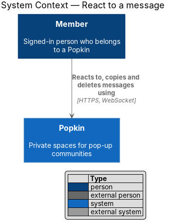
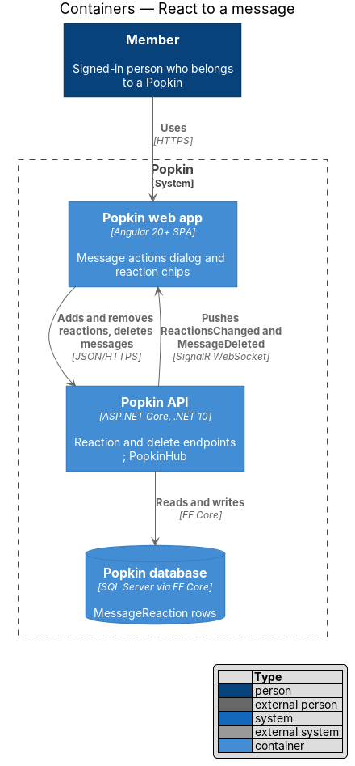
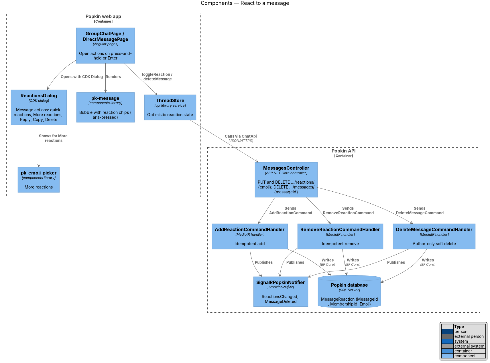
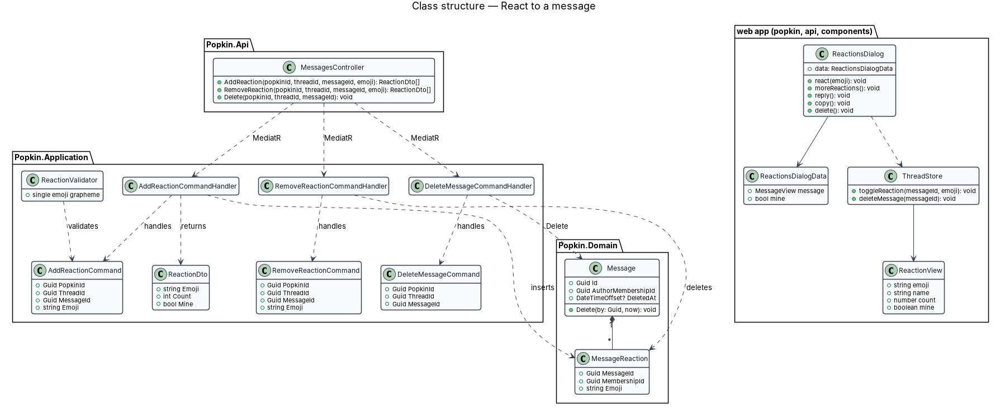
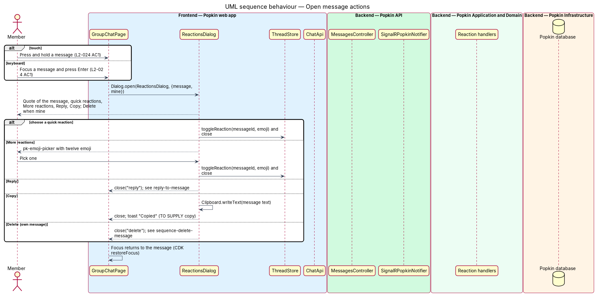
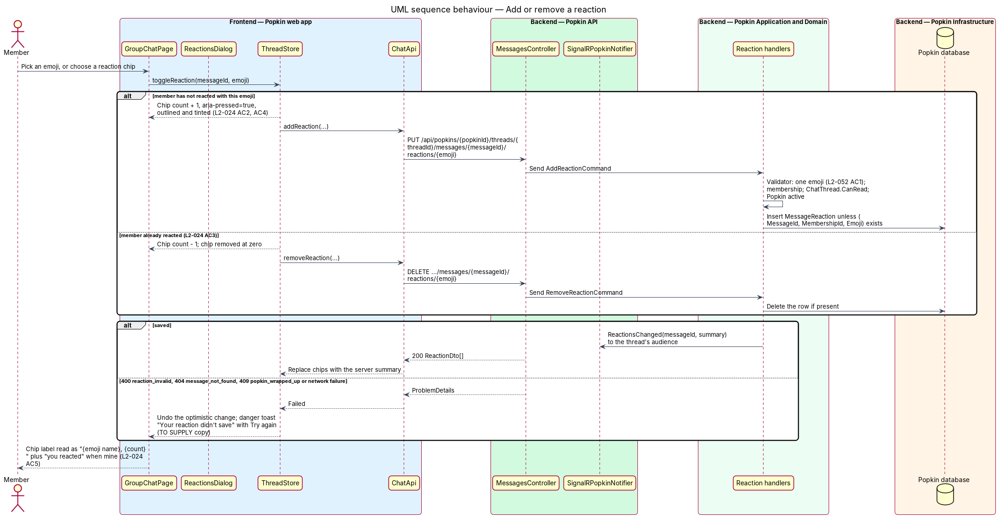
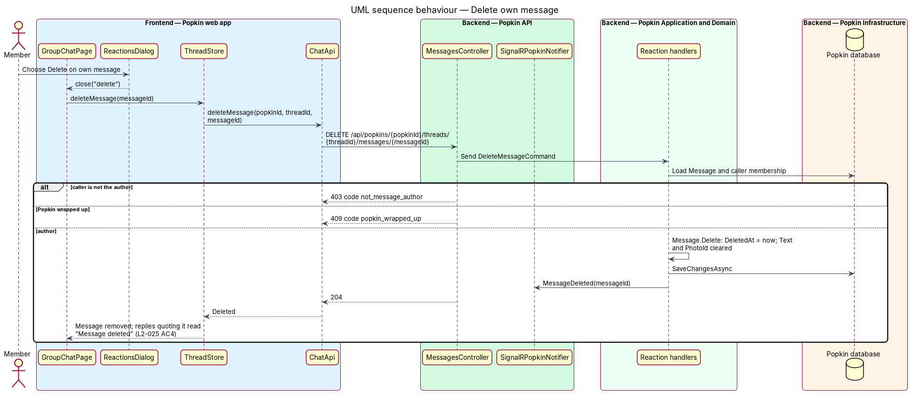

# React to a message

## Overview

Members of a *Popkin* talk in chat threads: the shared *Everyone* thread and *direct messages*
between two members. This feature lets a member answer a message without writing one, by adding an
emoji *reaction*, and gathers the other actions on a single message in one place.

- **reaction** — one emoji that one member attached to one message; a member may add several different emoji to the same message
- **reaction chip** — pill under a message showing one emoji and how many members chose it
- **message actions** — dialog opened from a message, holding quick reactions, "More reactions", "Reply", "Copy" and, on the member's own message, "Delete"
- **quick reactions** — the short row of emoji offered first in message actions

A member opens message actions by pressing and holding a message on a touch screen, or by focusing
it and pressing Enter on a keyboard. Picking an emoji adds a reaction; choosing a chip the member
already added removes it. A chip shows the emoji and its count; the member's own reaction is marked
as pressed, outlined and tinted, so the state is not carried by colour alone. Reactions show at once
and are undone with a message if they fail to save. "Reply" belongs to reply-to-message; "Delete"
is specified here because it lives in this dialog.

## Description

**Screens and states:**

- `docs/mocks/dialogs/reactions/default.html` — "Message actions": a quote of the message, an emoji grid labelled "Reactions" ("React heart", "React laughing", …), then "Reply" and "Copy".
- `docs/mocks/pages/group-chat/default.html` — reaction chips such as "Heart, you reacted, 3" (`aria-pressed="true"`) and "Pancakes, 6".
- `docs/mocks/pages/direct-message/default.html` — the same chips in a direct message (L2-023 AC3).
- `docs/mocks/notifications/toast/danger.html` — pattern for a failure toast with "Try again"; the copy for a reaction that did not save is `<TO SUPPLY>`.

**Differences between the mock and L2-024.** The mock offers six quick reactions (❤️ 😂 😍 🔥 👏 🥞);
L2-024 AC1 asks for five. The mock draws neither "More reactions" nor "Delete" on the member's own
message. The mock should be brought in line with L2-024 before implementation; until then the quick
reaction set and the layout of "More reactions" and "Delete" are `<TO SUPPLY>`.

**API:**

- `PUT /api/popkins/{popkinId}/threads/{threadId}/messages/{messageId}/reactions/{emoji}` — 200 `ReactionDto[]`, idempotent; 400 `reaction_invalid`; 404 `popkin_not_found`, `thread_not_found`, `message_not_found`; 409 `popkin_wrapped_up`.
- `DELETE /api/popkins/{popkinId}/threads/{threadId}/messages/{messageId}/reactions/{emoji}` — 200 `ReactionDto[]`, idempotent; the same 404 and 409 codes.
- `DELETE /api/popkins/{popkinId}/threads/{threadId}/messages/{messageId}` — 204; 403 `not_message_author`; 404 `message_not_found`; 409 `popkin_wrapped_up`.
- The emoji travels URL-encoded in the path.

**Frontend (Popkin web app):**

- **Opening** — `pk-message` is focusable and raises an `actions` output on a long press (duration `<TO SUPPLY>`) or on Enter (L2-024 AC1). The page opens `ReactionsDialog` with CDK `Dialog`; focus moves into the dialog, Escape closes it and focus returns to the message (L2-057 AC2).
- **`ReactionsDialog`** — `dialogs/reactions/reactions.dialog.ts`, class `ReactionsDialog`, composed of `pk-dialog`, the `bubble__quote` part of `pk-message`, a reactions group of emoji buttons with `aria-pressed`, and menu items. Data: `ReactionsDialogData { message: MessageView; mine: boolean }`. It closes with a result: `{ react: emoji }`, `'reply'`, `'delete'` or nothing. "Copy" writes the message text with the Clipboard API; its confirmation toast copy is `<TO SUPPLY>` (L2-056 AC7).
- **`pk-emoji-picker`** — existing design-system component (twelve emoji in a six-column grid), shown for "More reactions". Whether reactions accept any emoji beyond its set is `<TO SUPPLY>`.
- **Reaction chips** — `pk-message` renders `ReactionView { emoji, name, count, mine }` as buttons. A chip's accessible name reads "{emoji name}, {count}", with "you reacted" when `mine` (L2-024 AC5), as in "Heart, you reacted, 3". Emoji names come from a fixed name table in the `api` library; the source of the table is `<TO SUPPLY>`.
- **`ThreadStore.toggleReaction(messageId, emoji)`** — applies the change at once: adds the member's reaction (L2-024 AC2, AC4) or removes it and drops a chip that reaches zero (AC3). It then calls `ChatApi.addReaction` or `ChatApi.removeReaction` and replaces the chips with the server's summary. On failure it restores the previous chips and shows a danger toast that stays until dismissed (L2-056 AC7).
- **`ThreadStore.deleteMessage(messageId)`** — calls `ChatApi.deleteMessage` and removes the message on 204. Whether "Delete" asks for confirmation is `<TO SUPPLY>`; no mock draws a confirmation.

**Backend:**

- **`AddReactionCommand`** / **`RemoveReactionCommand`** — `PopkinId`, `ThreadId`, `MessageId`, `Emoji`.
- **`ReactionValidator`** — the emoji is one extended grapheme cluster of at most 32 UTF-16 units made only of emoji code points; anything else is 400 `reaction_invalid` (L2-052 AC1).
- **`AddReactionCommandHandler`** — membership through `IMembershipGuard`, `ChatThread.CanRead`, the message in that thread and not deleted, `PopkinSpace.EnsureActive()` (L2-045 AC2). It inserts `MessageReaction(MessageId, MembershipId, Emoji)` unless the row exists. **`RemoveReactionCommandHandler`** deletes the row if present. Both call `IPopkinNotifier.ReactionsChanged` with the new summary and return `ReactionDto[]` computed for the caller.
- **`ReactionDto`** — `Emoji`, `Count`, `Mine`. Message DTOs carry the same summary, grouped by emoji in order of first use.
- **`DeleteMessageCommand`** / **`DeleteMessageCommandHandler`** — only the author may delete (403 `not_message_author`); `Message.Delete` sets `DeletedAt` from `TimeProvider`, clears `Text` and `PhotoId` and removes the message's reactions. The handler calls `IPopkinNotifier.MessageDeleted`. A deleted message is no longer listed; a reply to it keeps its link and shows "Message deleted" (reply-to-message, L2-025 AC4). `DeletedAt` is an addition to the shared `Message` entity. What happens to the photo of a deleted message sent in Everyone, which is also in the album, is `<TO SUPPLY>`.
- **`MessageReactionConfiguration`** — key `(MessageId, MembershipId, Emoji)`; `IAppDbContext` gains `DbSet<MessageReaction>`.

## Requirements

| L2 ID | Refines (L1) | Requirement |
|-------|--------------|-------------|
| `L2-024` | `L1-007` | React to a message: Members react to messages with emoji. |
| `L2-045` | `L1-011` | A wrapped-up Popkin is read-only: Nothing new is added to a Popkin that has ended. |
| `L2-057` | `L1-014` | Accessible to WCAG 2.2 AA: Everyone can use every screen. |

## Diagrams

### System context

A member reacts to, copies and deletes messages through Popkin; no external system takes part.

### Containers

The web app adds and removes reactions and deletes messages through the Popkin API; the API stores
`MessageReaction` rows and pushes `ReactionsChanged` and `MessageDeleted` to the thread's audience.

### Components

The thread pages open `ReactionsDialog`, which shows `pk-emoji-picker` for more reactions, and render
chips through `pk-message`. `ThreadStore` calls `MessagesController`, which dispatches the add,
remove and delete handlers; each publishes through `SignalRPopkinNotifier`.

### Class structure

A `Message` owns its `MessageReaction` rows. The add and remove handlers handle their commands and
return `ReactionDto`; `DeleteMessageCommandHandler` calls `Message.Delete`. On the client,
`ReactionsDialog` takes `ReactionsDialogData` and acts through `ThreadStore`, which holds
`ReactionView` values.

### Behaviour — open message actions

Press and hold, or Enter on a focused message, opens the dialog (L2-024 AC1); each choice closes it
and focus returns to the message.

### Behaviour — add or remove a reaction

The chip changes at once; the API stores or removes the reaction idempotently and pushes the new
summary. A failure restores the previous chips and explains itself in a toast.

### Behaviour — delete own message

Only the author may delete. The message is soft-deleted, removed from every open thread, and replies
that quote it read "Message deleted".

