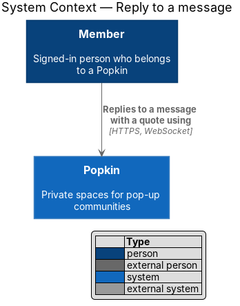
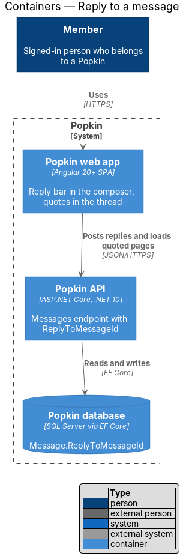
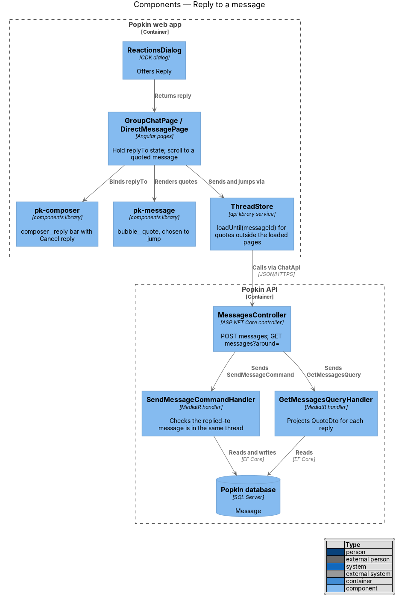
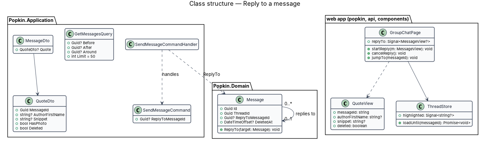
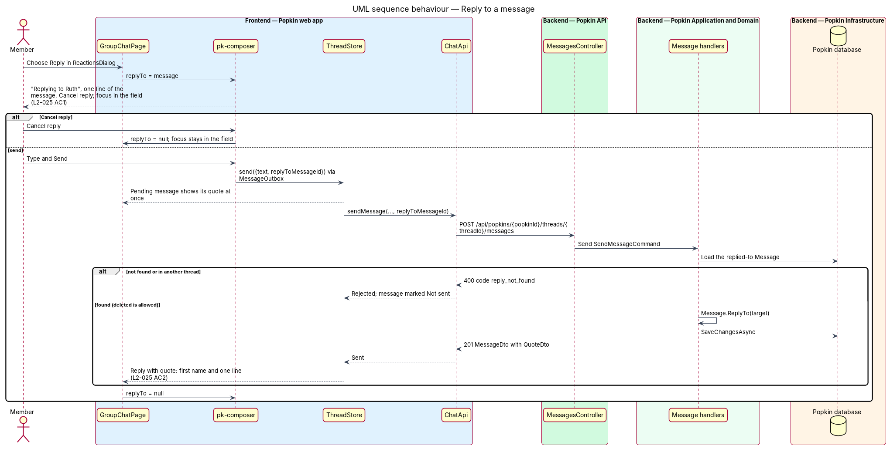
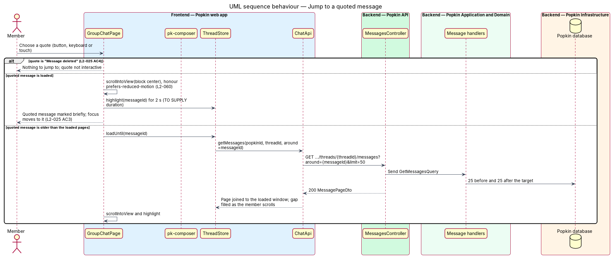

# Reply to a message

## Overview

Members of a *Popkin* talk in the shared *Everyone* thread and in *direct messages*. In a busy thread
a short answer such as "Put me down" is ambiguous unless it says what it answers. A *reply* solves
this: it is a message that carries a quote of the message it answers.

- **reply** — message whose `ReplyToMessageId` names an earlier message of the same thread
- **quote** — the first name of the quoted message's author and one line of its text, shown inside the reply's bubble
- **reply bar** — strip above the message field reading "Replying to {first name}" with one line of the message and "Cancel reply"

A member chooses "Reply" in the message actions dialog (react-to-message). The composer shows the
reply bar and puts focus in the message field. The sent reply carries its quote. Choosing a quote
scrolls the thread to the quoted message and marks it briefly. When the quoted message has been
deleted, the quote reads "Message deleted".

## Description

**Screens and states:**

- `docs/mocks/pages/group-chat/default.html` — the reply bar "Replying to Ruth" with one line of her message and the icon button "Cancel reply"; a sent reply whose quote of Ellie ("Can someone grab the paddles from the shed?") is a button named "Go to Ellie's message".
- `docs/mocks/pages/group-chat/marked.html` — after that quote is chosen: Ellie's message focused and marked (`msg--marked`), with an outline as well as a tint.
- `docs/mocks/pages/group-chat/deleted-quote.html` — Ellie deleted her message: it is gone from the thread, and the reply's quote reads "Message deleted" with no name and is not a button.
- `docs/mocks/pages/group-chat/read-only.html` — in a wrapped-up Popkin the quote is still a button and still jumps.
- `docs/mocks/dialogs/reactions/default.html` — the "Reply" action. The group chat's mocks stand for a direct message too (L2-023 AC3).

**Parts the components reproduce:**

- Reply bar — `div.composer__reply`: `strong` "Replying to {first name}", `span.truncate.text-muted` with one line of the message, and `button.icon-btn` `aria-label="Cancel reply"`.
- Live quote — `button.bubble__quote` `type="button"` `aria-label="Go to {first name}'s message"`, holding `strong` with the first name and `span.truncate` with the snippet.
- Deleted quote — `div.bubble__quote.bubble__quote--deleted` reading "Message deleted"; not focusable.
- Marked message — `div.msg.msg--marked`, for 2 seconds, on the message that has focus.

**API:**

- `POST /api/popkins/{popkinId}/threads/{threadId}/messages` with the optional `replyToMessageId` — 201 or 200 `MessageDto` with its `Quote`; 400 `reply_not_found` (field `replyToMessageId`) when it is not a message of the same thread (a deleted one and a system note are allowed); the other codes as in send-message-to-everyone.
- `MessageDto.Quote` — `QuoteDto(Guid MessageId, string? AuthorFirstName, string? Snippet, bool Deleted)`, or null for a message that replies to nothing. When the quoted message is deleted, `Deleted` is true and the name and snippet are null (L2-025 AC4). The hub's `MessageAdded` carries the same quote.
- No read centred on a message: the pages are those of [Live messages](../live-messages/README.md), `?before={id}` and `?after={id}`.

**Frontend (Popkin web app):**

- **`ThreadStore`** — holds `replyingTo`, the message being answered or null. `startReply(messageId)` sets it when `ReactionsDialog` closes with `{ kind: 'reply' }`; `cancelReply()` clears it; `send(text)` sends with `replyToMessageId` and clears it. `MessageOutbox` keeps `replyToMessageId` on the entry, so a pending, waiting or failed reply shows its quote, and a retry sends it again with its quote (failed-messages).
- **`pk-composer`** — renders its `composer__reply` part when given a reply: "Replying to {first name}", one truncated line of the message and the icon button "Cancel reply" (L2-025 AC1). The composer moves focus to the field when the bar shows; Escape in the field cancels the reply too.
- **`pk-message`** — renders its `quote` input, `MessageQuote { messageId, firstName, snippet, deleted }`, as its `bubble__quote` part through `pk-quote` (L2-025 AC2): a live quote is a button named "Go to {first name}'s message" that raises `goToQuote`; a deleted one reads "Message deleted" and is not a button (AC4).
- **Jump** — `ThreadStore.jumpTo(messageId)`: when the message is older than the loaded pages, the store loads earlier pages until it holds it; then it answers whether it found it, the page calls `pk-message`'s `reveal()`, which scrolls it to the centre of the thread and focuses it, and `ThreadStore.marked` names it for 2 seconds, which `pk-message` draws as `msg--marked`, an outline as well as a tint (L2-025 AC3, L2-057). Under `prefers-reduced-motion` the scroll is instant (L2-060). If the message cannot be found, because it was deleted meanwhile or the earlier pages run out, nothing scrolls.
- **Wrapped up** — a read-only thread shows quotes as they are, and they still jump (L2-045).

**Backend:**

- **`SendMessageCommand.ReplyToMessageId`** — optional. `SendMessageCommandHandler` loads the target; a target that does not exist or belongs to another thread is 400 `reply_not_found`, checked before the wrapped-up `409`. A deleted target is allowed and still links, and so is a system note, which can be replied to though it cannot be reacted to or deleted. `Message.Send(…, replyTo)` sets the link, and refuses a target of another thread.
- **`QuoteDto`** (`Chat/Quotes.cs`) — `Quotes.OfAsync` reads the quoted messages and their authors for a page of messages in two queries, not one per message. `Snippet` is the first line of the quoted text, cut on the server to at most 120 characters at a grapheme boundary, so no emoji is cut in two, and with no ellipsis; the client's `truncate` shortens it further to one line.
- **`MessageConfiguration`** — `ReplyToMessageId` is a self-reference with `DeleteBehavior.NoAction`; messages are soft-deleted (react-to-message), so the link never dangles.

### Tests

- API integration tests on InMemory, in `Popkin.Api.Tests/Chat/`: `ReplyTests` (a reply's quote, a deleted quote, the 120 characters, `reply_not_found`) and `MessageActionsAccessTests` (a wrapped-up Popkin). The snippet's cut has direct tests in `Popkin.Application.Tests/Chat/QuoteSnippetTests.cs`.
- Unit tests of `ThreadStore` (`startReply`, `cancelReply`, `jumpTo`, `marked`) and `MessageOutbox` (a reply that waits keeps its quote) in the `api` library.
- Playwright: the "replying" and "in a direct message" specs of `e2e/tests/react-and-reply.spec.ts`, through `e2e/pages/message-actions.ts`, with the states of `e2e/fixtures/react-states.ts`.
- Parity specs of `quote`, `message` (the quote and the mark) and `composer` (the reply bar).

### Built in journey 12

Everything above, for messages of text, in Everyone and in a direct message (L2-023 AC3). The
diagrams were not redrawn (known gap 69); what the reply bar and the quote show for a photo
was settled by journey 13: "Photo".

### Open questions

Settled for journey 12:

- The quote's accessible name: "Go to {first name}'s message"; a deleted quote reads "Message deleted" and is not a button.
- The snippet: the first line of the text, at most 120 characters, cut on the server between two grapheme clusters and with no ellipsis.
- The mark: 2 seconds, an outline as well as a tint (`msg--marked`), drawn by `group-chat/marked.html`; the deleted quote is drawn by `group-chat/deleted-quote.html`.
- A quoted message older than the loaded pages: the store loads earlier pages until it has it. A read centred on a message (`?around=`), with a gap that fills as the member scrolls, was the alternative; the simpler choice was taken, and it has no gap to draw.
- Escape in the field cancels a reply; a failed reply keeps its quote and a retry sends it with it.

Settled for journey 13 ([Send photos in chat](../send-photos-in-chat/README.md)):

- The reply bar and the quote of a photo message with no text read "Photo"; with text, its text. A reply may carry a photo.
- Built by journey 13: the quote the server answers reads "Photo" (`MessagePreview`), and a reply carries a photo. Not built: the reply bar, written by the client from the message, shows its empty text (known gap 76).

Still open:

- How many earlier pages a jump may load before it gives up: `<TO SUPPLY>`; none is set, and the pages are 50 messages each.

## Requirements

| L2 ID | Refines (L1) | Requirement |
|-------|--------------|-------------|
| `L2-025` | `L1-007` | Reply to a message: A reply quotes the message it answers. |
| `L2-060` | `L1-014` | Motion is optional: Motion explains; it never gets in the way. |
| `L2-023` | `L1-007` | Direct messages: Two members of one Popkin talk privately. |
| `L2-045` | `L1-011` | A wrapped-up Popkin is read-only: Nothing new is added to a Popkin that has ended. |
| `L2-057` | `L1-014` | Accessible to WCAG 2.2 AA: Everyone can use every screen. |

From `L2-023` this feature realises AC3 for replies.

## Diagrams

The diagrams below were not redrawn after the decisions of journey 12. They show a read
`?around={messageId}`, `GetMessagesQuery.Around`, `QuoteDto.HasPhoto`, `loadUntil`,
`highlighted` and `replyTo` on the page, where the design now loads earlier pages, has no
`HasPhoto`, and keeps `replyTo`, `jumpTo` and `marked` in `ThreadStore` (known gap 69).

### System context

A member replies to a message with a quote through Popkin; no external system takes part.

### Containers

The web app posts replies and loads earlier pages up to a quoted message through the Popkin API,
which stores the link in `Message.ReplyToMessageId`. The picture still shows a read around the
message (known gap 69).

### Components

`ReactionsDialog` hands "Reply" back to the page, which binds the reply to `pk-composer` and renders
quotes in `pk-message`. `ThreadStore` sends through `MessagesController`; the send handler checks the
replied-to message and the query handler projects quotes.

### Class structure

A `Message` may reply to one earlier `Message`. `MessageDto` carries an optional `QuoteDto`; the
page holds `replyTo` and renders `QuoteView`, and `ThreadStore` loads the pages a jump needs.

### Behaviour — reply to a message

"Reply" shows the reply bar with focus in the field (L2-025 AC1); the sent reply carries its quote
(AC2). A replied-to message outside the thread is refused with `reply_not_found`.

### Behaviour — jump to a quoted message

Choosing a quote scrolls to the quoted message and marks it for 2 seconds (L2-025 AC3), loading
earlier pages first when it is older than the loaded pages; a deleted quote has nowhere to go
(AC4). The picture still loads a page around the message (known gap 69).

