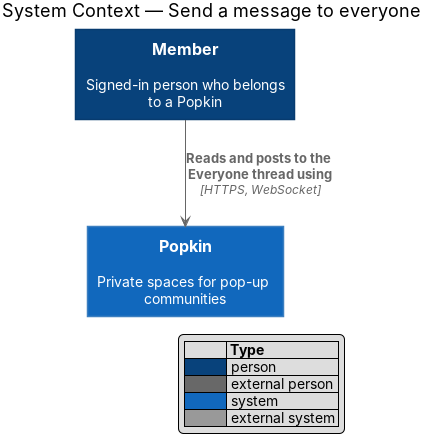
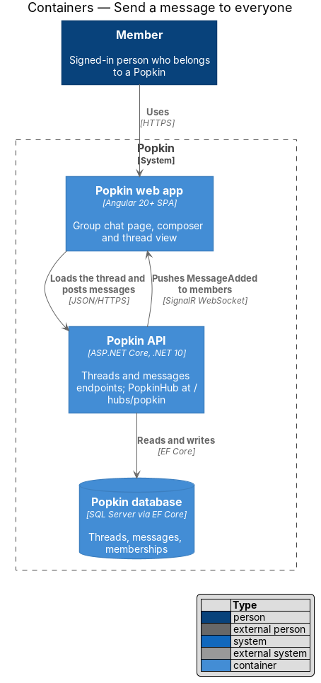
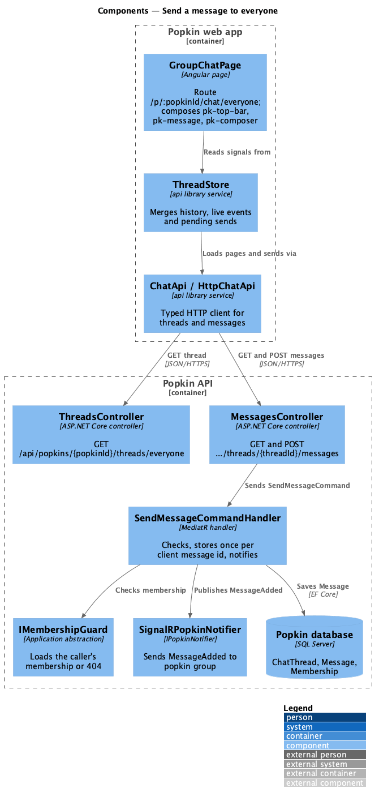
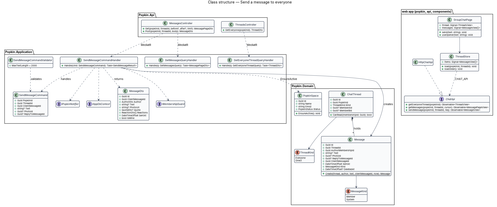
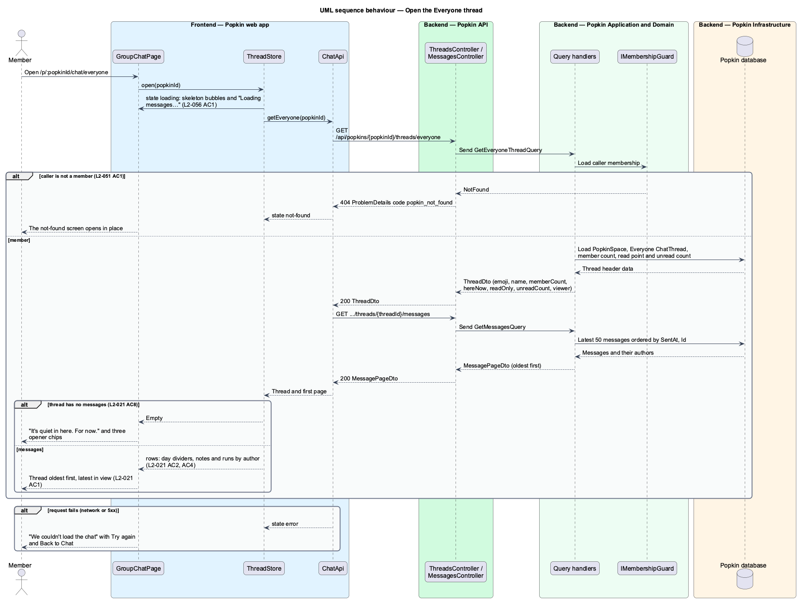
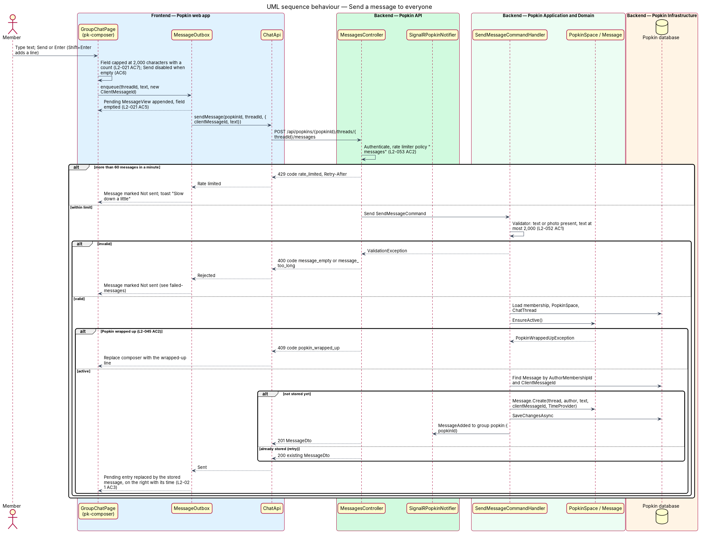

# Send a message to everyone

## Overview

Popkin is a free platform for pop-up communities: a group spins up a private space, invites people
by QR code, then chats, calls, shares photos and rates experiences together. Each such space is a
*Popkin*, and the people in it are its *members*. This feature belongs to the chat subsystem and
covers the one conversation every Popkin has from the moment it exists.

- **Everyone** — chat thread that every member of a Popkin shares
- **thread** — ordered list of messages between a fixed audience, either Everyone or a direct message
- **message** — text, a photo or both, posted by one member to one thread at a server-assigned time
- **system note** — message of kind `System` that Popkin writes into Everyone, such as "Joel popped in. Say hi! 👋"
- **composer** — message bar at the foot of a thread: Add, the message field with Emoji and Photo, and Send
- **here now** — count of members who have Popkin open at this moment

The requirements call the Everyone thread "the heart of a Popkin". A member opens it from the Chat
tab, reads the group's messages oldest first with the latest in view, and posts to the whole group.
The thread's own messages appear on the right in the Popkin's colour; other members' messages carry
an avatar and a first name, shown once for a run of consecutive messages. A divider names each day.
An empty thread invites the first message with three suggested openers.

This slice establishes the thread view, the composer and the send path that the other chat
features extend: reactions (react-to-message), replies (reply-to-message), photos
(send-photos-in-chat), live delivery (live-messages) and failure handling (failed-messages). Direct
messages (direct-messages) reuse the same view with a two-person audience.

## Description

The slice runs from the group chat page to the database. Everything below is introduced by this
design except where marked existing.

**Screens and states** (the mocks are the source of truth for the UI):

- `docs/mocks/pages/group-chat/default.html` — thread with day divider, system note, grouped messages, own message with time, reply bar.
- `docs/mocks/pages/group-chat/loading.html` — skeleton bubbles hidden from assistive technology and the status "Loading messages…".
- `docs/mocks/pages/group-chat/empty.html` — "It's quiet in here. For now.", three opener chips ("👋 Hey everyone!", "So glad you're here", "Who's coming?") and the sub-title "Just you so far".
- `docs/mocks/pages/group-chat/error.html` — "We couldn't load the chat" with "Try again" and "Back to Chat".
- `docs/mocks/pages/group-chat/read-only.html` — wrapped-up Popkin: composer replaced by "This Popkin has wrapped up. Messages stay, but nobody can post new ones." (L2-045 AC1).
- `docs/mocks/notifications/toast/warning.html` — "Slow down a little" with when to try again (L2-053 AC2, AC4).

**API:**

- `GET /api/popkins/{popkinId}/threads/everyone` — 200 `ThreadDto` `{ id, popkinId, kind, popkinName, emoji, colour, endsAt, memberCount, hereNow, presenceVersion, readOnly, unreadCount, lastReadMessageId, viewer { membershipId, firstName } }`; 404 `popkin_not_found`.
- `GET /api/popkins/{popkinId}/threads/{threadId}/messages` — 200 `MessagePageDto { items, hasMore }`, oldest first. With no cursor it is the latest page; `?before={id}` and `?after={id}` read the page next to a message; `?from={id}&to={id}` reads the whole window between two messages, both included (live-messages). `limit` is 50 by default and at most 50; the window takes no limit. A `from` or a `to` alone is ignored. 400 `message_not_found`, naming the cursor in `field`, when a cursor is not a message of the thread; 404 `popkin_not_found`, `thread_not_found`.
- `POST /api/popkins/{popkinId}/threads/{threadId}/messages` with `{ clientMessageId, text }` — 201 `MessageDto` when created, 200 with the stored `MessageDto` when the `clientMessageId` was already used by the caller; 400 `client_message_id_required`, `message_empty`, `message_too_long`, each naming its field; 404 `popkin_not_found`, `thread_not_found`; 409 `popkin_wrapped_up`; 429 `rate_limited` with `Retry-After`.
- `MessageDto` is `{ id, threadId, clientMessageId, kind, author { membershipId, firstName, avatar }, text, sentAt }`; `clientMessageId` is null for a system note. It says nothing about who is reading: the same value goes to every member over the hub, and the web app tells a member's own message by comparing `author.membershipId` with the thread's `viewer.membershipId`.

**Frontend (Popkin web app):**

- **`GroupChatPage`** — page at `frontend/projects/popkin/src/app/pages/group-chat/group-chat.page.ts`, selector `pk-group-chat-page`, route `/p/:popkinId/chat/everyone` with route data `{ shell: 'app', page: 'group-chat' }`, behind `signedInGuard`. It composes `pk-app-screen` with `pk-top-bar` (Back, the Popkin's emoji tile, its name and "{n} members · {m} here now", or "Just you so far" in a Popkin of one), `pk-thread` holding `pk-day-divider`, `pk-system-note` and `pk-message` rows, `pk-empty-state` with `pk-chip` openers, skeleton `pk-message` rows and `pk-composer`. `pk-popkin-nav` shows the Popkin's tabs with Chat current (L2-019 AC7) as a rail from 768 px and a sidebar from 1024 px, and no tabs on a phone (L2-058 AC8); from 1024 px a `pk-list-pane` holds the Everyone `pk-conversation-card` beside the thread (AC11); from 1280 px a `pk-detail-pane` names who is here now (AC12). The page holds no styles of its own (ADR 0007). A Popkin the person is not a member of opens the not-found screen in place (L2-051).
- **`pk-composer`** — design-system component (`docs/design-system/components/composer.html`) built in the `components` library. The field is a one-row `textarea` that grows with its text to about five lines, then scrolls. Enter sends and Shift+Enter adds a line (L2-021 AC5); Enter does not send while an input method is composing. Send is disabled while the field holds only white space (AC6). The field accepts at most 2,000 characters (AC7), and from 1,800 characters a count reads "1,800 / 2,000" under it (`composer__count`, a polite live region). No mock draws the count.
- **`pk-message`** — bubble component. Other members' messages carry avatar and first name once per run (L2-021 AC2); own messages sit on the right in the Popkin colour with the time, written "9:24", and a visually hidden "You" (AC3). A run ends when the author changes, at a day divider or at a system note; no gap in minutes ends one.
- **Day dividers** — `pk-day-divider`, labelled by `dayLabel` (`thread-text.ts` in the `api` library) in the device's time zone (L2-021 AC4): "Today", "Yesterday", the weekday for the five days before that, then the date as "5 Sep", with the year when it is not this year's. The thread mocks read "Today"; `group-chat/default` read "Saturday" and was corrected.
- **`ThreadStore`** — signal-based service in the `api` library, provided by the thread page. `open(popkinId)` reads the thread header and the latest 50 messages. It merges live events (live-messages) and pending entries from `MessageOutbox` (failed-messages), and exposes `thread`, `state` (`loading` | `ready` | `empty` | `error` | `not-found`) and `rows`: the day dividers, notes and messages of the screen, built by the pure function `threadRows`. The thread's `readOnly` says the Popkin has wrapped up.
- **`ChatApi` / `CHAT_API` / `HttpChatApi`** — contract, injection token and HTTP implementation in the `api` library: `getEveryone`, `getMessages`, `send`, `discard`, `markRead` and `getPresence`. The stores inject the token only. View models `ThreadView`, `MessageView`, `MessagePageView` and `PresenceView` live in `lib/models/chat.ts`.
- **Openers** — choosing an opener chip puts its text in the message field and moves focus there (L2-021 AC8); it does not send.
- **Text encoding** — message text is rendered with Angular interpolation only, never `innerHTML`, so markup shows as text (L2-052 AC2). Line breaks are preserved by CSS `white-space: pre-wrap` in `pk-message`.

**Backend (Popkin API, Application, Domain, Infrastructure):**

- **`ThreadsController`** — `GET /api/popkins/{popkinId}/threads/everyone` sends `GetEveryoneThreadQuery`. The handler returns `ThreadDto` with the Popkin's emoji, name, colour and end, the member count, the here-now count and its version from `PresenceTracker` (live-messages), `ReadOnly` when the Popkin is wrapped up, the reader's unread count and read point, and the `viewer`.
- **`MessagesController`** — `GET` sends `GetMessagesQuery` (keyset paging by `SentAt`, then `Id`); `POST` sends `SendMessageCommand`; `DELETE …/client/{clientMessageId}` sends `DiscardPendingMessageCommand` (failed-messages). The `POST` action carries the ASP.NET Core rate limiter policy `messages`: 60 messages per person per minute, partitioned by the person's id (L2-053 AC2, abuse-limits).
- **`SendMessageCommand`** — `PopkinId`, `ThreadId`, `ClientMessageId?`, `Text?`. `PhotoId?` and `ReplyToMessageId?` are added by send-photos-in-chat and reply-to-message.
- **Validation** — there is no validator class and no validation library: `SendMessageCommandHandler` makes the checks and throws `ProblemException.Invalid`. `ClientMessageId` must be given and not empty (`client_message_id_required`); the text, trimmed, must not be empty (`message_empty`) nor longer than 2,000 characters (`message_too_long`, `Message.MaxTextLength`). Each failure is a 400 ProblemDetails with its `code` and the `field` it names (L2-052 AC1).
- **`SendMessageCommandHandler`** — loads the caller's membership through `IMembershipGuard.RequireMemberAsync` (404 `popkin_not_found` for a non-member, L2-051 AC1), loads the `ChatThread` of that Popkin (`ChatThreads.RequireAsync`, 404 `thread_not_found`) and validates. A repeated `ClientMessageId` from the same author then returns the stored message instead of a second one (failed-messages), in a wrapped-up Popkin too. Otherwise a wrapped-up Popkin is refused with 409 `popkin_wrapped_up` (L2-045 AC2), read from `PopkinSpace.Status`, and the handler creates the message with `Message.Send` and `SentAt` from `TimeProvider`. After `SaveChangesAsync` it calls `IPopkinNotifier.MessageAdded`. The handler makes the checks the first design gave to `ChatThread.CanRead` and `PopkinSpace.EnsureActive()`; neither method exists.
- **`Message`** — entity: `Id`, `ThreadId`, `AuthorMembershipId`, `Text`, `ClientMessageId?` (null for a system note), `SentAt`, `Kind` (`MessageKind` `Member` | `System`) and `DeletedAt?`. A deleted message is left out of every read (failed-messages; L2-024 and L2-025 AC4, react-to-message). `PhotoId?` and `ReplyToMessageId?` are added by send-photos-in-chat and reply-to-message.
- **`ChatThread`** — entity: `Id`, `PopkinId`, `Kind` (`ChatThreadKind` `Everyone` | `Direct`), `CreatedAt`. `MemberAId?` and `MemberBId?` are added by direct-messages. The Everyone thread is created with its Popkin by the start-a-Popkin feature; this slice reads it only.
- **`MessageConfiguration`**, **`ThreadReadStateConfiguration`** — EF Core configurations in Infrastructure, with the migration `AddChat`; `ChatThreadConfiguration` is existing. `MessageConfiguration` declares the index `(ThreadId, SentAt, Id)` for paging and the unique index `(AuthorMembershipId, ClientMessageId)` for idempotent sends. `IAppDbContext` gains `DbSet<Message>` and `DbSet<ThreadReadState>` beside the existing `DbSet<ChatThread>`.
- **Existing infrastructure used as is** — cookie authentication with 401 instead of redirects, the fallback policy that requires an authenticated user, `AddProblemDetails`, and the `TimeProvider` singleton in `backend/src/Popkin.Api/Program.cs`.

### Built in steps

Journey 3, Chat with everyone, built this design for messages of text. What waits, and for which
journey:

- the composer's Add, Emoji and Photo buttons, and a photo in a message (`PhotoId`, a photo
  address on `MessageDto`): journey 13, Photos in chat;
- reactions and replies, with the reply bar that `group-chat/default` draws (`ReplyToMessageId`,
  a quote and reactions on `MessageDto`): journey 12, React and reply;
- "Start group call" in the top bar was built in journey 7, Group call, with the banner of a
  call under way ([Group call](../../calls/group-call/README.md));
- the read-only line of `group-chat/read-only` was built in journey 9, Wrap up: the composer of
  a thread whose `readOnly` is true is closed, with the line in its place
  ([Read-only Popkin](../../wrap-up/read-only-popkin/README.md));
- the list of conversations was built in journey 11, Direct message: `/p/:popkinId/chat` is
  the Chat tab, no longer a redirect to the Everyone thread, and from 1024 px the Everyone
  thread's list pane is `pk-conversations`, with the member's direct messages under the
  Everyone card, which shows no count beside the open thread
  ([Conversations](../conversations/README.md));
- the screens the Home, Photos and Experiences tabs lead to: journeys 4, 5 and 8.

The `components` library gained `pk-badge`, `pk-chip`, `pk-banner`, `pk-popkin-nav`,
`pk-app-screen`, `pk-day-divider`, `pk-system-note`, `pk-message`, `pk-thread`, `pk-composer`,
`pk-list-pane`, `pk-conversation-card` and `pk-detail-pane`, each with its parity spec (ADR 0008);
`pk-top-bar`, `pk-icon-button`, `pk-avatar`, `pk-skeleton` and `pk-empty-state` were extended.

Tests: `EveryoneThreadTests`, `ReadMessagesTests`, `SendMessageTests` and `MessageRateLimitTests`
in `Popkin.Api.Tests/Chat/`; unit tests of `threadRows`, `thread-text` and `ThreadStore` in the
`api` library (ADR 0011); `e2e/tests/group-chat.spec.ts`, with the chat's requests answered by
`e2e/fixtures/chat.ts` (ADR 0005).

## Requirements

| L2 ID | Refines (L1) | Requirement |
|-------|--------------|-------------|
| `L2-021` | `L1-007` | Send a message to everyone: The Everyone thread is the heart of a Popkin. |
| `L2-045` | `L1-011` | A wrapped-up Popkin is read-only: Nothing new is added to a Popkin that has ended. |
| `L2-052` | `L1-012` | Input is validated and output is encoded: Nothing a person types can harm another person or the system. |
| `L2-053` | `L1-012` | Abuse is limited: One person cannot flood the system or another person. |

## Diagrams

### System context

A member reads and posts to the Everyone thread of a Popkin through the Popkin system. No external
system takes part in this slice.

### Containers

The web app loads the thread and posts messages to the Popkin API over HTTPS; the API stores them in
the Popkin database and pushes `MessageAdded` back over the SignalR connection.

### Components

`GroupChatPage` reads `ThreadStore`, which calls `ChatApi`. In the API, `MessagesController`
dispatches `SendMessageCommand`; its handler checks membership, saves the `Message` and publishes
through `SignalRPopkinNotifier`.

### Class structure

A `ChatThread` holds many `Message` rows. `SendMessageCommandHandler` handles `SendMessageCommand`,
depends on `IMembershipGuard`, `IAppDbContext` and `IPopkinNotifier`, and reads
`PopkinSpace.Status`. On the client, `GroupChatPage` reads `ThreadStore`, which depends on the
`ChatApi` contract through `CHAT_API`.

### Behaviour — open the Everyone thread

The page shows skeleton bubbles while it loads the thread header and the latest 50 messages, then
shows either the thread or the empty state with openers. A non-member receives 404
`popkin_not_found` and sees the not-found screen (L2-051 AC1); a failed load shows the error state.

### Behaviour — send a message

The composer appends a pending message at once and empties the field (L2-021 AC5). The API applies
the rate limit (L2-053 AC2) and validation (L2-052 AC1), answers a repeated `ClientMessageId` with
the stored message, applies the wrapped-up rule (L2-045 AC2), stores the message, and notifies the
Popkin group.

