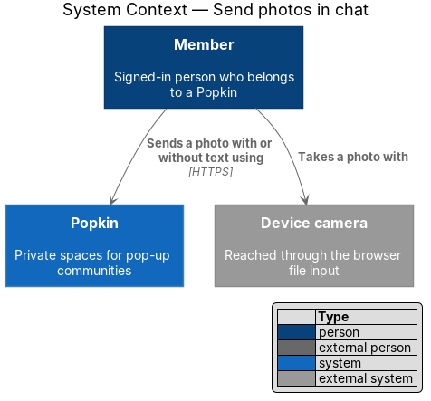
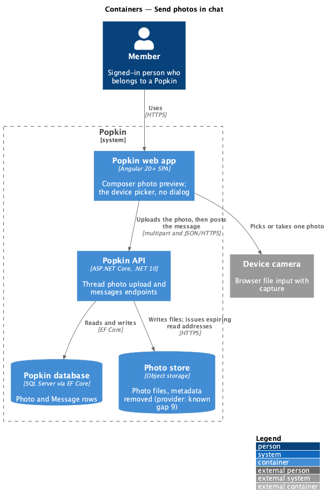
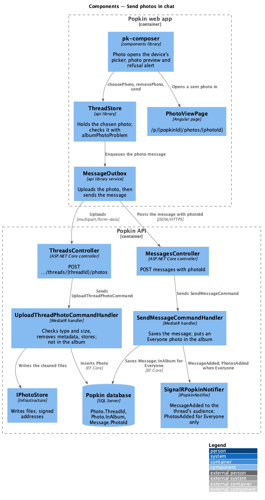
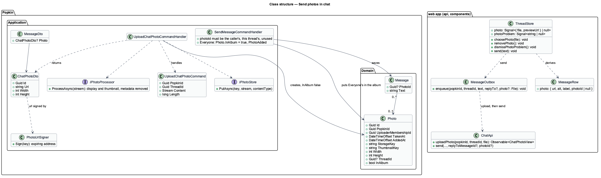
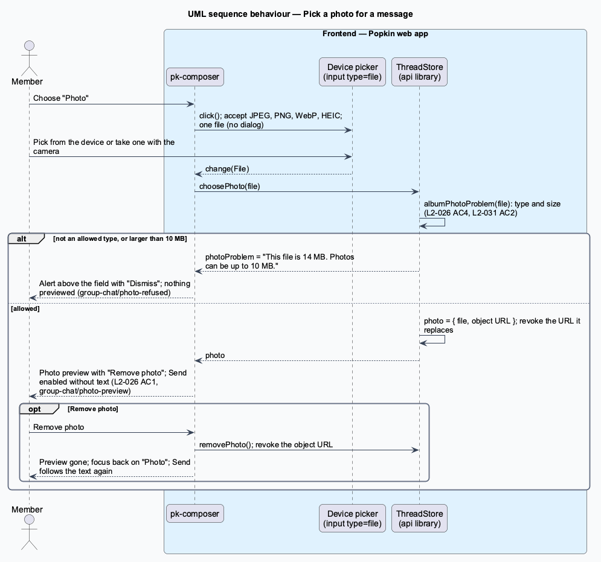
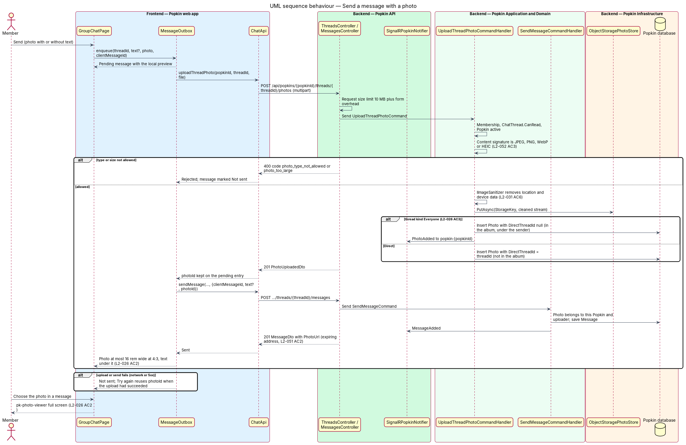

# Send photos in chat

## Overview

Members of a *Popkin* talk in the shared *Everyone* thread and in *direct messages*, and keep the
group's pictures in *Photos*, the Popkin's shared album. This feature lets a chat message carry one
photo, with or without text, and decides when such a photo also lands in the album.

- **photo message** — chat message whose `PhotoId` names a stored photo; it may also carry text
- **photo preview** — the chosen photo shown above the message field, with a "Remove photo" action, before it is sent
- **chat photo** — photo uploaded from the composer of a thread; it is in the album only once it is sent in Everyone
- **orphaned chat photo** — chat photo that was uploaded and never sent on a message
- **expiring address** — short-lived, signed URL for a photo file, issued only to members who may see it

A member chooses "Photo" in the composer and the device's own picker opens: one photo, picked from
the device or, on a phone, taken with the camera. No dialog opens in chat; the Add photos dialog
stays the album's. An accepted photo waits above the message field as the photo preview, with
"Remove photo"; a refused one is not previewed, and an alert above the field says why, in the
album's words. Send is enabled with text, a photo or both. The photo uploads when the message is
sent, then the message is posted with it.

In the thread the photo shows at most 16 rem wide at 4:3 with any text under it, and is a link
to the photo view. A photo sent in Everyone joins Photos under the sender's name when its
message is sent; a photo sent in a direct message never does, and only that direct message's two
members can read it. The limits of the album apply: JPEG, PNG, WebP or HEIC, at most 10 MB, with
location and device data removed.

## Description

**Screens and states:**

- `docs/mocks/pages/group-chat/default.html` — Dev's photo message: the photo, a link to the photo view named "Open photo from Dev" holding the image with alt text "Photo from Dev", and "Dock was glass this morning" under it in the same bubble. Every thread mock that draws a photo message draws it so, the read-only thread included, where the photo still opens.
- `docs/mocks/pages/group-chat/photo-preview.html` — Mara has chosen a photo: the photo preview above the field (the image, alt "Photo to send", and the icon button "Remove photo"), the field empty and Send enabled (L2-026 AC1).
- `docs/mocks/pages/group-chat/photo-refused.html` — the alert above the field, "This file is 14 MB. Photos can be up to 10 MB." with "Dismiss"; nothing is previewed and Send is disabled (L2-026 AC4, L2-031 AC2).
- `docs/mocks/pages/direct-message/default.html` — Walt's photo message in a direct message, "Open photo from Walt" (L2-023 AC3).
- `docs/mocks/pages/photo-view/direct.html` — the photo view of Walt's direct-message photo, opened from the chat: no previous or next, no caption, and no reactions or comments of its own; Close goes back to the direct message.
- "Photo" in every composer mock leads to `photo-preview.html`, standing for the device's picker.
- No mock draws a photo message that is sending. A sending message is drawn by no mock of text either; the app shows it a little fainter, with "Sending" in visually hidden text. A photo message that waits or fails takes the states of `group-chat/offline.html` and `failed-send.html`.

**Parts the components reproduce:**

- Photo preview — `div.composer__photo` above `form.composer__row`, holding `img` (alt "Photo to send") and `button.icon-btn.icon-btn--card.composer__remove` named "Remove photo" (`aria-label` and `title`), with the close icon.
- Refused photo — `div.alert.alert--danger.composer__alert` `role="alert"` above `form.composer__row`, holding the alert icon, `p.grow` with the reason, and `button` "Dismiss".
- Photo of a message — the first child of `div.bubble`: `a.bubble__photo` with `href` the photo view, `aria-label` "Open photo from {first name}" ("Open your photo" on the member's own), holding `img` with alt "Photo from {first name}" ("Your photo"). The text follows as `p` in the same bubble; a quote, when the message is a reply, comes before the photo.
- "Photo" in `pk-composer` — the same `icon-btn` named "Photo", now a button that clicks a hidden file input instead of a link to the Add photos dialog.

**API:**

- `POST /api/popkins/{popkinId}/threads/{threadId}/photos` (multipart, one part `file`) — 201 `ChatPhotoDto { id, url, width, height }`, `url` the display image's expiring address; 400 `photo_type_not_allowed`, `photo_too_large` (the album's codes and messages), `validation_failed` (no file); 404 `popkin_not_found`, `thread_not_found` (a direct message of two other members too); 409 `popkin_wrapped_up`; 413 over the request limit of 10 MB plus 64 KB of multipart overhead. It counts under the `photos` policy of [Abuse limits](../../security/abuse-limits/README.md), 60 a minute per person, with the album's uploads.
- `POST /api/popkins/{popkinId}/threads/{threadId}/messages` — the body gains an optional `photoId`; text becomes optional when a photo is given. Neither is `400` `validation_failed` "Write a message or choose a photo." (field `text`). `400` `photo_not_found` (field `photoId`) when the photo is not the caller's upload for this thread, or is already on a message. Idempotent by `clientMessageId` as before.
- `MessageDto` gains `Photo: ChatPhotoDto | null`, on every read, every answer of a send and `MessageAdded`. Each read signs fresh addresses (L2-051 AC2).
- `GET /api/popkins/{popkinId}/photos/{photoId}` — a direct-message photo answers its two members only; anyone else, a third member included, gets 404 `photo_not_found` (L2-023 AC2). Its `PreviousPhotoId` and `NextPhotoId` are null. An uploaded photo that is on no message yet answers its uploader alone.
- The album, the album summary of the home, the counts of My Popkins, the wrap-up, the recap and the album's zip read only the photos in the album: never a direct-message photo, and never an Everyone photo whose message was not sent.

**Frontend (Popkin web app):**

- **Picking** — "Photo" in `pk-composer` clicks a hidden `input type="file"` with `accept="image/jpeg,image/png,image/webp,image/heic"`, one file. On a phone the platform's picker offers the camera, so no camera permission is asked. Choosing another photo replaces the one chosen. No dialog opens (decision 1); `AddPhotosDialog` keeps its one mode, the album's.
- **`ThreadStore`** (`api` library) — a `photo` signal holding the chosen `File` and its preview's object URL; `choosePhoto(file)` checks it with `albumPhotoProblem` and, when refused, sets the `photoProblem` signal to the reason instead; `removePhoto()` and `dismissPhotoProblem()`. `send(text)` sends the text, the photo or both, then clears the photo. An object URL is revoked when it is replaced, sent or the store is destroyed.
- **`pk-composer`** — shows the photo preview from `photo` and the alert from `photoProblem` (L2-026 AC1, L2-031 AC2). Send is enabled with text, a photo or both; a reply and a photo may go together. "Remove photo" returns focus to "Photo"; "Dismiss" too. The preview is the same size at every form factor, XS to XL, and the alert fills the composer's width, which is the thread's: the whole screen on a phone, the column beside the list from 1024 px (L2-058 AC3, AC11). The mocks draw each state at 360, 768 and 1280 px.
- **`MessageOutbox.enqueue(popkinId, threadId, text, replyTo?, photo?: File)`** — uploads the photo with `ChatApi.uploadPhoto`, keeps the answered `photoId` on the entry, then calls `ChatApi.send(…, replyToMessageId?, photoId?)`, text possibly empty. A retry after a successful upload reuses the `photoId` and does not upload again ([Failed messages](../failed-messages/README.md)). A pending, waiting or failed row shows its photo from the local object URL. The `File` is held in memory only: `LocalOutboxStorage` saves entries to local storage, which cannot hold a file (see Open questions).
- **`thread-rows.ts`** — `MessageRow.photo: { url, alt, label, photoId | null }`: alt "Photo from {first name}" or "Your photo", label "Open photo from {first name}" or "Open your photo"; `photoId` null while it is not sent.
- **`pk-message`** — draws `a.bubble__photo`, a link to the photo view, with the image at most 16 rem wide at 4:3 (`object-fit: cover`) and the text under it (L2-026 AC2). Choosing it navigates to the photo view, `/p/{popkinId}/photos/{photoId}`, full screen below 1024 px and with the side panel from 1024 px, in Everyone and in a direct message alike. A pending photo, whose `photoId` is null, is the same picture in a `span.bubble__photo`, not a link, and does not open. A long press on the photo opens the message's actions and does not follow the link.
- **Photo view** — `PhotoViewPage` opens a direct-message photo as any other; with no previous or next it offers none, and swiping does nothing. Close and Escape go back to the screen it was opened from.
- **Quotes and previews** — the quote of a reply, the reply bar and the quote of Message actions read "Photo" for a photo message with no text, and its text otherwise. The previews of the Chat tab (`conversation-text.ts`), the home's chat card and My Popkins read "Photo", or "You: Photo", likewise. Copy copies the text, and is not offered when there is none.
- **Wrapped up** — the composer is gone, and the read-only thread shows photos, which still open (L2-045).

**Backend:**

- **`ThreadsController.UploadPhoto`** — `[RequestSizeLimit]` of 10 MB plus 64 KB, `[EnableRateLimiting(RateLimitPolicyNames.Photos)]`, and sends `UploadChatPhotoCommand`.
- **`UploadChatPhotoCommandHandler`** — membership through `IMembershipGuard`, `ChatThread.CanRead`, then a Popkin that has not wrapped up (L2-045). It checks the size and the content signature with `ImageSniffer` whatever the name or declared type says (L2-052 AC3), passes the file to `IPhotoProcessor`, which removes location and device data and makes the same display and thumbnail files as the album (L2-031 AC6), writes them through `IPhotoStore`, and inserts a `Photo` with `ThreadId` the thread's and `InAlbum` false. It sends no event.
- **`SendMessageCommandHandler`** — with a `PhotoId`, the photo must be the caller's, uploaded for this thread and on no message, else 400 `photo_not_found`. Sending sets `Message.PhotoId`; in Everyone it also sets `Photo.InAlbum` and `AddedAt`, so the photo joins Photos under the sender when its message is sent (L2-026 AC3), and sends `PhotoAdded` to the Popkin's group with `MessageAdded`. A direct-message photo stays out of the album, and its `MessageAdded` reaches the two members alone through the thread's `Audience`.
- **`Photo`** — gains `ThreadId` (null for an album upload) and `InAlbum` (true for an album upload; for an Everyone chat photo, once its message is sent). **`Message`** gains `PhotoId`. Every query of the album, of its summary and of the counts named above filters `InAlbum`. One migration.
- **`GetPhotoQueryHandler`** — a photo with a `ThreadId` is read through `ChatThread.CanRead` (L2-051 AC2); not in the album, it has no neighbours.
- **`DeleteMessageCommandHandler`** — deleting a photo message removes the message; an Everyone photo stays in the album, where it was added under the sender, and a direct-message photo is removed from the store and the database.
- **Addresses** — `PhotoUrlSigner` signs every address, which expires as the album's do.

### Tests

The API tests prove each rule of privacy: a third member's read of a direct-message photo is 404,
the message with its address reaches only the two members, the album, the album summary and the
home's photos summary never list it, and the album's zip leaves it out. Further: an Everyone photo
joins the album when its message is sent and not at upload, `photo_not_found` for another's
upload or one already used, the wrapped-up 409, the type and size refusals and a photo with no
text. Unit tests of `ThreadStore` (choosing, refusing, removing, sending), `MessageOutbox` (upload
then send, a retry that reuses the `photoId`) and the rows and previews; Playwright through the
page objects of the group chat and the direct message, with the states above keyed in `routes.ts`.

### Open questions

Settled for journey 13:

1. No dialog in chat: "Photo" opens the device's picker; the Add photos dialog stays the album's. An accepted photo shows as the photo preview with "Remove photo"; a refused one is not previewed, and an alert above the field says why in the album's words (`albumPhotoProblem`), with "Dismiss". The server checks again whatever the client says. Chat mode of `AddPhotosDialog`, its confirm label and whether it keeps a caption no longer arise.
2. Send is enabled with text, a photo or both; sending clears the preview; a photo and a reply may go together.
3. The upload happens on send: the outbox uploads, keeps the `photoId`, then posts the message; a retry after a successful upload reuses it. While uploading or sending, the photo shows from the local object URL, marked as sending like any message.
4. In the thread, the photo is at most 16 rem wide at 4:3 with any text under it; alt "Photo from {first name}" ("Your photo"); a link "Open photo from {first name}" ("Open your photo"), `a.bubble__photo`, to the photo view, in Everyone and in a direct message. A link, not a button: it navigates, so it opens in a new tab and shows its address as any link does (known gap 75). A photo still sending has no address and is not a link. A chat photo has no caption: the message's text is its words.
5. An Everyone photo joins Photos under the sender when its message is sent, not at upload, with `PhotoAdded`; a direct-message photo never does.
6. A direct-message photo is readable only by its two members: the message and its address reach only them, `GET …/photos/{photoId}` is 404 `photo_not_found` to anyone else, and the album, its summaries and its zip never include it. Each is proved by an API test.
7. The photo view of a direct-message photo has no previous or next, and shows its sharer as any photo; it offers no delete (journey 14).
8. Quoted or previewed, a photo message with no text reads "Photo"; with text, its text. Reactions work on photo messages as on any message; Copy is hidden when there is no text.
9. Deleting a photo message removes the message; an Everyone photo stays in the album, and a direct-message photo is removed from the store.
10. In a wrapped-up Popkin the upload is 409 `popkin_wrapped_up`, and the read-only thread shows photos, which still open.
11. The upload's codes are the album's: `photo_type_not_allowed` and `photo_too_large`; its request limit is 10 MB plus 64 KB.
12. The imaging is the album's (`IPhotoProcessor`, Magick.NET, HEIC accepted), with the same display and thumbnail files; addresses are signed by `PhotoUrlSigner`.

Still open:

- Removing orphaned chat photos after a period: `<TO SUPPLY>`, a `Popkin.Worker` job the expected home (known gap 71).
- A photo message waiting to send across a reload: the outbox is saved to local storage, which cannot hold a file, so a photo not yet uploaded lives only in memory and a reload loses it; one already uploaded can be resent from its `photoId`. What a restored entry without its file shows is `<TO SUPPLY>` (known gap 72).
- Whether a direct-message photo takes the photo reactions and comments of the album. The mock (`photo-view/direct.html`) draws none: its reactions live on its message. `<TO SUPPLY>` (known gap 73).
- What the removal of an album that was not kept, and the erasure of a deleted account, do to direct-message photos and to the photos of Everyone's messages; the read-only thread then shows a photo that is gone. `<TO SUPPLY>` (known gap 74).
- What "Shared between you", in the person pane of a direct message from 1024 px, lists, and whether its thumbnails open the photo view: the mock draws three plain thumbnails. `<TO SUPPLY>` (known gap 64).
- "Photo removed", for a photo taken out of the album, is journey 14's.

## Requirements

| L2 ID | Refines (L1) | Requirement |
|-------|--------------|-------------|
| `L2-026` | `L1-007` | Send photos in chat: A message carries a photo with or without text. |
| `L2-023` | `L1-007` | Direct messages: Two members of one Popkin talk privately. |
| `L2-031` | `L1-009` | Add photos: Any member adds photos to the album. |
| `L2-045` | `L1-011` | A wrapped-up Popkin is read-only: Nothing new is added to a Popkin that has ended. |
| `L2-051` | `L1-012` | Popkins are private to their members: Membership decides everything a person sees. |
| `L2-052` | `L1-012` | Input is validated and output is encoded: Nothing a person types can harm another person or the system. |
| `L2-058` | `L1-014` | Responsive from 360 px: One layout serves every screen size. |

From `L2-023` this feature realises AC2 and AC3 for photos; from `L2-031`, AC2 and AC6.

## Diagrams

### System context

A member sends a photo through Popkin, picking it from the device or taking it with the camera that
the browser's file input reaches.

### Containers

The web app uploads the photo to the Popkin API and then posts the message. The API writes the
cleaned files to the Photo store and the `Photo` and `Message` rows to the Popkin database.

### Components

The composer's file input hands the photo to `ThreadStore`, and `MessageOutbox` calls the thread
photo endpoint and then the messages endpoint. `SendMessageCommandHandler` puts an Everyone photo
in the album and publishes `PhotoAdded`; a direct-message photo stays with its two members.

### Class structure

`UploadChatPhotoCommandHandler` depends on `IPhotoProcessor` and `IPhotoStore` and creates a
`Photo` with its `ThreadId` and `InAlbum` false. A `Message` refers to at most one `Photo`. On the
client, `ThreadStore` holds the chosen photo and `MessageOutbox` sends it.

### Behaviour — pick a photo

The device's picker returns one file; `ThreadStore` refuses a wrong type or a file over 10 MB
with its reason, and an accepted photo appears above the message field with "Remove photo".

### Behaviour — send a message with a photo

The outbox uploads first, then sends the message with the returned `photoId`. A photo sent in
Everyone joins the album when its message is sent (L2-026 AC3); a failure leaves the message "Not
sent", and a retry reuses a completed upload.

