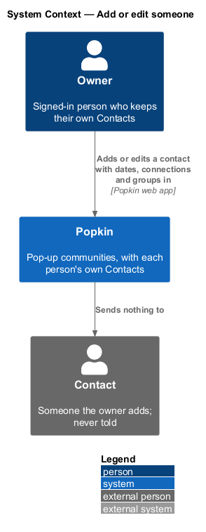
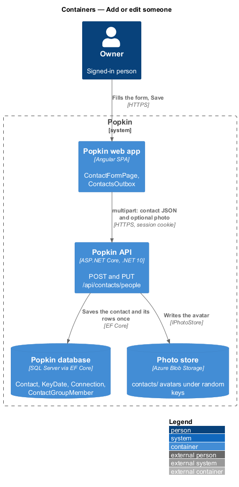
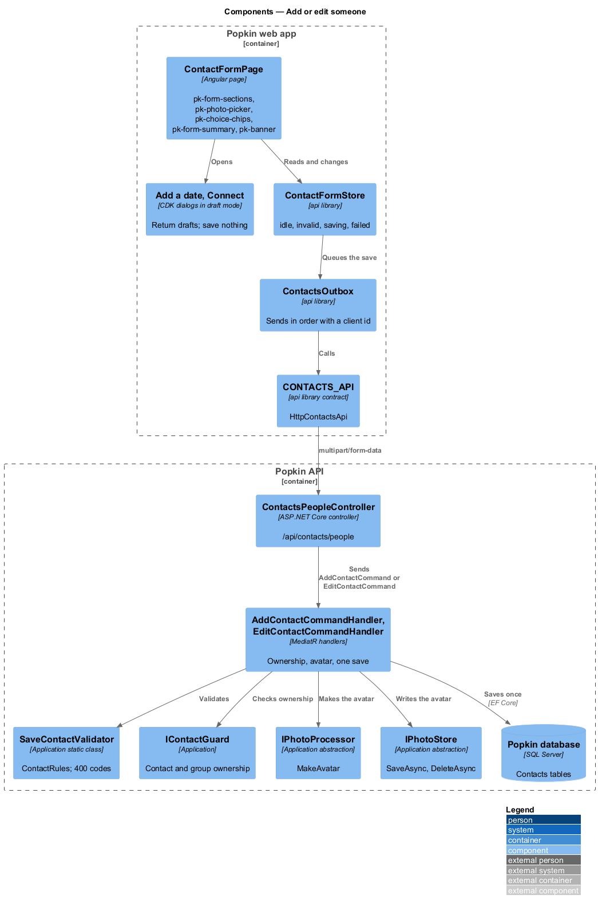
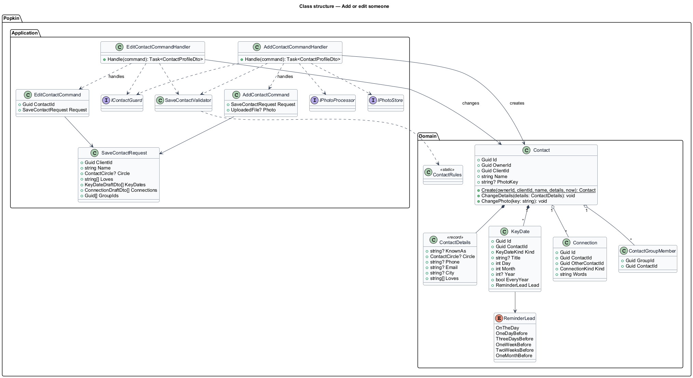
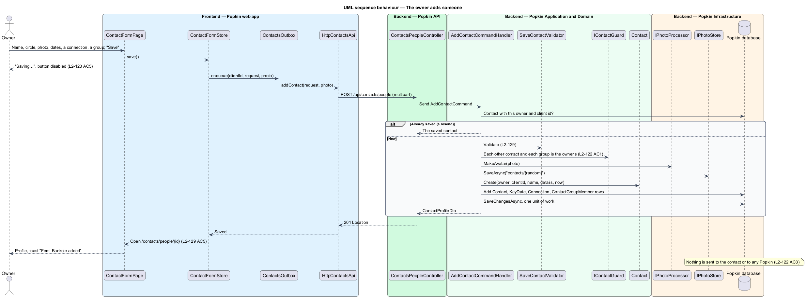
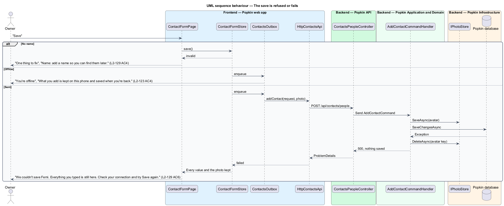

# Add or edit someone

## Overview

Popkin is a platform for pop-up communities. In Contacts (L1-029) a person keeps the people who
matter to them, whether or not they have a Popkin account. Add someone makes a contact, and the
same form edits one (L1-031). The form is a screen, not a dialog: `/contacts/people/new` to add
and `/contacts/people/:contactId/edit` to edit. One "Save" keeps the contact with their photo,
key dates, connections and groups together, and nobody is told (L2-122 AC3).

- **owner** — signed-in `Person` whose Contacts the form writes to
- **contact form** — screen of four sections, "Who", "Dates to remember", "How they connect" and "Details", shared by add and edit
- **circle** — one of Family, Friends, Work, Neighbours and Clubs (`ContactCircle`), the kind of tie the owner has with a contact
- **date draft** — key date chosen in Add a date and held by the form until "Save"
- **connection draft** — connection chosen in Connect and held by the form until "Save"
- **client id** — identifier the web app gives each save, so that a resend saves once

Add a date (L2-138) and Connect (L2-150) are their own designs. Opened from the form, each returns
a draft to the form and saves nothing. The profile the form opens after a save is
[A contact's profile](../contact-profile/README.md); "Delete {first name}" opens
[Delete a contact](../delete-contact/README.md).

## Description

### Screens and states

Popkin web app, `docs/mocks/pages/add-contact/`:

- `default.html` — the top bar "Cancel", "Add someone" and "Save", then `pk-form-sections`
  (L2-129 AC1): "Who" with "Add a photo", "Name" ("Their name"), "How you know them" ("Sister,
  neighbour, old boss…") and the radio group "Circle" of "Family", "Friends", "Work",
  "Neighbours" and "Clubs"; "Dates to remember", "We’ll nudge you ahead of each one.", each date
  with its kind and day ("Birthday" "9 March"), the select "Remind me about the birthday" of "On
  the day", "1 day before", "3 days before", "1 week before", "2 weeks before" and "1 month
  before", and "Remove the birthday", then "Another date" (L2-129 AC2); "How they connect",
  "Builds your map of who’s who.", each connection ("Grace Adeyemi" "Partner") with "Remove the
  connection to Grace", then "Connect to someone" (L2-129 AC3); "Groups", one toggle chip per
  group of the owner ("🎓 Sheffield lot" pressed); "Details", "Optional.", with "Phone", "Email",
  "City" and "Things they love" ("Jazz, cycling, Arsenal…").
- `invalid.html` — `pk-form-summary` "One thing to fix" with the link "Name: add a name so you
  can find them later.", and the field's error "Add a name so you can find them later." with
  `aria-invalid` (L2-129 AC4).
- `submitting.html` — "Save" reads "Saving…" and is disabled (L2-123 AC5).
- `error.html` — the danger `pk-banner` "We couldn’t save Femi. Everything you typed is still
  here. Check your connection and try Save again.", every value kept (L2-129 AC6).
- `edit.html` — "Edit Chidi", every value filled in, the photo shown, and "Delete Chidi" at the
  end (L2-130 AC1, AC3).
- After a save, the contact's profile opens (L2-129 AC5, L2-130 AC2).
  `docs/mocks/pages/contact-profile/empty.html` draws the toast that follows an add: "Femi
  Bankole added", "You’ll hear about his birthday a week before.", "Undo".
- "Cancel" saves nothing and opens People after an add, or the profile after an edit (L2-129
  AC7, L2-130 AC2).
- Offline, "Save" keeps the contact in `ContactsOutbox` and shows "You’re offline", "What you
  add is kept on this phone and saved when you’re back." (L2-123 AC4,
  `docs/mocks/notifications/contacts-toast/warning.html`).

### Conflicts and gaps

- **Fields.** The length of each field, the form of a phone and an email, whether a birthday
  keeps its year, where "How you met" is entered (the profile shows it; the form has no field)
  and "Things they love" as one comma-separated field are known gap 102. Until it is settled,
  the form splits "Things they love" at commas and the API takes a list; every limit is
  `<TO SUPPLY>`; the interim ruling in the register sets them. Whether a circle is required is
  `<TO SUPPLY>`; the API accepts none.
- **The toast after an add.** L2-129 AC5 asks only that the profile opens. The mock's toast uses
  "his", which L2-122 AC4 forbids; the requirement stands, so the line reads "You’ll hear about
  Femi’s birthday a week before." What "Undo" undoes is `<TO SUPPLY>`; it is not built until a
  requirement says.
- **Changing the photo in Edit.** `edit.html` draws the photo with no way to change or remove
  it. Until a mock draws one, the edit form shows the photo only, and the API keeps it.
- **Key dates in Edit.** A date's day is not changed once added (known gap 103); the form changes
  its reminder or removes it. The kinds offered are known gap 103 too.
- **The groups list.** The manifest says the form needs no request before it shows, but the
  "Groups" chips are the owner's groups. The form reads them through Groups' own endpoint
  (L2-146) as it opens and shows the part when they arrive; with no group, the part is left out.
- **The photo offline.** Whether a picked photo waits in `ContactsOutbox` with the rest is
  `<TO SUPPLY>`; until settled, an offline save keeps the photo too.

### API

Endpoints on `ContactsPeopleController` (`Popkin.Api/Controllers/Contacts/`), behind the default
authenticated policy; each sends one MediatR request.

- `POST /api/contacts/people` — `multipart/form-data`: the part `contact` holds
  `SaveContactRequest` as JSON, and the optional part `photo` one image. `201`
  `ContactProfileDto` with `Location`. A second request with the same `clientId` answers the
  contact the first made.
- `PUT /api/contacts/people/{contactId}` — the same parts, without `photo` (see Conflicts).
  `200` `ContactProfileDto`; `404` `contact_not_found`.
- `SaveContactRequest` — `clientId`, `name`, `knownAs?`, `circle?`, `phone?`, `email?`, `city?`,
  `loves` (`string[]`), `keyDates` (`KeyDateDraftDto[]`: `id?` for a kept date, `kind`,
  `title?`, `day`, `month`, `year?`, `everyYear`, `reminder`), `connections`
  (`ConnectionDraftDto[]`: `id?`, `otherContactId`, `kind`, `words`) and `groupIds`. A kept date
  or connection missing from the lists is removed; one without `id` is added.
- Refusals, all ProblemDetails with `code`: `400` `contact_name_required` (L2-129 AC4),
  `contact_field_too_long` with the field's name, `contact_phone_invalid`,
  `contact_email_invalid`, `contact_circle_not_allowed`, `key_date_invalid`,
  `reminder_not_allowed`, `photo_type_not_allowed`, `photo_too_large`; `404`
  `contact_not_found` for a connection to a contact that is not the owner's, and
  `group_not_found` for a group that is not theirs (L2-122 AC1).

### Backend

- **`Contact`** (Domain) — `Contact.Create(ownerId, clientId, name, details, now)`,
  `ChangeDetails(details)`, `ChangePhoto(key)`; `details` is a `ContactDetails` record of the
  fields of "Who" and "Details". The name is trimmed.
- **The limits** (Domain) — the field limits of gap 102 as constants on `Contact`
  (`MaxNameLength` and the rest), as `Experience` keeps its own; the `ReminderLead` values "On
  the day" to "1 month before" come with [Key dates](../key-dates/README.md). (`ContactRules`
  already names the sign-in rules for a phone or email, so the form's rules do not take it.)
- **`SaveContactValidator`** (Application, a static class as `ExperienceFields` is) — applies
  the limits to `SaveContactRequest` for add and edit, and throws
  `ProblemException.Invalid(code, title, field)` with the codes above.
- **`AddContactCommand`** / **`AddContactCommandHandler`** (`Popkin.Application/Contacts/People/`)
  — returns the existing contact when `(OwnerId, ClientId)` already exists. Otherwise it checks
  each `otherContactId` and group id with `IContactGuard`, makes the avatar with
  `IPhotoProcessor.MakeAvatar` (null is `photo_type_not_allowed`), writes it through
  `IPhotoStore.SaveAsync` under `contacts/` and a random key, adds the `Contact`, its `KeyDate`
  rows, its `Connection` rows and its `ContactGroupMember` rows, and saves once. When the save
  fails, it deletes the photo it wrote.
- **`EditContactCommand`** / **`EditContactCommandHandler`** — `IContactGuard.RequireOwnedAsync`,
  then the same checks; updates the details, applies each list as kept, added or removed, and
  saves once. A date's day and kind are not changed (gap 103).
- Nothing is sent to the contact, to any Popkin or over the hub (L2-122 AC3). Logs and metrics
  carry the route template and status only, never a name, phone, email or loved thing.

### Frontend (Popkin web app)

- **`ContactFormPage`** (`app/pages/contact-form/contact-form.page.ts` and `.html`), routes
  `/contacts/people/new` and `/contacts/people/:contactId/edit`, data `{ shell: 'bare', page:
  'add-contact' }`. It composes `pk-top-bar` ("Cancel", the heading, "Save"),
  `pk-form-sections`, `pk-photo-picker` ("Add a photo"), `pk-text-field`, `pk-choice-chips`
  (Circle, a radio group), the date entries and person picks of `pk-form-sections` with
  `pk-select-field` and `pk-icon-button`, `pk-chip` toggles for Groups, `pk-form-summary`,
  `pk-banner` for the failed save and `pk-button` for "Delete {first name}". Phone and Email
  use `type="tel"` and `type="email"`.
- "Another date" opens Add a date and "Connect to someone" opens Connect, each in draft mode,
  returning a draft that the form lists. Removing a draft or a kept item takes it off the list.
- **`ContactFormStore`** (`frontend/projects/api/src/lib/api/contacts/`) — holds the values,
  the drafts and `idle | invalid | saving | failed`; fills itself from `ContactProfileStore`
  when the profile is loaded, or reads `GET /api/contacts/people/{contactId}` on a direct
  visit. "Save" with no name sets `invalid` and moves focus to the summary. A save sends
  through `ContactsOutbox` with a new client id; a refusal or a failure sets `failed` and keeps
  every value and the picked photo. Unit tested (ADR 0011).
- **`contact-form-text.ts`** — "Edit {first name}", "Delete {first name}", "Remind me about the
  {kind}", "Remove the {kind}", "Remove the connection to {first name}", the failed banner and
  the toast. Unit tested.
- **`CONTACTS_API`** — `addContact(request, photo?)`, `editContact(contactId, request)`.

### Tests

- API acceptance tests (InMemory), `Popkin.Api.Tests/Contacts/AddContactTests.cs`: an add with a
  photo, two dates, a connection and a group saves them together and answers the profile; no
  name answers `400` `contact_name_required` and saves nothing; a resend with the same client id
  saves once; a connection to another person's contact answers `404` `contact_not_found`; an
  edit removes a date and a connection left out of the lists; another person's contact cannot
  be edited.
- A direct test of `SaveContactValidator`, one case per rule and code.
- Playwright, `e2e/tests/add-contact.spec.ts` through the `ContactFormPage` page object: adding
  Femi opens the profile, a missing name shows the summary, a failed save keeps everything,
  "Cancel" opens People, editing Chidi and "Delete Chidi". Recorded responses for `POST` and
  `PUT`; the failed save is stubbed in `stubs.ts`; `routes.ts` gains each state.
- Parity for `pk-form-sections`.

## Requirements

| L2 ID | Refines (L1) | Requirement |
|-------|--------------|-------------|
| `L2-129` | `L1-031` | Add someone: Add someone makes a contact with who they are, their dates, connections, groups and details. (AC1–AC7) |
| `L2-130` | `L1-031` | Edit a contact: A contact is edited with the same form, which ends with Delete. (AC1–AC3) |

## Diagrams

### System context

The owner adds or edits a contact in Popkin; the contact is not told.

### Containers

The web app sends one multipart request; the API writes the photo to the photo store and the
contact's rows to the database.

### Components

`ContactFormPage` saves through `ContactFormStore` and `ContactsOutbox`; the handlers validate,
check ownership of every related row and save once.

### Class structure

`SaveContactRequest` carries the contact and its drafts; `Contact` owns its key dates and the
owner's connections and group memberships that name it.

### Behaviour — the owner adds someone

A valid save writes the photo, the contact and its rows in one unit of work, then opens the
profile.

### Behaviour — the save is refused or fails

A missing name is caught before sending; a failed request keeps everything typed.

