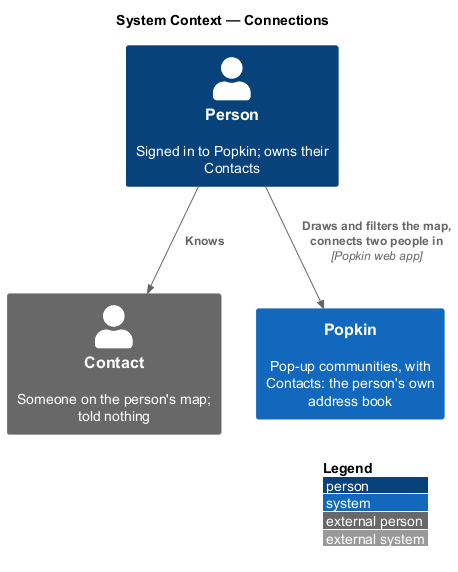
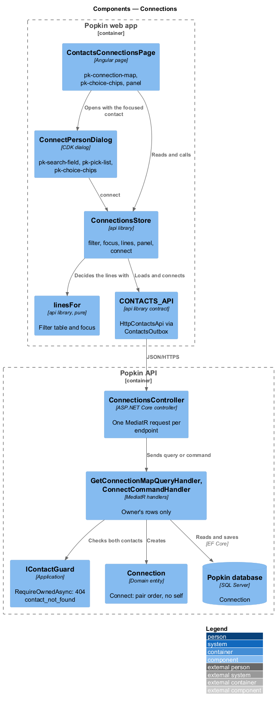
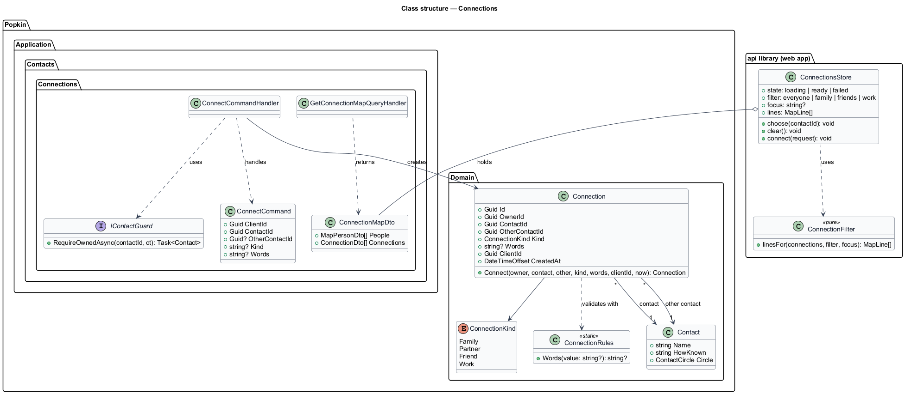
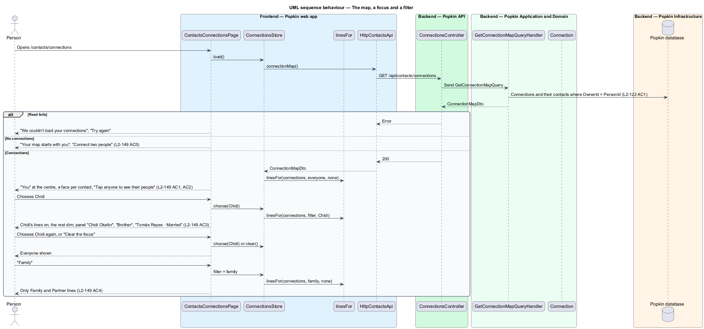

# Connections

## Overview

Popkin is a platform for pop-up communities. Contacts is a person's own address book inside the
Popkin web app, seen by nobody else (L1-029). Connections is the Contacts page that records how
the person's contacts know each other and draws it as a map, with the person at the centre
(L1-037). A face on the map opens that contact's people; a filter shows only family, friends or
work; and "Connect" joins two contacts. It sits at `/contacts/connections`; on a phone it is
reached from Groups and has a "Groups" back link (L2-121 AC4).

- **connection** — record that two of the person's contacts know each other, with a kind and the person's words (`Connection`)
- **connection kind** — one of `Family`, `Partner`, `Friend` and `Work` (`ConnectionKind`)
- **words** — short phrase in the person's own words for a connection ("Married", "Mum")
- **map** — drawing of "You" at the centre, a face per connected contact and a line per connection
- **face** — button on the map for one contact
- **focus** — state in which one face is chosen, its lines come forward and the rest fade
- **filter** — choice of "Everyone", "Family", "Friends" or "Work" that limits the lines shown
- **promised introduction** — connection the person has said they will make, drawn dotted

A connection is the `Connection` entity of the shared Contacts architecture
([Contacts](../../README.md#contacts)): two contacts, a `ConnectionKind` and the owner's words. A
contact's profile lists the same connections under "People around {first name}"
([A contact's profile](../contact-profile/README.md), L2-150 AC4); Add someone's "How they connect"
opens `ConnectPersonDialog` in draft mode, which saves nothing: the connection is saved with the
contact ([Add or edit someone](../add-contact/README.md)). Deleting a contact removes both ends of
its connections through `ContactRemoval` ([Delete a contact](../delete-contact/README.md)).

## Description

### Screens and states

Popkin web app, `docs/mocks/pages/contacts-connections/`:

- `none.html` — "Connections", "Who’s family, who’s friends, and how everyone knows each other",
  the filter chips "Everyone" (pressed), "Family", "Friends" and "Work", and the map: "You" at the
  centre and 12 faces, each a button named with the contact's full name. The panel reads "Tap
  anyone to see their people" and "Lines show how people know each other: coral for family, green
  for friends, a dashed grey line for work. Dotted means an introduction you’ve promised."
  (L2-149 AC1, AC2).
- `default.html` — Chidi chosen (`aria-pressed="true"`): his lines are on and the rest dim. The
  panel names "Chidi Okafor" and "Brother", lists "You · Brother" and "Tomás Reyes · Married",
  each opening a profile ("You" opens the account), and offers "Open profile", "Connect" and
  "Clear the focus" (L2-149 AC3).
- `family.html` — "Family" pressed: only family and partner lines (L2-149 AC4).
- `empty.html` — "Your map starts with you", "Connect two people — a couple, a parent and child,
  old friends — and they appear here, joined by a line." and "Connect two people" (L2-149 AC5).
- `loading.html`, and `error.html` — "We couldn’t load your connections", "Your map is safe.
  Check your connection and try again." and "Try again".

`docs/mocks/dialogs/connect-person/`:

- `default.html` — "Connect Chidi to…", "Search your people", the "Who" list of contacts as radio
  rows, "How they know each other" as radio chips "Family", "Partner", "Friend", "Work" (Family
  chosen), "In your words" ("Mum, old friends, worked together…") and "Connect" (L2-150 AC1).
- `invalid.html` — "One thing to fix", "Who: pick who Chidi is connected to." and the list's error
  "Pick who Chidi is connected to." (L2-150 AC2).
- `no-results.html` — "No one called “Femi” in your contacts", "Add them first, then connect
  them to Chidi." and "Add “Femi”" (L2-150 AC3).
- `busy.html` — "Connecting…", disabled.

### Conflicts and gaps

- **Direction and words (gap 109).** Whether a connection reads both ways and in whose words is
  open. The design stores one row per pair, with the owner's words, and shows the same words from
  either side ("Married" on Chidi's and on Tomás's). A second connection of the same pair is
  refused with `409` `already_connected` until gap 109 says otherwise (`<TO SUPPLY>`).
- **The line to "You" (gap 109).** The mock draws a line from "You" to most faces, and the panel
  lists "You · Brother". The design draws it from the contact's `ContactCircle` and labels it with
  how the person knows them; whether that is right is `<TO SUPPLY>`.
- **Promised introductions (gap 109).** No form makes a dotted line. `pk-connection-map` takes a
  `promised` flag per line, and the API sends none until gap 109 settles where one comes from.
- **Who is on the map (gap 109).** The design draws every contact in at least one connection;
  which contacts it leaves out is `<TO SUPPLY>`. How the faces are placed is `<TO SUPPLY>`: the
  mock places them by hand.
- **Connect with no contact chosen (gap 109).** "Connect two people" on the empty map opens the
  dialog with no first contact; what it asks first is `<TO SUPPLY>`.
- **The kind's default.** The mock draws "Family" chosen; whether a kind starts chosen is
  `<TO SUPPLY>`. "In your words" is optional, as no invalid state asks for it; its limit is
  `<TO SUPPLY>`.
- **"Add “{name}”"** opens Add someone; whether it fills the name and returns to the dialog is
  `<TO SUPPLY>`. Who the "Who" list leaves out besides the contact itself is `<TO SUPPLY>`.
- **Deleting or changing a connection** is not drawn. Deleting a contact removes every connection
  it is in, at either end, through `ContactRemoval` ([Delete a contact](../delete-contact/README.md)).

### API

Every endpoint is on `ConnectionsController` (`Popkin.Api/Controllers/Contacts/`); each sends one
MediatR request. Nothing tells either contact (L2-122 AC3).

- `GET /api/contacts/connections` — `200` `ConnectionMapDto`: `people` (`MapPersonDto[]`:
  `contactId`, `firstName`, `fullName`, `photoUrl`, `howKnown`, `circle`) and `connections`
  (`ConnectionDto[]`: `id`, `contactId`, `otherContactId`, `kind`, `words`).
- `POST /api/contacts/connections` — body `{ clientId, contactId, otherContactId, kind, words? }`.
  `201` `ConnectionDto`. A second request with the same `clientId` returns the first connection.
  Refusals: `400` `who_required` (the summary "Who: pick who {first name} is connected to."),
  `connection_to_self`, `kind_not_allowed`, `words_too_long`; `404` `contact_not_found` for either
  contact; `409` `already_connected`.

### Backend

- **`ConnectionKind`** (Domain) — `Family`, `Partner`, `Friend`, `Work`.
- **`Connection`** (Domain) — `Id`, `OwnerId`, `ContactId`, `OtherContactId`, `Kind`, `Words?`,
  `ClientId`, `CreatedAt`. `Connect(owner, contact, other, kind, words, clientId, now)` refuses a
  contact connected to itself. The pair is stored with the smaller id first, so one unique index
  on (`OwnerId`, `ContactId`, `OtherContactId`) holds either order.
- **`ConnectionRules`** — `Words(string?)` trims, keeps null for empty, and refuses too long.
- **`GetConnectionMapQueryHandler`** (`Popkin.Application/Contacts/Connections/`) — the owner's
  connections and the contacts in them, no tracking.
- **`ConnectCommandHandler`** — checks both contacts with `IContactGuard.RequireOwnedAsync`,
  refuses an existing pair, saves once.
- No hub event. No log, metric or span carries a contact's name or the words.

### Frontend (Popkin web app)

- **`ContactsConnectionsPage`** (`pages/contacts-connections/contacts-connections.page.ts`, route
  `/contacts/connections`, `shell: 'app'`, `page: 'contacts-connections'`) — composes
  `pk-contacts-page`, `pk-page-head` with the "Groups" back link below medium screens,
  `pk-choice-chips` as toggle chips for the filter, `pk-connection-map`, the panel's `pk-contact-list`
  list with `pk-button` "Open profile", "Connect" and `pk-icon-button` "Clear the focus",
  `pk-empty-state` and `pk-skeleton`.
- **`ConnectPersonDialog`** (`dialogs/connect-person/connect-person.dialog.ts`) — `pk-dialog`
  titled "Connect {first name} to…", `pk-search-field` "Search your people" (matching is gap
  101), `pk-pick-list` "Who" of contacts with their photos, the no-results note with "Add
  “{name}”", `pk-choice-chips` "How they know each other", `pk-text-field` "In your words",
  `pk-form-summary` and "Connect" / "Connecting…". On success it closes and the map shows the
  line (L2-150 AC4). Its `mode` input is `save` (the default, which calls `ConnectionsStore.connect`)
  or `draft`, used by Add someone and Edit: it validates the same way, sends nothing, and closes
  with `{ otherContactId, kind, words }` for the contact form to save with the contact.
- **`ConnectionsStore`** (`frontend/projects/api/src/lib/api/contacts/connections-store.ts`) —
  `loading | ready | failed`, `filter`, `focus` (a contact id or null), `lines`, `panel`;
  `choose(id)` focuses or, for the chosen face, clears; `clear()`; `connect(request)` through
  `ContactsOutbox`.
- **`connection-filter.ts`** (pure) — `linesFor(connections, filter, focus)`: each line's kind,
  shown or hidden by the filter table below, and `on` or `dim` by the focus.
- **`connections-text.ts`** — "Tap anyone to see their people", the legend, "Connect {first name}
  to…", "Who: pick who {first name} is connected to.", "No one called “{name}” in your contacts"
  and the kind labels.
- **`CONTACTS_API`** — `connectionMap()`, `connect(request)`.
- **`pk-connection-map`** (components, backlog row 21) — "You" and the faces as buttons with
  `aria-pressed` and the full name, lines in an `aria-hidden` SVG: family coral, partner coral,
  friend green, work dashed grey, promised dotted. Colour is never alone: the dash and dot carry
  the kind, and the panel lists each connection in words. Faces take Tab and Enter or Space.

| Filter | Kinds shown |
|---|---|
| Everyone | Family, Partner, Friend, Work |
| Family | Family, Partner |
| Friends | Friend |
| Work | Work |

### Tests

- API acceptance tests (InMemory, `Popkin.Api.Tests/Contacts/ConnectionsTests`): a connection made
  shows on the map from both contacts; a resend with the same `clientId` saves once; nobody chosen
  is `400` `who_required`; a contact connected to itself is `400` `connection_to_self`; another
  person's contact is `404` `contact_not_found`; the same pair in either order is `409`
  `already_connected`.
- Direct tests of `Connection.Connect` (pair order, self) and `ConnectionRules.Words`.
- Unit tests (api library): `linesFor` one case per row of the filter table, with and without a
  focus; `ConnectionsStore.choose` twice clears the focus; `connections-text`.
- Playwright (`e2e/tests/contacts/connections.spec.ts`) through `ContactsConnectionsPage` and
  `ConnectPersonDialog` with recorded responses: no focus, focusing Chidi and clearing it by
  choosing again and by "Clear the focus", the Family filter, the empty and error states, and the
  dialog's invalid, no-results and busy states and a connection made. `routes.ts` gains every
  state of both screens.
- Parity: `pk-connection-map` with no focus, a focus, a filter and a promised line.

## Requirements

| L2 ID | Refines (L1) | Requirement |
|-------|--------------|-------------|
| `L2-149` | `L1-037` | Connections: Connections draws how the person's contacts know each other. (AC1–AC5) |
| `L2-150` | `L1-037` | Connect two people: A connection is made between two contacts. (AC1–AC4) |

## Diagrams

### System context

The person records how their contacts know each other; neither contact is told.

### Containers

The web app reads the map and writes connections through the API, which keeps them in the
database.

### Components

`ConnectionsStore` holds the filter and the focus and asks `linesFor` which lines show;
`ConnectionsController` sends one request per endpoint.

### Class structure

A `Connection` joins two `Contact` rows of one owner with one `ConnectionKind` and the owner's
words.

### Behaviour — the map, a focus and a filter

The map loads; choosing a face focuses it, choosing it again clears, and a filter limits the
lines.

### Behaviour — connecting two people

The dialog checks that someone is chosen; the API checks both contacts are the person's and the
pair is new.

