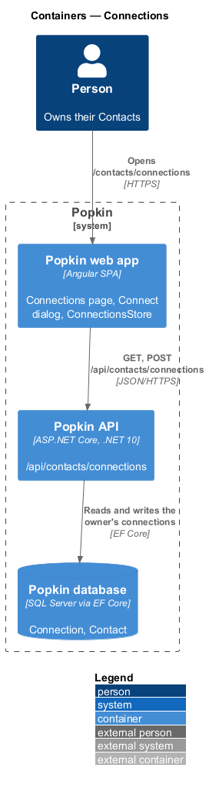
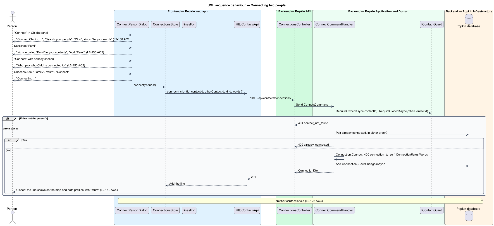

# Connections

## Overview

Popkin is a platform for pop-up communities. Contacts is a person's own address book inside the
Popkin web app, seen by nobody else (L1-029). Connections is the Contacts page that records how
the person's contacts know each other and draws it as a map, with the person at the centre
(L1-037). A face on the map opens that contact's people; a filter shows only family, friends or
work; and "Connect" joins two contacts. It sits at `/contacts/connections`; on a phone it is
reached from Groups and has a "Groups" back link (L2-121 AC4).

- **connection** — record that two of the person's contacts know each other, with a kind and the person's words (`Connection`)
- **connection kind** — one of `Family`, `Partner`, `Friend` and `Work` (`ConnectionKind`)
- **words** — short phrase in the person's own words for a connection ("Married", "Mum")
- **map** — drawing of "You" at the centre, a face per connected contact and a line per connection
- **face** — button on the map for one contact
- **focus** — state in which one face is chosen, its lines come forward and the rest fade
- **filter** — choice of "Everyone", "Family", "Friends" or "Work" that limits the lines shown
- **promised introduction** — connection the person has said they will make, drawn dotted

A connection is the `Connection` entity of the shared Contacts architecture
([Contacts](../../README.md#contacts)): two contacts, a `ConnectionKind` and the owner's words. A
contact's profile lists the same connections under "People around {first name}"
([A contact's profile](../contact-profile/README.md), L2-150 AC4); Add someone's "How they connect"
opens `ConnectPersonDialog` in draft mode, which saves nothing: the connection is saved with the
contact ([Add or edit someone](../add-contact/README.md)). Deleting a contact removes both ends of
its connections through `ContactRemoval` ([Delete a contact](../delete-contact/README.md)).

## Description

### Screens and states

Popkin web app, `docs/mocks/pages/contacts-connections/`:

- `none.html` — "Connections", "Who’s family, who’s friends, and how everyone knows each other",
  the filter chips "Everyone" (pressed), "Family", "Friends" and "Work", and the map: "You" at the
  centre and 12 faces, each a button named with the contact's full name. The panel reads "Tap
  anyone to see their people" and "Lines show how people know each other: coral for family, green
  for friends, a dashed grey line for work. Dotted means an introduction you’ve promised."
  (L2-149 AC1, AC2).
- `default.html` — Chidi chosen (`aria-pressed="true"`): his lines are on and the rest dim. The
  panel names "Chidi Okafor" and "Brother", lists "You · Brother" and "Tomás Reyes · Married",
  each opening a profile ("You" opens the account), and offers "Open profile", "Connect" and
  "Clear the focus" (L2-149 AC3).
- `family.html` — "Family" pressed: only family and partner lines (L2-149 AC4).
- `empty.html` — "Your map starts with you", "Connect two people — a couple, a parent and child,
  old friends — and they appear here, joined by a line." and "Connect two people" (L2-149 AC5).
- `loading.html`, and `error.html` — "We couldn’t load your connections", "Your map is safe.
  Check your connection and try again." and "Try again".

`docs/mocks/dialogs/connect-person/`:

- `default.html` — "Connect Chidi to…", "Search your people", the "Who" list of contacts as radio
  rows, "How they know each other" as radio chips "Family", "Partner", "Friend", "Work" (Family
  chosen), "In your words" ("Mum, old friends, worked together…") and "Connect" (L2-150 AC1).
- `invalid.html` — "One thing to fix", "Who: pick who Chidi is connected to." and the list's error
  "Pick who Chidi is connected to." (L2-150 AC2).
- `no-results.html` — "No one called “Femi” in your contacts", "Add them first, then connect
  them to Chidi." and "Add “Femi”" (L2-150 AC3).
- `busy.html` — "Connecting…", disabled.

### Rulings (known gap 109, settled)

- **Direction and words.** One row per pair, with the owner's words, shown the same from either
  side ("Married" on Chidi's and on Tomás's). The pair is stored smaller id first; a second
  connection of the same pair, in either order, is `409` `already_connected`, and "Who" leaves out
  anyone already connected, so the dialog never offers it (L2-150 AC5).
- **The line to "You".** Drawn from the contact's `ContactCircle`: Family a family line, Work a
  work line, Friends, Neighbours and Clubs a friend line; no circle, no line. The panel labels it
  with their "Known as", else the circle (L2-149 AC6, AC7).
- **Promised introductions.** "Not introduced yet" ("A dotted line, until you've introduced
  them.") in Connect stores `Promised`; the line is dotted while it is set (L2-150 AC6).
- **Who is on the map and where.** Every contact in at least one connection, spaced evenly round
  an oval (radius 0.4 of the map's width and height) from the top, clockwise, in the order they
  were first connected; the mocks are drawn from this rule (L2-149 AC6).
- **Connect with no contact chosen.** "Connect two people" opens Connect titled "Connect two
  people" with "Connect" as a select ("Choose someone") above "Who"; nobody chosen reads
  "Connect: choose the first person." (L2-150 AC7, mock `choose.html`).
- **The kind's default.** "Family", as drawn. "In your words" is optional, at most 60 characters
  (`words_too_long`, "Keep it to 60 characters.").
- **"Add “{name}”"** opens Add someone with the name filled (`?name=`); it does not return to the
  dialog. "Who" leaves out the contact itself and everyone already connected to them.
- **Changing and removing.** A connection is removed in Add someone or Edit, under "How they
  connect" ("Remove the connection to {first name}"), and saved with the contact; to change one,
  remove it and connect again (L2-150 AC9). Deleting a contact removes every connection it is in
  through `ContactRemoval`.

### API

Every endpoint is on `ConnectionsController` (`Popkin.Api/Controllers/Contacts/`); each sends one
MediatR request. Nothing tells either contact (L2-122 AC3).

- `GET /api/contacts/connections` — `200` `ConnectionMapDto`: `people` (`MapPersonDto[]`:
  `contactId`, `firstName`, `fullName`, `photoUrl`, `howKnown`, `circle`) and `connections`
  (`ConnectionDto[]`: `id`, `contactId`, `otherContactId`, `kind`, `words`, `promised`), people in
  the order they were first connected. `MapPersonDto` also carries `knownAs` and `accent`.
- `DELETE /api/contacts/connections/{id}` — `204`; another person's is `404`
  `connection_not_found`.
- `POST /api/contacts/connections` — body `{ clientId, contactId, otherContactId, kind, words?,
  promised }`.
  `201` `ConnectionDto`. A second request with the same `clientId` returns the first connection.
  Refusals: `400` `who_required` (the summary "Who: pick who {first name} is connected to."),
  `connection_to_self`, `kind_not_allowed`, `words_too_long`; `404` `contact_not_found` for either
  contact; `409` `already_connected`.

### Backend

- **`ConnectionKind`** (Domain) — `Family`, `Partner`, `Friend`, `Work`.
- **`Connection`** (Domain) — `Id`, `OwnerId`, `ContactId`, `OtherContactId`, `Kind`, `Words?`,
  `Promised`,
  `ClientId`, `CreatedAt`. `Connect(owner, contact, other, kind, words, clientId, now)` refuses a
  contact connected to itself. The pair is stored with the smaller id first, so one unique index
  on (`OwnerId`, `ContactId`, `OtherContactId`) holds either order.
- **`ConnectionRules`** — `Words(string?)` trims, keeps null for empty, and refuses too long.
- **`GetConnectionMapQueryHandler`** (`Popkin.Application/Contacts/Connections/`) — the owner's
  connections and the contacts in them, no tracking.
- **`ConnectCommandHandler`** — checks both contacts with `IContactGuard.RequireOwnedAsync`,
  refuses an existing pair, saves once.
- **`ContactProfileDto.Around`** — the contact's connections as `AroundDto` (`contactId`, `name`,
  `initials`, `accent`, `photoUrl`, `kind`, `words`), drawn as "People around {first name}".
- **`SaveContactRequest.Connect`/`Disconnect`** — what "How they connect" adds and removes, saved
  with the contact in the same `SaveChanges`.
- No hub event. No log, metric or span carries a contact's name or the words.

### Frontend (Popkin web app)

- **`ContactsConnectionsPage`** (`pages/contacts-connections/contacts-connections.page.ts`, route
  `/contacts/connections`, `shell: 'app'`, `page: 'contacts-connections'`) — composes
  `pk-contacts-page`, `pk-page-head` with the "Groups" back link below medium screens,
  `pk-filter-chips` "Show" (each kind keyed with `pk-link-key`), `pk-connection-map`, and
  `pk-connection-panel` holding `pk-people-around` and "Open profile" and "Connect";
  `pk-empty-state` and `pk-skeleton`. `?contact={id}` opens with that face chosen (L2-149 AC8).
- **`ConnectPersonDialog`** (`dialogs/connect-person/connect-person.dialog.ts`) — `pk-dialog`
  titled "Connect {first name} to…" or "Connect two people" (with "Connect" as
  `pk-select-field` first), `pk-search-field` "Search your people" (`matchesName`, as People),
  `pk-person-choice` "Who" A to Z, the no-results `pk-empty-state` with "Add “{name}”" to
  `/contacts/people/new?name=`, `pk-choice-chips` "How they know each other", `pk-text-field`
  "In your words", `pk-setting-row` "Not introduced yet", `pk-form-summary` and "Connect" /
  "Connecting…". `mode: 'draft'` (Add someone, Edit) sends nothing and closes with the draft.
- **`ConnectionsStore`** (`api/contacts/connections-store.ts`) — `loading | ready | failed`,
  `filter`, `focus`, `people`, `view` (`connectionMapOf`), `chosen`, `rows`; `choose(id)` focuses
  or, for the chosen face, clears; `clear()`; `connected()` reads the map again.
- **`connections-view.ts`** (pure) — `placeFaces` (the oval), `mapLinks` (the lines to "You" from
  the circle, then the connections, a promised one pending) and `panelRows`.
- **`connections-text.ts`** — the hint and legend, `lineToYou`, Connect's title, summaries,
  errors and no-results words.
- **`CONTACTS_API`** — `connectionMap()`, `connect(request)`, `disconnect(id)`.
- **Profile** — "People around {first name}" is `pk-people-around` of `ContactProfileView.around`.
- **Add someone and Edit** — "How they connect" lists the drafts and the kept connections as
  `pk-person-pick` with "Remove the connection to {first name}", and "Connect to someone" opens
  Connect in draft mode; `ContactFormStore` sends `connect` and `disconnect` with the contact.
- **`pk-connection-map`** (components, backlog row 21) — "You" and the faces as buttons with
  `aria-pressed` and the full name, lines in an `aria-hidden` SVG: family coral, partner coral,
  friend green, work dashed grey, promised dotted. Colour is never alone: the dash and dot carry
  the kind, and the panel lists each connection in words. Faces take Tab and Enter or Space.

| Filter | Kinds shown |
|---|---|
| Everyone | Family, Partner, Friend, Work |
| Family | Family, Partner |
| Friends | Friend |
| Work | Work |

### Tests

- API acceptance tests (InMemory, `Popkin.Api.Tests/Contacts/ConnectionsTests`, 7): a connection
  made shows on the map and on both profiles, and a resend saves once; the same pair either way
  is `409` `already_connected`; `who_required`, `connection_to_self`, `kind_not_allowed`,
  `words_too_long` and another person's contact (`404`); a promised line, and only the owner
  sees or removes one; one removed; connected and removed with the contact; and gone with either
  contact. `PurgeDeletedAccountsTests` checks erasure.
- Direct tests (`Popkin.Application.Tests/Contacts/ConnectionTests`): the pair's order, a contact
  to itself, the words, the kinds and the line to "You", one case per row.
- Unit tests (api library, `connections-view.spec.ts`): `placeFaces`, `lineToYou` per circle,
  `mapLinks`, `panelRows`, and Connect's words.
- Playwright (`tests/contacts-connections.spec.ts`) through `ContactsConnectionsPage` and
  `ConnectPersonDialog`, on the mocks' map: drawn, a face chosen and cleared both ways, opened
  for a contact, Family, empty and failed; Connect's list, nobody chosen, no results, a
  connection made dotted, busy, and from the empty map. `routes.ts` keys every state.
- Parity: `pk-connection-map` (none, focus, family), `pk-connection-panel` (hint, chosen),
  `pk-people-around` and `pk-person-choice` (chosen, invalid).

## Requirements

| L2 ID | Refines (L1) | Requirement |
|-------|--------------|-------------|
| `L2-149` | `L1-037` | Connections: Connections draws how the person's contacts know each other. (AC1–AC5) |
| `L2-150` | `L1-037` | Connect two people: A connection is made between two contacts. (AC1–AC4) |

## Diagrams

### System context

The person records how their contacts know each other; neither contact is told.

### Containers

The web app reads the map and writes connections through the API, which keeps them in the
database.

### Components

`ConnectionsStore` holds the filter and the focus and asks `linesFor` which lines show;
`ConnectionsController` sends one request per endpoint.

### Class structure

A `Connection` joins two `Contact` rows of one owner with one `ConnectionKind` and the owner's
words.

### Behaviour — the map, a focus and a filter

The map loads; choosing a face focuses it, choosing it again clears, and a filter limits the
lines.

### Behaviour — connecting two people

The dialog checks that someone is chosen; the API checks both contacts are the person's and the
pair is new.

