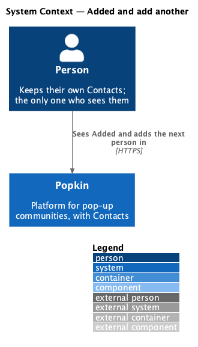
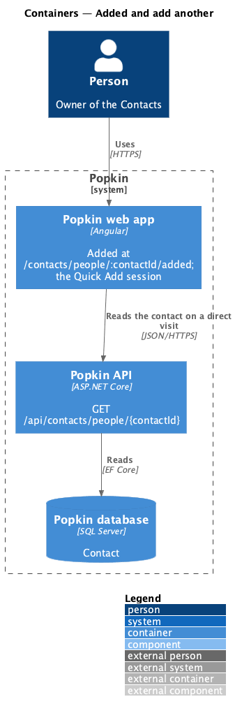
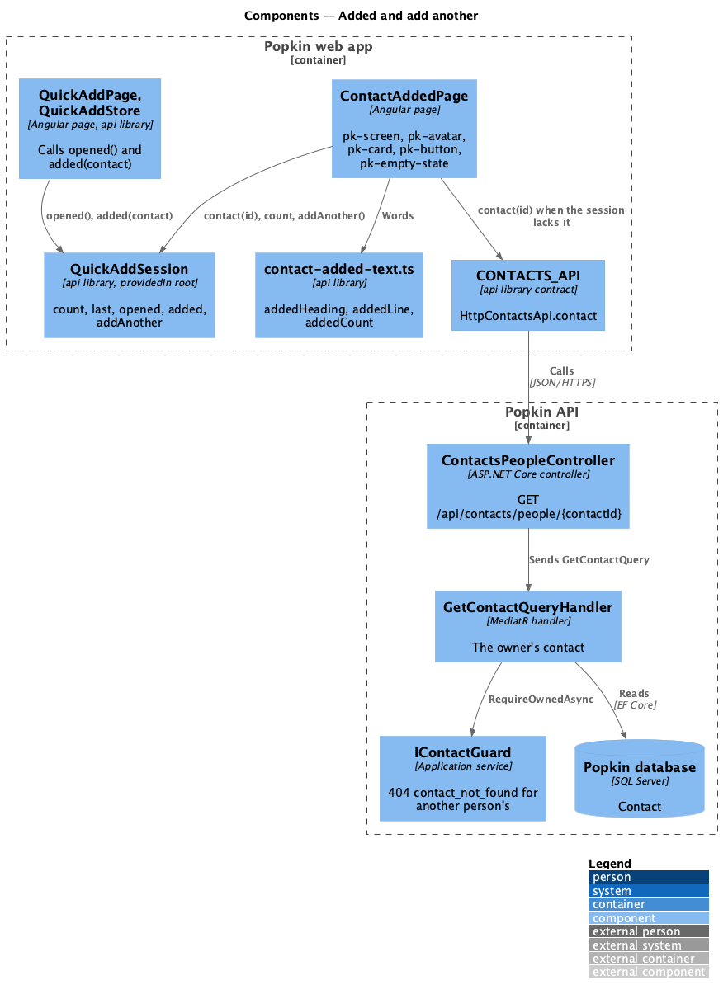
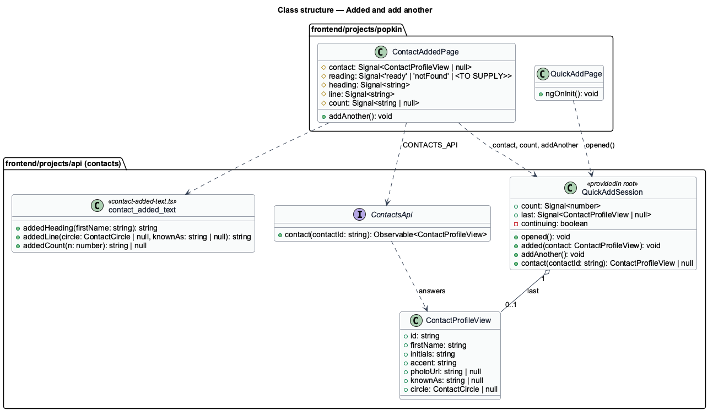
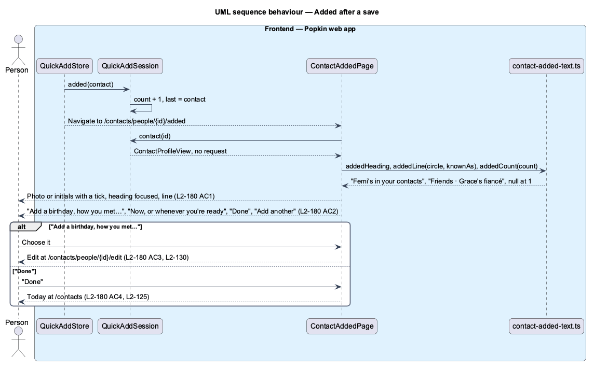
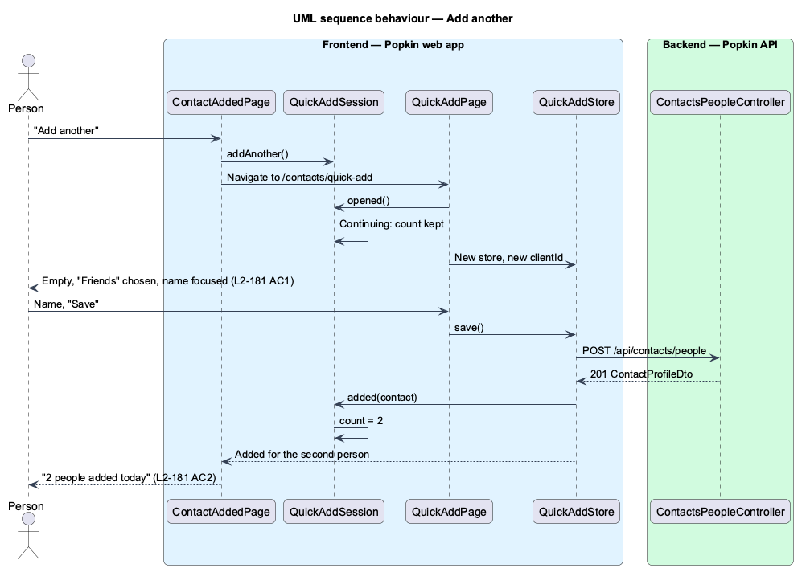
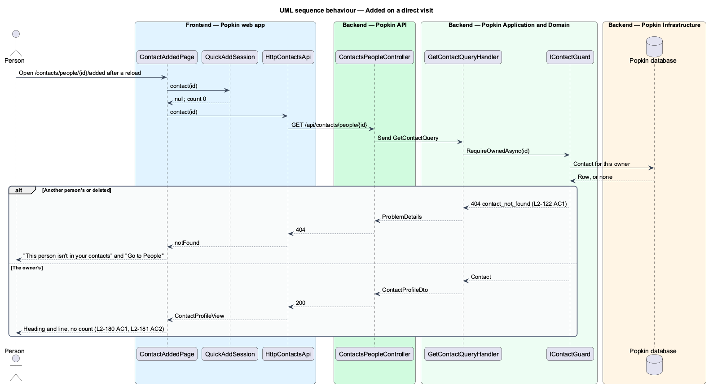

# Added and add another

## Overview

Popkin is a platform for pop-up communities. Contacts (L1-029) is a person's own address book in
the Popkin web app, and Quick Add (L1-043) adds someone to it with only a name
([Quick Add](../quick-add/README.md)). Added is the screen that follows a save: it says the
contact is kept, and offers three ways on, more about them, the next person, or done. People met
together are added one after another, so Added offers "Add another" and, from the second person,
counts the people added since Quick Add opened.

- **Added** — screen at `/contacts/people/:contactId/added` that confirms a contact saved by Quick Add
- **Quick Add session** — run of saves from the moment Quick Add opens until it is next opened by any way other than "Add another", held by the web app alone
- **count** — number of contacts saved in the current Quick Add session, the `{n}` of "{n} people added today"
- **line** — text under the heading of Added: the contact's circle and how the owner knows them ("Friends · Grace's fiancé"), or the circle alone

The count is the web app's, not the API's: the API keeps no Quick Add session, and the count says
nothing about the contacts added elsewhere. "Add a birthday, how you met…" opens Edit a contact
([Add or edit someone](../add-contact/README.md), L2-130), and "Done" opens Today
([Today](../today/README.md), L2-125).

## Description

### Screens and states

Popkin web app, `docs/mocks/pages/contact-added/`, route `/contacts/people/:contactId/added`:

- `default.html` — the contact's photo, or their initials on their accent colour, in the `2xl`
  avatar; the heading "{first name}'s in your contacts"; the line "Friends · Grace's fiancé"
  (L2-180 AC1); the link row "Add a birthday, how you met…" with "Now, or whenever you're
  ready"; "Done" (primary) and "Add another" (ghost) (L2-180 AC2). The first person of a session
  shows no count (L2-181 AC2).
- `another.html` — the same, with "3 people added today" under the line (L2-181 AC2).
- With no "Who are they?", the line is the circle alone ("Friends") (L2-180 AC1).
- The heading takes focus when Added opens, so a screen reader announces it.

### Conflicts between the mocks and L2-180

The mocks were drawn before L2-180 and L2-181. The design follows the requirements, and the mocks
change `<TO SUPPLY>`:

- **The tick.** L2-180 AC1 shows the photo or initials "with a tick"; the mocks draw no tick, and
  no component draws one on an avatar. Proposed: a `tick` input on `pk-avatar`, a library change
  with its parity spec `<TO SUPPLY>`.
- **The heading.** The mocks read "Femi's in your Contacts"; L2-180 AC1 reads "{first name}'s in
  your contacts".
- **"Done".** The mocks' notes and `docs/mocks/README.md` open People; L2-180 AC4 opens Today.

### Rulings

- **Where Added gets the contact.** Quick Add hands the saved `ContactProfileView` to
  `QuickAddSession`, and Added shows it with no request. On a reload or a direct visit, Added
  reads `GET /api/contacts/people/{contactId}` through `CONTACTS_API.contact`. A contact not the
  owner's answers `404` `contact_not_found` (L2-122 AC1), and Added shows the empty state of
  `NOT_FOUND_TEXT` ("This person isn't in your contacts") with "Go to People", as Edit does.
  Added has no loading or failed mock: while the read is under way it shows `<TO SUPPLY>`, and a
  failed read shows `<TO SUPPLY>`.
- **The count.** `QuickAddSession` lives in memory for the web app's lifetime
  (`providedIn: 'root'`). Quick Add calls `opened()` as it opens; that starts a new session at
  0 unless "Add another" opened it. Each save adds 1. Added shows the count from 2. A reload, a
  sign-out or a new visit to Quick Add from the shortcut, Today or a link starts again, so Added
  after a reload shows no count. Keeping the count across a reload (for example in
  `sessionStorage`) is not required `<TO SUPPLY>`.
- **The count's words.** "{n} people added today" is the spec's wording although the session may
  cross midnight; the count is the session's, not the day's.
- **"Add another"** calls `QuickAddSession.addAnother()` and navigates to `/contacts/quick-add`.
  Quick Add's store is provided by its page, so the form opens empty, with "Friends" chosen, a
  new client id and the name field focused (L2-181 AC1).
- **A contact added offline** reaches no Added and no count (the proposal of
  [Quick Add](../quick-add/README.md)).

### Backend

Nothing new. A direct visit reads `ContactsPeopleController.Get` (`GET
/api/contacts/people/{contactId}`), whose `GetContactQuery` answers the owner's contact as
`ContactProfileDto` or `404` `contact_not_found` through `IContactGuard`
([A contact's profile](../contact-profile/README.md)).

### Frontend (Popkin web app)

- **`ContactAddedPage`** (`app/pages/contact-added/contact-added.page.ts` and `.html`), route
  `contacts/people/:contactId/added`, `canActivate: [signedInGuard, contactsOpenGuard]`, data
  `{ shell: 'bare', page: 'contact-added' }`, title `<TO SUPPLY>`. It composes `pk-screen`
  (`middle`), `pk-avatar` (`size="2xl"`, the photo or initials, `data-accent`, the tick), an
  `h1` with `tabindex="-1"` focused on open, the line and the count as text (`text-muted`,
  `text-sm`), `pk-card` as a link with `pk-icon` to `/contacts/people/{id}/edit` (L2-180 AC3),
  `pk-button` "Done" (`variant="primary"`, `block`, `routerLink="/contacts"`, L2-180 AC4) and
  `pk-button` "Add another" (`variant="ghost"`, `block`), and `pk-empty-state` for a contact not
  found. The two-line link row of the mock (`card--row`) is not a variant of `pk-card` yet
  `<TO SUPPLY>`.
- **`QuickAddSession`** (`frontend/projects/api/src/lib/api/contacts/quick-add-session.ts`,
  `providedIn: 'root'`) — `count: Signal<number>`, `last: Signal<ContactProfileView | null>`,
  `opened()`, `added(contact)`, `addAnother()` and `contact(contactId)`, which answers `last`
  when its id matches. Unit tested (ADR 0011).
- **`contact-added-text.ts`** (`frontend/projects/api/src/lib/api/contacts/`) —
  `addedHeading(firstName)` "{first name}'s in your contacts", `addedLine(circle, knownAs)`
  "{circle} · {knownAs}" or the circle alone, and `addedCount(n)` "{n} people added today", or
  null below 2. Unit tested.

### Tests

- No API acceptance test: Added adds no endpoint, and the read is proven by the profile's tests.
- Unit tests, one case per row: `QuickAddSession` — a first save counts 1; a second after
  `addAnother()` counts 2; `opened()` without `addAnother()` starts at 0; `contact(id)` answers
  `last` only for its id. `contact-added-text.ts` — the line with and without "Who are they?";
  no count at 1, "2 people added today" at 2.
- Playwright, `e2e/tests/contact-added.spec.ts` through the `ContactAddedPage` and `QuickAddPage`
  page objects, on recorded responses: a save shows the heading and line with no count; "Add
  another" opens an empty Quick Add with "Friends" chosen and the name focused; a second save
  shows "2 people added today"; "Done" opens Today; "Add a birthday, how you met…" opens Edit
  for the contact; a direct visit reads the contact and shows no count. `routes.ts` keys
  `contact-added` default and another.
- Parity: `pk-avatar` with its tick, and the link row of `pk-card` once supplied.

## Requirements

| L2 ID | Refines (L1) | Requirement |
|-------|--------------|-------------|
| `L2-180` | `L1-043` | Added: Added says the contact is kept and offers more about them, the next person, or done. (AC1–AC4) |
| `L2-181` | `L1-043` | Add another: People met together are added one after another. (AC1–AC2) |

## Diagrams

### System context

The owner sees Added in Popkin after a Quick Add save; nobody else is told.

### Containers

Added needs no request after a Quick Add save; on a direct visit the web app reads the contact
from the API.

### Components

`ContactAddedPage` reads the contact and the count from `QuickAddSession`, falling back to
`CONTACTS_API.contact` and `ContactsPeopleController.Get`.

### Class structure

`QuickAddSession` keeps the count and the last saved contact; `contact-added-text.ts` turns them
into the heading, the line and the count.

### Behaviour — Added after a save

Added shows the saved contact, its line and, from the second person, the count; "Done" and "Add a
birthday, how you met…" leave it.

### Behaviour — add another

"Add another" opens an empty Quick Add within the same session, so the next save counts on.

### Behaviour — Added on a direct visit

A reload or a link reads the contact from the API and shows no count; another person's contact
is not found.

