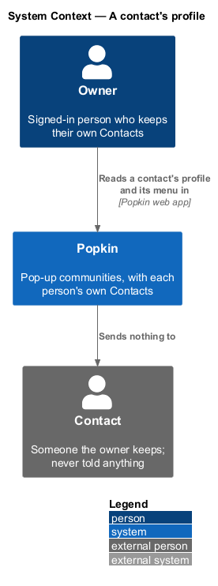
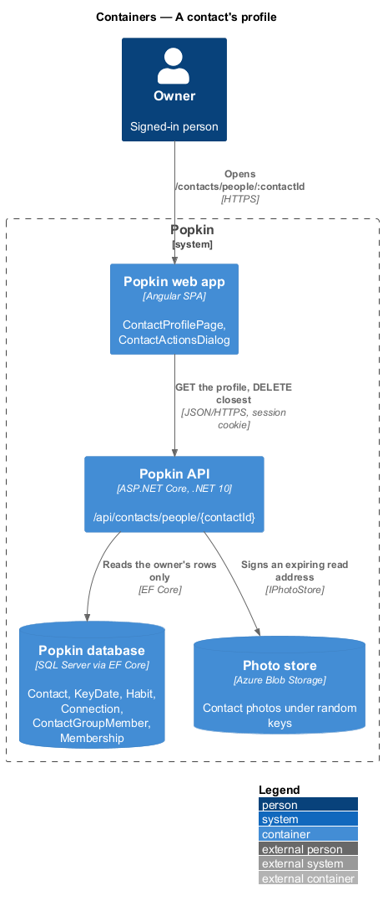
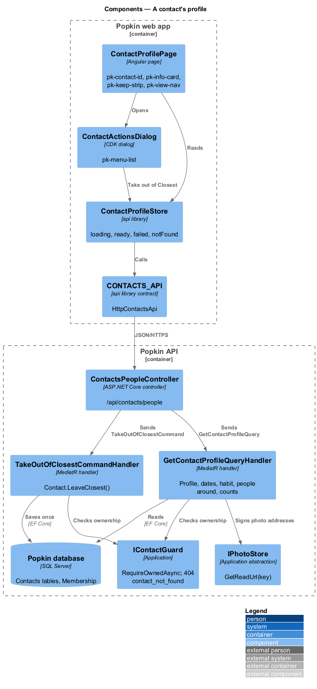
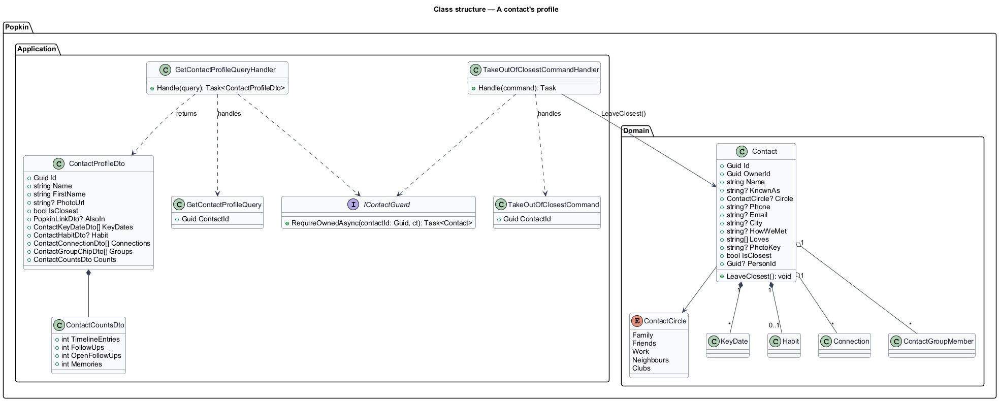
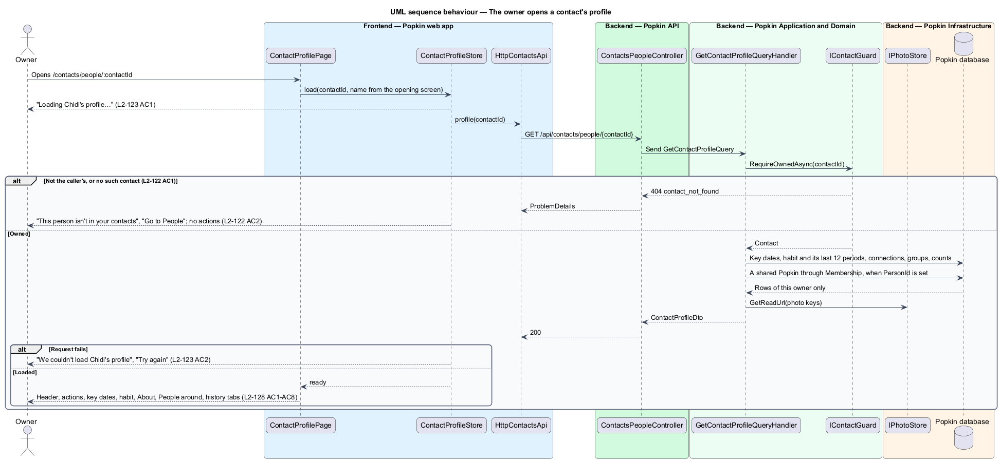
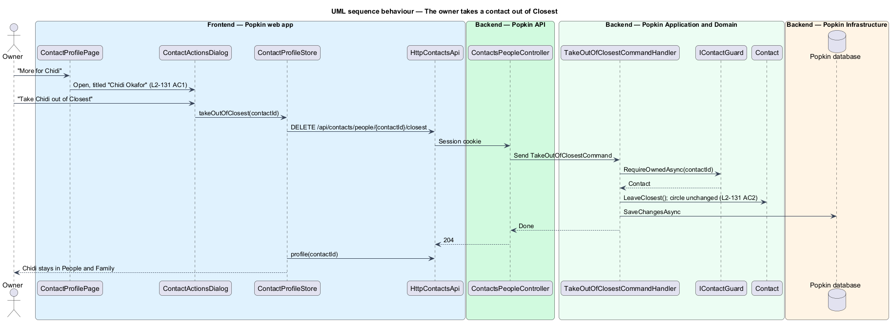

# A contact's profile

## Overview

Popkin is a platform for pop-up communities. Contacts (L1-029) is a person's own address book
inside the Popkin web app, and a profile is the one page that shows everything kept about one
contact (L1-031). The profile opens at `/contacts/people/:contactId` from People, Today, Dates, a
connection or a group. It shows who the contact is, their key dates, the habit kept with them,
what the owner knows about them, the people around them and their history. Its menu, "More for
{first name}", gathers what else can be done with them.

- **owner** — signed-in `Person` whose Contacts hold the contact; the only reader of the profile
- **contact** — `Contact` row of the owner's Contacts, with or without a Popkin account behind it
- **first name** — first word of the contact's name (`PersonName.FirstName`), the only way Contacts names a contact (L2-122 AC4)
- **Closest** — the owner's short list of the contacts that matter most, marked by `Contact.IsClosest`
- **near key date** — key date close enough that its line also shows the days left ("in 11 days")
- **Also in your Popkin** — Popkin in which the owner and the account a contact was imported from are both members

The history tabs of the profile ("Timeline", "Follow-ups {n}", "Memories & files") are drawn by
this design as a shell. Their contents belong to [Log a conversation or a milestone](../log-entry/README.md),
[Follow-ups](../follow-ups/README.md) and [Memories](../memories/README.md). Adding and editing
the contact belong to [Add or edit someone](../add-contact/README.md), and deleting to
[Delete a contact](../delete-contact/README.md).

## Description

### Screens and states

Popkin web app, `docs/mocks/pages/contact-profile/`:

- `default.html` — "People" back, the icon buttons "Edit profile" and "More for Chidi", then
  `pk-contact-id`: the photo, "Chidi Okafor", "Brother · Family · Manchester" and "Also in your
  Popkin “Lakeside Weekend”", with "Message", "Call" and "Log" (L2-128 AC1 to AC3). "Key dates"
  lists "Birthday" "Jan 24" with "Reminder: 1 week before", and "Anniversary"
  "Sat, Sep 26 · in 11 days" with "Reminder: 3 days before", then "Add a date" (L2-128 AC4). The
  habit card reads "Every 2 weeks", "Lunch with Chidi", the keep strip "Kept 9 of the last 12"
  and "Overdue since Sep 13" (L2-128 AC5). "About Chidi" lists Phone, Email, City, How you met and
  "Loves", one item per thing loved (L2-128 AC6). "People around Chidi" lists "Tomás Reyes"
  "Married" and the group chip "🏙️ Chidi & Tomás" (L2-128 AC7). The history tabs "Timeline",
  "Follow-ups 1" and "Memories & files" close the page (L2-128 AC8).
- `grace.html` — a habit kept on time: "Monthly", "Catch-up with Grace", "Kept 10 of the last
  12", "Next: Oct 11"; a near birthday "Sat, Sep 19 · in 4 days".
- `empty.html` — Femi, with an email and no phone, so "Email" replaces "Message" and "Call"
  (L2-128 AC3); no habit, so the add card "Make a habit of seeing Femi" (L2-128 AC5); no
  "Also in your Popkin"; the timeline's empty state "Nothing logged with Femi yet". It also draws
  the toast that follows Add someone (see [Add or edit someone](../add-contact/README.md)).
- `milestones.html`, `follow-ups.html`, `memories.html` — the history tabs; their contents belong
  to the three designs named in the Overview.
- `loading.html` — "Loading Chidi’s profile…" under the name (L2-123 AC1).
- `error.html` — "We couldn’t load Chidi’s profile", "Chidi’s timeline and notes are safe. Check
  your connection and try again.", "Try again" (L2-123 AC2, AC3).
- `not-found.html` — "This person isn’t in your contacts", "They may have been deleted, or the
  link came from someone else’s contacts. Only you can see yours.", "Go to People"; no "Edit
  profile" and no "More" (L2-122 AC2).

Dialog `docs/mocks/dialogs/contact-actions/default.html` — titled "Chidi Okafor", it offers "Take
Chidi out of Closest" with the hint "Chidi stays in People and Family.", "Edit profile", "See
Chidi’s connections" and "Delete Chidi" (L2-131 AC1). `not-closest.html` — for Femi, who is not in
Closest, the first item reads "Add Femi to Closest" with the hint "Femi shows first in People."
(L2-131 AC4).

On a phone the profile shows only its "People" back link, not the Contacts tabs (L2-121 AC6).

### Rulings (known gaps settled 2026-11-16)

- **Closest** (gap 100). The menu offers "Take {first name} out of Closest" to a contact in
  Closest and "Add {first name} to Closest" ("{first name} shows first in People.") to one who is
  not. Closest has no limit of its own. No message follows either; the menu closes and the
  profile reloads.
- **Days left** (gap 101). A key date shows the days left when its next day is 30 days away or
  fewer: "today", "tomorrow", "in {n} days".
- **The name before the profile loads** (gap 111). Opened from a screen that showed the name,
  the loading and failed copy name the contact ("Loading Chidi’s profile…"). Opened from a typed
  or saved address, they read "Loading the profile…", "We couldn’t load this profile" and "The
  timeline and notes are safe. Check your connection and try again.".
- **Also in your Popkin.** Only a contact imported from an account (`PersonId` set) can have one.
  A Popkin counts while both hold a `Membership` with no `LeftAt`, wrapped up or not. With more
  than one, the newest is named and "and {n} more" follows (L2-128 AC2).
- **A group chip** (gap 108) opens that group's detail, `/contacts/groups/{groupId}`.
- **History tab address.** The mocks draw the tabs as links. This design keeps the tab in the
  query (`?view=timeline|follow-ups|memories`) so a tab can be linked and the back button
  works; the three content designs follow it.
- **"Follow-ups {n}"** (gap 115) counts the open follow-ups and shows no number at none; the
  delete dialog counts every follow-up.
- **Built in steps.** The header, About, the menu and the states come first. `keyDates`,
  `habit`, `connections`, `groups`, `counts` and `alsoIn` join the DTO with Key dates, Habits,
  Connections, Groups, the history designs and Import; until each joins, the page leaves its
  section out, shows the habit's add card and the empty timeline.

### API

Every endpoint is on `ContactsPeopleController` (`Popkin.Api/Controllers/Contacts/`) under
`/api/contacts/people`, behind the default authenticated policy. Each sends one MediatR request.

- `GET /api/contacts/people/{contactId}` — `200` `ContactProfileDto`; `404` `contact_not_found`
  for a contact that is not the caller's or does not exist (L2-122 AC1). The fields:
  `id`, `name`, `firstName`, `initials`, `accent`, `photoUrl` (an expiring read address from
  `IPhotoStore.GetReadUrl`, or null), `knownAs`, `circle`, `city`, `phone`, `email`, `howWeMet`,
  `loves` (`string[]`), `isClosest`, `alsoIn` (`PopkinLinkDto?`: `popkinId`, `name`, `emoji`,
  `colour`), `alsoInMore` (the number of other shared Popkins), `keyDates` (`ContactKeyDateDto[]`: `id`, `kind`, `title`, `day`, `month`, `year?`,
  `everyYear`, `reminder`, `nextOn`, `daysLeft`; read with `?on=`, the device's day), `habit` (`ContactHabitDto?`: `id`, `rhythm`, `name`,
  `kept` (12 booleans, oldest first), `overdueSince?`, `nextOn?`), `connections`
  (`ContactConnectionDto[]`: `connectionId`, `contactId`, `name`, `initials`, `photoUrl`,
  `words`), `groups` (`ContactGroupChipDto[]`: `groupId`, `name`, `emoji`) and `counts`
  (`timelineEntries`, `followUps`, `openFollowUps`, `memories`). The same DTO fills the edit form.
- `PUT /api/contacts/people/{contactId}/closest` — `204`; puts the contact in Closest (L2-131
  AC4); one already in it changes nothing.
- `DELETE /api/contacts/people/{contactId}/closest` — `204`; `404` `contact_not_found`. Taking
  out a contact not in Closest is a `204` that changes nothing (L2-131 AC2).

### Backend

- **`Contact`** (Domain) — the entity of the shared Contacts section. This design uses
  `IsClosest`, `JoinClosest()`, and `LeaveClosest()`, which clears it and leaves the circle as it
  is.
- **`GetContactProfileQuery`** / **`GetContactProfileQueryHandler`**
  (`Popkin.Application/Contacts/Profile/`) — calls `IContactGuard.RequireOwnedAsync(contactId)`,
  then reads the contact's `KeyDate`, `Habit` with its last 12 `HabitKept` periods, `Connection`
  rows with the other contact, `ContactGroupMember` rows with their `ContactGroup`, and the three
  counts, all filtered by `OwnerId = ICurrentPerson.PersonId`. A key date's `nextOn`
  comes from `KeyDate.NextOccurrence` and its `reminder` from `KeyDate.Lead`. They and the
  habit's `overdueSince` or `nextOn` are computed from `TimeProvider` in the owner's time zone,
  which is known gap 104; the habit's counting rules are known gap 105.
- **`alsoIn`** — when `Contact.PersonId` is set, the handler finds a `PopkinSpace` in which both
  `ICurrentPerson.PersonId` and that person hold a `Membership` with no `LeftAt`. It reads only
  the Popkin's name, emoji and colour, and tells the other person nothing.
- **`TakeOutOfClosestCommand`** and **`AddToClosestCommand`** with their handlers
  (`Popkin.Application/Contacts/Profile/`) — the guard, `Contact.LeaveClosest()` or
  `JoinClosest()`, and one save.
- No hub event is sent; telemetry records the route template only, never a name, phone or note.

### Frontend (Popkin web app)

- **`ContactProfilePage`** (`app/pages/contact-profile/contact-profile.page.ts` and `.html`),
  route `/contacts/people/:contactId`, data `{ shell: 'app', page: 'contact-profile', phoneTabs:
  false }`. It composes `pk-contacts-page`, `pk-contact-id` (header, actions and the facts of
  "About {first name}"), `pk-info-card` (the habit, or its add card), `pk-keep-strip`,
  `pk-list-row` for key dates and connections, `pk-chip` for groups, `pk-view-nav` for the
  history tabs, `pk-skeleton`, and `pk-empty-state` for the error and not-found states. "Message"
  is an `sms:` link, "Call" a `tel:` link and "Email" a `mailto:` link; "Log" goes to
  `/contacts/people/:contactId/log`; "Add a date" opens Add a date (L2-138); the add card opens
  New habit (L2-145); "Also in your Popkin" goes to `/p/:popkinId`.
- **`ContactActionsDialog`** (`app/dialogs/contact-actions/`) — `pk-dialog` headed with the full
  name and a `pk-menu-list` of `pk-menu-item`s; the Closest item carries the hint "{first name}
  stays in People and {circle}." and "Delete {first name}" is `danger`. "Edit profile" goes to
  `/contacts/people/:contactId/edit`, "See {first name}'s connections" to Connections with the
  contact chosen (L2-149), and "Delete {first name}" opens `DeleteContactDialog`.
- **`ContactProfileStore`** (`frontend/projects/api/src/lib/api/contacts/`) — `loading | ready |
  failed | notFound`, keeps the name passed from the opening screen for the loading and failed
  copy, reloads after its own writes and on "Try again". Unit tested (ADR 0011).
- **`contact-profile-text.ts`** (api library) — the subtitle "{knownAs} · {circle} · {city}"
  without empty parts, a key date's day ("Jan 24", "Sat, Sep 26 · in 11 days"), "Kept {n} of
  the last 12", "Overdue since {day}", "Next: {day}", and the state copy of L2-123. Unit tested.
- **`CONTACTS_API`** — `contact(contactId)`, `addToClosest(contactId)`, `takeOutOfClosest(contactId)`.

### Tests

- API acceptance tests (InMemory, ADR 0005), `Popkin.Api.Tests/Contacts/ContactProfileTests.cs`:
  the owner reads the profile with its dates, habit, connections, groups and counts; another
  person's contact answers `404` `contact_not_found`, as an unknown id does; "Also in your
  Popkin" names a Popkin both share and not one the other person has left; adding a contact to
  Closest and taking them out keeps their circle.
- Direct tests of `contact-profile-text.ts` and `ContactProfileStore`, one case per row: the
  subtitle with each part missing, the phone, email-only and neither action sets, overdue and
  next habit lines.
- Playwright, `e2e/tests/contact-profile.spec.ts` through `ContactProfilePage` and
  `ContactActionsDialog` page objects: the default, grace and empty profiles, loading, a failed
  load with "Try again", not found, the menu, taking Chidi out of Closest and adding Femi to it. Responses are
  recorded from `GET /api/contacts/people/{contactId}` after `popkin seed` adds Mara's Contacts
  cast, idempotently; `routes.ts` gains each state.
- Parity for `pk-contact-id`, `pk-info-card`, `pk-keep-strip` and `pk-contacts-page`.

## Requirements

| L2 ID | Refines (L1) | Requirement |
|-------|--------------|-------------|
| `L2-128` | `L1-031` | A contact's profile: A profile shows one contact: who they are, key dates, habit, details, the people around them and their history. (AC1–AC8) |
| `L2-131` | `L1-031` | More for a contact: A profile's menu offers Closest, Edit profile, the contact's connections and Delete. (AC1–AC3) |

## Diagrams

### System context

The owner reads a contact's profile in Popkin; nobody else, and not the contact, is involved.

### Containers

The web app reads the profile from the API, which reads the Contacts tables and signs the photo's
address from the photo store.

### Components

`ContactProfilePage` reads through `ContactProfileStore`; `ContactsPeopleController` sends one
query or command, and the handler checks ownership through `IContactGuard` first.

### Class structure

`ContactProfileDto` gathers the contact with its key dates, habit, connections, groups and
counts; `Contact` owns `IsClosest`.

### Behaviour — the owner opens a profile

The handler refuses another person's contact with `404` `contact_not_found`, which shows the
not-found state; otherwise the page draws every section.

### Behaviour — the owner takes a contact out of Closest

The menu sends the change; the contact stays in People and in their circle.

