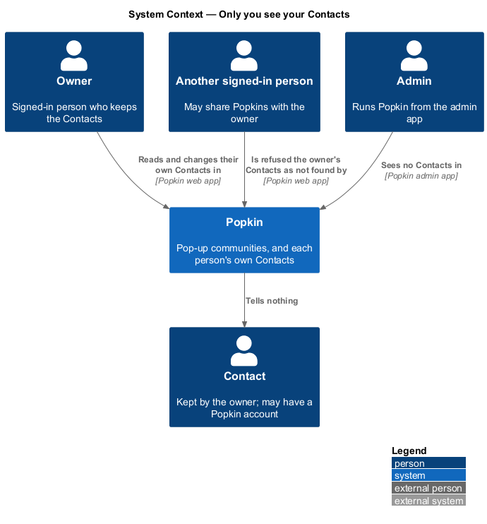
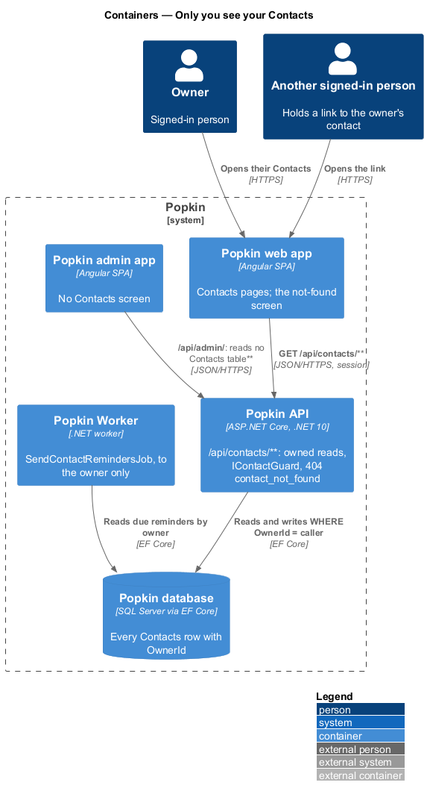
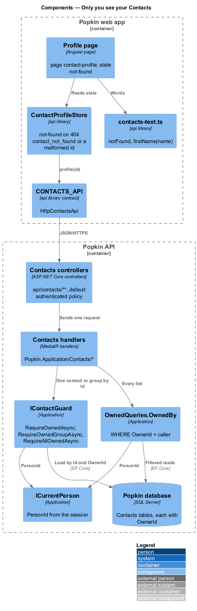
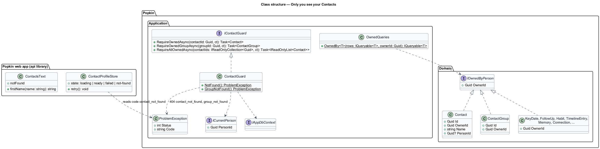
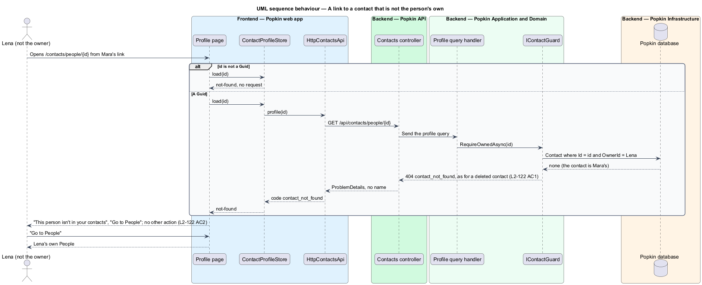
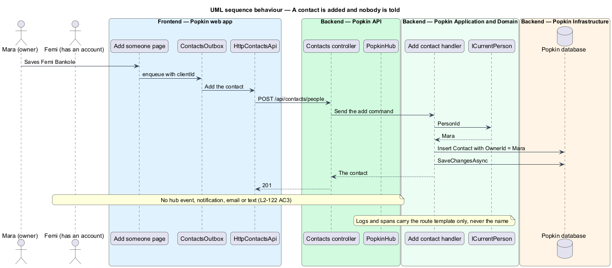

# Only you see your Contacts

## Overview

Popkin is a platform for pop-up communities. Contacts is a signed-in person's own address book
(L1-029). Everything in it belongs to the person who added it: no other person, no member of a
shared Popkin and no admin sees or changes it, and nobody is told they were added, imported,
connected or deleted. This design fixes how the API enforces that, what a person sees on opening
a link to a contact that is not theirs, and the one rule for how Contacts speaks of a contact.

- **owner** — signed-in `Person` whose `Id` a Contacts row carries as `OwnerId`
- **Contacts row** — row of any Contacts table: `Contact`, `KeyDate`, `ReminderPreferences`, `TimelineEntry`, `Memory`, `FollowUp`, `Habit`, `HabitKept`, `ContactGroup`, `ContactGroupMember` or `Connection`
- **owned read** — query that filters a Contacts table by `OwnerId` equal to the caller before anything else
- **contact guard** — `IContactGuard`, the service that loads one contact or group for its owner or refuses it as not found
- **first name** — first word of a contact's name, the only way Contacts names a contact in the text it writes

The rule follows the one the API already keeps for Popkins: a person who is not a member gets
`404` `popkin_not_found` from `IMembershipGuard`, so a Popkin's existence is never disclosed
(L2-051). `IContactGuard` does the same for Contacts with `404` `contact_not_found` and `404`
`group_not_found` ([Contacts](../../README.md#contacts)).

## Description

### Screens and states

`docs/mocks/pages/contact-profile/not-found.html`:

- The page has no page head and no actions; it shows the back link "People" (to
  `/contacts/people`) and `pk-empty-state` as an alert at level 1: "This person isn't in your
  contacts", "They may have been deleted, or the link came from someone else's contacts. Only you
  can see yours." and "Go to People" (L2-122 AC2).
- The Contacts navigation shows as on any profile: from medium screens only, with "13 people ·
  only you" and People current ([Open Contacts](../open-contacts/README.md), L2-121 AC6).
- The screen offers no edit, no "More" and no other action, so nothing about the contact asked
  for is disclosed (L2-122 AC2).

The same state shows for `/contacts/people/{id}`, `/contacts/people/{id}/edit` and
`/contacts/people/{id}/log` whenever the API answers `404` `contact_not_found`, and for an `id`
that is not a `Guid`, without asking the API. Only the profile's state is drawn; the edit and log
addresses reuse it.

Nothing else on screen belongs to this design: every list the owner sees holds only their own
rows, so another person's contacts never appear to be refused.

### Conflicts and gaps

- **Pronouns in the mocks.** Today's "Last time: she asked you to do a reading at her wedding."
  (`contacts-today/default.html`) is a pronoun in a line Contacts shows (L2-122 AC4). When the
  line quotes what the owner typed, the words are the owner's and are shown as typed; what "Last
  time:" quotes is open (known gap 99). Text Contacts composes itself ("Message Grace", "Grace is
  into", "Grace's birthday", "Loading Chidi's profile…") uses the first name only.
- **First name.** Add someone has one "Name" field (`add-contact/default.html`); the first name is
  its first word ("Grace Adeyemi" is Grace). Whether a contact can carry a separate first name or
  a nickname is open with the contact's fields (known gap 102).
- **Deleting a contact** removes it from the owner's Contacts only, through `ContactRemoval`
  (shared section); which of its rows that removes is open (known gap 110).
- **An imported contact** keeps the `PersonId` of the account it came from. That person is not
  told, and a later change to their account does not reach the contact `<TO SUPPLY>` (known gap
  110 covers what Import brings over).

### API

Every Contacts endpoint is under `/api/contacts/**`, on a controller in
`Popkin.Api/Controllers/Contacts/`, behind the default authenticated policy; none is
`[AllowAnonymous]`.

- A request for one contact by id — `GET /api/contacts/people/{id}` and every route under it —
  answers `404` `contact_not_found` when the contact does not exist, was deleted, or has another
  owner. The three are indistinguishable: the same status, code and title "This person isn't in
  your contacts.", and no other field (L2-122 AC1).
- A request for one group by id answers `404` `group_not_found` under the same rule.
- A write naming another owner's contact anywhere in its body (a follow-up's contact, a group's
  members, a connection's two contacts) answers `404` `contact_not_found` and changes nothing.
- A list endpoint returns only the caller's rows; it never refuses, it leaves the rest out.
- No `/api/admin/**` endpoint reads a Contacts table, and no Popkin endpoint returns a Contacts
  row (L2-122 AC1).

### Backend

- **`IOwnedByPerson`** (Domain) — `Guid OwnerId`. Every Contacts entity implements it; `OwnerId`
  is set once, from `ICurrentPerson.PersonId`, when the row is made, and has no setter after.
- **`OwnedQueries.OwnedBy<T>(this IQueryable<T> rows, Guid ownerId)`** (Application) — the owned
  read, `rows.Where(r => r.OwnerId == ownerId)`. Every Contacts handler starts its reads with it.
- **`IContactGuard`** / **`ContactGuard`** (`Popkin.Application/Contacts/Security/`) —
  `RequireOwnedAsync(Guid contactId, CancellationToken)` returns the `Contact` whose `Id` and
  `OwnerId` match, or throws `ContactGuard.NotFound()` (`404` `contact_not_found`).
  `RequireOwnedGroupAsync(Guid groupId, CancellationToken)` does the same for `ContactGroup` with
  `ContactGuard.GroupNotFound()` (`404` `group_not_found`).
  `RequireAllOwnedAsync(IReadOnlyCollection<Guid> contactIds, CancellationToken)` checks a write's
  contacts in one read and refuses the whole write if one is not owned. It depends on
  `IAppDbContext` and `ICurrentPerson` only, like `MembershipGuard`.
- **Nobody is told (L2-122 AC3).** A Contacts handler sends no hub event (it has no
  `IPopkinClient`), creates no notification for another person, sends no email or text to a
  contact, and changes no `Membership`. The Worker's `SendContactRemindersJob` writes only to the
  owner.
- **Admins.** The admin handlers read `Person`, `PopkinSpace` and their own tables; none reads a
  Contacts table. Deleting an account deletes its Contacts rows through the same `ContactRemoval` (L2-049). What erasing an account
  does to the contacts other owners imported from it is `<TO SUPPLY>`.
- **Telemetry (ADR 0012).** A Contacts route is recorded as its template
  (`/api/contacts/people/{id}`). No log, metric dimension or span carries a contact's name, phone,
  email, city, note or any text the owner typed. The ProblemDetails of `contact_not_found` holds
  no name.

### Frontend (Popkin web app)

- **`ContactProfileStore`** (`api/src/lib/api/contacts/contact-profile-store.ts`, built by the
  profile's design) — gains the state `not-found`, set on `404` with code `contact_not_found`
  (read through `toApiProblem`) or on an `id` that is not a `Guid`. Unit tested.
- **The profile page** (built by the profile's design, a `.page.ts` and `.page.html` under
  `pages/`, route data `shell: 'app'`, `page: 'contact-profile'`) — in `not-found` it composes `pk-contacts-page`,
  the "People" back link and `pk-empty-state` (`icon`, `level` 1, alert) with `a pk-button
  variant="primary" size="md" routerLink="/contacts/people"` "Go to People". The edit and log
  pages compose the same block from `contacts-text.ts` in the same state.
- **`contacts-text.ts`** — `notFound` ("This person isn't in your contacts", the line above),
  and `firstName(name)`, the first word of a name. Every line that names a contact is built from
  `firstName`; none takes a pronoun. Unit tested.

### Tests

- API acceptance tests (InMemory, ADR 0005), one or two representative paths: Lena asking for
  Mara's contact by id gets `404` `contact_not_found` with the same body as a deleted one; Lena's
  `GET /api/contacts/people` lists none of Mara's contacts; a follow-up Lena adds naming Mara's
  contact is refused and nothing is saved.
- Nobody is told: importing and deleting a contact who has an account sends that account's hub
  connection (a real SignalR client on `ApiFactory`) nothing, and `ApiFactory`'s fake senders
  record no message.
- Direct test of `ContactGuard`, one case per row: own contact; another owner's; deleted;
  unknown id; own group; another owner's group; `RequireAllOwnedAsync` with one foreign id.
- Unit tests: `ContactProfileStore` maps `contact_not_found` and a malformed id to `not-found`;
  `firstName`.
- Playwright: `tests/contacts-privacy.spec.ts` through `ContactProfilePage`
  (`pages/contact-profile.page.ts`): a link to a contact not in Contacts shows the not-found
  screen with "Go to People" and no other action; "Go to People" opens People. The answer `404`
  `contact_not_found` is stubbed in `stubs.ts`; `routes.ts` gains `contactProfileNotFound`.

## Requirements

| L2 ID | Refines (L1) | Requirement |
|-------|--------------|-------------|
| `L2-122` | `L1-029` | Only you see your Contacts: Everything in Contacts belongs to the person who added it. (AC1–AC4) |

## Diagrams

### System context

The owner reads and changes their own Contacts; another signed-in person, a contact and an admin
reach none of it.

### Containers

The API filters every Contacts read by owner and refuses any other person's row as not found;
nothing leaves the API toward anyone but the owner.

### Components

Each Contacts handler reads through `OwnedBy` and loads one row through `IContactGuard`; the
profile store turns `contact_not_found` into the not-found screen.

### Class structure

Every Contacts entity carries `OwnerId` through `IOwnedByPerson`; `ContactGuard` is the one place
that turns another owner's row into `404`.

### Behaviour — a link to someone else's contact

A person opens a contact link that came from another person's Contacts; the API answers as for a
contact that does not exist, and the page offers only "Go to People".

### Behaviour — a contact is added and told nothing

The owner adds a contact who has a Popkin account; the save touches only the owner's rows and
sends nothing to anyone.

