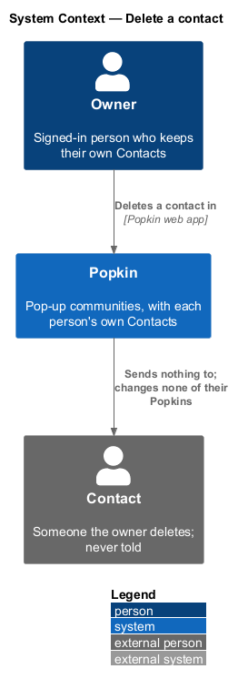
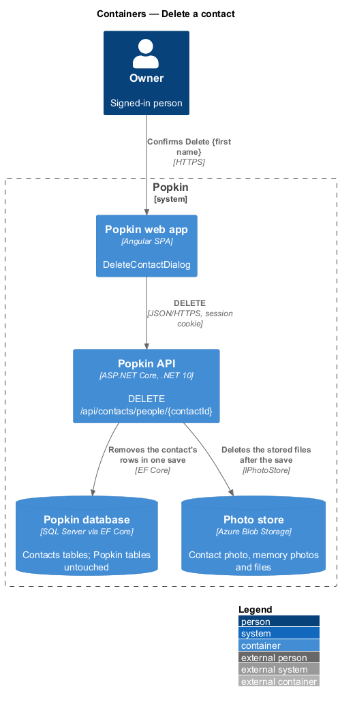
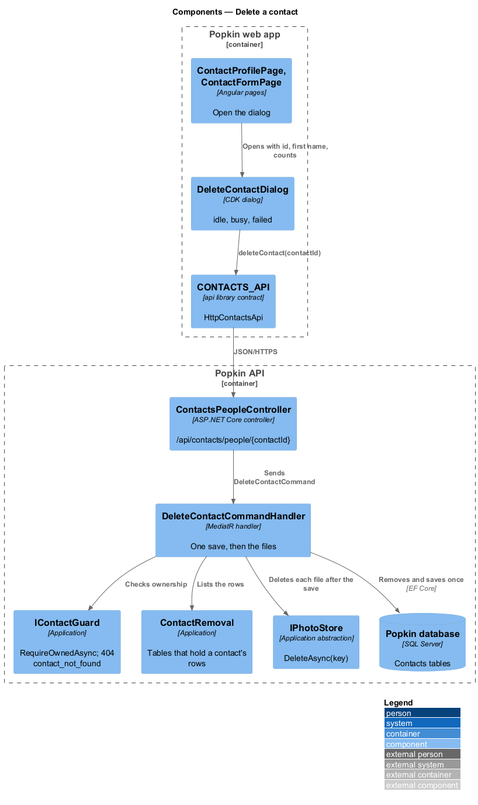
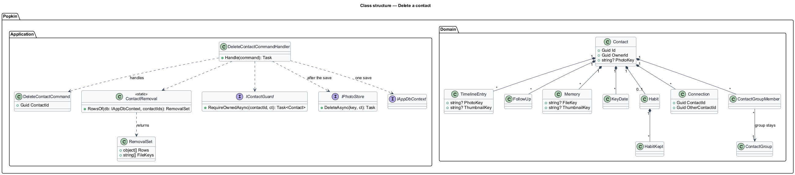
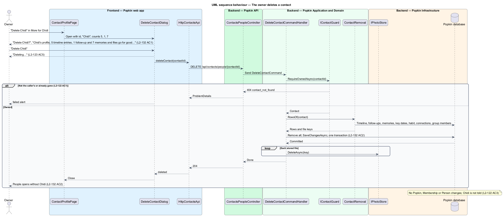
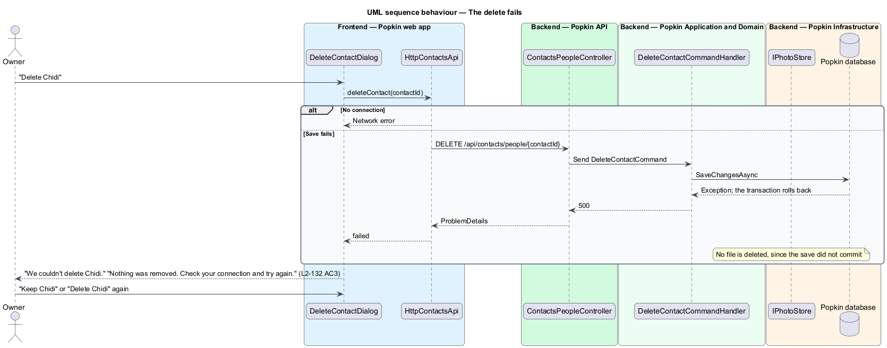

# Delete a contact

## Overview

Popkin is a platform for pop-up communities. In Contacts (L1-029) only the owner sees a contact,
and the owner may delete one (L1-031). Deleting removes what was kept about that contact and
nothing else: every Popkin stays as it was, and the contact is not told (L2-132, L2-122 AC3).
The dialog opens from "Delete {first name}" in the profile's menu
([A contact's profile](../contact-profile/README.md)) and at the end of the edit form
([Add or edit someone](../add-contact/README.md)).

- **owner** — signed-in `Person` whose Contacts hold the contact
- **what was kept** — contact's profile, timeline entries, follow-ups, memories and files, the rows L2-132 names
- **rows that name the contact** — key dates, habit with its kept periods, connections from or to the contact, and group memberships, which cannot stand without it
- **stored file** — photo or file in `IPhotoStore` under a random key: the contact's photo and each memory's photo or file

## Description

### Screens and states

Popkin web app, `docs/mocks/dialogs/delete-contact/`, over the profile:

- `default.html` — "Delete Chidi?", "Chidi’s profile, 5 timeline entries, 1 follow-up and 7
  memories and files go for good. Your Popkins don’t change, and Chidi isn’t told.", the danger
  button "Delete Chidi" and "Keep Chidi" (L2-132 AC1). "Close" and Escape keep the contact, as
  "Keep Chidi" does.
- `busy.html` — "Deleting…", disabled; "Keep Chidi" stays (L2-123 AC5).
- `failed.html` — the alert "We couldn’t delete Chidi." with "Nothing was removed. Check your
  connection and try again.", and "Delete Chidi" offered again (L2-132 AC3).
- Success closes the dialog and opens People (`/contacts/people`), without Chidi (L2-132 AC2).

### Conflicts and gaps

- **What else goes.** What deleting a contact does to their key dates, habit, connections and
  groups is known gap 110. The dialog names only what L2-132 names. A row that names the
  contact cannot outlive it, so until gap 110 is settled the handler also deletes the rows that
  name the contact; each group, and every other contact, stays. When gap 110 is settled the
  dialog's sentence may need those rows too.
- **Counts of zero and one.** The mock shows "5 timeline entries", "1 follow-up" and "7 memories
  and files". The plural forms come from the counts ("1 timeline entry", "2 follow-ups"); a count of zero is left out of the sentence, so with nothing logged it reads "Femi’s profile
  goes for good. Your Popkins don’t change, and Femi isn’t told." (ruled 2026-11-16).
- **No message after a delete.** L2-132 asks for none and no mock draws one, so People opens
  with no toast.
- **Offline.** The shared Contacts rules queue an offline write in `ContactsOutbox`. A delete is
  not queued: L2-132 AC3 draws the failure, so the dialog sends at once and shows `failed`
  without a connection.
- **A file that cannot be deleted.** Files are deleted after the database save; a file the store
  fails to delete is left behind, as for an account's photo
  ([Manage the account](../../accounts/manage-account/README.md)). No sweep removes such files (ruled
  2026-11-16): the failure is logged with the count of files left, as for an account's photo.

### API

- `DELETE /api/contacts/people/{contactId}` on `ContactsPeopleController`, behind the default
  authenticated policy; it sends one `DeleteContactCommand`. `204` when deleted; `404`
  `contact_not_found` for a contact that is not the caller's or is already gone (L2-122 AC1).
- The counts of the dialog come from `ContactProfileDto.counts` (`timelineEntries`,
  `followUps`, `memories`) that the profile already holds; the dialog makes no request to open.

### Backend

- **`DeleteContactCommand`** / **`DeleteContactCommandHandler`**
  (`Popkin.Application/Contacts/People/`) — calls `IContactGuard.RequireOwnedAsync(contactId)`,
  then, through `IAppDbContext`, collects the stored-file keys: the contact's `PhotoKey`, each
  `Memory`'s `FileKey` and `ThumbnailKey`, and each milestone `TimelineEntry`'s `PhotoKey` and
  `ThumbnailKey`. It removes the `Contact`, its `TimelineEntry`, `FollowUp` and `Memory` rows
  (L2-132 AC2), and the rows that name it: `KeyDate`, `Habit` and `HabitKept`, every
  `Connection` whose `ContactId` or `OtherContactId` is the contact, and every
  `ContactGroupMember` of the contact. It saves once, so either all go or none does (L2-132 AC3).
- After the save, it calls `IPhotoStore.DeleteAsync` for each collected key. A failure there is
  logged with the count of files left, never a key, a name or a note, and the delete still
  answers `204`.
- **What does not change** — no `PopkinSpace`, `Membership`, `Person`, message or photo of any
  Popkin is read for writing or changed; when the contact was imported, the account it came
  from is untouched (L2-132 AC2). Nothing is sent over the hub or to the contact (L2-122 AC3).
- **`ContactRemoval`** (Application) — the list of Contacts tables that hold a contact's rows,
  used by this handler and by the erasure of a deleted account (`PurgeDeletedAccountsCommand`,
  L2-049 AC4), so that both remove the same rows and files. Each later feature adds its rows.

### Frontend (Popkin web app)

- **`DeleteContactDialog`** (`app/dialogs/delete-contact/delete-contact.dialog.ts` and `.html`) —
  CDK Dialog with `pk-dialog` (heading "Delete {first name}?", the sentence as its description),
  `pk-alert` in the failed state, the danger `pk-button` "Delete {first name}" / "Deleting…" and
  the secondary "Keep {first name}", which takes the initial focus. Its data is the contact's
  id, first name and counts. State `idle | busy | failed`; a failure enables the button again.
- On success, it closes with `deleted`; the opener navigates to `/contacts/people`, and
  `ContactProfileStore` and the People store drop the contact.
- **`delete-contact-text.ts`** (api library) — the sentence with its plural forms and the failed
  copy. Unit tested (ADR 0011).
- **`CONTACTS_API`** — `deleteContact(contactId)`.

### Tests

- API acceptance tests (InMemory, ADR 0005), `Popkin.Api.Tests/Contacts/DeleteContactTests.cs`:
  deleting Chidi removes the contact, the timeline entries, follow-ups, memories, key dates,
  habit, both ends of each connection and the group memberships, keeps the groups, the other
  contacts and every Popkin, membership and person, and deletes each stored file through a fake
  `IPhotoStore`; another person's contact answers `404` `contact_not_found` and nothing is
  removed; a fault injected through `IAppDbContext` on save leaves every row and every file in
  place.
- A direct test of `delete-contact-text.ts`, one case per count of 0, 1 and more.
- Playwright, `e2e/tests/delete-contact.spec.ts` through the `DeleteContactDialog` and
  `ContactProfilePage` page objects: the sentence as drawn, "Keep Chidi" keeps the profile,
  "Delete Chidi" opens People, a failed delete shows the alert (stubbed in `stubs.ts`), and
  "Delete Chidi" from the edit form opens the same dialog. The `DELETE` answer is recorded;
  `routes.ts` gains the three states.
- No new component; `pk-dialog`, `pk-alert` and `pk-button` have their parity specs.

## Requirements

| L2 ID | Refines (L1) | Requirement |
|-------|--------------|-------------|
| `L2-132` | `L1-031` | Delete a contact: Deleting a contact removes what was kept about them and nothing else; Popkins do not change and the contact is not told. (AC1–AC3) |

## Diagrams

### System context

The owner deletes a contact in Popkin; the contact and every Popkin are untouched.

### Containers

The API removes the contact's rows in one transaction, then deletes its stored files.

### Components

`DeleteContactDialog` calls `CONTACTS_API`; `DeleteContactCommandHandler` checks ownership,
removes the rows listed by `ContactRemoval` and then the files.

### Class structure

The contact owns the rows that go with it; `ContactRemoval` names them for this handler and for
account deletion.

### Behaviour — the owner deletes a contact

The rows go in one save; the files go after it; People opens.

### Behaviour — the delete fails

A failed save removes nothing, and the dialog stays open with its alert.

