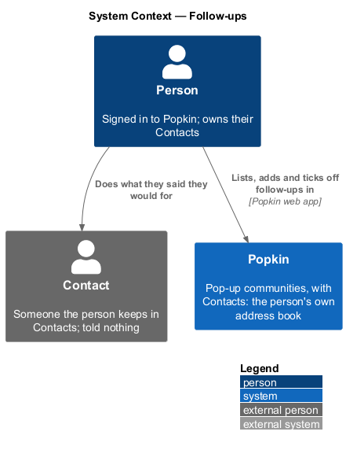
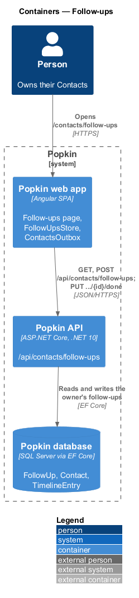
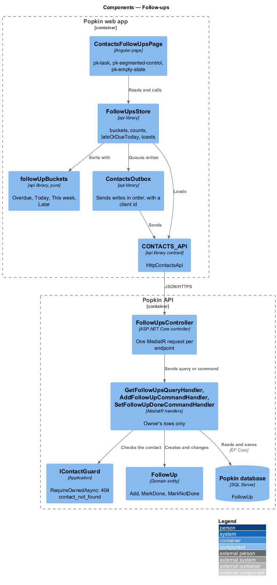
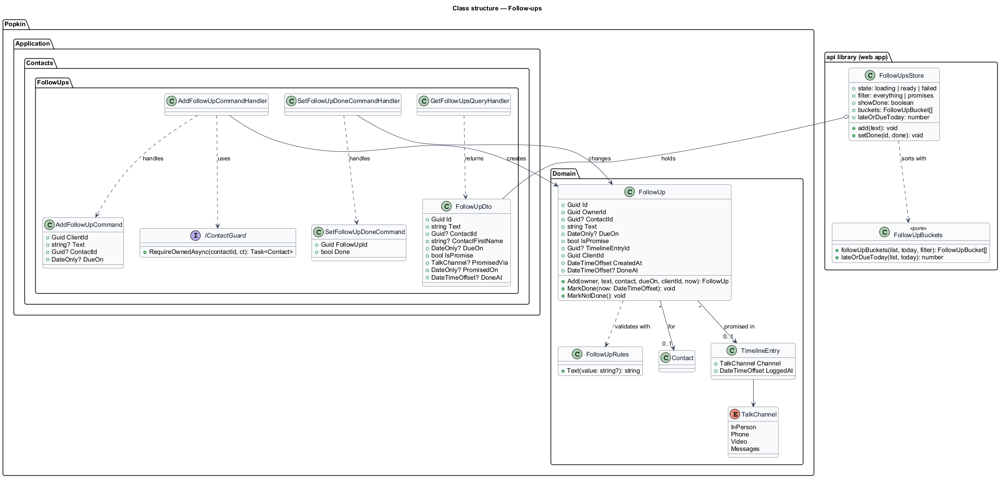
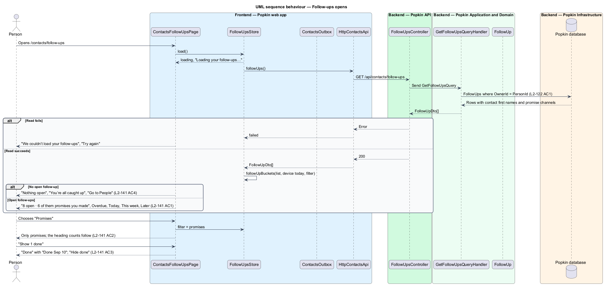
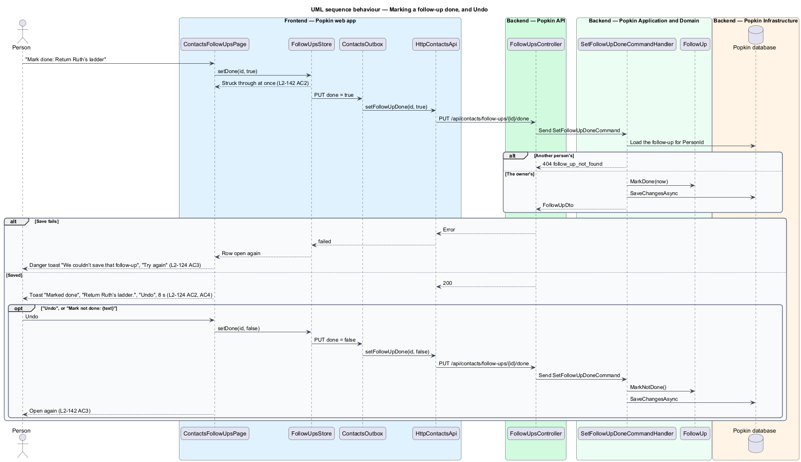
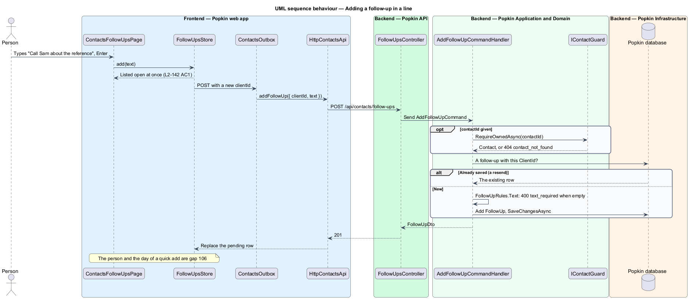

# Follow-ups

## Overview

Popkin is a platform for pop-up communities. Contacts is a person's own address book inside the
Popkin web app, seen by nobody else (L1-029). Follow-ups is the Contacts page that keeps what the
person said they would do for their contacts, shows what is late, and lets them tick each thing
off (L1-034). It sits at `/contacts/follow-ups`, one of the five phone tabs of Contacts, and its
count of late and due-today follow-ups is the badge on the Follow-ups tab (L2-121 AC5).

- **follow-up** — thing the person means to do for a contact, with its text and the day it is due
- **promise** — follow-up the person said aloud to the contact, noted while logging a conversation
- **due bucket** — one of "Overdue", "Today", "This week" and "Later", decided by the due day
- **open follow-up** — follow-up not yet marked done
- **done follow-up** — follow-up marked done, kept with the day it was done
- **quick add** — the one-line field "Add a follow-up" at the top of the page

A follow-up is the `FollowUp` entity of the shared Contacts architecture
([Contacts](../../README.md#contacts)): text, due day, `IsPromise`, the timeline entry it came
from and `DoneAt`. Most follow-ups are made while logging a conversation
([Log a conversation or milestone](../log-entry/README.md), L2-135); this page lists them all,
adds one in a line and marks them done. A contact's profile lists that contact's follow-ups in
its own tab, `/contacts/people/:id?view=follow-ups` ([A contact's profile](../contact-profile/README.md));
that tab uses the same task component, endpoints and rules, with the contact's id as `contactId`.

## Description

### Screens and states

Popkin web app, `docs/mocks/pages/contacts-follow-ups/`, on Tuesday 15 September 2026:

- `default.html` — "Follow-ups" with "8 open · 6 of them promises you made", the quick add
  "Add a follow-up" ("Call Sam about the reference…"), the tabs "Everything" and "Promises", and
  the buckets "Overdue 1", "Today 1", "This week 3" and "Later 3". Each `task` row has a check
  button named "Mark done: {text}" (`aria-pressed="false"`), the text, the contact's first name
  linking to their profile, "You promised · {how}, {when}" for a promise ("You promised ·
  Messages, Sep 3"), and its day: "2 days late", "Today", a weekday ("Thu") or a date ("Sep 20").
  Under the list, "Show 1 done" (L2-141 AC1).
- `promises.html` — "Promises" chosen: only the 6 promises, "This week 2" and "Later 2"
  (L2-141 AC2). The page's subtitle keeps the counts of every open follow-up.
- `done.html` — the "Done" heading with "Bring the soup pot back on Thursday", "Done Sep 10", its
  check named "Mark not done: {text}" (`aria-pressed="true"`), and "Hide done" (L2-141 AC3).
- `empty.html` — "Nothing open", "You’re all caught up", "Nothing you said you’d do is waiting.
  Add one above when it comes up, or log a conversation and note what you promised." and "Go to
  People" (L2-141 AC4). The quick add and the tabs stay.
- `loading.html` — the head, the quick add and the tabs, with "Loading your follow-ups…" in a
  visually hidden status.
- `error.html` — "We couldn’t load your follow-ups", "Nothing you added is lost. Check your
  connection and try again." and "Try again".
- `docs/mocks/notifications/contacts-toast/success.html` — "Marked done", "Return Ruth’s
  ladder." and "Undo", leaving after 8 seconds and waiting while hovered or focused (L2-124 AC2,
  AC4). `danger.html` — "We couldn’t save that follow-up", "Check your connection and try
  again." and "Try again", staying until dismissed (L2-124 AC3).
- The navigation's badge reads "2", named "2 follow-ups late or due today" (L2-121 AC5).

Ticking a follow-up strikes it through at once, before the save answers (L2-142 AC2); "Undo" in
the toast, or "Mark not done: {text}", opens it again (L2-142 AC3, L2-124 AC4).

### Conflicts and gaps

- **Quick add's person and day (gap 106).** "Add a follow-up" takes text only (L2-142 AC1). Which
  contact it is for, its due day and its bucket are `<TO SUPPLY>`. Until gap 106 is settled the
  API accepts a follow-up with no contact and no day, and the page lists it under "Later" with no
  name and no day (the design's proposal, `<TO SUPPLY>`).
- **End of "This week".** The mocks put Saturday 19 September under "This week" and Sunday 20
  September under "Later", which reads as a week that ends on Saturday. The design follows the
  mocks; whether the week's end follows the person's locale is `<TO SUPPLY>` (proposed new gap).
- **Copy not drawn.** "1 day late" for one day, how "{when}" of a promise is written beyond the
  mocks' "Sep 3" and "Sat", and the order of two follow-ups due the same day are `<TO SUPPLY>`.
- **Done follow-ups.** How many done follow-ups "Show {n} done" counts (all, or a recent window),
  and whether "Promises" filters the "Done" list too, are `<TO SUPPLY>`.
- **Editing and deleting** a follow-up are not drawn (gap 106); nothing here builds them.
- **Reminders** for a follow-up or a promise's "Remind me {day}" belong to
  [Reminders](../reminders/README.md) (gap 104).
- **Time zone.** The person's time zone is open (gap 104). A due day is a calendar day with no
  time; the web app decides "today" by the device's date, as Start a Popkin resolves its end on
  the device.

### API

Every endpoint is on `FollowUpsController` (`Popkin.Api/Controllers/Contacts/`), behind the
default authenticated policy; each sends one MediatR request. Another person's follow-up answers
`404` `follow_up_not_found` (proposed beside `contact_not_found`, L2-122 AC1).

- `GET /api/contacts/follow-ups` — `200` `FollowUpDto[]`, open and done: `id`, `text`,
  `contactId`, `contactFirstName` (both null for none), `dueOn` (`DateOnly`, or null), `isPromise`,
  `promisedVia` (`TalkChannel`) and `promisedOn` (`DateOnly`) from the timeline entry of a promise,
  and `doneAt`.
- `POST /api/contacts/follow-ups` — body `{ clientId, text, contactId?, dueOn? }`. `201`
  `FollowUpDto`. A second request with the same `clientId` returns the first follow-up and saves
  nothing (ContactsOutbox resends). Refusals: `400` `text_required`, `text_too_long` (limit
  `<TO SUPPLY>`, gap 106); `404` `contact_not_found`.
- `PUT /api/contacts/follow-ups/{id}/done` — body `{ done }`. `200` `FollowUpDto`. `true` sets
  `DoneAt` to now, `false` clears it; asking for the state it already has changes nothing, so a
  resend is safe. Refusal: `404` `follow_up_not_found`.

### Backend

- **`FollowUp`** (Domain) — `Id`, `OwnerId`, `ContactId?`, `Text`, `DueOn?` (`DateOnly`),
  `IsPromise`, `TimelineEntryId?`, `ClientId`, `CreatedAt`, `DoneAt?`. `Add(owner, text, contact,
  dueOn, clientId, now)`, `MarkDone(now)`, `MarkNotDone()`.
- **`FollowUpRules`** (Domain) — `Text(string?)` trims and refuses empty or too long text.
- **`GetFollowUpsQueryHandler`** (`Popkin.Application/Contacts/FollowUps/`) — reads the owner's
  follow-ups with each contact's first name and each promise's channel and day, no tracking.
- **`AddFollowUpCommandHandler`** — checks the contact through `IContactGuard.RequireOwnedAsync`,
  returns the existing row for a known `ClientId`, adds and saves once.
- **`SetFollowUpDoneCommandHandler`** — loads the follow-up for `ICurrentPerson.PersonId`, applies
  `MarkDone` or `MarkNotDone` with `TimeProvider`'s now, and saves.
- No hub event and no Worker job. No log, metric or span carries a follow-up's text or a contact's
  name.

### Frontend (Popkin web app)

- **`ContactsFollowUpsPage`** (`pages/contacts-follow-ups/contacts-follow-ups.page.ts`, route
  `/contacts/follow-ups`, `shell: 'app'`, `page: 'contacts-follow-ups'`) — composes
  `pk-contacts-layout`, `pk-page-head`, `pk-task` for the quick add and each row,
  `pk-segmented-control` (`kind="tabs"`, "Everything", "Promises"), the bucket headings with
  their counts, `pk-button` "Show {n} done" / "Hide done", `pk-empty-state` for the empty and
  error states, and `pk-skeleton` while loading. The Overdue heading is marked late by its words
  and its count, not by its colour alone.
- **`FollowUpsStore`** (`frontend/projects/api/src/lib/api/contacts/follow-ups-store.ts`,
  `providedIn: 'root'`) — `loading | ready | failed`, `filter` (`everything | promises`),
  `showDone`, `buckets`, `openCount`, `promiseCount`, `lateOrDueToday`. `add(text)` and
  `setDone(id, done)` change the list at once, send through `ContactsOutbox`, and on a failure put
  the row back and raise the danger toast of L2-124 AC3, whose "Try again" sends the same write.
  `setDone(id, true)` raises the toast "Marked done" with the text and "Undo" (L2-124 AC4).
- **`followUpBuckets(followUps, today, filter)`** (`follow-up-buckets.ts`, pure) — the rule table
  below, each bucket sorted by due day. `lateOrDueToday(followUps, today)` counts open follow-ups
  due today or before; the Contacts navigation shows it as the badge, and no badge at 0 (owned by
  [Open Contacts](../open-contacts/README.md)).
- **`follow-ups-text.ts`** — "{n} open · {n} of them promises you made", "Nothing open", "{n}
  days late", "You promised · {how}, {when}", "Done {day}", "Show {n} done", "Mark done: {text}"
  and "Mark not done: {text}".
- **`CONTACTS_API`** — `followUps()`, `addFollowUp(request)`, `setFollowUpDone(id, done)`.
- **`pk-task`** (components, backlog row 17) — a check button with `aria-pressed` and the label
  "Mark done: {text}" or "Mark not done: {text}", the text (struck through when done, and the
  label says so), the meta line with the contact link, and the field form that adds one. It works
  by touch and by keyboard; Enter in the field adds.

| Due day against today | Bucket | Day shown |
|---|---|---|
| Before today | Overdue | "{n} days late" |
| Today | Today | "Today" |
| After today, up to the coming Saturday | This week | Weekday ("Thu") |
| After the coming Saturday | Later | Date ("Sep 20") |
| None | Later (proposal, gap 106) | Nothing |
| Done | Done (shown with "Show {n} done") | "Done {day}" |

### Tests

- API acceptance tests (InMemory, `Popkin.Api.Tests/Contacts/FollowUpsTests`): a follow-up added
  through the API is listed open; marking it done and not done; a resend with the same `clientId`
  saves once; empty text is `400` `text_required`; another person's follow-up is `404`
  `follow_up_not_found` and their contact `404` `contact_not_found`.
- Direct tests of `FollowUp` and `FollowUpRules`: done, not done, done twice; text trimmed, empty,
  too long.
- Unit tests (api library, ADR 0011): `followUpBuckets` one case per row of the table, on fixed
  dates around Tuesday 15 September 2026, including Saturday 19 and Sunday 20 September;
  `lateOrDueToday`; the Promises filter and its counts; `FollowUpsStore` marking done, the undo
  and a failed save that puts the row back; `follow-ups-text`.
- Playwright (`e2e/tests/contacts/follow-ups.spec.ts`) through `ContactsFollowUpsPage` with
  recorded responses: the buckets and counts as drawn, Promises, Show and Hide done, marking done
  with the toast and Undo, a failed save's danger toast, quick add, the empty and error states,
  and the badge. New `routes.ts` entries cover every state of the manifest.
- Parity: `pk-task` and its quick-add field.

## Requirements

| L2 ID | Refines (L1) | Requirement |
|-------|--------------|-------------|
| `L2-141` | `L1-034` | Follow-ups: Follow-ups lists what the person said they would do. (AC1–AC4) |
| `L2-142` | `L1-034` | Add and finish a follow-up: A follow-up is added in a line and ticked off. (AC1–AC3) |

## Diagrams

### System context

The person keeps their follow-ups in Contacts; nobody else, and no contact, is told anything.

### Containers

The web app reads and writes follow-ups through the API, which keeps them in the database. Writes
made offline wait in `ContactsOutbox`.

### Components

`FollowUpsStore` holds the list and the due buckets; `FollowUpsController` sends one MediatR
request per endpoint, and each handler reads only the owner's rows.

### Class structure

`FollowUp` belongs to one owner, may name one contact and may come from one timeline entry; the
web app turns a list of them into due buckets.

### Behaviour — Follow-ups opens

The store loads every follow-up and sorts the open ones into buckets by the device's date.

### Behaviour — marking a follow-up done, and Undo

The row is struck through at once; the save follows, the toast offers "Undo", and a failure puts
the row back with the danger toast.

### Behaviour — quick add

Text typed into "Add a follow-up" becomes an open follow-up, sent once through the outbox.

