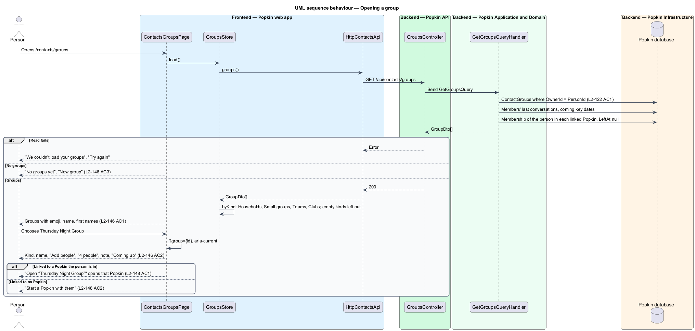

# Groups

## Overview

Popkin is a platform for pop-up communities. Contacts is a person's own address book inside the
Popkin web app, seen by nobody else (L1-029). Groups is the Contacts page where the person puts
contacts together as households, small groups, teams and clubs, so their dates and notes sit in
one place (L1-036). A group is also where Contacts meets Popkin's purpose: a group linked to a
Popkin opens it, and a group with none starts one, whose invite then goes to the group's members
(L2-148). Groups sits at `/contacts/groups`, one of the five phone tabs, and leads to Connections.

- **group** — named set of the person's contacts with one kind, an emoji and a note (`ContactGroup`)
- **kind** — one of `Household`, `SmallGroup`, `Team` and `Club` (`GroupKind`)
- **group member** — contact in a group (`ContactGroupMember`)
- **open group** — group whose detail shows beside the list, or under the "Groups" heading on a phone
- **linked Popkin** — Popkin a group points to through its optional `PopkinId`
- **group invite** — the Popkin's invite sent to each group member once the Popkin is made

The entities are `ContactGroup` and `ContactGroupMember` of the shared Contacts architecture
([Contacts](../../README.md#contacts)). Making a Popkin is [Start a Popkin](../../popkins/start-popkin/README.md);
the invite follows the crew invite of [Recap](../../wrap-up/recap/README.md) (L2-046 AC5), which
sends a new Popkin's invite link to people over SMS or email through `ICrewInviteSender`. A
profile's group chip lists the contact's groups ([A contact's profile](../contact-profile/README.md))
and opens that group (L2-146 AC4).

## Description

### Screens and states

Popkin web app, `docs/mocks/pages/contacts-groups/`:

- `default.html` and `detail.html` — "Groups", "Households, teams, small groups and clubs",
  "Connections" and "New group". The `group-browser` lists "Households" (🏡 Mum’s house, 🏙️ Chidi
  & Tomás), "Small groups" (🕯️ Thursday Night Group, 🎓 Sheffield lot) and "Teams" (⚽ Tigers U9,
  ✏️ Studio design team), each with its members' first names; no Clubs heading, since there is no
  club (L2-146 AC1). The open group, marked `aria-current`, shows "Small group", "Thursday Night
  Group", "Open “Thursday Night Group”", "Add people", "4 people" with how the person knows each
  and when they last talked ("Thursday group", "Thu"), the note "Thursdays 7:30 at Walt’s. Bring
  something to share." and "Coming up" ("Ruth’s birthday Oct 24") (L2-146 AC2, L2-148 AC1).
- `start.html` — Sheffield lot, linked to no Popkin: "Start a Popkin with them" (L2-148 AC2).
- `empty.html` — "No groups yet", "Put a household, a team or a small group together, so their
  dates and notes sit in one place." and "New group" (L2-146 AC3).
- `loading.html`, and `error.html` — "We couldn’t load your groups", "Nothing is lost. Check your
  connection and try again." and "Try again".
- On a phone, the open group shows under the "Groups" heading with a back link (L2-146 AC2).

Dialogs, `docs/mocks/dialogs/`:

- `new-group/` — "New group"; "Name" ("Mum’s house, the five-a-side…"); "What kind" as radio
  chips "Household", "Small group", "Team", "Club"; "Who’s in" with "Take {first name} out" per
  person and "Add people"; "Note" with "Optional. Only you can see it."; "Make the group"
  (L2-147 AC1). `invalid` — "One thing to fix", "Name: give the group a name." and "Give the
  group a name, like “Book club”." (AC2). `busy` — "Making it…".
- `group-add-people/` — "Add people to Thursday Night Group", "Search your people", a tick list
  where Walt, Ellie, Ruth and Joel are ticked, disabled and marked "In the group", and "Add 2
  people"; with nobody new ticked the button is off (L2-147 AC3). `busy` — "Adding…".
- "Start a Popkin with them" opens Name your Popkin with the group's name, and invites Grace and
  Ben once the Popkin is made (mock note, L2-148 AC3).

### Rulings (known gaps 108 and 116, settled 2026-11-16)

- **The link.** Only "Start a Popkin with them" links a group, through `ContactGroup.PopkinId`
  (L2-148 AC4). The Popkin keeps its own members: the mock's Thursday Night Group of 4 and its
  Popkin of 9, and "Tigers U9" against "Tigers U9 Parents", are as they should be. "Open" shows
  while the person's membership has `LeftAt` null, a wrapped-up Popkin included (its address shows
  the recap). Once they leave, the group counts as linked to none and "Start a Popkin with them"
  shows again; a new start replaces the old link. A group linked to a Popkin the person is still in
  refuses another (`409` `group_linked_elsewhere`).
- **Who is invited** (L2-148 AC5). The contact's own phone gets a text, else their own email an
  email, as the crew invite's message says; a member with neither, or whose send fails, is
  skipped; the toast says the invites are on their way, and the created screen offers the
  Popkin's link for anyone skipped. The invite
  goes once: asking again for the Popkin the group is already linked to sends nothing. Import's
  account details never replace the contact's own.
- **Emoji and colour** (gap 116, L2-146 AC6). The emoji follows the kind: 🏡 Household,
  🕯️ Small group, 🤝 Team, ⭐ Club; New group has no emoji field. The colour comes from the
  group's id through `AvatarAccent.For`, as a person's does. The mocks are redrawn to these emoji.
- **New group** (L2-147 AC4, AC5). "What kind" starts on "Household". "Add people" there reads
  "Add people to {name}", or "Add people to the group" with no name yet; it picks without saving,
  and those ticked join "Who's in", each with "Take {first name} out". Name is at most 40
  characters ("Keep it to 40 characters.", `name_too_long`), note at most 500 ("Keep the note to
  500 characters.", `note_too_long`); names may repeat.
- **Kept as made** (L2-147 AC7). A group is not renamed or deleted. People leave a group through
  the "Groups" toggles of their own Edit (L2-147 AC6), which `SaveContactRequest.groupIds` sets in
  full; deleting a contact removes their memberships through `ContactRemoval`, and the group
  stays, empty or not.
- **The open group's address.** `/contacts/groups/{groupId}`, so a profile's chip (L2-146 AC4),
  the phone's back link and the browser's Back all work; an unknown id shows the list.
- **Members and Coming up** (L2-146 AC5). How the person knows each member is their Known as,
  else their circle. When they last talked reads as on People ("Thu", "Aug 13"). "Coming up" is
  the members' next key dates within a year, at most three, soonest first, each read as on Dates
  ("Ruth’s birthday", "Oct 24"). Members list in the order they joined, those who joined together
  A to Z. Add people lists the group's own first, then everyone else A to Z.

### API

Every endpoint is on `GroupsController` (`Popkin.Api/Controllers/Contacts/`); each sends one
MediatR request. Another person's group answers `404` `group_not_found` (L2-122 AC1).

- `GET /api/contacts/groups?on={yyyy-MM-dd}` — `200` `GroupDto[]`, by kind then name: `id`,
  `name`, `kind`, `emoji`, `accent`, `note`, `members` (`GroupMemberDto[]`: `contactId`,
  `firstName`, `fullName`, `initials`, `accent`, `photoUrl`, `knownAs`, `circle`, `lastTalkedOn`,
  `lastTalkedDays`), `comingUp` (`KeyDateRowDto[]`, read for `on`), and `popkin` (`{ id, name }`,
  or null when there is none or the person is no longer in it). Without `on`, as the contact form
  reads it for the names only, the API's own day stands in.
- `POST /api/contacts/groups` — body `{ clientId, name, kind, note?, contactIds[] }`. `201`
  `GroupDto`. Refusals: `400` `name_required`, `name_too_long`, `kind_not_allowed`,
  `note_too_long` (40 and 500 characters); `404` `contact_not_found`. A resend with the same
  `clientId` answers the group made.
- `POST /api/contacts/groups/{groupId}/members` — body `{ contactIds[] }`. `200` `GroupDto`. A
  contact already in the group is left as it is. Refusals: `404` `group_not_found`,
  `contact_not_found`.
- `POST /api/contacts/groups/{groupId}/popkin` — body `{ popkinId }`. `202 Accepted`. Links the
  group to the Popkin and sends the group invite. Refusals: `404` `group_not_found`,
  `popkin_not_found`; `403` `host_only`; `409` `popkin_wrapped_up`; `409`
  `group_linked_elsewhere` when the group is linked to another Popkin the person is still in.
  Asking again for the same Popkin sends nothing more.
- The profile (`GET /api/contacts/people/{id}`) gains `groups` (`{ id, name, emoji, accent }[]`),
  and `SaveContactRequest` gains `groupIds` (Add someone and Edit set the contact's groups in full;
  without it Edit leaves them alone); a group that is not the person's is `404` `group_not_found`.

### Backend

- **`GroupKind`** (Domain) — `Household`, `SmallGroup`, `Team`, `Club`, in the list's order.
- **`ContactGroup`** (Domain) — `Id`, `OwnerId`, `Name`, `Kind`, `Emoji`, `Note`, `PopkinId?`,
  `ClientId`, `CreatedAt`, and its members. `Make(owner, name, kind, note, contacts, clientId,
  now)`, `Add(contacts)`, `LinkTo(popkinId)` (refuses a different Popkin).
- **`ContactGroupMember`** (Domain) — `GroupId`, `ContactId` (key together), `AddedAt`.
- **`GroupRules`** — `Name(string?)`, `Note(string?)`.
- **`GetGroupsQueryHandler`** — the owner's groups with members, each member's last talked day
  from their latest conversation, the coming key dates, and the linked Popkin when
  `IAppDbContext.Memberships` holds the person with `LeftAt` null.
- **`MakeGroupCommandHandler`**, **`AddGroupPeopleCommandHandler`** — check every contact through
  `IContactGuard.RequireOwnedAsync` and save once.
- **`InviteGroupToPopkinCommandHandler`** — loads the group for its owner, calls
  `IMembershipGuard.RequireHostAsync(popkinId)`, refuses a wrapped-up Popkin, applies `LinkTo`,
  and sends `CrewInviteMessage(popkin name, Host's first name, invite link)` through the
  `ICrewInviteSender` of each member's channel, as `InviteCrewCommandHandler` does. A failed send
  is skipped. A member who is already in the Popkin through an imported account is sent nothing.
- No hub event. No log, metric or span carries a group's name, note or a member's details.

### Frontend (Popkin web app)

- **`ContactsGroupsPage`** (`pages/contacts-groups/contacts-groups.page.ts`, routes
  `/contacts/groups` and `/contacts/groups/:groupId`, `shell: 'app'`, `page: 'contacts-groups'`)
  — composes `pk-contacts-page`, `pk-page-head` ("Connections", "New group"), `pk-group-browser`
  with the open group's actions ("Open “{Popkin}”" or "Start a Popkin with them", "Add people")
  and parts: `pk-list-head` "{n} people" over `pk-group-members`, the note as `pk-info-card` with
  `pk-info-line`, and "Coming up" as `pk-coming-up`; `pk-empty-state` and `pk-skeleton`.
- **`NewGroupDialog`** (`dialogs/new-group/new-group.dialog.ts`) — `pk-dialog`, `pk-text-field`
  "Name", `pk-choice-chips` "What kind" (on "Household"), "Who’s in" as `pk-person-pick` with
  "Take {first name} out", "Add people", `pk-textarea` "Note", `pk-form-summary` and "Make the
  group" / "Making it…". Name and note are checked before anything is sent; it closes with the
  group, which then opens.
- **`GroupAddPeopleDialog`** (`dialogs/group-add-people/group-add-people.dialog.ts`) —
  `pk-search-field` "Search your people" (`matchesName`, as People) and `pk-tick-list`: the
  group's own first, ticked, disabled and "In the group", then everyone else A to Z. "Add {n}
  people" / "Adding…", off with nobody new ticked. From New group (no `groupId`) it only closes
  with those ticked.
- **"Start a Popkin with them"** links to `/new?group={groupId}&name={name}`. `NameYourPopkinPage`
  reads both into `NewPopkinDraft` (`groupOf`, the name); `NewPopkinCreator`, once the Popkin is
  made, calls `ContactsApi.invitePopkinGroup(popkinId, groupId)` without waiting and says
  "Invites are on their way" (or "We couldn’t invite the group"), as it does with `crewOf`.
- **"Open “{Popkin}”"** opens `/p/{popkinId}`.
- **`GroupsStore`** (`api/contacts/groups-store.ts`) — `loading | ready | failed`, `byKind`
  (kinds in order, empty kinds left out), `openId` and `open`, `saved(group)`.
- **`groups-text.ts`** — kind headings and labels, "{n} people", "Open “{Popkin}”", "Add {n}
  people", "Add people to {group}" (or "the group"), "Take {first name} out", member names, how
  known and last talked, and the name and note errors.
- **`CONTACTS_API`** — `groups(on)`, `makeGroup(request)`, `addGroupPeople(groupId, contactIds)`,
  `invitePopkinGroup(popkinId, groupId)`.
- **Profile** — "People around {first name}" ends with the contact's group chips, each a link to
  `/contacts/groups/{groupId}` (`ContactProfileView.groups`).
- **Add someone and Edit** — "Groups" lists `groups()` as `pk-chip` toggles, the contact's own
  pressed, and `ContactFormStore` sends `groupIds`; with no group the part is left out.
- **Components** — `pk-group-browser` (backlog row 20); new `pk-group-members`, `pk-coming-up`
  and `pk-tick-list` (row 34; Import uses the tick list too).

### Tests

- API acceptance tests (InMemory, `Popkin.Api.Tests/Contacts/GroupsTests`, 12): a group made is
  listed with its emoji, members and note, and a resend saves once; the name, note and kind
  refusals; another person's contact or group; adding people leaves members alone; "Coming up"
  holds the next three within a year; the contact form sets a contact's groups; starting a Popkin
  invites the members by phone or email, once; "Open" only while the person is in the Popkin, and
  a Popkin they are still in refuses another; a deleted contact leaves the group.
  `PurgeDeletedAccountsTests` checks erasure.
- Direct tests (`Popkin.Application.Tests/Contacts/ContactGroupTests`): the emoji per kind,
  joining once, linking, and the name, note and kind rules, one case per row.
- Unit tests (api library, `groups-store.spec.ts`): `byKind`, the open group, a group saved, the
  empty and failed states, and the words.
- Playwright (`tests/contacts-groups.spec.ts`) through `ContactsGroupsPage`, `NewGroupDialog` and
  `GroupAddPeopleDialog`: the list and an open group as drawn, "Open", "Start a Popkin with them"
  through to the invite, the phone's back link, a profile chip, empty, failed and loading; New
  group refused, too long, made with people picked, busy and failed; Add people; the form's
  toggles. `routes.ts` keys every state.
- Parity: `pk-group-members`, `pk-coming-up` and `pk-tick-list`.

## Requirements

| L2 ID | Refines (L1) | Requirement |
|-------|--------------|-------------|
| `L2-146` | `L1-036` | Groups: Groups lists the person's households, small groups, teams and clubs. (AC1–AC3) |
| `L2-147` | `L1-036` | Make a group: A group is made and people are added to it. (AC1–AC3) |
| `L2-148` | `L1-036` | A group and its Popkin: A group opens its Popkin or starts one. (AC1–AC3) |

## Diagrams

### System context

The person keeps groups in Contacts and starts a Popkin with one; the members receive only the
Popkin's invite, by SMS or email.

### Containers

The web app reads and writes groups through the API; the API sends the group invite through Azure
Communication Services, as it sends a crew invite.

### Components

`GroupsController` sends one request per endpoint; `InviteGroupToPopkinCommandHandler` checks the
Host, links the group and sends each invite through `ICrewInviteSender`.

### Class structure

A `ContactGroup` has one `GroupKind`, many `ContactGroupMember` rows and at most one linked
`PopkinSpace`.

### Behaviour — opening a group

The list groups by kind; opening one shows its members, note, coming dates and "Open" or "Start a
Popkin with them".

### Behaviour — making a group and adding people

New group checks the name first; Add people sends only the people newly ticked.

### Behaviour — Start a Popkin with them

Name your Popkin opens with the group's name; once the Popkin is made, the group is linked and
its members are invited.

