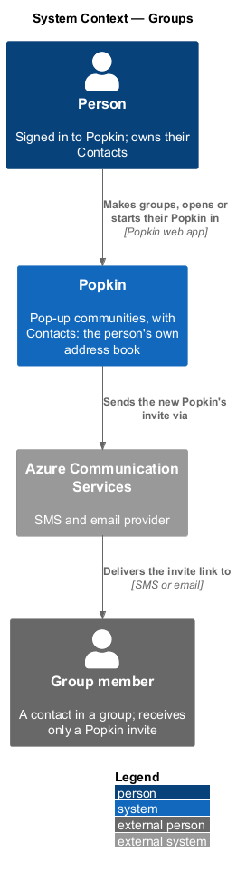
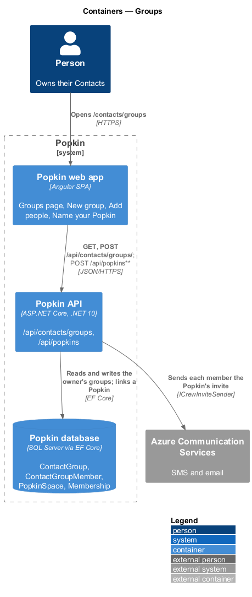
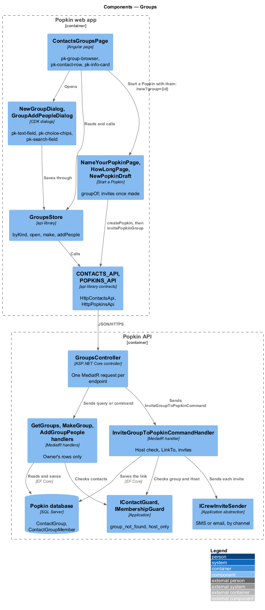
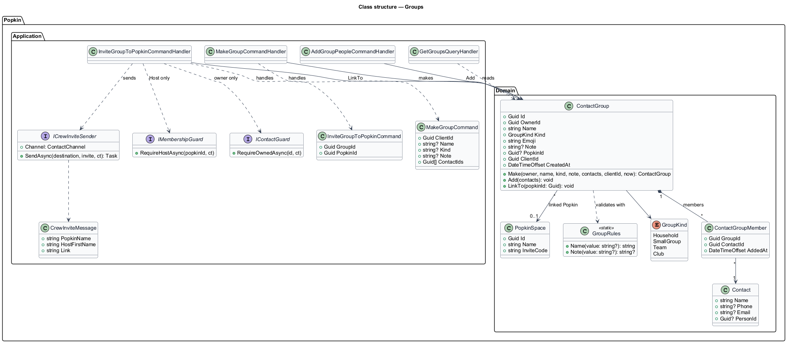
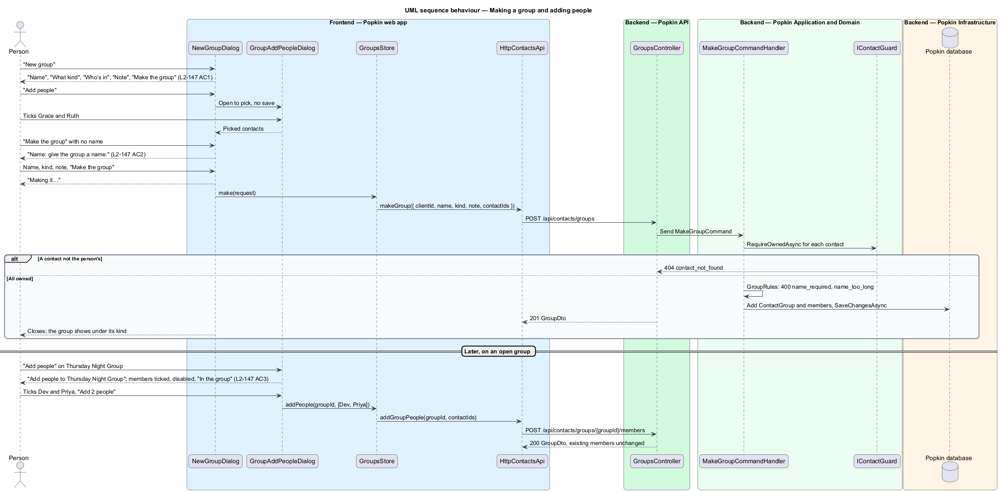
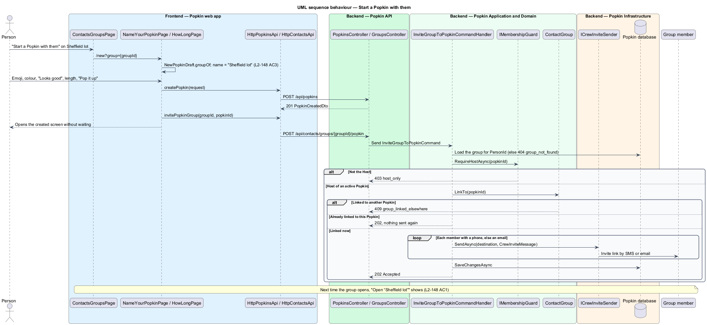

# Groups

## Overview

Popkin is a platform for pop-up communities. Contacts is a person's own address book inside the
Popkin web app, seen by nobody else (L1-029). Groups is the Contacts page where the person puts
contacts together as households, small groups, teams and clubs, so their dates and notes sit in
one place (L1-036). A group is also where Contacts meets Popkin's purpose: a group linked to a
Popkin opens it, and a group with none starts one, whose invite then goes to the group's members
(L2-148). Groups sits at `/contacts/groups`, one of the five phone tabs, and leads to Connections.

- **group** — named set of the person's contacts with one kind, an emoji and a note (`ContactGroup`)
- **kind** — one of `Household`, `SmallGroup`, `Team` and `Club` (`GroupKind`)
- **group member** — contact in a group (`ContactGroupMember`)
- **open group** — group whose detail shows beside the list, or under the "Groups" heading on a phone
- **linked Popkin** — Popkin a group points to through its optional `PopkinId`
- **group invite** — the Popkin's invite sent to each group member once the Popkin is made

The entities are `ContactGroup` and `ContactGroupMember` of the shared Contacts architecture
([Contacts](../../README.md#contacts)). Making a Popkin is [Start a Popkin](../../popkins/start-popkin/README.md);
the invite follows the crew invite of [Recap](../../wrap-up/recap/README.md) (L2-046 AC5), which
sends a new Popkin's invite link to people over SMS or email through `ICrewInviteSender`. A
profile's group chip lists the contact's groups ([A contact's profile](../contact-profile/README.md));
what it opens is gap 108.

## Description

### Screens and states

Popkin web app, `docs/mocks/pages/contacts-groups/`:

- `default.html` and `detail.html` — "Groups", "Households, teams, small groups and clubs",
  "Connections" and "New group". The `group-browser` lists "Households" (🏡 Mum’s house, 🏙️ Chidi
  & Tomás), "Small groups" (🕯️ Thursday Night Group, 🎓 Sheffield lot) and "Teams" (⚽ Tigers U9,
  ✏️ Studio design team), each with its members' first names; no Clubs heading, since there is no
  club (L2-146 AC1). The open group, marked `aria-current`, shows "Small group", "Thursday Night
  Group", "Open “Thursday Night Group”", "Add people", "4 people" with how the person knows each
  and when they last talked ("Thursday group", "Thu"), the note "Thursdays 7:30 at Walt’s. Bring
  something to share." and "Coming up" ("Ruth’s birthday Oct 24") (L2-146 AC2, L2-148 AC1).
- `start.html` — Sheffield lot, linked to no Popkin: "Start a Popkin with them" (L2-148 AC2).
- `empty.html` — "No groups yet", "Put a household, a team or a small group together, so their
  dates and notes sit in one place." and "New group" (L2-146 AC3).
- `loading.html`, and `error.html` — "We couldn’t load your groups", "Nothing is lost. Check your
  connection and try again." and "Try again".
- On a phone, the open group shows under the "Groups" heading with a back link (L2-146 AC2).

Dialogs, `docs/mocks/dialogs/`:

- `new-group/` — "New group"; "Name" ("Mum’s house, the five-a-side…"); "What kind" as radio
  chips "Household", "Small group", "Team", "Club"; "Who’s in" with "Take {first name} out" per
  person and "Add people"; "Note" with "Optional. Only you can see it."; "Make the group"
  (L2-147 AC1). `invalid` — "One thing to fix", "Name: give the group a name." and "Give the
  group a name, like “Book club”." (AC2). `busy` — "Making it…".
- `group-add-people/` — "Add people to Thursday Night Group", "Search your people", a tick list
  where Walt, Ellie, Ruth and Joel are ticked, disabled and marked "In the group", and "Add 2
  people"; with nobody new ticked the button is off (L2-147 AC3). `busy` — "Adding…".
- "Start a Popkin with them" opens Name your Popkin with the group's name, and invites Grace and
  Ben once the Popkin is made (mock note, L2-148 AC3).

### Conflicts and gaps

- **How a group is linked to a Popkin (gap 108).** The design gives `ContactGroup` an optional
  `PopkinId`. "Start a Popkin with them" sets it to the Popkin it makes. Any other way to set or
  clear it, and how the mocks' Thursday Night Group of 4 maps to a Popkin of 9, are open:
  `<TO SUPPLY>`.
- **A linked Popkin the person has left or that has wrapped up.** "Open" shows only while the
  person is a member (`Membership.LeftAt` is null). For a Popkin they left, the design treats the
  group as linked to no Popkin; for a wrapped-up one, "Open" leads to its recap. Both are
  `<TO SUPPLY>` under gap 108.
- **Telling a contact.** L2-122 AC3 tells a contact nothing about being added to Contacts or a
  group. The group invite of L2-148 AC3 is a Popkin invite the person chose to send; it names the
  Popkin and its Host and says nothing of Contacts or the group.
- **Who is invited.** A member with a phone gets an SMS and one with only an email gets an email,
  as the crew invite does. A member with neither is skipped. What the person is told of a skipped
  member, the toasts after the invites, and whether an imported contact's account channel wins
  over the contact's own details are `<TO SUPPLY>`.
- **The emoji.** The list shows each group's emoji, and New group offers no emoji field. How a
  group gets its emoji is `<TO SUPPLY>` (proposed new gap).
- **New group's defaults.** The mock draws "Club" chosen; the default kind is `<TO SUPPLY>`.
  "Add people" in New group opens a dialog titled "Add people to {group}" before the group has a
  name; its title there is `<TO SUPPLY>`.
- **The name's length.** A Popkin's name is at most 40 characters (L2-008); a group's limit and
  what Name your Popkin does with a longer name are `<TO SUPPLY>`.
- **Coming up** — how far ahead and how many key dates are `<TO SUPPLY>` (gaps 99 and 103).
- **Renaming, deleting a group and taking people out** after it is made are gap 108. Deleting a
  contact removes their group memberships through `ContactRemoval`, and the group stays
  ([Delete a contact](../delete-contact/README.md)).

### API

Every endpoint is on `GroupsController` (`Popkin.Api/Controllers/Contacts/`); each sends one
MediatR request. Another person's group answers `404` `group_not_found` (L2-122 AC1).

- `GET /api/contacts/groups` — `200` `GroupDto[]`: `id`, `name`, `kind`, `emoji`, `note`,
  `members` (`GroupMemberDto[]`: `contactId`, `firstName`, `fullName`, `photoUrl`, `howKnown`,
  `lastTalkedOn`), `comingUp` (`KeyDateSoonDto[]`), and `popkin` (`{ id, name, address }`, or
  null when there is none or the person is not a member).
- `POST /api/contacts/groups` — body `{ clientId, name, kind, note?, contactIds[] }`. `201`
  `GroupDto`. Refusals: `400` `name_required`, `name_too_long`, `kind_not_allowed`,
  `note_too_long` (limits `<TO SUPPLY>`); `404` `contact_not_found`.
- `POST /api/contacts/groups/{groupId}/members` — body `{ contactIds[] }`. `200` `GroupDto`. A
  contact already in the group is left as it is. Refusals: `404` `group_not_found`,
  `contact_not_found`.
- `POST /api/contacts/groups/{groupId}/popkin` — body `{ popkinId }`. `202 Accepted`. Links the
  group to the Popkin and sends the group invite. Refusals: `404` `group_not_found`,
  `popkin_not_found`; `403` `host_only`; `409` `popkin_wrapped_up`; `409`
  `group_linked_elsewhere` when the group is linked to another Popkin. Asking again for the same
  Popkin sends nothing more.

### Backend

- **`GroupKind`** (Domain) — `Household`, `SmallGroup`, `Team`, `Club`, in the list's order.
- **`ContactGroup`** (Domain) — `Id`, `OwnerId`, `Name`, `Kind`, `Emoji`, `Note`, `PopkinId?`,
  `ClientId`, `CreatedAt`, and its members. `Make(owner, name, kind, note, contacts, clientId,
  now)`, `Add(contacts)`, `LinkTo(popkinId)` (refuses a different Popkin).
- **`ContactGroupMember`** (Domain) — `GroupId`, `ContactId` (key together), `AddedAt`.
- **`GroupRules`** — `Name(string?)`, `Note(string?)`.
- **`GetGroupsQueryHandler`** — the owner's groups with members, each member's last talked day
  from their latest conversation, the coming key dates, and the linked Popkin when
  `IAppDbContext.Memberships` holds the person with `LeftAt` null.
- **`MakeGroupCommandHandler`**, **`AddGroupPeopleCommandHandler`** — check every contact through
  `IContactGuard.RequireOwnedAsync` and save once.
- **`InviteGroupToPopkinCommandHandler`** — loads the group for its owner, calls
  `IMembershipGuard.RequireHostAsync(popkinId)`, refuses a wrapped-up Popkin, applies `LinkTo`,
  and sends `CrewInviteMessage(popkin name, Host's first name, invite link)` through the
  `ICrewInviteSender` of each member's channel, as `InviteCrewCommandHandler` does. A failed send
  is skipped. A member who is already in the Popkin through an imported account is sent nothing.
- No hub event. No log, metric or span carries a group's name, note or a member's details.

### Frontend (Popkin web app)

- **`ContactsGroupsPage`** (`pages/contacts-groups/contacts-groups.page.ts`, route
  `/contacts/groups`, `shell: 'app'`, `page: 'contacts-groups'`) — composes `pk-contacts-layout`,
  `pk-page-head`, `pk-group-browser`, `pk-contact-row` for each member, `pk-info-card` for the
  note, `pk-empty-state` and `pk-skeleton`. The open group is the query parameter `?group={id}`,
  so the phone's back link and the browser's Back close it (proposal, `<TO SUPPLY>`).
- **`NewGroupDialog`** (`dialogs/new-group/new-group.dialog.ts`) — `pk-dialog`, `pk-text-field`
  "Name", `pk-choice-chips` "What kind", the "Who’s in" list with `pk-icon-button` "Take {first
  name} out", "Add people", `pk-textarea` "Note", `pk-form-summary` and "Make the group" /
  "Making it…".
- **`GroupAddPeopleDialog`** (`dialogs/group-add-people/group-add-people.dialog.ts`) —
  `pk-search-field` "Search your people" over the person's contacts (matching is gap 101), a tick
  list of `pk-contact-row` where members are ticked, disabled and "In the group", and "Add {n}
  people" / "Adding…", off with nobody new ticked. New group uses it to pick, without a save.
- **"Start a Popkin with them"** links to `/new?group={groupId}`. `NameYourPopkinPage` reads it
  into `NewPopkinDraft.groupOf` and fills the name with the group's name. `HowLongPage`, which
  makes the Popkin, then calls `ContactsApi.invitePopkinGroup(groupId, popkinId)` and opens the
  created screen without waiting, as it does with `crewOf`.
- **"Open “{Popkin}”"** opens the Popkin's address ([Open a Popkin by its address](../../popkins/open-by-address/README.md)).
- **`GroupsStore`** (`frontend/projects/api/src/lib/api/contacts/groups-store.ts`) — `loading |
  ready | failed`, `byKind` (kinds in order, empty kinds left out), `open`, `make(request)`,
  `addPeople(groupId, contactIds)`. Writes go through `ContactsOutbox`.
- **`groups-text.ts`** — kind headings and labels, "{n} people", "Open “{Popkin}”", "Add {n}
  people", "Add people to {group}" and "Take {first name} out".
- **`CONTACTS_API`** — `groups()`, `makeGroup(request)`, `addGroupPeople(groupId, contactIds)`,
  `invitePopkinGroup(groupId, popkinId)`.
- **`pk-group-browser`** (components, backlog row 20) — the kinds as headings, each group a link
  with `aria-current` when open, and the detail beside or below.

### Tests

- API acceptance tests (InMemory, `Popkin.Api.Tests/Contacts/GroupsTests`): a group made with two
  contacts is listed under its kind; adding people leaves existing members alone; an empty name is
  `400` `name_required`; another person's group is `404` `group_not_found`; the Host of a new
  Popkin links a group and each member with a phone or email is sent one invite through a fake
  `ICrewInviteSender`; asking twice sends once; a non-Host is `403` `host_only`; "Open" is absent
  after the person leaves the Popkin.
- Direct tests of `ContactGroup.LinkTo` (none, same, other) and `GroupRules`.
- Unit tests (api library): `GroupsStore.byKind` leaves out an empty kind and keeps the order of
  L2-146 AC1; `NewPopkinDraft.groupOf`; `groups-text`.
- Playwright (`e2e/tests/contacts/groups.spec.ts`) through `ContactsGroupsPage`, `NewGroupDialog`
  and `GroupAddPeopleDialog` with recorded responses: the list and an open group as drawn,
  "Open", the empty and error states, New group invalid and busy, Add people with the button off,
  and "Start a Popkin with them" reaching Name your Popkin with the name filled and the invite
  request sent after the Popkin is made. `routes.ts` gains every state of the three screens.
- Parity: `pk-group-browser`, `pk-contact-row` in its tick form, `pk-info-card`.

## Requirements

| L2 ID | Refines (L1) | Requirement |
|-------|--------------|-------------|
| `L2-146` | `L1-036` | Groups: Groups lists the person's households, small groups, teams and clubs. (AC1–AC3) |
| `L2-147` | `L1-036` | Make a group: A group is made and people are added to it. (AC1–AC3) |
| `L2-148` | `L1-036` | A group and its Popkin: A group opens its Popkin or starts one. (AC1–AC3) |

## Diagrams

### System context

The person keeps groups in Contacts and starts a Popkin with one; the members receive only the
Popkin's invite, by SMS or email.

### Containers

The web app reads and writes groups through the API; the API sends the group invite through Azure
Communication Services, as it sends a crew invite.

### Components

`GroupsController` sends one request per endpoint; `InviteGroupToPopkinCommandHandler` checks the
Host, links the group and sends each invite through `ICrewInviteSender`.

### Class structure

A `ContactGroup` has one `GroupKind`, many `ContactGroupMember` rows and at most one linked
`PopkinSpace`.

### Behaviour — opening a group

The list groups by kind; opening one shows its members, note, coming dates and "Open" or "Start a
Popkin with them".

### Behaviour — making a group and adding people

New group checks the name first; Add people sends only the people newly ticked.

### Behaviour — Start a Popkin with them

Name your Popkin opens with the group's name; once the Popkin is made, the group is linked and
its members are invited.

