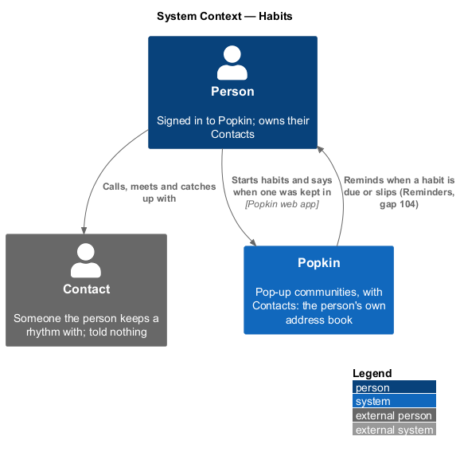
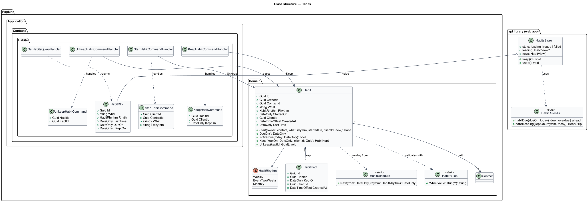
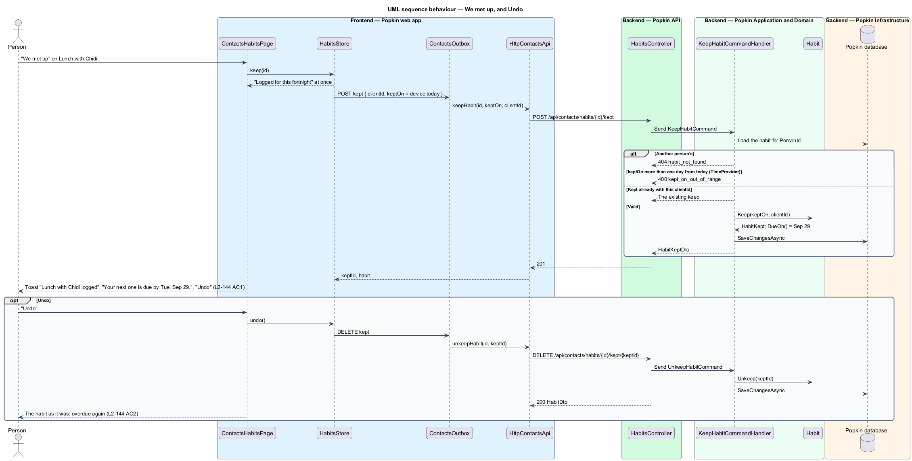

# Habits

## Overview

Popkin is a platform for pop-up communities. Contacts is a person's own address book inside the
Popkin web app, seen by nobody else (L1-029). Habits is the Contacts page of the rhythms the
person keeps with their contacts: a Sunday call, a lunch every two weeks, a monthly catch-up
(L1-035). It shows which rhythm is overdue, how often each has been kept, and moves a habit on
when the person says it was kept. It sits at `/contacts/habits`; on a phone it is reached from
Today and has a "Today" back link (L2-121 AC4).

- **habit** — rhythm the person keeps with one contact, named by what they do together
- **rhythm** — how often a habit falls due: `Weekly`, `EveryTwoWeeks` or `Monthly` (`HabitRhythm`)
- **period** — one span of a habit's rhythm: a week, a fortnight or a month
- **kept** — record that the habit happened in a period (`HabitKept`)
- **last time** — day the habit was last kept, or the day it started when it has never been kept
- **due day** — last time plus the rhythm; the habit's next day
- **overdue habit** — habit whose due day has passed
- **keep strip** — row of the last 12 periods, each marked kept or not

A habit is the `Habit` and `HabitKept` entities of the shared Contacts architecture
([Contacts](../../README.md#contacts)). A contact's profile shows the contact's habit as an info
card ("Every 2 weeks", "Lunch with Chidi", "Overdue since Sep 13") from the same rules
([A contact's profile](../contact-profile/README.md)); Today lists an overdue habit under "To do
today" ([Today](../today/README.md)). Reminding the person when a habit comes due and when it
slips (L2-145 AC4) belongs to [Reminders](../reminders/README.md).

## Description

### Screens and states

Popkin web app, `docs/mocks/pages/contacts-habits/`, on Tuesday 15 September 2026:

- `default.html` — "Habits", "Small rhythms that keep people close" and "New habit". The
  overdue habit leads the page as a `spotlight`: "Two days overdue", "Lunch with Chidi", "Every 2
  weeks · you’ve kept 9 of the last 12", "Call Chidi" (a `tel:` link), "We met up" and its keep
  strip, named "Kept 9 of the last 12, the latest one is due" (L2-143 AC2). Under it, one
  `habit-row` per habit: photo, name, rhythm, keep strip ("Kept 11 of the last 12"), "11 weeks
  running" and "Next Sun, Sep 20"; each opens the contact's profile (L2-143 AC1).
- `kept.html` — after "We met up": "Logged for this fortnight", the button pressed, and the toast
  "Lunch with Chidi logged", "Your next one is due by Tue, Sep 29." with "Undo" (L2-144 AC1).
- `empty.html` — "No habits yet", "A habit is a rhythm with someone: a Sunday call, a monthly
  catch-up. We’ll nudge you when one is due, and again if it slips." and "New habit" (L2-143 AC4).
- `loading.html`, and `error.html` — "We couldn’t load your habits", "Your streaks are safe.
  Check your connection and try again." and "Try again".

`docs/mocks/dialogs/new-habit/`:

- `default.html` — "New habit"; "With" showing Chidi Okafor, "Brother", and "Change"; "What"
  ("Sunday call, lunch, a walk…"); "How often" as radio chips "Weekly", "Every 2 weeks" and
  "Monthly", "Weekly" chosen; "We’ll remind you when it’s due, and nudge again if a week slips
  by."; "Start the habit" (L2-145 AC1).
- `invalid.html` — "One thing to fix", "What: say what you’ll do together." linking to the field,
  and the field error "Say what you’ll do together, like “Sunday call”." (L2-145 AC2).
- `busy.html` — "Starting…", disabled.

### Rulings (gap 105, settled)

- **Periods.** A habit's periods are counted back from its due day in steps of its rhythm (7
  days, 14 days, or a calendar month by `AddMonths`); the latest is the one today falls in. A
  period is kept when a day kept falls in it; the latest, unkept, is due (a new habit's first
  period, or one whose due day has come); any other unkept period is missed. Periods before the habit started are not drawn, so a
  new habit reads "Kept {n} of the last {m}" with fewer than 12 (L2-143 AC5). The kept mock
  follows from it: after a late "We met up" the period that was due is missed and a new kept one
  is drawn.
- **Running.** Kept periods in a row ending with the latest, a latest one still due not breaking
  it; shown from two: "{n} weeks running", "{n} fortnights running", "{n} months running"
  (L2-143 AC6). The mocks' "11 weeks running" and "7 months running" did not count their strips;
  they now read "10 weeks running" and "8 months running".
- **Last time and due day.** A habit's last time is its latest day kept, else the day it started;
  its due day is its last time plus its rhythm. A new weekly habit is due a week after it starts.
- **Keeping again.** "We met up" is on the spotlight only; once kept it reads "Logged for this
  {week | fortnight | month}" and is pressed until Habits opens again. The API keeps any day
  within one day of its own, once per client id.
- **Several overdue.** The one overdue longest leads; the others are rows with "Overdue since
  {day}" for their next; a habit due today reads "Due today" (L2-143 AC7).
- **Lateness.** "One day overdue" to "Nine days overdue" in words, then "{n} days overdue".
- **No phone.** "Call {first name}" is left out for a contact with no phone.
- **New habit's contact.** From a profile, "With" is that contact with "Change"; from Habits, or
  after "Change", "With" is a select, "Choose someone", of the people with no habit yet
  (`dialogs/new-habit/choose.html`). Nothing chosen: "With: choose who the habit is with."
  (L2-145 AC5). One habit per contact: a second is `409` `habit_exists` (AC6).
- **Ending.** "End this habit", under the habit on the profile, ends it at once with the toast
  "{habit} ended" and "Undo" (L2-144 AC3). Editing and pausing are not offered: to change one,
  end it and start another. An ended habit keeps its kept days, so Undo restores it as it was.
- **Rhythm words** are "Weekly", "Every 2 weeks", "Monthly" (`docs/mocks/README.md` note 10),
  and a habit reads "{what} with {first name}" (L2-122 AC4).
- **"What"** is up to 80 characters: "Keep it to 80 characters." (`what_too_long`).
- Deleting a contact removes their habit and its kept days through `ContactRemoval`.
- **Time zone (gap 104).** Days are calendar days with no time; the web app sends the device's
  date as the day kept, and the API accepts it within one day of its own UTC date.

### API

Every endpoint is on `HabitsController` (`Popkin.Api/Controllers/Contacts/`); each sends one
MediatR request. Another person's habit answers `404` `habit_not_found` (proposed, L2-122 AC1).

- `GET /api/contacts/habits` — `200` `HabitDto[]`: `id`, `contactId`, `contactFirstName`,
  `contactName`, `contactInitials`, `contactAccent`, `contactPhone`, `contactPhotoUrl`, `what`,
  `rhythm`, `startedOn`, `lastTime`, `dueOn`, and `keptOn` (the days kept, newest first, as far
  back as 12 periods). The profile's `habit` is the same `HabitDto`, or `null`.
- `POST /api/contacts/habits` — body `{ clientId, contactId, what, rhythm }`. `201` `HabitDto`.
  Refusals: `400` `what_required` (the summary "What: say what you’ll do together."),
  `what_too_long` (80), `rhythm_not_allowed`; `404` `contact_not_found`; `409` `habit_exists`.
- `POST /api/contacts/habits/{id}/kept` — body `{ clientId, keptOn }`. `201` `HabitKeptDto`
  (`keptId`, `habit`), whose `habit.dueOn` is the next one. Refusals: `400` `kept_on_out_of_range`;
  `404` `habit_not_found`.
- `DELETE /api/contacts/habits/{id}/kept/{keptId}` — "Undo". `200` `HabitDto`, as before the
  keep (L2-144 AC2); `404` `habit_not_found`.
- `POST /api/contacts/habits/{id}/end` — "End this habit". `204`; `404` `habit_not_found`.
- `DELETE /api/contacts/habits/{id}/end` — its "Undo". `200` `HabitDto`; `404`
  `habit_not_found`; `409` `habit_exists` if another was started with them since.

### Backend

- **`HabitRhythm`** (Domain) — `Weekly`, `EveryTwoWeeks`, `Monthly`.
- **`Habit`** (Domain) — `Id`, `OwnerId`, `ContactId`, `What`, `Rhythm`, `StartedOn`
  (`DateOnly`), `EndedAt` (null while it runs), `ClientId`, `CreatedAt`, and its `HabitKept`
  rows. `End(now)`, `Resume()`. `Start(owner, contact, what,
  rhythm, startedOn, clientId, now)`; `LastTime` (latest kept day, else `StartedOn`); `DueOn()`
  is `LastTime` plus the rhythm; `IsOverdue(today)` is `today > DueOn()` (L2-143 AC3);
  `Keep(keptOn, clientId)`; `Unkeep(keptId)`.
- **`HabitSchedule`** (Domain, static) — `Next(DateOnly from, HabitRhythm)`: 7 days, 14 days, or
  one calendar month by `DateOnly.AddMonths`, which keeps the day or takes the month's last.
  `Reminders` uses the same rule.
- **`HabitKept`** (Domain) — `Id`, `HabitId`, `KeptOn` (`DateOnly`), `ClientId`, `CreatedAt`.
- **`HabitRules`** — `What(string?)` trims and refuses empty or too long text.
- **`GetHabitsQueryHandler`**, **`StartHabitCommandHandler`** (checks the contact with
  `IContactGuard.RequireOwnedAsync`), **`KeepHabitCommandHandler`** (checks `keptOn` against
  `TimeProvider`, saves once, and returns the existing row for a known `ClientId`),
  **`UnkeepHabitCommandHandler`** — in `Popkin.Application/Contacts/Habits/`.
- No hub event. No log, metric or span carries what a habit is or whom it is with.

### Frontend (Popkin web app)

- **`ContactsHabitsPage`** (`pages/contacts-habits/contacts-habits.page.ts`, route
  `/contacts/habits`, `shell: 'app'`, `page: 'contacts-habits'`) — composes `pk-contacts-page`,
  `pk-page-head` with the "Today" back link below medium screens, `pk-spotlight` for the overdue
  habit, `pk-habit-row` per habit, `pk-empty-state` and `pk-skeleton`. "New habit" opens
  `NewHabitDialog`.
- **`NewHabitDialog`** (`dialogs/new-habit/new-habit.dialog.ts`) — CDK dialog in `pk-dialog`, with
  the contact as `pk-person-pick` and "Change", or "With" as `pk-select-field` of my people with no
  habit yet (with its error), `pk-text-field` "What", `pk-choice-chips` "How often",
  `pk-form-summary` and `pk-button` "Start the habit" / "Starting…". It validates "What" before
  sending; it closes on success, and the habit then shows on Habits and the profile (L2-145 AC3).
- **`HabitsStore`** (`frontend/projects/api/src/lib/api/contacts/habits-store.ts`) — `loading |
  ready | failed`, `leading` (the overdue habit that leads), `rows`, `keep(id)` and `undo()`.
  `keep` marks the spotlight "Logged for this {period}" at once, sends through `ContactsOutbox`,
  and raises the toast "{habit} logged", "Your next one is due by {day}." with "Undo".
- **`habit-rules.ts`** (pure) — `habitDue(dueOn, today)`: `due` on the due day, `overdue` with
  the days late after it, `ahead` before it; `habitKeeping(keptOn, rhythm, today)`: the 12 cells
  of the keep strip (oldest first), the kept count and the run, as ruled above.
- **`habits-text.ts`** — "Two days overdue", "Overdue since {day}", "{rhythm} · you’ve kept {n}
  of the last 12", "{n} weeks running", "{n} months running", "Next {day}", "Logged for this
  fortnight", "{habit} logged", "Your next one is due by {day}." and the rhythm words.
- **`CONTACTS_API`** — `habits()`, `startHabit(request)`, `keepHabit(id, keptOn, clientId)`,
  `unkeepHabit(id, keptId)`.
- The profile's habit is `pk-info-card` with a small `pk-keep-strip` and its foot; "End this habit"
  under it ends it through `ContactProfileStore.endHabit`, with the toast "{habit} ended" and
  Undo; without one, "Make a habit of seeing {first name}" opens New habit with them.
- **`pk-habit-list`** lists the rows, each ruled from the one above.
- **`pk-keep-strip`** and **`pk-habit-row`** (components, backlog row 18) — the strip is
  `role="img"` with the label "Kept {n} of the last 12", so kept is never told by colour alone.
  **`pk-spotlight`** (row 19) — the tinted lead with its actions.

| Rhythm | Last time | Due day | Today | State |
|---|---|---|---|---|
| Weekly | Sep 13 | Sep 20 | Sep 15 | ahead, "Next Sun, Sep 20" |
| Every 2 weeks | Aug 30 | Sep 13 | Sep 15 | overdue by 2 days, "Overdue since Sep 13" |
| Every 2 weeks | Sep 15 (kept) | Sep 29 | Sep 15 | ahead, "due by Tue, Sep 29" |
| Monthly | Sep 3 | Oct 3 | Sep 15 | ahead, "Next Sat, Oct 3" |
| Monthly | Jan 31 | Feb 28 (2026) | Mar 1 | overdue by 1 day |
| Weekly | Sep 8 | Sep 15 | Sep 15 | due, not overdue |

The keep strip, newest periods last (K kept, · missed, D due):

| Rhythm | Started | Days kept | Due day | Today | Latest periods | Kept | Run |
|---|---|---|---|---|---|---|---|
| Weekly | Aug 1 | Aug 30, Sep 6, Sep 13 | Sep 20 | Sep 15 | 8 drawn: `·····KKK` | 3 of the last 8 | 3 weeks |
| Every 2 weeks | Jan 1 | Aug 16, Aug 30 | Sep 13 | Sep 15 | `…KKD` | latest is due | 2 fortnights |
| Every 2 weeks | Jan 1 | Aug 16, Aug 30, Sep 15 | Sep 29 | Sep 15 | `…K·K` (Aug 18–Sep 1 kept, Sep 1–15 missed) | | none |
| Monthly | Jan 1 | Sep 3 | Oct 3 | Sep 15 | `…K` (Sep 3–Oct 3) | | |
| Weekly | Jan 1 | Sep 1 | Sep 8 | Sep 15 | `…K·D` (Sep 8–15 missed, Sep 15–22 due) | | |
| Weekly | Sep 15 | none | Sep 22 | Sep 15 | 1 drawn: `D` | 0 of the last 1, latest is due | none |

### Tests

- API acceptance tests (InMemory, `Popkin.Api.Tests/Contacts/HabitsTests`, 10): a habit started is
  listed with its due day; "We met up" moves the due day on; Undo puts it back; a resent keep
  saves once; "What" empty is `400` `what_required`; another person's habit is `404`
  `habit_not_found`; a day kept too far from today is `400` `kept_on_out_of_range` under
  `FakeTimeProvider`.
- Direct tests of `HabitSchedule.Next` and `Habit.IsOverdue`, one case per row of the table above.
- Unit tests (api library): `habitDue`, `habitKeeping` (one case per row of the periods table),
  `HabitsStore` keep, undo and a failed keep, and `habits-text`.
- Playwright: `tests/contacts-habits.spec.ts` (13) through `ContactsHabitsPage`, `NewHabitDialog`
  and `ContactProfilePage`, on recorded responses and the mocks' habits: Habits as drawn, We met up and Undo, empty,
  failed, New habit from Habits and from a profile, Change, busy, the profile's card, and End
  with Undo. `routes.ts` keys every state of `contacts-habits` and `new-habit`.
- Parity: `pk-spotlight` in its row form with its strip, `pk-habit-row` (first and last),
  `pk-info-card` (the profile's habit) and `pk-person-pick` with Change.

## Requirements

| L2 ID | Refines (L1) | Requirement |
|-------|--------------|-------------|
| `L2-143` | `L1-035` | Habits: Habits lists the rhythms the person keeps. (AC1–AC4) |
| `L2-144` | `L1-035` | Keep a habit: Saying the habit was kept moves it on. (AC1–AC2) |
| `L2-145` | `L1-035` | New habit: A habit is started with one contact. (AC1–AC4) |

## Diagrams

### System context

The person keeps rhythms with their contacts in Contacts; the contacts are told nothing.

### Containers

The web app reads habits and writes keeps through the API; the Worker's reminder job reads the
same due days (owned by Reminders).

### Components

`HabitsStore` decides what leads and what is overdue from the due days the API returns; the
handlers own the rule "last time plus rhythm".

### Class structure

A `Habit` is with one contact, has one `HabitRhythm` and many `HabitKept` rows; `HabitSchedule`
turns a last time and a rhythm into the due day.

### Behaviour — Habits opens

The page loads the habits and leads with the one overdue longest.

### Behaviour — "We met up", and Undo

The keep is logged for its period and the toast offers "Undo", which removes the keep.

### Behaviour — New habit

The dialog checks "What" first; the API saves the habit and it shows on Habits and the profile.

