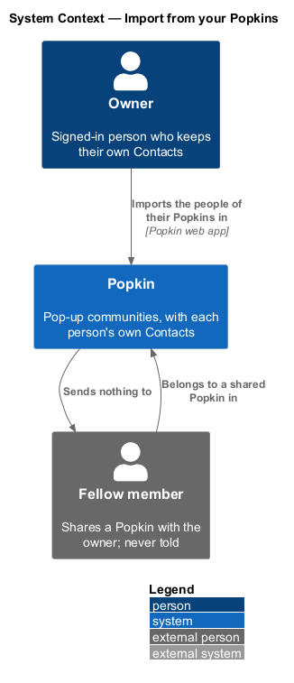
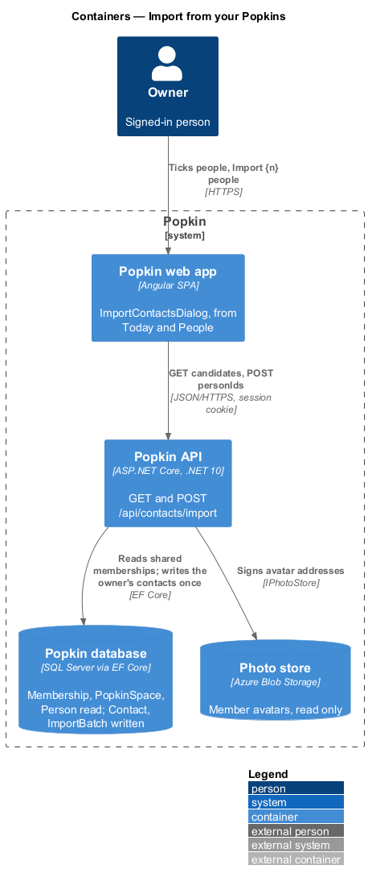
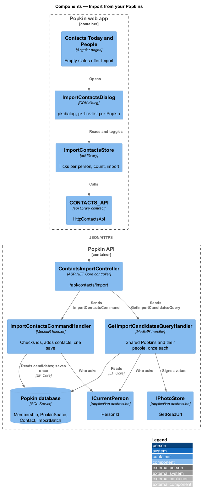
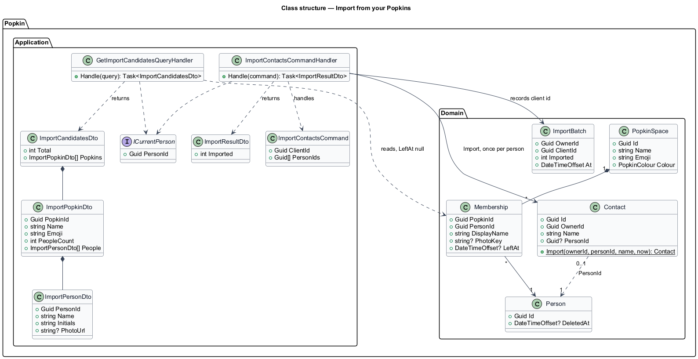
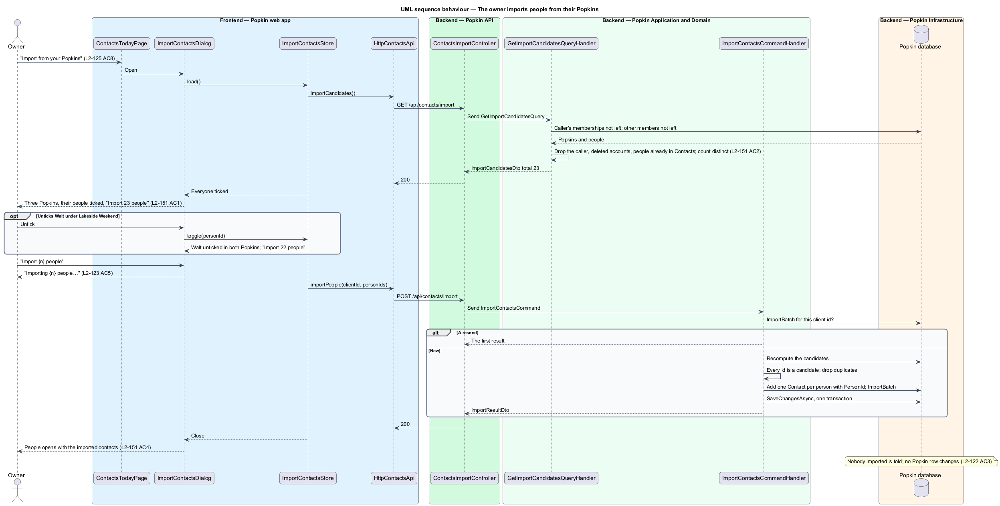
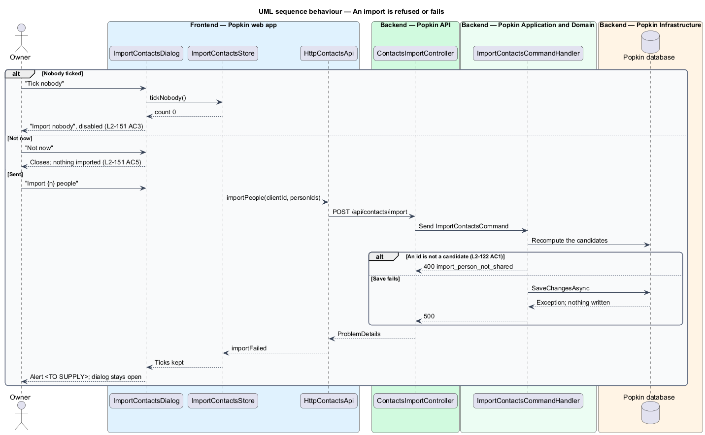

# Import from your Popkins

## Overview

Popkin is a platform for pop-up communities. Contacts (L1-029) keeps close the people a person
meets in their Popkins, and Import brings them in (L1-038). The dialog lists everyone the person
shares a Popkin with, under each Popkin, all ticked. The person unticks whom they do not want and
imports the rest. Each person is imported once, however many Popkins are shared, and nobody is
told (L2-151, L2-122 AC3).

- **owner** — signed-in `Person` who imports into their own Contacts
- **shared Popkin** — `PopkinSpace` in which the owner holds a `Membership` that has not been left
- **candidate** — `Person` other than the owner with a `Membership`, not left, in a shared Popkin
- **tick** — choice to import one candidate, kept per person, so a candidate listed under two Popkins carries one tick shown in both places
- **imported contact** — `Contact` made by Import, whose `PersonId` is the candidate's

Import opens from the empty Today (L2-125 AC8) and the empty People
(`docs/mocks/pages/contacts-people/empty.html`). A contact made by Import is a contact like any
other: its profile is [A contact's profile](../contact-profile/README.md), where "Also in your
Popkin" uses its `PersonId`.

## Description

### Screens and states

Popkin web app, `docs/mocks/dialogs/import-contacts/`, over the empty Today:

- `default.html` — "Import from your Popkins", "Everyone you share a Popkin with, once each. They
  aren’t told, and only you will see them.", "Tick nobody", then one section per shared Popkin
  with its tile, name and number of people ("🏕️ Lakeside Weekend" "13 people", "🕯️ Thursday
  Night Group" "8 people", "⚽ Tigers U9 Parents" "18 people"). Under each are its people, each a
  ticked checkbox with avatar and name ("Walt Brennan", "Dev Patel"…), then "Show 9 more". The
  footer offers "Import 23 people" and "Not now" (L2-151 AC1). Walt Brennan, in two of the
  Popkins, counts once in the 23 (L2-151 AC2).
- `busy.html` — "Importing 23 people…", disabled (L2-123 AC5).
- With nobody ticked, the button reads "Import nobody" and is disabled (L2-151 AC3); the
  manifest marks the invalid state not applicable for that reason.
- Success closes the dialog and opens People with the imported contacts (L2-151 AC4).
- "Not now", "Close" and Escape import nothing (L2-151 AC5).
- Entry points: Today's empty state reads "{n} people from your Popkins are ready to import.
  Only you can see your contacts." when there are candidates (L2-125 AC8;
  `docs/mocks/pages/contacts-today/empty.html`), and People's empty state offers "Import from
  your Popkins" beside "Add someone".

### Rulings (known gaps 110 and 117, settled 2026-11-16)

- **What is imported.** The name the candidate shows in the first Popkin listed, and nothing
  else: their photo, phone and email stay theirs. Every Popkin the owner has not left is listed,
  wrapped up or not, in the order My Popkins uses. A person who already has a contact (by
  `PersonId`) is never offered again, so "once each" holds across imports too (L2-151 AC2).
  Import is offered from the empty Today and the empty People, where its entry points are drawn.
- **People in a Popkin** are listed A to Z by name. The first four show; "Show {n} more" shows
  the rest of that Popkin and goes (L2-151 AC6). `default.html` is redrawn to match.
- **"Tick nobody"** becomes "Tick everyone" once nobody is ticked (`nobody.html`; L2-151 AC3).
- **One person.** "Import 1 person", "Importing 1 person…".
- **Loading and a failed read.** The dialog shows skeleton rows while the candidates load
  (`loading.html`). A failed read says "We couldn’t load your Popkins’ people." and "Check your
  connection and try again." with "Try again" (`error.html`; L2-151 AC7).
- **Nobody to import.** With no candidates the dialog reads "No one to import yet" and "When you
  share a Popkin with someone, they show here." and offers "Close" alone (`empty.html`; L2-151
  AC8).
- **A failed import.** The dialog stays open with every tick kept, and an alert says "We
  couldn’t import them." and "Everyone you ticked is still ticked. Check your connection and try
  again." Nothing is imported, since the save is one transaction (`failed.html`; L2-151 AC9).
- **Offline.** An import is not queued in `ContactsOutbox`; without a connection it fails as
  above, because it depends on the candidates the API holds.
- **The circle of an imported contact.** None; the contact has none until edited.
- **A resend** is kept once by `ImportBatch`, an `IClientWrite` row like every other Contacts
  write.

### API

Endpoints on `ContactsImportController` (`Popkin.Api/Controllers/Contacts/`) under
`/api/contacts/import`, behind the default authenticated policy; each sends one MediatR request.

- `GET /api/contacts/import` — `200` `ImportCandidatesDto`: `total` (distinct candidates, the
  "{n}" of "Import {n} people" and of Today's line) and `popkins`
  (`ImportPopkinDto[]`: `popkinId`, `name`, `emoji`, `colour`, `peopleCount`, `people`
  (`ImportPersonDto[]`: `personId`, `name`, `initials`, `accent`, `photoUrl`)). Popkins are in
  the order My Popkins uses; people in each by name. A candidate who already has a contact is
  left out (see Conflicts).
- `POST /api/contacts/import` — body `{ clientId, personIds }`. `200` `ImportResultDto`
  `{ imported }`. Refusals: `400` `import_nobody` for an empty list; `400`
  `import_person_not_shared` when any id is not a candidate of the caller, so Import never
  reveals or copies an account the owner does not share a Popkin with (L2-122 AC1). A resend
  with the same `clientId` answers the first result and imports nothing more.

### Backend

- **`GetImportCandidatesQuery`** / **`…Handler`** (`Popkin.Application/Contacts/Import/`) — reads
  the caller's memberships with no `LeftAt` (`ICurrentPerson.PersonId`), their `PopkinSpace`
  rows, and the other memberships of those Popkins with no `LeftAt`. It drops the caller and any
  person whose `Contact.PersonId` the caller already holds, counts distinct `PersonId`s for
  `total`, and signs avatar addresses with `IPhotoStore.GetReadUrl`. A deleted account
  (`Person.DeletedAt` set) is never a candidate.
- **`ImportContactsCommand`** / **`ImportContactsCommandHandler`** — recomputes the candidates
  as the query does, refuses any id outside them, removes duplicate ids (L2-151 AC2), skips a
  `PersonId` the owner already holds, adds one `Contact` per remaining person through
  `Contact.Import(ownerId, personId, name, now)`, and saves once. It records the client id of
  the import so a resend saves once.
- **`ImportBatch`** (Domain, new table, `IClientWrite`) — `Id`, `OwnerId`, `ClientId`,
  `Imported`, `At`; the record of one import that makes a resend safe, read through
  `ClientWrites.FindAsync` as the other Contacts writes are. Erasing the account removes it.
- Nobody is told: no notification, no hub event, no row in any Popkin and nothing on the
  imported person's account (L2-151 AC4, L2-122 AC3). Logs and metrics carry the route
  template, the status and the count imported, never a name or an id of a person.

### Frontend (Popkin web app)

- **`ImportContactsDialog`** (`app/dialogs/import-contacts/import-contacts.dialog.ts` and
  `.html`) — CDK Dialog with `pk-dialog` (heading, the sentence as its description), a
  `pk-tick-list` per shared Popkin, "Tick nobody" as a text `pk-button`, the primary
  `pk-button` "Import {n} people" / "Import nobody" / "Importing {n} people…" and the quiet "Not
  now" ("Close" alone with nobody to import). It opens with skeleton rows while the candidates
  load, and a failed read or import shows its alert as ruled above. On success it closes with
  `imported` and the opener navigates to `/contacts/people`.
- **`pk-tick-list`** (components, new) — a section headed by a `pk-popkin-tile`, a name and
  "{n} people", a list of rows each with a native checkbox, `pk-avatar` and the name as its
  label, and "Show {n} more". It takes `ticked` as a set of keys and emits `toggled(key)`, so
  the same person shows the same tick in every section. It needs its design-system page and a
  backlog row before it is built.
- **`ImportContactsStore`** (`frontend/projects/api/src/lib/api/contacts/`) — `loading | ready |
  failed | importing | importFailed`, the ticked set (every candidate at first), `count` of
  distinct ticked people, `tickNobody()`, `toggle(personId)` and `import()`. Unit tested
  (ADR 0011).
- **`import-contacts-text.ts`** — "Import {n} people", "Import 1 person", "Import
  nobody", "Importing {n} people…", "{n} people", "Show {n} more", and Today's "{n} people from
  your Popkins are ready to import. Only you can see your contacts." Unit tested.
- **`CONTACTS_API`** — `importCandidates()`, `importPeople(clientId, personIds)`.

### Tests

- API acceptance tests (InMemory, ADR 0005), `Popkin.Api.Tests/Contacts/ImportContactsTests.cs`:
  Mara's candidates across three Popkins count Walt once; a person who left a Popkin, a deleted
  account and Mara herself are not candidates; importing makes one contact per person with its
  `PersonId`, and importing again makes none; an id from a Popkin Mara does not share answers
  `400` `import_person_not_shared` and imports nobody; an empty list answers `400`
  `import_nobody`; nothing is written to any Popkin or to the imported person.
- A direct test of `ImportContactsStore`, one case per row: everyone ticked at first, one tick
  shared by two sections, "Tick nobody" giving "Import nobody" disabled, the count after
  toggles.
- Playwright, `e2e/tests/import-contacts.spec.ts` through the `ImportContactsDialog` page
  object, from Today's and People's empty states: the dialog as drawn, unticking Walt in one
  Popkin unticks him in both, "Tick nobody", "Import 23 people" opens People, "Not now" imports
  nothing. The `GET` and `POST` answers are recorded after `popkin seed` adds Mara's Popkins;
  `routes.ts` gains both states.
- Parity for `pk-tick-list`.

## Requirements

| L2 ID | Refines (L1) | Requirement |
|-------|--------------|-------------|
| `L2-151` | `L1-038` | Import from your Popkins: The people a person shares Popkins with are brought into Contacts, once each, chosen by ticks, and nobody is told. (AC1–AC5) |

## Diagrams

### System context

The owner imports the people of their Popkins; those people are not told.

### Containers

The web app reads the candidates and posts the ticked ones; the API reads memberships and writes
only the owner's contacts.

### Components

`ImportContactsDialog` works through `ImportContactsStore`; both handlers compute the candidates
from `Membership` the same way, so the command never imports someone the query would not offer.

### Class structure

Candidates come from `Membership` and `PopkinSpace`; each import adds `Contact` rows that carry
the candidate's `PersonId`.

### Behaviour — the owner imports people

The dialog lists the candidates once each; the import saves one contact per ticked person in one
transaction and opens People.

### Behaviour — an import is refused or fails

An id outside the candidates is refused; a failed save imports nobody and keeps the ticks.

