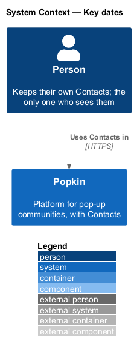
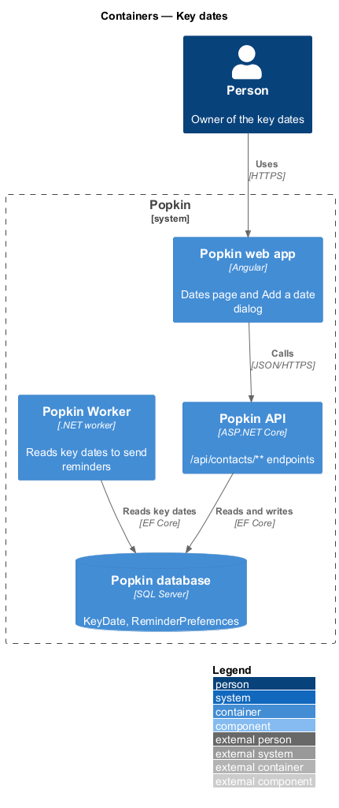
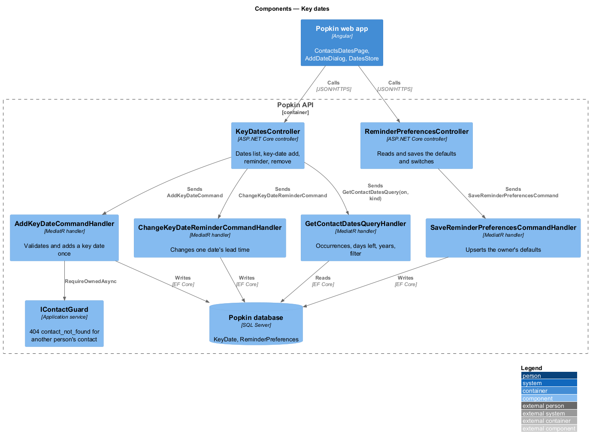
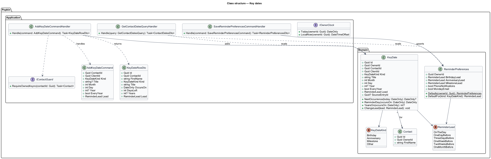
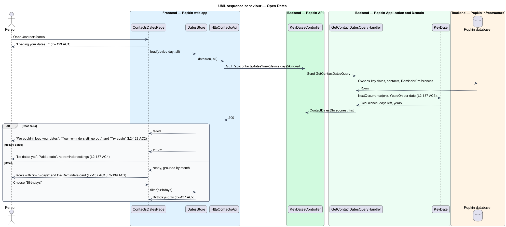
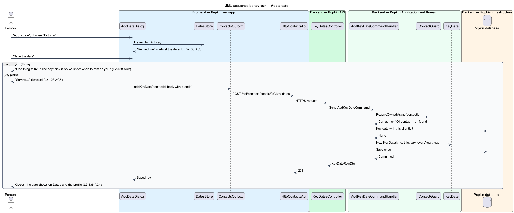
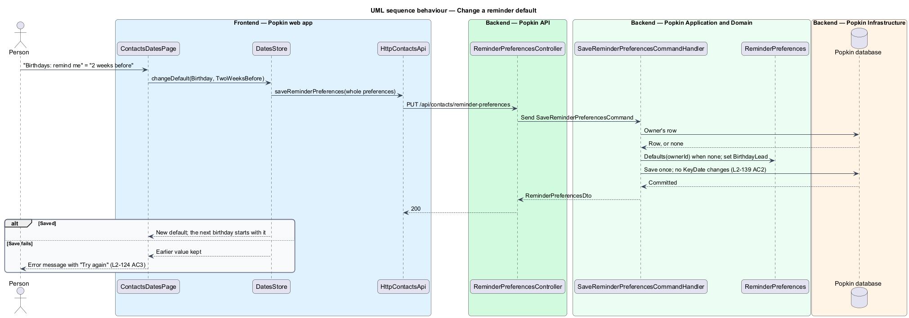

# Key dates

## Overview

Contacts is a person's own address book inside the Popkin web app (L1-029). Key dates are the
days that matter to the person's contacts: birthdays, anniversaries and other days, each with
its own reminder (L1-033). The Dates page (`/contacts/dates`) lists them soonest first, under
their month. Add a date adds one for a contact, and the "Reminders" card on Dates holds the
default lead time of each kind. The reminders themselves reach the person through
[Reminders](../reminders/README.md); a milestone remembered every year arrives from
[Log a conversation or milestone](../log-entry/README.md).

- **key date** — day of a contact's life that the owner keeps, with a kind, a title, a day and month, an optional year and a reminder
- **kind** — one of `Birthday`, `Anniversary`, `Milestone` or `Other` ("Something else"), the `KeyDateKind` of a key date
- **occurrence** — one coming round of a key date: the next day on or after the device day that falls on its day and month, or its own day for a date not kept every year
- **lead time** — how long before an occurrence its reminder arrives, one of the six `ReminderLead` values from "On the day" to "1 month before"
- **reminder day** — occurrence minus lead time, the day the reminder of [Reminders](../reminders/README.md) is due
- **reminder default** — lead time a new key date of one kind starts with, kept per owner in `ReminderPreferences`
- **line** — second line of a date's row: the age or the years when the first year is known ("Turns 33", "5 years married")

Every key date belongs to one owner, and only that owner sees or changes it (L2-122).
`IContactGuard` answers `404` `contact_not_found` for a contact of anyone else, and `404`
`key_date_not_found` for a key date of anyone else.

## Description

### Screens and states

`docs/mocks/pages/contacts-dates/`, route `/contacts/dates`:

- `default.html` — "Dates", "Birthdays, anniversaries and the days that matter to your people"
  and "Add a date"; the chips "Everything", "Birthdays", "Anniversaries" and "Milestones" (a
  `role="group"` named "Show", each `aria-pressed`); one section per month ("September",
  "October"…), each row a date tile (weekday over day, "Sat" / "19"), the contacts' avatars, the
  kind's icon, the title ("Grace's birthday"), the line ("Turns 33"), "in 4 days" and, from small
  screens, the reminder ("1 week before") (L2-137 AC1, AC3). The aside "Reminders" reads "Each
  date can have its own lead time. These are the defaults for new ones." with "Birthdays",
  "Anniversaries" and "Milestones", each a select named "{Kinds}: remind me" of the six lead
  times, at first "1 week before", "3 days before" and "On the day" (L2-139 AC1). Under them the
  switches "Phone notifications" and "Monday email" belong to [Reminders](../reminders/README.md).
- `birthdays.html` — "Birthdays" pressed; only birthdays show (L2-137 AC2).
- `empty.html` — "No dates yet", "Add a birthday or an anniversary and we'll remind you ahead of
  it, in good time to send a card." with "Add a date", and no reminder settings (L2-137 AC4).
- `loading.html` — "Loading your dates…" (L2-123 AC1).
- `error.html` — "We couldn't load your dates", "Your reminders still go out. Check your
  connection and try again." and "Try again" (L2-123 AC2, AC3).

`docs/mocks/dialogs/add-date/` (opens from Dates and from a profile's "Add a date"):

- `default.html` — "Add a date"; "For" with the contact ("Ben Hale", "Uni friend") and "Change";
  "What kind" as a radio group of "Birthday", "Anniversary" and "Something else"; "What's the
  day?" ("Their wedding, a new job…"); "The day" (a date field); "Remind me" with the six lead
  times; the switch "Every year" ("It comes round again, with the same reminder."); "Save the
  date" (L2-138 AC1).
- `invalid.html` — "One thing to fix", "The day: pick it, so we know when to remind you.", and
  under the field "Pick the day, so we know when to remind you." (L2-138 AC2).
- `busy.html` — "Saving…", disabled (L2-123 AC5).

Choosing a kind sets "Remind me" to that kind's default (L2-138 AC3). A saved date shows on Dates
and on the contact's profile, and a date kept every year comes round each year with the same
reminder (L2-138 AC4). A changed default applies to dates added after it; a kept date keeps its
own lead time (L2-139 AC2), and changing one date's reminder changes that date alone (AC3).

### Conflicts and gaps

- **Kinds.** Add a date offers three kinds; Dates filters "Milestones" and lists a work
  anniversary. The design keeps four kinds: `Milestone` arises from a milestone remembered every
  year ([Log a conversation or milestone](../log-entry/README.md)), and `Other` is "Something
  else". Under "Milestones" Dates shows `Milestone` and `Other`. The default of `Other` is
  `<TO SUPPLY>` (the mock starts it at "1 week before"); known gap 103.
- **How far ahead** Dates looks, changing a date's day once added and how a one-off date such as
  "Iris is one month old" arises are known gap 103. Until it is settled, Dates lists every next
  occurrence, whatever its distance.
- **The line.** "Hackney Town Hall, 2 pm", "Ben & Kate's daughter" and "Work anniversary" are
  lines Add a date has no field for. The design shows the age or the years when the year is
  known and nothing otherwise. Proposed as a new known gap.
- **Two contacts on one date.** "Chidi & Tomás's anniversary" shows both avatars; "For" names one
  contact. The design keeps one `ContactId` per key date and shows that contact alone. Proposed
  as a new known gap.
- **"For" from Dates.** On a profile, "For" is that contact. From Dates the mock names Ben with
  "Change", and no picker is drawn. What "For" starts with and what "Change" opens are
  `<TO SUPPLY>`; proposed as a new known gap.
- **"Soon" and "near".** The tile of the first two rows is tinted (`date-tile--soon`); the
  distance that tints it is `<TO SUPPLY>`, as the profile's "when it is near" is (gap 101).
- **"1 month before"** and a birthday on 29 February in a year without one: the reminder day of
  each is `<TO SUPPLY>`.
- **"Today"** — Dates counts from the device day it sends, as Today does
  ([Today](../today/README.md)). The Worker needs the owner's time zone, which is known gap 104.

### API

`KeyDatesController` and `ReminderPreferencesController`
(`Popkin.Api/Controllers/Contacts/`), behind the default authenticated policy.

- `GET /api/contacts/dates?on={device day}&kind={all|birthdays|anniversaries|milestones}` — `200`
  `ContactDatesDto`: `dates` (`KeyDateRowDto[]`, soonest first: `id`, `contactId`, `firstName`,
  `avatar`, `kind`, `title`, `occursOn`, `daysLeft`, `years` (null without a year), `lead`) and
  `preferences` (`ReminderPreferencesDto`). `400` `invalid_date`. A profile's key dates come in
  its own read, as `ContactProfileDto.keyDates` (`ContactKeyDateDto`, computed by the same
  `KeyDate` methods) ([Contact profile](../contact-profile/README.md)).
- `POST /api/contacts/people/{contactId}/key-dates` — body `{ clientId, kind, title?, month,
  day, year?, everyYear, lead }`. `201` `KeyDateRowDto`. A resend with the same `clientId`
  answers `200` with the date already saved. Refusals: `400` `day_required`, `day_not_valid`,
  `kind_not_allowed`, `lead_not_allowed`, `title_too_long` (length `<TO SUPPLY>`, gap 103);
  `404` `contact_not_found`.
- `PUT /api/contacts/key-dates/{keyDateId}/reminder` — body `{ lead }`. `200` `KeyDateRowDto`;
  `404` `key_date_not_found` (L2-139 AC3). Add someone's "Remind me about the {kind}" uses it
  ([Add someone](../add-contact/README.md), L2-129).
- `DELETE /api/contacts/key-dates/{keyDateId}` — `204`; `404` `key_date_not_found`. Add someone's
  "Remove the {kind}" uses it.
- `GET /api/contacts/reminder-preferences` — `200` `ReminderPreferencesDto` `{ birthdayLead,
  anniversaryLead, milestoneLead, phoneNotifications, mondayEmail }`; an owner without a row gets
  the defaults.
- `PUT /api/contacts/reminder-preferences` — the whole `ReminderPreferencesDto`. `200`. Refusals:
  `400` `lead_not_allowed`.

### Backend

- **`KeyDateKind`**, **`ReminderLead`** (Domain enums) — as defined above.
- **`KeyDate`** (Domain) — `Id`, `OwnerId`, `ContactId`, `ClientId`, `Kind`, `Title`, `Month`,
  `Day`, `Year?`, `EveryYear`, `Lead`, `SourceEntryId?` (the milestone it came from),
  `CreatedAt`. `NextOccurrence(today)` gives the occurrence on or after today, or null for a
  one-off date that has passed; `ReminderDay(occursOn)` subtracts the lead time; `YearsOn(occursOn)`
  gives the occurrence's year minus `Year`, or null; `ChangeLead(lead)`. Unique index on
  (`OwnerId`, `ClientId`).
- **`ReminderPreferences`** (Domain) — one row per owner: `BirthdayLead` (`OneWeekBefore`),
  `AnniversaryLead` (`ThreeDaysBefore`), `MilestoneLead` (`OnTheDay`), `PhoneNotifications` and
  `MondayEmail` (both `true`, L2-140 AC4). `Defaults(ownerId)` and `DefaultFor(kind)`.
- **`IOwnerClock`** (Application) — `Today(ownerId)` and `LocalNow(ownerId)` over `TimeProvider`,
  in the owner's zone (`<TO SUPPLY>`, gap 104), for the Worker, which has no device day
  ([Reminders](../reminders/README.md)).
- **`GetContactDatesQueryHandler`** — reads the owner's key dates with their contact's first
  name and avatar, computes each occurrence, days left and years from `on`, filters by kind,
  orders by occurrence, and adds the preferences.
- **`AddKeyDateCommandHandler`** — `IContactGuard.RequireOwnedAsync(contactId)`; validates with
  `AddKeyDateValidator` (a real day of that month, a year when "Every year" is off); returns the
  saved row for a known `ClientId`; adds the `KeyDate` and saves once.
- **`ChangeKeyDateReminderCommandHandler`**, **`RemoveKeyDateCommandHandler`** — load through
  `IContactGuard`, change one date, save once. Removing a date removes its pending reminder rows
  ([Reminders](../reminders/README.md)).
- **`GetReminderPreferencesQueryHandler`**, **`SaveReminderPreferencesCommandHandler`** — read
  or upsert the owner's row. Saving changes no kept key date (L2-139 AC2).
- No log line, metric dimension or span carries a title, a contact's name or a day.

### Frontend (Popkin web app)

- **`ContactsDatesPage`** (`pages/contacts-dates/contacts-dates.page.ts`, route
  `/contacts/dates`, data `{ shell: 'app', page: 'contacts-dates' }`) — composes
  `pk-contacts-layout` (aside variant), `pk-page-head`, `pk-choice-chips` for the filter, one
  `pk-section` per month of rows with the date tile of `pk-spotlight`, `pk-avatar-stack` and the
  reminder text, `pk-info-card` "Reminders" with three `pk-select-field` and the switches,
  `pk-skeleton` while loading, and `pk-empty-state` for empty and failed.
- **`AddDateDialog`** (`dialogs/add-date/add-date.dialog.ts`) — CDK Dialog opened with
  `{ contactId? }` from Dates and from a profile. Composes `pk-dialog`, `pk-form-summary`, the
  person pick of `pk-form-sections`, `pk-choice-chips` (radio), `pk-text-field` for the title and
  the day (`type="date"`), `pk-select-field`, `pk-setting-row` with `pk-switch`, and
  `pk-button` "Save the date" / "Saving…". It closes with the saved row. In draft mode, opened
  from Add someone or Edit ([Add someone](../add-contact/README.md)), it validates the same way,
  saves nothing and closes with a `KeyDateDraftDto` (`id?`, `kind`, `title?`, `day`, `month`,
  `year?`, `everyYear`, `reminder`); the date is saved with the contact.
- **`DatesStore`** (`frontend/projects/api/src/lib/api/contacts/dates-store.ts`) —
  `loading | ready | empty | failed`, the filter, the month groups and the preferences; it reads
  again after Add a date. A changed default is saved at once and kept on failure with the toast
  of L2-124.
- **`contact-dates-text.ts`** — "in {n} days", "Turns {n}", "{n} years married", the six lead
  labels, "{Kinds}: remind me" and the month headings. Unit tested with `DatesStore`.
- **`CONTACTS_API`** — `dates(on, kind)`, `addKeyDate(contactId, body)`,
  `changeKeyDateReminder(id, lead)`, `removeKeyDate(id)`, `reminderPreferences()`,
  `saveReminderPreferences(body)`. An add made offline waits in `ContactsOutbox` (L2-123 AC4).

### Tests

- API acceptance (InMemory, ADR 0005): a birthday added shows on Dates and on the profile with
  "Turns {n}"; no day answers `400` `day_required`; another person's contact answers `404`
  `contact_not_found`; a resend saves once; a changed default starts the next date and leaves
  kept dates alone; changing one date's reminder changes that date only.
- Direct tests of `KeyDate`, one case per row: next occurrence before, on and after the day;
  every year and one-off; the reminder day for each of the five lead times in days, with
  "1 month before" and 29 February added once supplied; years with and without a first year.
  `ReminderPreferences.Defaults` gives the three defaults and both switches on.
- Playwright: `tests/contacts-dates.spec.ts` through `ContactsDatesPage` and `AddDateDialog` page
  objects, on recorded responses: the list and its filter, empty, failed with "Try again", the
  invalid day, a saved date, a changed default. `routes.ts` keys each state of the mocks.
- Parity: the date tile of `pk-spotlight` and `pk-info-card`.

## Requirements

| L2 ID | Refines (L1) | Requirement |
|-------|--------------|-------------|
| `L2-137` | `L1-033` | Dates: Dates lists the days that matter to the person's contacts. (AC1–AC4) |
| `L2-138` | `L1-033` | Add a date: A key date is added for a contact. (AC1–AC4) |
| `L2-139` | `L1-033` | Reminder defaults: Each date has its own reminder, starting from a default for its kind. (AC1–AC3) |

## Diagrams

### System context

The owner keeps key dates in Popkin; nothing about them reaches anyone else.

### Containers

The web app reads and writes key dates through the API, which keeps them in the database. The
Worker reads them to send reminders ([Reminders](../reminders/README.md)).

### Components

`KeyDatesController` sends one MediatR request per endpoint; the handlers check ownership with
`IContactGuard` and count days from the device day the request carries.

### Class structure

`KeyDate` owns the rules of occurrence, reminder day and years; `ReminderPreferences` holds the
defaults per owner.

### Behaviour

Dates opens, filters and shows its empty and failed states.

Add a date starts "Remind me" at the kind's default, refuses a missing day and saves once.

A changed default is saved for the owner and leaves kept dates alone.

