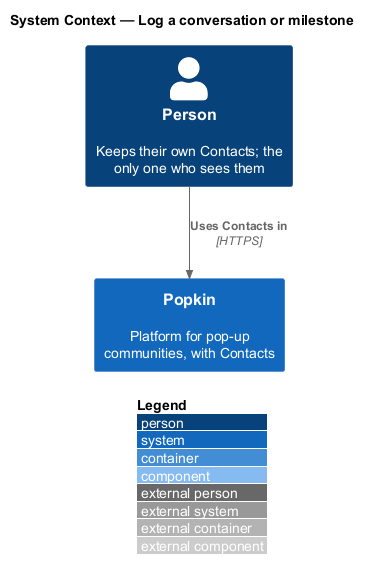
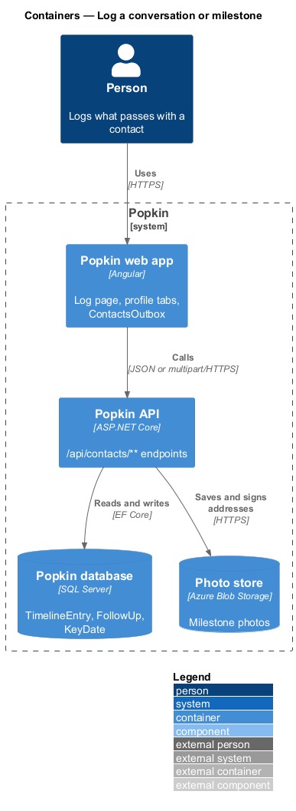
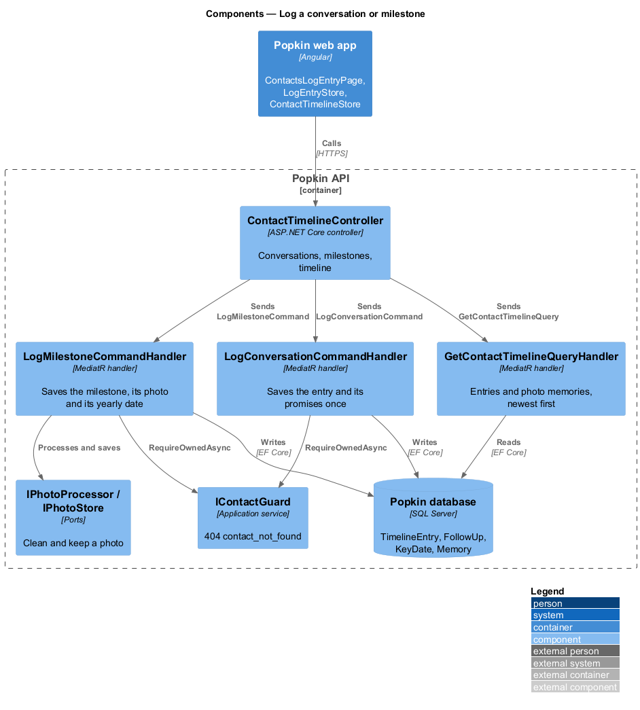
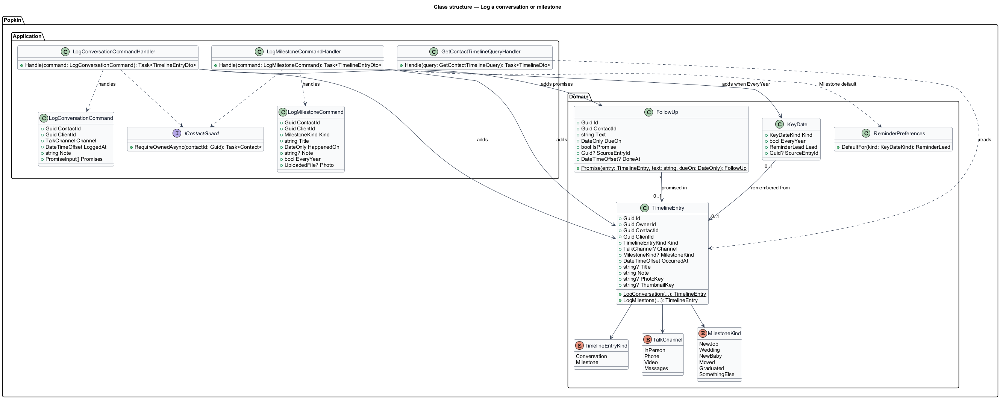
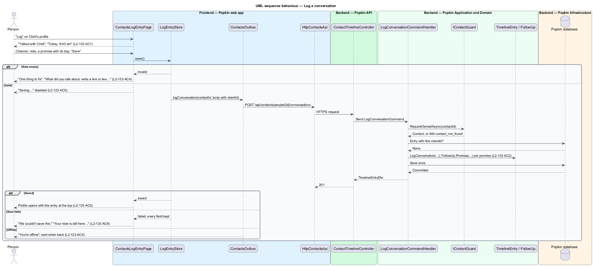
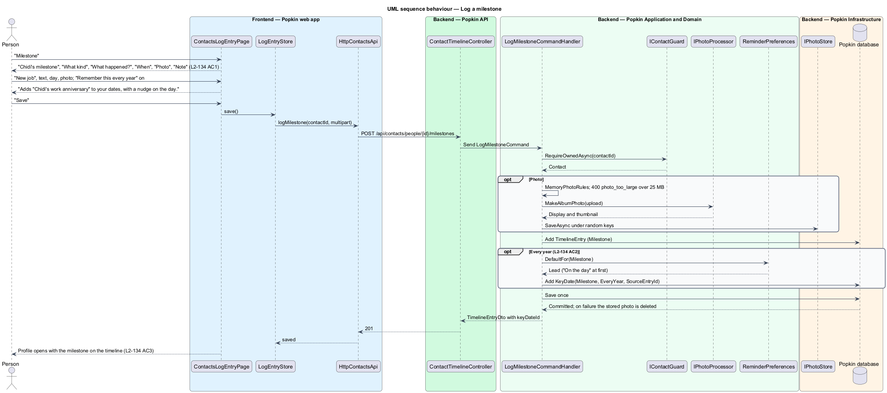
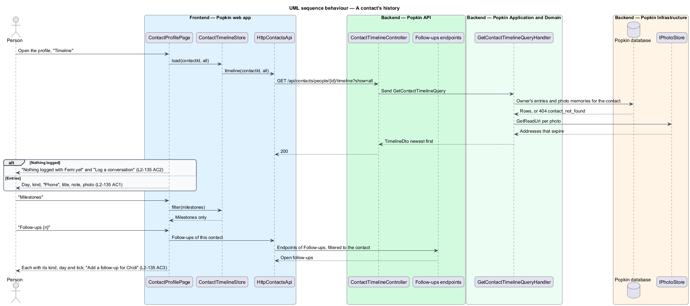

# Log a conversation or milestone

## Overview

Contacts keeps what passes between the person and the people they know (L1-032). After a chat,
the person logs it from the contact's profile: how they talked, what they talked about and
anything they said they would do. A promise goes on the person's follow-ups, so it does not slip.
A milestone, a turn in the contact's life, is logged the same way and may be remembered every
year as a key date. The profile then shows the contact's history in two tabs: "Timeline" and
"Follow-ups {n}". The page is "Log a conversation" at `/contacts/people/:id/log`; the profile is
[Contact profile](../contact-profile/README.md) and the follow-ups list is
[Follow-ups](../follow-ups/README.md).

- **timeline entry** — conversation or milestone logged about one contact, a `TimelineEntry`
- **conversation** — timeline entry of a talk, with its `TalkChannel` ("In person", "Phone", "Video" or "Messages"), when it was logged and a note
- **milestone** — timeline entry of a turn in a contact's life, with its `MilestoneKind`, what happened, when, an optional photo and a note
- **promise** — follow-up made in a conversation, with its due day, that says how and when it was made ("You promised · Phone, Sep 15")
- **follow-up** — thing the person means to do for a contact, a `FollowUp` ([Follow-ups](../follow-ups/README.md))
- **yearly milestone date** — key date of kind `Milestone` added when "Remember this every year" is on

Every entry belongs to its owner alone (L2-122): `IContactGuard` answers `404`
`contact_not_found` for a contact of anyone else.

## Description

### Screens and states

`docs/mocks/pages/log-entry/` (route `/contacts/people/:id/log`):

- `default.html` — the top bar "Talked with Chidi" with "Cancel" (an icon button) and "Save";
  "What to log" of "Conversation" and "Milestone"; "How you talked" of "In person", "Phone",
  "Video" and "Messages"; "Today, 8:40 am"; "What did you talk about?"; "Anything you said you'd
  do?" with "It goes on your follow-ups, so it doesn't slip.", a promise "Send him the
  flat-hunting checklist" with "Remind me Thu, Sep 17" and "Remove this promise", and "Add a
  promise or follow-up"; "Worth remembering" with "Add a date" (L2-133 AC1 to AC3).
- `milestone.html` — "Chidi's milestone"; "What kind" of "New job", "Wedding", "New baby",
  "Moved", "Graduated" and "Something else"; "What happened?", "When", "Photo" with "Add a photo",
  "Note"; the switch "Remember this every year" with "Adds "Chidi's work anniversary" to your
  dates, with a nudge on the day." (L2-134 AC1, AC2).
- `invalid.html` — "One thing to fix", "What did you talk about: write a line or two, so you
  remember it later.", and under the field "Write a line or two, so you remember it later."
  (L2-133 AC4).
- `submitting.html` — "Saving…", disabled (L2-123 AC5).
- `error.html` — "We couldn't save this." and "Your note is still here. Check your connection and
  try Save again."; the note is kept (L2-133 AC6).
- After a save the profile opens with the entry at the top of the timeline, as a milestone for a
  milestone (L2-133 AC5, L2-134 AC3).

The profile's tabs (`docs/mocks/pages/contact-profile/`):

- `default.html` — "Timeline" with the filter "All", "Conversations" and "Milestones" and the
  buttons "Milestone" and "Conversation", which open Log. Entries newest first, each with its day
  ("Sep 6", "Sep 26, 2021"), its kind, for a conversation how and how long ("Phone · 40 min"), its
  title and note, and a memory's photo (L2-135 AC1). `milestones.html` shows the filter on
  "Milestones".
- `empty.html` — "Nothing logged with Femi yet", "Jot down what you talked about after your next
  chat. Future you will thank you." and "Log a conversation" (L2-135 AC2).
- `follow-ups.html` — "Add a follow-up for Chidi" ("Something to do for Chidi…") and the open
  follow-ups with their kind and day ("Ask Chidi how the commute is going", "Follow-up", "Sep
  20"), each with its tick (L2-135 AC3).

### Rulings (known gap 106, settled)

- **Title and length.** A conversation has no title and no length: the timeline shows its channel
  ("Phone") and its note. The mocks drop "40 min" and the conversations' titles. A milestone's
  title is "What happened?".
- **When.** A conversation is logged at the moment Log opened ("Today, 8:40 am"), sent as
  `loggedAt`; it cannot be changed. A milestone's "When" is a date input, required.
- **The promise editor** is the dialog Add a promise (`docs/mocks/dialogs/add-promise/`): "What
  you said you'd do" (required: "Say what you'll do, so it goes on your follow-ups."; at most 200
  characters, as a follow-up) and "Remind me", a date, tomorrow at first. "Add the promise" lists
  it as the mock's `promise` row; "Remove this promise" takes it off before Save. Promises are
  saved with the conversation, never alone.
- **"Worth remembering"** offers "Add a date" alone, which opens Add a date for the contact; no
  suggestions. The mocks drop the suggested tag.
- **A milestone needs** its kind ("New job" at first), "What happened?" (1 to 200 characters:
  "Say what happened.") and "When". Its note is optional, up to 2,000 characters.
- **A conversation's note** ("What did you talk about?") is 1 to 2,000 characters.
- **The yearly date's title** is "{first name}'s {what}": work anniversary (New job), wedding
  anniversary (Wedding), baby's birthday (New baby), move anniversary (Moved), graduation
  anniversary (Graduated), and for Something else the milestone's own words. The hint names the
  owner's Milestones lead ("with a nudge on the day", "with a nudge 1 week before").
- **A milestone's photo** waits for [Memories and files](../memories/README.md): "Add a photo"
  opens Add a memory for the contact after the milestone is saved. A milestone carries no file of
  its own.
- **Offline.** Log sends at once; a failure keeps every field and shows the error state, whose
  Save sends again under the same client id. Nothing is queued.
- **Paging.** The timeline answers every entry of the contact, newest first; a person logs a
  handful a month, so there is no paging.
- **Editing and deleting** an entry or a promise are not built; an entry goes when its contact
  does (`ContactRemoval`).

### API

`ContactTimelineController` (`Popkin.Api/Controllers/Contacts/`), default authenticated policy.

- `POST /api/contacts/people/{contactId}/conversations` — body `{ clientId, channel, loggedAt,
  note, promises: [{ text, dueOn }] }`. `201` `TimelineEntryDto`. A resend with the same
  `clientId` answers `200` with the entry already saved. Refusals: `400` `note_required`
  (L2-133 AC4), `note_too_long`, `promise_text_required`, `promise_text_too_long`,
  `promise_due_required`; `404` `contact_not_found`.
- `POST /api/contacts/people/{contactId}/milestones` — JSON: `clientId`, `kind`, `title`,
  `happenedOn`, `note?`, `everyYear`. `201` `TimelineEntryDto` with `keyDateId` when a yearly
  milestone date was added. Refusals: `400` `title_required`, `title_too_long`,
  `happened_on_required`, `note_too_long`; `404` `contact_not_found`.
- `GET /api/contacts/people/{contactId}/timeline?show={all|conversations|milestones}` — `200`
  `TimelineDto`: `entries` newest first, each `TimelineItemDto` (`id`, `kind` of `Conversation`,
  `Milestone` or `Memory`, `day`, `channel?`, `milestoneKind?`, `title?`, `note?`, `photoUrl?`).
  A memory comes from [Memories and files](../memories/README.md). Every entry; no paging.
- The Follow-ups tab reads and writes through the endpoints of
  [Follow-ups](../follow-ups/README.md), filtered to the contact (L2-135 AC3, L2-142).

### Backend

- **`TalkChannel`** (`InPerson`, `Phone`, `Video`, `Messages`), **`MilestoneKind`** (`NewJob`,
  `Wedding`, `NewBaby`, `Moved`, `Graduated`, `SomethingElse`), **`TimelineEntryKind`**
  (`Conversation`, `Milestone`) — Domain enums.
- **`TimelineEntry`** (Domain) — `Id`, `OwnerId`, `ContactId`, `ClientId`, `Kind`, `Channel?`,
  `MilestoneKind?`, `OccurredAt`, `Title?`, `Note`, `PhotoKey?`, `ThumbnailKey?`, `CreatedAt`.
  `LogConversation(…)` and `LogMilestone(…)`. Unique index on (`OwnerId`, `ClientId`).
- **`FollowUp`** (Domain, from [Follow-ups](../follow-ups/README.md)) — `FollowUp.Promise(entry,
  text, dueOn)` makes one with `IsPromise` and `SourceEntryId`; its "You promised · {how},
  {when}" reads the source entry's channel and day (L2-133 AC2).
- **`LogConversationCommandHandler`** (`Popkin.Application/Contacts/Timeline/`) —
  `IContactGuard.RequireOwnedAsync`; `LogConversationValidator`; returns the saved entry for a
  known `ClientId`; adds the entry and one promise per row; saves once.
- **`LogMilestoneCommandHandler`** — the same guard and validation; with `everyYear` it
  adds a `KeyDate` of kind `Milestone`, `EveryYear`, the day and month of `happenedOn` and the lead
  `ReminderPreferences.DefaultFor(Milestone)` (L2-134 AC2). One save.
- **`GetContactTimelineQueryHandler`** — the owner's entries and the contact's photo memories,
  merged newest first, with photo addresses from `IPhotoStore.GetReadUrl`.
- No log, metric or span carries a note, a promise, a title or a name.

### Frontend (Popkin web app)

- **`ContactsLogEntryPage`** (`pages/contacts-log-entry/contacts-log-entry.page.ts`, route
  `/contacts/people/:id/log`, data `{ shell: 'bare', page: 'log-entry' }`; the mock has a top bar
  and no Contacts navigation). `?kind=milestone` opens it on Milestone. Composes `pk-top-bar`,
  `pk-segmented-control` "What to log", `pk-choice-chips` for "How you talked" and "What kind",
  `pk-textarea`, `pk-text-field`, `pk-form-summary`, `pk-alert` for the failure, the promise row
  of `pk-task`, `pk-photo-picker`, and `pk-setting-row` with `pk-switch`.
- **`LogEntryStore`** (`frontend/projects/api/src/lib/api/contacts/log-entry-store.ts`) — the
  form, its validation ("One thing to fix"), `idle | saving | failed`, the yearly title and hint,
  and the save, sent at once under one client id. On success it navigates to the profile; on failure it
  keeps every field. Unit tested.
- **`ContactTimelineStore`** — the Timeline tab: `loading | ready | empty | failed`, the filter,
  and an entry saved by Log placed first.
- The tabs are the profile's `?view=timeline` and `?view=follow-ups`
  ([Contact profile](../contact-profile/README.md)); they compose `pk-contact-timeline` and, for
  follow-ups, `pk-task` with its add field (`POST /api/contacts/follow-ups`, `PUT
  /api/contacts/follow-ups/{id}/done`); the empty timeline is `pk-empty-state`.
- **`CONTACTS_API`** — `logConversation(contactId, body)`, `logMilestone(contactId, form)`,
  `timeline(contactId, show)`.

### Tests

- API acceptance (InMemory): a conversation with a promise heads the timeline and makes a promise
  follow-up that reads "You promised · Phone, {day}"; an empty note answers `400`
  `note_required`; another person's contact answers `404` `contact_not_found`; a resend saves
  once; a milestone with "Remember this every year" adds a `Milestone` key date at the owner's
  default, titled "Chidi's work anniversary".
- Direct tests: the filter of `GetContactTimelineQueryHandler` (all, conversations, milestones);
  the promise text of `FollowUp` per `TalkChannel`.
- Playwright: `tests/contacts-log-entry.spec.ts` through `LogEntryPage` and `ContactProfilePage`
  page objects on recorded responses: each mock state, Cancel, a save opening the profile, the
  filter, the empty timeline and the Follow-ups tab. `routes.ts` keys each state.
- Parity: `pk-contact-timeline` and `pk-task` with its promise row.

## Requirements

| L2 ID | Refines (L1) | Requirement |
|-------|--------------|-------------|
| `L2-133` | `L1-032` | Log a conversation: A conversation is logged with what was promised. (AC1–AC6) |
| `L2-134` | `L1-032` | Log a milestone: A milestone is a turn in a contact's life. (AC1–AC3) |
| `L2-135` | `L1-032` | A contact's history: The profile shows what was logged and what is to do. (AC1–AC3) |

## Diagrams

### System context

The owner logs what passes with a contact; the contact is told nothing.

### Containers

The web app sends each entry to the API, through the offline outbox; the API keeps entries in the
database and a milestone's photo in the photo store.

### Components

### Class structure

A conversation's promises become follow-ups; a yearly milestone becomes a key date.

### Behaviour

A conversation is validated, saved once with its promises, or kept on failure.

A milestone is saved with its photo and, when remembered every year, its key date.

The profile's Timeline and Follow-ups tabs show the contact's history.

