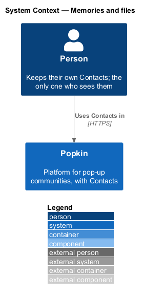
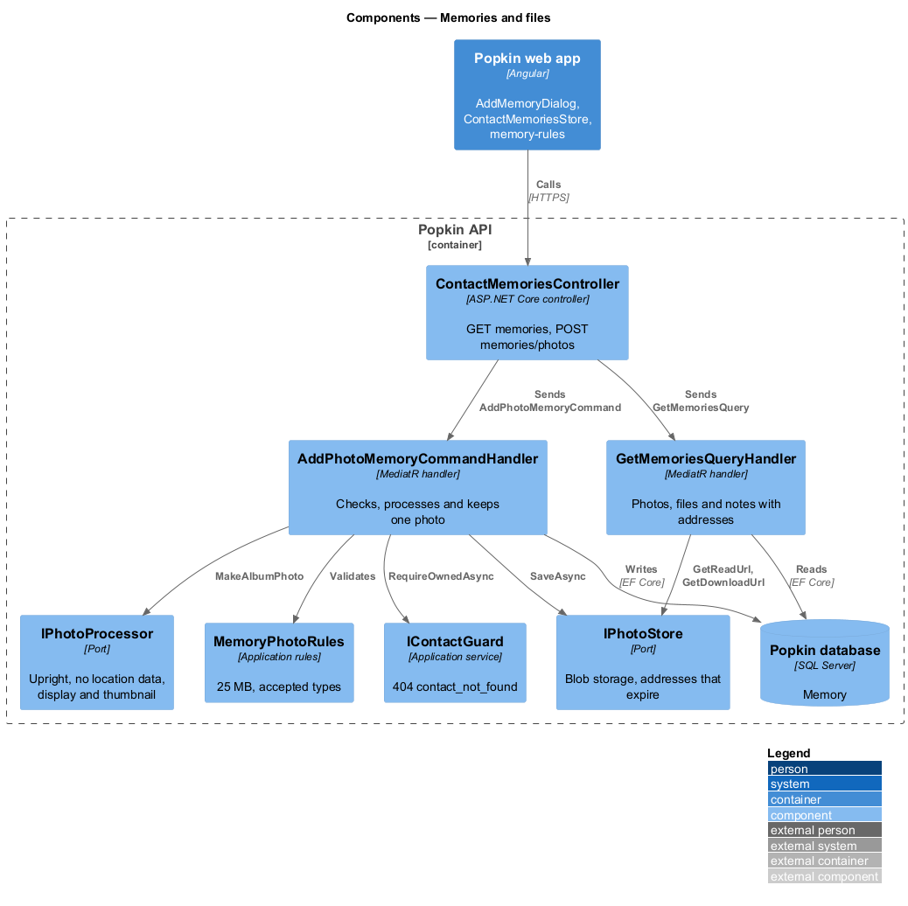

# Memories and files

## Overview

Beside what was said, a person keeps things about the people they know: a photo from a day
together, a file such as a wedding speech, a note of gift ideas (L1-032). "Memories & files" is
the third tab of a contact's profile ([Contact profile](../contact-profile/README.md)). It lists
what the owner has kept, and "Add" opens "Add to {first name}'s memories". Photo memories also
appear on the contact's timeline ([Log a conversation or milestone](../log-entry/README.md)).

- **memory** — photo, file or note kept about one contact, a `Memory`
- **photo memory** — memory of one photo with an optional caption and the day it was taken
- **file memory** — memory of one file with its name and size
- **note memory** — memory of text with the day it was last updated
- **caption** — optional words under a photo memory, "Only you can see it."

Memories belong to their owner alone (L2-122). Their files are kept in the photo store under
random keys and read through addresses that expire, as the album's photos are
([ADR 0022](../../../adr/0022-photos-in-azure-blob-storage.md)).

## Description

### Screens and states

`docs/mocks/pages/contact-profile/memories.html` — "Photos, files and notes you've kept about
Chidi. Private to you." with "Add"; the photos as a grid with caption and day ("Hot sauce night ·
Aug 8", "Wedding day bonfire · Sep 26, 2021"); files with their name, month and size ("Wedding
speech.pdf", "Sep 2021 · 84 KB"); notes with when they were updated ("Gift ideas: Fela reissue on
vinyl, Dishoom cookbook, bike lights", "Updated Aug 31") (L2-136 AC1).

`docs/mocks/dialogs/add-memory/`:

- `default.html` — "Add to Chidi's memories"; "What to add" of "Photo", "File" and "Note";
  "Choose a photo"; "Caption" with "Optional. Only you can see it."; "Save" (L2-136 AC2).
- `file.html` — "File": "Choose a file" and "A PDF, a document, a spreadsheet or a picture, up to
  25 MB. Only you can see it." (L2-136 AC5).
- `note.html` — "Note" with "Up to 2,000 characters. Only you can see it." (L2-136 AC6).
- `invalid.html` — "One thing to fix", "Photo: that one is 32 MB; choose one up to 25 MB.", and
  at the field "That photo is 32 MB. A photo can be up to 25 MB." with "Choose another photo"
  (L2-136 AC3).
- `busy.html` — the file "IMG_4471.jpg", "Uploading · 2.4 of 3.1 MB" with a progress bar named
  "Uploading IMG_4471.jpg", and "Uploading…", disabled (L2-136 AC4, L2-123 AC5).

The dialog checks the size in the browser before any upload, and the API checks it again.

### Rulings (known gap 107, settled)

- **Caption** — optional, up to 200 characters ("Keep it to 200 characters.").
- **A photo's day** — its capture time when the upload carries one, otherwise the day it was
  added; a `takenOn` sent with the upload (`yyyy-MM-dd`) is used instead, as a milestone's photo
  is dated by the milestone.
- **File** (`docs/mocks/dialogs/add-memory/file.html`) — "Choose a file": a PDF, a Word document,
  a spreadsheet, plain text or a picture (`application/pdf`, `.doc`/`.docx`, `.xls`/`.xlsx`,
  `text/plain`, and the photo types), up to 25 MB, kept as it is under a random key. It is listed
  with its name, the month it was added and its size ("Sep 2021 · 84 KB") and opens through a
  download address that expires. Refusals: `file_too_large` ("That file is {n} MB. A file can be
  up to 25 MB."), `file_type_not_allowed` ("Choose a PDF, a document, a spreadsheet or a
  picture.").
- **Note** (`docs/mocks/dialogs/add-memory/note.html`) — 1 to 2,000 characters; "Updated {day}"
  is the day it was added, since a note is not edited. Refusals: `note_required`,
  `note_too_long`.
- **A milestone's photo** — Log's "Photo" ("Add a photo") chooses a photo; once the milestone is
  saved, the photo is added as a photo memory captioned with what happened and dated by the
  milestone's day. If that upload fails the milestone stays saved and Log stays open with "We
  couldn't add the photo." and "{first name}'s milestone is saved. Check your connection and try
  Save again."; Save resends the milestone, kept once under its client id, then the photo.
- **The timeline** lists photo memories among the entries, by their day, each with its caption
  as its title and its thumbnail (L2-135 AC1).
- **Editing and deleting** a memory are not built; memories and their files go with their
  contact (`ContactRemoval`) and with a deleted account.
- **Offline** — nothing is queued; a failed upload keeps the choice and the caption, and Save
  sends again under the same client id.
- **Rate limit** — the album's `photos` policy covers photo and file uploads.

### API

`ContactMemoriesController` (`Popkin.Api/Controllers/Contacts/`), default authenticated policy.

- `GET /api/contacts/people/{contactId}/memories` — `200` `MemoriesDto`: `photos`
  (`PhotoMemoryDto`: `id`, `caption?`, `day`, `thumbnailUrl`, `photoUrl`), `files`
  (`FileMemoryDto`: `id`, `fileName`, `addedOn`, `sizeBytes`, `downloadUrl`), `notes`
  (`NoteMemoryDto`: `id`, `text`, `updatedOn`), each newest first. `404` `contact_not_found`.
- `POST /api/contacts/people/{contactId}/memories/photos` — `multipart/form-data` with `file`,
  `caption?` and `clientId`. `201` `PhotoMemoryDto` and a `Location`. A resend with the same
  `clientId` answers `200`. Refusals: `400` `validation_failed` without a file, `photo_too_large`
  over 25 MB, `photo_type_not_allowed`, `caption_too_long`, `taken_on_not_valid`; `404` `contact_not_found`; `413`
  `request_too_large` for a body over 50 MB, twice the largest photo as
  [Add photos](../../photos/add-photos/README.md) sets its limit; `429` `rate_limited` under the
  Photos policy, as for a Popkin's photos. The checks run in this order: ownership, caption, missing file, size, type.
- `POST …/memories/files` — `multipart/form-data` with `file` and `clientId`. `201`
  `FileMemoryDto`, `200` for a resend. Refusals: `validation_failed` without a file,
  `file_too_large`, `file_type_not_allowed` (the type is read from the file's bytes, and for an
  Office document its name).
- `POST …/memories/notes` — JSON `{ clientId, text }`. `201` `NoteMemoryDto`, `200` for a resend.
  Refusals: `note_required`, `note_too_long`.
- `POST …/memories/photos` also takes `takenOn` (`yyyy-MM-dd`), which dates the photo instead of
  its capture time; a milestone's photo sends the milestone's day.
- `GET …/timeline?show=all` lists photo memories as items of kind `Memory` with `thumbnailUrl` and
  `photoUrl`.

### Backend

- **`MemoryKind`** (Domain) — `Photo`, `File`, `Note`.
- **`Memory`** (Domain) — `Id`, `OwnerId`, `ContactId`, `ClientId`, `Kind`, `Caption?`,
  `FileKey?`, `ThumbnailKey?`, `FileName?`, `ContentType?`, `SizeBytes?`, `Text?`, `TakenAt?`,
  `AddedAt`, `UpdatedAt`. `AddPhoto(…)` makes a photo memory. Unique index on (`OwnerId`,
  `ClientId`).
- **`MemoryPhotoRules`** (Application) — `MaxBytes` = 25 MB and the accepted types; the milestone
  photo of [Log a conversation or milestone](../log-entry/README.md) uses the same rules.
- **`AddPhotoMemoryCommandHandler`** (`Popkin.Application/Contacts/Memories/`) —
  `IContactGuard.RequireOwnedAsync`; validates; `IPhotoProcessor.MakeAlbumPhoto` turns the upload
  upright, removes its location and device data and gives the display image, the thumbnail and
  the capture time (L2-054); `IPhotoStore.SaveAsync` keeps the display image and the thumbnail
  under random keys; adds the `Memory` and saves once, deleting both files if the save fails.
  Bytes that do not decode answer `photo_type_not_allowed`.
- **`GetMemoriesQueryHandler`** — the contact's memories with addresses from
  `IPhotoStore.GetReadUrl` and, for a file, `GetDownloadUrl(key, fileName)`.
- **Deletion** — `ContactRemoval` deletes a memory's `FileKey` and `ThumbnailKey` files through
  `IPhotoStore`, for a deleted contact and a deleted account alike (L2-049); a milestone's
  `PhotoKey` and `ThumbnailKey` go the same way.
- No log, metric or span carries a caption, a file name or a note.

### Frontend (Popkin web app)

- **`AddMemoryDialog`** (`dialogs/add-memory/`) — CDK Dialog opened from the profile's "Add"
  with the contact's id and first name. Composes `pk-dialog`, `pk-form-summary`, `pk-alert`,
  `pk-segmented-control` "What to add" (radios), `pk-memory-chooser` ("Choose a photo", "Choose a
  file" with its hint, "Choose another photo" once one is chosen or refused), `pk-memory-upload`
  for the chosen photo or file and its progress, `pk-text-field` "Caption" and `pk-textarea`
  "Note". It closes with what was kept. States: default, chosen, file, note, invalid, busy.
- **`AddMemoryStore`** (api library) — the kind, the chosen file, the caption and note, the
  problems (a file over 25 MB as soon as it is chosen, the rest once Save is chosen, the API's
  refusals at their field), `idle | uploading | saving | failed`, how much is sent, and one
  client id per memory. Unit tested.
- **`memory-text.ts`** (api library) — 25 MB, the photo and file types, "Photo: that one is {n}
  MB; choose one up to 25 MB.", "That photo is {n} MB. A photo can be up to 25 MB.", "Uploading ·
  {sent} of {total} MB", a file's size in KB or MB, "Sep 2021 · 84 KB", "Updated Aug 31" and
  "Hot sauce night · Aug 8". Unit tested.
- **`ContactMemoriesStore`** (api library) — the tab: `loading | ready | failed`, and a memory
  just saved placed first among its kind. Unit tested.
- The tab is the profile's `?view=memories`: the line and "Add", `pk-memory-grid` for the photos
  and `pk-memory-list` for the files (their name downloads them) and notes; a failed read is
  `pk-empty-state` with "Try again". The timeline draws a photo memory with its photo.
- Log's milestone pairs "When" with `pk-memory-chooser` "Photo" in `pk-form-pair`;
  `LogEntryStore` sends the photo once the milestone is saved.
- **`CONTACTS_API`** — `memories(contactId)`, `addPhotoMemory(contactId, clientId, file,
  caption, takenOn?)` and `addFileMemory(contactId, clientId, file)`, which post with
  `reportProgress` and emit progress and the saved memory, and `addNoteMemory(contactId,
  clientId, text)`.

### Tests

- API acceptance (InMemory, a fake `IPhotoStore`): a photo with a caption is listed with its
  caption and day; a 26 MB photo answers `400` `photo_too_large`; a text file answers `400`
  `photo_type_not_allowed`; another person's contact answers `404` `contact_not_found`; a resend
  saves once; a failed save leaves no file.
- Direct test of `memory-rules.ts`: each size at and around 25 MB, each size text.
- Playwright: `tests/contacts-memories.spec.ts` through `ContactProfilePage`, `AddMemoryDialog`
  and `LogEntryPage` on recorded responses, with stubs for the progress and the refusals: the
  tab, nothing kept, a failed read, a photo on the timeline, the dialog, a photo too large,
  uploading, a saved photo, a refused photo, a file, a note, a failure, and a milestone's photo.
  `routes.ts` keys each state.
- Parity: `pk-memory-grid`, `pk-memory-list`, `pk-memory-chooser` (photo, file, refused, Log),
  `pk-memory-upload` (chosen) and the timeline's photo memory.

## Requirements

| L2 ID | Refines (L1) | Requirement |
|-------|--------------|-------------|
| `L2-136` | `L1-032` | Memories and files: Photos, files and notes are kept about a contact. (AC1–AC4) |

## Diagrams

### System context

### Containers

The web app uploads a photo to the API, which keeps the file in the photo store and the memory in
the database.

### Components

### Class structure

### Behaviour

A photo is checked in the browser, uploaded with progress, processed and stored once.

The tab lists photos, files and notes through addresses that expire.

