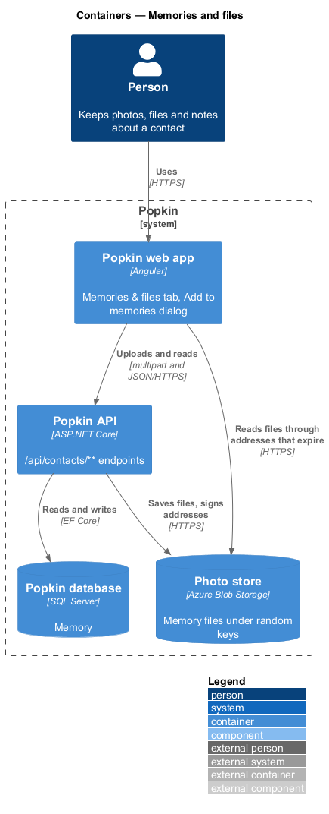
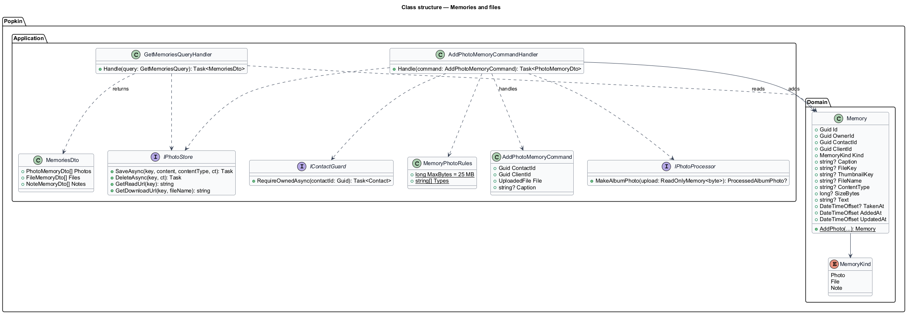
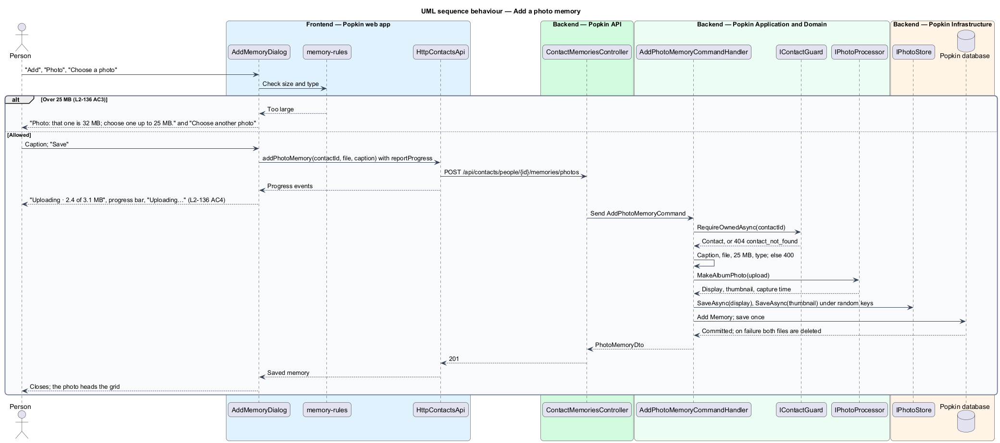
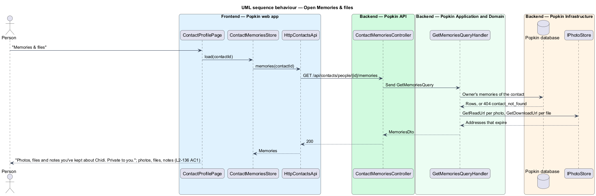

# Memories and files

## Overview

Beside what was said, a person keeps things about the people they know: a photo from a day
together, a file such as a wedding speech, a note of gift ideas (L1-032). "Memories & files" is
the third tab of a contact's profile ([Contact profile](../contact-profile/README.md)). It lists
what the owner has kept, and "Add" opens "Add to {first name}'s memories". Photo memories also
appear on the contact's timeline ([Log a conversation or milestone](../log-entry/README.md)).

- **memory** — photo, file or note kept about one contact, a `Memory`
- **photo memory** — memory of one photo with an optional caption and the day it was taken
- **file memory** — memory of one file with its name and size
- **note memory** — memory of text with the day it was last updated
- **caption** — optional words under a photo memory, "Only you can see it."

Memories belong to their owner alone (L2-122). Their files are kept in the photo store under
random keys and read through addresses that expire, as the album's photos are
([ADR 0022](../../../adr/0022-photos-in-azure-blob-storage.md)).

## Description

### Screens and states

`docs/mocks/pages/contact-profile/memories.html` — "Photos, files and notes you've kept about
Chidi. Private to you." with "Add"; the photos as a grid with caption and day ("Hot sauce night ·
Aug 8", "Wedding day bonfire · Sep 26, 2021"); files with their name, month and size ("Wedding
speech.pdf", "Sep 2021 · 84 KB"); notes with when they were updated ("Gift ideas: Fela reissue on
vinyl, Dishoom cookbook, bike lights", "Updated Aug 31") (L2-136 AC1).

`docs/mocks/dialogs/add-memory/`:

- `default.html` — "Add to Chidi's memories"; "What to add" of "Photo", "File" and "Note";
  "Choose a photo"; "Caption" with "Optional. Only you can see it."; "Save" (L2-136 AC2).
- `invalid.html` — "One thing to fix", "Photo: that one is 32 MB; choose one up to 25 MB.", and
  at the field "That photo is 32 MB. A photo can be up to 25 MB." with "Choose another photo"
  (L2-136 AC3).
- `busy.html` — the file "IMG_4471.jpg", "Uploading · 2.4 of 3.1 MB" with a progress bar named
  "Uploading IMG_4471.jpg", and "Uploading…", disabled (L2-136 AC4, L2-123 AC5).

The dialog checks the size in the browser before any upload, and the API checks it again.

### Conflicts and gaps

- **File and Note** have no form in the mocks: the files accepted and their size, a note's
  length, and editing or deleting a memory are known gap 107. The tab lists both kinds; "File"
  and "Note" in the dialog are `<TO SUPPLY>`, and their endpoints are not designed here.
- **A photo's day** — the mock dates photos by when they were taken ("Sep 26, 2021"). The day is
  the photo's capture time when the upload carries one, and the day it was added otherwise.
- **Caption and title** — the dialog takes a caption alone, so the timeline shows a memory's
  caption as its title and no note; the profile mock was changed to match ("Hot sauce night").
- **Caption length** is `<TO SUPPLY>` (gap 107).
- **Photo types** — the album's types (`image/jpeg`, `image/png`, `image/webp`, `image/heic`) are
  used; L2-136 names none.
- **Offline** — `ContactsOutbox` keeps its entries in local storage, which holds no file, so a
  photo is not queued; whether the outbox should keep files is `<TO SUPPLY>`.
- **Deleting a contact or an account** removes the memory rows and their files (`FileKey`,
  `ThumbnailKey`) through `ContactRemoval` ([Delete a contact](../delete-contact/README.md));
  what deleting a contact does beyond that is gap 110.

### API

`ContactMemoriesController` (`Popkin.Api/Controllers/Contacts/`), default authenticated policy.

- `GET /api/contacts/people/{contactId}/memories` — `200` `MemoriesDto`: `photos`
  (`PhotoMemoryDto`: `id`, `caption?`, `day`, `thumbnailUrl`, `photoUrl`), `files`
  (`FileMemoryDto`: `id`, `fileName`, `addedOn`, `sizeBytes`, `downloadUrl`), `notes`
  (`NoteMemoryDto`: `id`, `text`, `updatedOn`), each newest first. `404` `contact_not_found`.
- `POST /api/contacts/people/{contactId}/memories/photos` — `multipart/form-data` with `file`,
  `caption?` and `clientId`. `201` `PhotoMemoryDto` and a `Location`. A resend with the same
  `clientId` answers `200`. Refusals: `400` `validation_failed` without a file, `photo_too_large`
  over 25 MB, `photo_type_not_allowed`, `caption_too_long`; `404` `contact_not_found`; `413`
  `request_too_large` for a body over 50 MB, twice the largest photo as
  [Add photos](../../photos/add-photos/README.md) sets its limit; `429` `rate_limited` under a
  policy `<TO SUPPLY>`. The checks run in this order: ownership, caption, missing file, size, type.
- Files and notes: `<TO SUPPLY>` (gap 107).

### Backend

- **`MemoryKind`** (Domain) — `Photo`, `File`, `Note`.
- **`Memory`** (Domain) — `Id`, `OwnerId`, `ContactId`, `ClientId`, `Kind`, `Caption?`,
  `FileKey?`, `ThumbnailKey?`, `FileName?`, `ContentType?`, `SizeBytes?`, `Text?`, `TakenAt?`,
  `AddedAt`, `UpdatedAt`. `AddPhoto(…)` makes a photo memory. Unique index on (`OwnerId`,
  `ClientId`).
- **`MemoryPhotoRules`** (Application) — `MaxBytes` = 25 MB and the accepted types; the milestone
  photo of [Log a conversation or milestone](../log-entry/README.md) uses the same rules.
- **`AddPhotoMemoryCommandHandler`** (`Popkin.Application/Contacts/Memories/`) —
  `IContactGuard.RequireOwnedAsync`; validates; `IPhotoProcessor.MakeAlbumPhoto` turns the upload
  upright, removes its location and device data and gives the display image, the thumbnail and
  the capture time (L2-054); `IPhotoStore.SaveAsync` keeps the display image and the thumbnail
  under random keys; adds the `Memory` and saves once, deleting both files if the save fails.
  Bytes that do not decode answer `photo_type_not_allowed`.
- **`GetMemoriesQueryHandler`** — the contact's memories with addresses from
  `IPhotoStore.GetReadUrl` and, for a file, `GetDownloadUrl(key, fileName)`.
- **Deletion** — `ContactRemoval` deletes a memory's `FileKey` and `ThumbnailKey` files through
  `IPhotoStore`, for a deleted contact and a deleted account alike (L2-049); a milestone's
  `PhotoKey` and `ThumbnailKey` go the same way.
- No log, metric or span carries a caption, a file name or a note.

### Frontend (Popkin web app)

- **`AddMemoryDialog`** (`dialogs/add-memory/add-memory.dialog.ts`) — CDK Dialog opened from the
  profile's "Add" with the contact's id and first name. Composes `pk-dialog`, `pk-form-summary`,
  `pk-segmented-control` "What to add", the add card of `pk-info-card` for "Choose a photo"
  through `pk-files-input`, `pk-upload-item` for the chosen file and its progress, `pk-text-field`
  "Caption" with its hint, and `pk-button` "Save" / "Uploading…". It closes with the saved memory.
  `pk-upload-item` gains an input that leaves out its own caption field, since the dialog's
  caption is a field of its own.
- **`memory-rules.ts`** (api library) — 25 MB, the types, "Photo: that one is {n} MB; choose one
  up to 25 MB.", "That photo is {n} MB. A photo can be up to 25 MB.", "Uploading · {sent} of
  {total} MB" and a file's size in KB or MB. Unit tested.
- **`ContactMemoriesStore`** — the tab: `loading | ready | failed`, and a saved memory placed
  first.
- The tab is the profile's `?view=memories` ([Contact profile](../contact-profile/README.md));
  it composes the memory grid and rows of `pk-contact-id` (backlog row 13).
- **`CONTACTS_API`** — `memories(contactId)` and `addPhotoMemory(contactId, file, caption)`,
  which posts with `reportProgress` and emits progress and the saved memory.

### Tests

- API acceptance (InMemory, a fake `IPhotoStore`): a photo with a caption is listed with its
  caption and day; a 26 MB photo answers `400` `photo_too_large`; a text file answers `400`
  `photo_type_not_allowed`; another person's contact answers `404` `contact_not_found`; a resend
  saves once; a failed save leaves no file.
- Direct test of `memory-rules.ts`: each size at and around 25 MB, each size text.
- Playwright: `tests/contacts-memories.spec.ts` through `ContactProfilePage` and
  `AddMemoryDialog` page objects on recorded responses, with stubs for the progress and the
  refusal: the tab, a photo too large, uploading, a saved photo. `routes.ts` keys each state.
- Parity: `pk-upload-item` without its caption, and the memory grid of `pk-contact-id`.

## Requirements

| L2 ID | Refines (L1) | Requirement |
|-------|--------------|-------------|
| `L2-136` | `L1-032` | Memories and files: Photos, files and notes are kept about a contact. (AC1–AC4) |

## Diagrams

### System context

### Containers

The web app uploads a photo to the API, which keeps the file in the photo store and the memory in
the database.

### Components

### Class structure

### Behaviour

A photo is checked in the browser, uploaded with progress, processed and stored once.

The tab lists photos, files and notes through addresses that expire.

