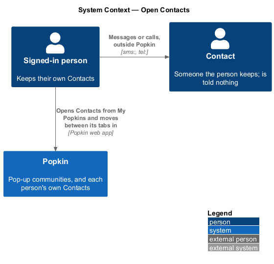
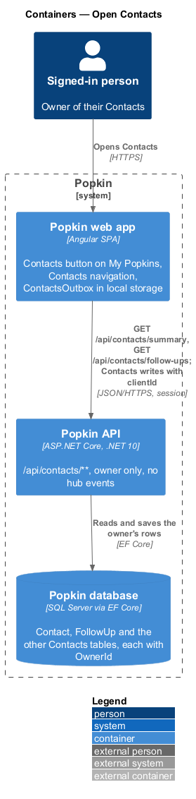
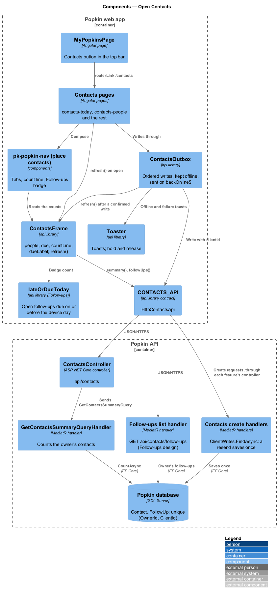
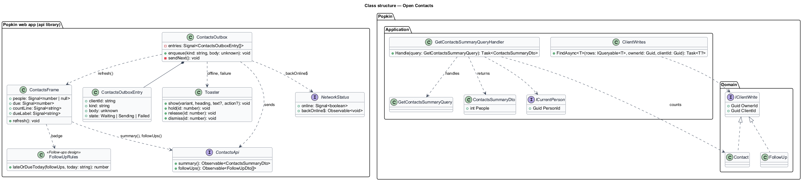
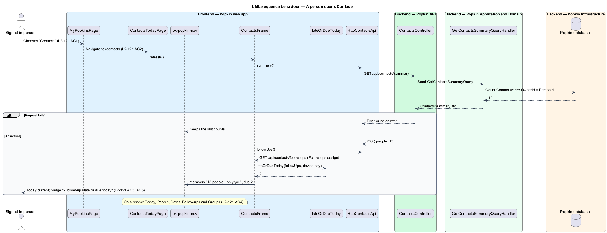
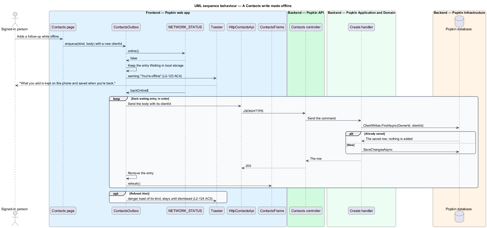

# Open Contacts

## Overview

Popkin is a platform for pop-up communities. Contacts is a signed-in person's own address book
inside the Popkin web app: the people who matter to them, whether or not they have a Popkin
account (L1-029). This design covers the way in and the frame every Contacts page shares: the
"Contacts" button on My Popkins, the Contacts navigation, and the rules for loading, failure,
offline writes, busy buttons and messages that each Contacts page follows. The pages themselves
are designed in their own features: [Today](../today/README.md), [People](../people/README.md)
and the rest of `contacts/`. Who may see a Contacts row is [Only you see your
Contacts](../contacts-privacy/README.md).

- **Contacts** — person's own address book of contacts, seen only by them
- **contact** — person kept in Contacts by its owner, with or without a Popkin account
- **owner** — signed-in `Person` whose Contacts a row belongs to
- **Contacts navigation** — `pk-popkin-nav` drawn for Contacts: the 📇 tile, "Contacts", the count line, "Your Popkins" and the Contacts tabs
- **Contacts summary** — count of the people kept, which the navigation shows on every Contacts page
- **Contacts outbox** — ordered queue on the device of the Contacts writes made offline, sent when the connection returns
- **device day** — calendar date on the person's device, which every "today", "late" and "days left" in Contacts is counted from

Contacts adds no container and no hub event (the shared rules of
[Contacts](../../README.md#contacts)). A page reads its data when it opens and after its own
writes. The navigation's counts are held by `ContactsFrame`, which reads them when a Contacts
page opens and after each Contacts write, so the count line and the Follow-ups badge show in every
state of every page, including its loading and failed states, as the mocks draw them. The count
line comes from `GET /api/contacts/summary`; the badge is the `lateOrDueToday` rule of
[Follow-ups](../follow-ups/README.md) applied to `GET /api/contacts/follow-ups` with the device
day, so the badge and the Follow-ups page count the same way.

## Description

### Screens and states

My Popkins, `docs/mocks/pages/my-popkins/` (`default`, `loading`, `empty`, `error`, `offline`,
`active-only`):

- Every state's top bar holds a quiet "Contacts" button after "New Popkin" and before "Scan to
  join". Its label is `only-s-up`, so the narrowest phones show the icon alone; the link keeps
  `aria-label="Contacts"` and `title="Contacts"` (L2-121 AC1). It goes to `/contacts`, which is
  Today (L2-121 AC2).

The Contacts navigation, drawn on every Contacts page (`contacts-today/default.html` and its
siblings):

- `nav aria-label="Contacts"`: "Your Popkins" back to `/popkins`, the tile 📇, "Contacts" and
  "13 people · only you"; with nobody kept, "Only you can see them" (`contacts-today/empty.html`)
  (L2-121 AC3).
- Tabs Today, People, Dates, Follow-ups, Habits, Groups and Connections, the current one with
  `aria-current="page"` (L2-121 AC3). Habits and Connections are `only-m-up`: a phone shows five
  tabs (L2-121 AC4). Habits is reached from Today's overdue habit and Connections from Groups;
  their "Today" and "Groups" back links are drawn by the Habits and Connections designs.
- Follow-ups carries a badge "2", named "2 follow-ups late or due today"; with none, no badge
  (L2-121 AC5).
- A profile's navigation is `only-m-up` (`contact-profile/default.html`): a phone shows only the
  page's "People" back link (L2-121 AC6). The profile route says so with the route data
  `phoneTabs: false`.
- Add someone, Edit and Log (`/contacts/people/new`, `/:id/edit`, `/:id/log`) use `shell: 'bare'`
  and show no Contacts navigation.

Loading, failure and offline (L2-123), as each page's `loading` and `error` mocks draw them:

- Loading keeps the page head and shows skeletons beside a `role="status"` line: "Loading your
  day…", "Loading your people…", "Loading {first name}'s profile…", "Loading your dates…",
  "Loading your follow-ups…", "Loading your habits…", "Loading your groups…", "Loading your
  connections…" (L2-123 AC1).
- Failure replaces the body with `pk-empty-state` as an alert: the heading, then the safe line
  followed by "Check your connection and try again.", and "Try again" (L2-123 AC2). The table of
  headings and safe lines is L2-123 AC2, word for word, held in `contacts-text.ts`. "Try again"
  reads the page's data again (L2-123 AC3).
- Offline, a write is kept and the warning toast "You're offline" / "What you add is kept on this
  phone and saved when you're back." shows (`contacts-toast/warning.html`, L2-123 AC4).
- While a save is under way its button is disabled and reads "Saving…", "Starting…", "Making
  it…", "Connecting…", "Adding…", "Importing {n} people…", "Deleting…" or "Uploading…"
  (L2-123 AC5). Each dialog's design names which.

Messages, `docs/mocks/notifications/contacts-toast/`:

- `success.html` — "Marked done", "Return Ruth's ladder.", "Undo" (L2-124 AC4).
- `danger.html` — "We couldn't save that follow-up", "Check your connection and try again.",
  "Try again" (L2-124 AC3).
- `warning.html` — the offline toast above.
- `info.html` — a date's reminder, "Grace turns 33 on Saturday", owned by
  the reminders design (L2-140).
- Every toast is announced through the polite `pk-toast-region` and has "Dismiss" (L2-124 AC1).
  Success and info leave after 8 seconds and wait while hovered or focused; warning and danger
  stay until dismissed (L2-124 AC2, AC3).

### Conflicts and gaps

- **One person.** The count line reads "{n} people · only you" and the badge "{n} follow-ups late
  or due today". The count line reads "1 person · only you" for one, and the badge "1 follow-up
  late or due today" (known gap 111, ruled 2026-11-16).
- **Toasts that wait.** `Toaster` removes a success toast after 8 seconds whatever the pointer
  does; L2-124 AC2 asks it to wait while hovered or focused. This design adds the wait to
  `Toaster` for the whole app, which L2-056 AC7 does not forbid.
- **Danger toasts are polite.** The mocks put every toast in one `aria-live="polite"` region; the
  design keeps it, so a failure is announced without interrupting.
- **Other devices** (gap 110, ruled). Contacts does not push between devices; a second device
  sees a change on its next read.
- **Photos offline** (gap 118, ruled). A photo waits with its write in memory, as chat's do; the
  write is in local storage. A reload while offline sends the write without its photo.
- **Add someone offline.** Save keeps the contact in the outbox, shows the warning toast and
  opens People, as Cancel does, when People was opened before (a screen never fetched shows
  the offline screen, L2-056 AC4); People, offline, shows its failure state. When the connection
  returns the outbox sends the add, then the frame and an open People read again.
- **Built in steps.** The switch, the way in from My Popkins, the Contacts navigation, Today's
  greeting and empty state, the guard that keeps a closed Contacts on My Popkins (with My
  Popkins as the safe answer, ADR 0023) and toasts that wait are built first. `ContactsOutbox`
  comes with the first write (Add someone), the loading and failure states with the first page
  that reads its own data (People), and the Follow-ups badge with Follow-ups.
- **Time zone.** The device day is the day the person sees. Each Contacts page that opens saves
  the device's zone, and the Worker's reminders come at 9 am there
  ([Reminders](../reminders/README.md), known gap 104 ruled).

### API

`ContactsController` (`Popkin.Api/Controllers/Contacts/ContactsController.cs`), route
`api/contacts`, behind the default authenticated policy; it sends one MediatR request.

- `GET /api/contacts/summary` — `200` `ContactsSummaryDto` `{ people }`: how many contacts the
  caller owns. Another person's rows are never counted (L2-122 AC1).
- The badge reads `GET /api/contacts/follow-ups`, defined by [Follow-ups](../follow-ups/README.md);
  this design adds no endpoint for it.
- Every Contacts write that creates a row carries `clientId` (a `Guid` made on the device). A
  second request with a `clientId` the owner has already used returns the saved row with `200`
  and saves nothing, so a resend from the outbox saves once (L2-123 AC4). Each feature's
  create endpoints follow this rule. Deleting a contact and importing are not queued: they are
  sent at once, and offline they fail with their own message.

### Backend

- **`GetContactsSummaryQuery`** / **`GetContactsSummaryQueryHandler`**
  (`Popkin.Application/Contacts/Summary/`) — counts `Contact` rows whose `OwnerId` is
  `ICurrentPerson.PersonId`: one `CountAsync`, no entity loaded.
- **`ContactsDayValidator`** — the shared FluentValidation rule for the `on` (`yyyy-MM-dd`, `400`
  `invalid_date`) that Today and People take from the device day.
- **`IClientWrite`** (Domain) — `Guid OwnerId`, `Guid ClientId`. Each entity a Contacts write
  creates implements it; its table has a unique index on (`OwnerId`, `ClientId`).
  `ClientWrites.FindAsync<T>(IQueryable<T>, ownerId, clientId)` returns the row already saved,
  which the create handler returns in place of a new one.
- **Telemetry.** The route is recorded as `/api/contacts/summary`; the count is not recorded. No log or span carries a contact's name or any text the owner typed.

### Frontend (Popkin web app)

- **My Popkins** (`pages/my-popkins/my-popkins.page.html`) — the top bar gains `a pk-button
  variant="quiet" size="sm" routerLink="/contacts" aria-label="Contacts" title="Contacts"` with
  the icon and a `only-s-up` label, after "New Popkin".
- **Routes** (`app.routes.ts`) — the eleven Contacts routes of the shared section, with `page`
  the manifest id: `contacts-today` (`/contacts`), `contacts-people`, `contact-profile`,
  `contacts-dates`, `contacts-follow-ups`, `contacts-habits`, `contacts-groups` and
  `contacts-connections` with `shell: 'app'`; `add-contact` (`/contacts/people/new`; the edit
  route's id is the Edit design's) and `log-entry` with `shell: 'bare'`. The profile route also
  carries `phoneTabs: false`. An open group is `/contacts/groups?group={id}`. Each route is lazy
  and behind the signed-in guard of the other app routes.
- **`pk-popkin-nav`** (components, changed) — gains `place: 'popkin' | 'contacts'` (default
  `popkin`). For `contacts` it takes `contactsCurrent: ContactsNavTab` (`today`, `people`,
  `dates`, `follow-ups`, `habits`, `groups`, `connections`), `members` as the count line, and
  `due` as the Follow-ups badge with its name; it draws the 📇 tile, `aria-label="Contacts"`,
  links under `/contacts`, and Habits and Connections as `only-m-up`. The page passes the route's
  `phoneTabs` to the existing `wide` input: with `phoneTabs: false` the navigation is absent on a
  phone and a rail or sidebar from 768 px (L2-121 AC6). Its slots are unchanged.
- **`ContactsFrame`** (`api/src/lib/api/contacts/contacts-frame.ts`) — root service holding
  `people`, `due`, `countLine` and `dueLabel`. `refresh()` reads the summary and the follow-ups,
  and sets `due` to `lateOrDueToday(followUps, deviceDay)` from the Follow-ups design; each
  Contacts page calls it on open, and `ContactsOutbox` after each confirmed write. A failed read
  keeps the last answer. Unit tested.
- **`ContactsOutbox`** (`contacts/contacts-outbox.ts`) — modelled on `MessageOutbox`: entries
  `{ clientId, kind, body, state: 'Waiting' | 'Sending' | 'Failed' }`, kept in local storage
  through `CONTACTS_OUTBOX_STORAGE` (`LocalContactsOutboxStorage`, a JSON list under
  `popkin.contacts-outbox` through the `api` library's `JsonListStorage`) so a reload loses nothing. `enqueue(kind, body)` sends at once
  when `NETWORK_STATUS.online()` is true; offline it keeps the entry and shows the offline toast
  once. On `backOnline$` it sends the waiting entries one at a time, in order. Deleting and
  importing do not pass through it. A refused entry
  (`4xx`) is `Failed` and raises the danger toast of its kind. Unit tested.
- **`contacts-text.ts`** (api library) — the loading lines, the failure headings and safe lines
  of L2-123 AC1 and AC2, the busy labels of L2-123 AC5, the toasts of L2-124, `countLine(n)` and
  `dueLabel(n)`. Unit tested.
- **`ContactsPageState`** (`contacts/contacts-page-state.ts`) — `'loading' | 'ready' | 'empty' |
  'failed'`, the shape every Contacts store exposes, with `retry()`.
- **`Toaster`** (changed) — gains `hold(id)` and `release(id)`; a held toast's 8-second timer
  stops and restarts on release. `pk-toast` emits `held` on `pointerenter` and `focusin`, and
  `released` on `pointerleave` and `focusout` (L2-124 AC2).
- **`CONTACTS_API`** — `summary()`, with `followUps()` of the Follow-ups design; every write method takes the `clientId` its outbox entry
  carries. `HttpContactsApi` implements it.
- **`pk-contacts-page`** (component backlog row 22) — the `contacts-page` body and the
  `contacts-grid` columns every Contacts page composes inside `pk-app-screen`.

### Tests

- API acceptance tests (InMemory, ADR 0005): the summary counts only the caller's contacts, not
  Lena's; a create sent twice with one `clientId` saves one row. The badge's rule is tested by
  Follow-ups (`lateOrDueToday`).
- Unit tests (api library): `ContactsOutbox` (offline keeps, back online sends in order, a reload
  keeps waiting entries, a refusal fails), `ContactsFrame`, `contacts-text.ts`, and `Toaster`'s
  hold and release with fake timers.
- Playwright: `tests/contacts-nav.spec.ts` through `ContactsNav` (`pages/contacts-nav.ts`) and
  `MyPopkinsPage`: Contacts from My Popkins opens Today; the tabs mark the current page; the
  badge and its name; five tabs on a phone; no tabs on a phone's profile; "Only you can see them"
  with nobody. `tests/contacts-offline.spec.ts`: a follow-up ticked offline shows the warning
  toast and is sent when the page's network returns. Recorded responses add
  `GET /api/contacts/summary` (and use the Follow-ups recording); `stubs.ts` adds an empty
  summary.
- `routes.ts` gains `contactsToday` and the other Contacts entries as each page lands.
- Parity: `popkin-nav` drawn for Contacts, and `toast` held.

## Requirements

| L2 ID | Refines (L1) | Requirement |
|-------|--------------|-------------|
| `L2-121` | `L1-029` | Reach Contacts: Contacts opens from My Popkins and has its own navigation. (AC1–AC6) |
| `L2-123` | `L1-029` | Loading, errors and offline in Contacts: Each Contacts page says what it is waiting for and keeps what was entered. (AC1–AC5) |
| `L2-124` | `L1-029` | Contacts messages: Short messages confirm, warn and report in Contacts. (AC1–AC4) |

## Diagrams

### System context

A signed-in person reaches their Contacts from My Popkins in the Popkin web app; nobody else
takes part.

### Containers

The web app reads the Contacts summary and sends Contacts writes to the API, which keeps them in
the database; no hub event and no Worker take part in opening Contacts.

### Components

Every Contacts page composes `pk-popkin-nav` for Contacts with the counts `ContactsFrame` holds;
writes pass through `ContactsOutbox`, which refreshes the frame when the API confirms them.

### Class structure

`ContactsFrame`, which counts the badge with Follow-ups' `lateOrDueToday`, `ContactsOutbox` and
`Toaster` on the device; the summary query and the
`IClientWrite` rule that makes a resend save once on the server.

### Behaviour — a person opens Contacts

The person chooses "Contacts" on My Popkins; Today opens and the navigation reads its counts.

### Behaviour — a write made offline

A follow-up added offline waits in the outbox, the warning toast shows, and the write is sent
once when the connection returns.

