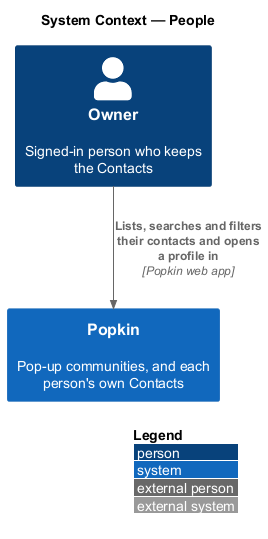
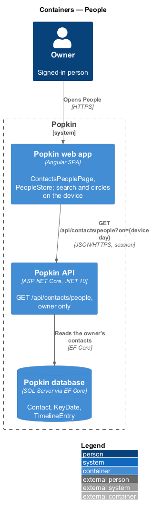
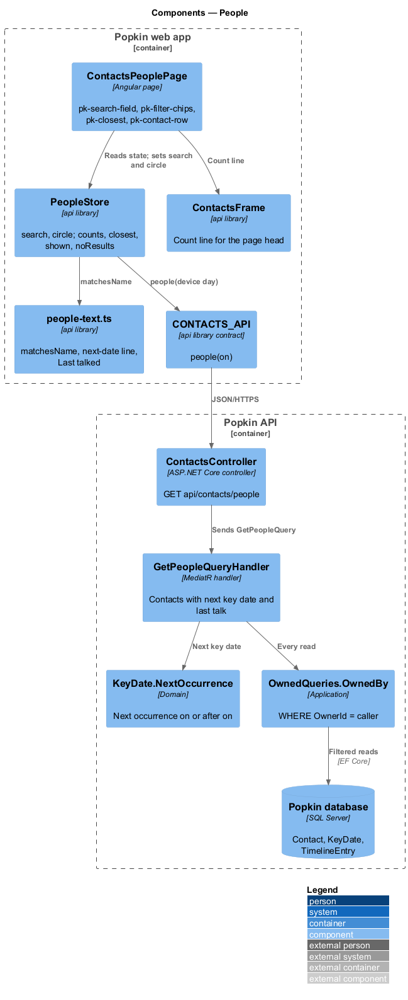
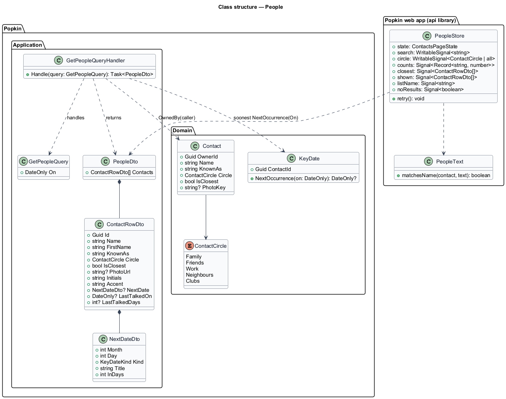
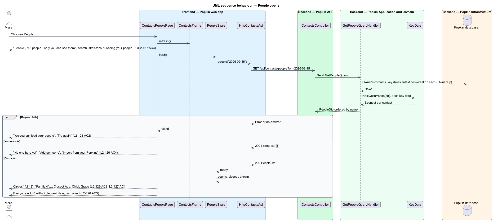
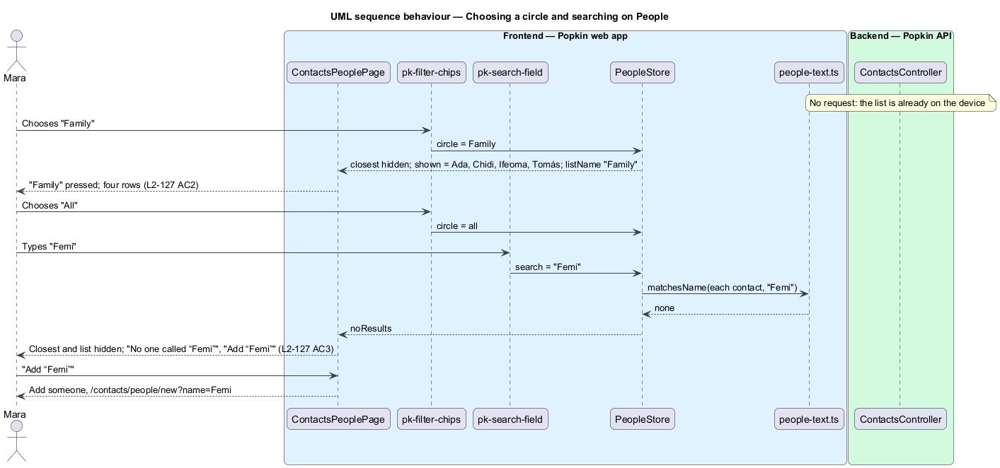

# People

## Overview

Popkin is a platform for pop-up communities. Contacts is a signed-in person's own address book
(L1-029), and People (`/contacts/people`) lists every contact in it (L1-031). The person finds
someone by name, narrows the list to one circle, sees their closest people first, and opens a
profile. People is read in one request; searching and choosing a circle happen on the device,
over the list already read.

- **circle** — one of five kinds of tie a contact is filed under: Family, Friends, Work, Neighbours or Clubs (`ContactCircle`)
- **Closest** — contacts the owner keeps at the top of People, by `Contact.IsClosest`
- **Everyone** — list of every contact, by first name A to Z
- **next key date** — soonest occurrence of a contact's key dates on or after the device day
- **last talked** — day of the latest conversation logged with a contact
- **device day** — calendar date on the person's device ([Open Contacts](../open-contacts/README.md))

The count in the page head comes from the Contacts summary that `ContactsFrame` holds, so it shows
while the list loads and when it fails, as the mocks draw it. Adding, editing and deleting a
contact are the Add someone, Edit and Delete designs; the profile is the profile's design.

## Description

### Screens and states

`docs/mocks/pages/contacts-people/`, Mara's 13 contacts on Tuesday 15 September 2026:

- `default.html` — the page head "People" and "13 people · only you can see them", with
  "Connections" from medium screens (`only-m-up`, to `/contacts/connections`) and "Add someone"
  (to `/contacts/people/new`) (L2-126 AC1). Then:
  - The search "Search by name" (L2-127 AC1).
  - The circles as a group named "Circle": "All 13" (pressed), "Family 4", "Friends 2", "Work 2",
    "Neighbours 1", "Clubs 4"; each chip says it is chosen with `aria-pressed` (L2-127 AC1).
  - "Closest": the photos and first names of Ada, Chidi and Grace, each opening the profile
    (L2-126 AC2).
  - From medium screens, the column heads "Name", "Circle", "Next date" and "Last talked".
  - "Everyone": each contact's photo or initials, name and how Mara knows them ("Ada Okafor",
    "Mum"), then from medium screens the circle ("Family"), the next key date ("Oct 7 ·
    Birthday", "Birthday Apr 29") and when they last talked, named "Last talked Sun" or "Last
    talked 59 days ago"; each row opens the profile (L2-126 AC3).
- `family.html` — "Family" pressed: only Ada, Chidi, Ifeoma and Tomás, in a list named "Family",
  without Closest (L2-127 AC2).
- `no-results.html` — "Femi" typed: Closest and the list are hidden; "No one called “Femi”",
  "Check the spelling, or add them as someone new." and "Add “Femi”", which opens Add someone
  (L2-127 AC3). The circles stay.
- `loading.html` — the page head and the search stay; skeleton rows beside "Loading your people…"
  (L2-127 AC4, L2-123 AC1).
- `error.html` — "We couldn't load your people", "Nobody you added is lost. Check your connection
  and try again." and "Try again" (L2-123 AC2, AC3); no search or circles.
- `empty.html` — "Only you can see them", "Add someone" in the page head, then "No one here yet",
  "Add the people who matter, or bring in the people you already know from your Popkins.", "Add
  someone" and "Import from your Popkins" (the import dialog, L2-151); no search, circles or
  Connections (L2-126 AC4).

### Conflicts and gaps

- **Search.** Whether the search matches the whole name or a part, a first or a last name, and
  whether it keeps the chosen circle is open (known gap 101). `matchesName` is the one place the
  rule lives.
- **The next key date's form.** Some rows read "Oct 7 · Birthday" in bold, others "Birthday Apr
  29" plain; which form a date takes is open (known gap 101).
- **Closest.** How a contact enters Closest, how many it holds and its order are open (known gap
  100). The mock orders it by first name.
- **Last talked.** "59 days ago" and "33 days ago" are drawn quiet, for Sam and Joel, who are
  drifting on Today; the threshold is known gap 99. The rule for "Sun" against "Sep 5" is `<TO
  SUPPLY>`, as it is for Today. A contact with no conversation logged shows `<TO SUPPLY>`.
- **The circle's name.** The mock gives the list the accessible name "Family" (or "Everyone") and
  draws no heading; L2-126 AC3 and L2-127 AC2 were worded to match, so the list is named for
  assistive technology only.
- **"Add “{name}”"** passes the typed name to Add someone as `?name=`; whether the form starts
  with it filled in is the Add someone design's `<TO SUPPLY>`.
- **How many contacts** a person may keep is open (known gap 110); People reads them all at once.

### API

On `ContactsController` (`api/contacts`), one MediatR request:

- `GET /api/contacts/people?on=2026-09-15` — `200` `PeopleDto` `{ contacts: ContactRowDto[] }`,
  ordered by name, ignoring case; `400` `invalid_date`. Another owner's contacts are never in it
  (L2-122).
  - `ContactRowDto`: `id`, `name`, `firstName`, `knownAs` ("Mum"), `circle` (`ContactCircle`),
    `isClosest`, `photoUrl` (an address that expires, ADR 0022), `initials`, `accent`,
    `nextDate` (`NextDateDto?`: `month`, `day`, `kind` (`KeyDateKind`), `title`, `inDays`) and
    `lastTalkedOn` (`DateOnly?`) with `lastTalkedDays` (`int?`).

### Backend

- **`GetPeopleQuery(DateOnly On)`** / **`GetPeopleQueryHandler`**
  (`Popkin.Application/Contacts/People/`) — reads the owner's contacts through `OwnedBy`, their key
  dates, and the latest conversation `TimelineEntry` per contact, in three reads. The next key
  date is the soonest `KeyDate.NextOccurrence(On)` ([Key dates](../key-dates/README.md)); a
  milestone does not count as talking. It writes nothing.
- **`ContactCircle`** (Domain) — `Family`, `Friends`, `Work`, `Neighbours`, `Clubs`, in that order.
- **`ContactsDayValidator`** validates `on`.

### Frontend (Popkin web app)

- **`ContactsPeoplePage`** (`pages/contacts-people/contacts-people.page.ts` and `.html`, route
  `/contacts/people`, `shell: 'app'`, `page: 'contacts-people'`) — composes `pk-app-screen`,
  `pk-popkin-nav` for Contacts with `people` current, `pk-contacts-layout`, `pk-page-head` with
  the count line from `ContactsFrame`, then by state: `pk-search-field` (kept while loading),
  `pk-filter-chips`, the Closest strip, the column heads and `pk-contact-row` per contact;
  `pk-skeleton` rows beside the status line; `pk-empty-state` for failed (alert, "Try again"),
  empty and no results (status, "Add “{name}”").
- **`PeopleStore`** (`api/src/lib/api/contacts/people-store.ts`) — `ContactsPageState`; `search`
  and `circle` (`ContactCircle | 'all'`) signals; derived `counts` (per circle and all),
  `closest` (shown only with no search and `all`), `shown` (the rows left after circle and
  search), `listName` ("Everyone" or the circle's name) and `noResults`. A search typed while
  loading is kept and applied when the list arrives. `retry()`. Unit tested.
- **`people-text.ts`** (api library) — `matchesName(contact, text)`, the next-date line, "Last
  talked {when}", "No one called “{name}”" and "Add “{name}”". Unit tested.
- **`CONTACTS_API`** — `people(on)`.
- **Components** — `pk-contact-row` (component backlog row 12; its design-system page,
  `contact-row.html`, also draws the `closest` strip, built with it as `pk-closest`), new
  `pk-filter-chips` (`div[pk-filter-chips]`, the mock's `chips` block: a `role="group"` with a
  label and `pk-chip` buttons carrying `aria-pressed` and a count), `pk-chip` (changed: gains
  `count`, drawn as `chip__count`), `pk-search-field`, `pk-page-head`, `pk-button`,
  `pk-empty-state`, `pk-skeleton`, `pk-contacts-layout` (row 22). `pk-choice-chips` is not used:
  it is a radio group with `aria-checked`, and the mock's circles are pressed buttons.

### Tests

- API acceptance tests (InMemory): Mara's 13 contacts come back A to Z, Grace with her birthday in
  4 days and last talked on 11 September; Lena's contacts are not in Mara's list; `on` missing is
  `400` `invalid_date`.
- Direct test of `GetPeopleQueryHandler`, one case per row: no key date; one; several (soonest
  wins); a one-off date past; no conversation; a milestone after the last conversation.
- Unit tests: `PeopleStore` (counts, a circle hides Closest, a search hides Closest, no results,
  a search typed while loading) and `people-text.ts`.
- Playwright: `tests/contacts-people.spec.ts` through `ContactsPeoplePage`
  (`pages/contacts-people.page.ts`): the list as drawn and a row opening the profile; choosing
  Family; a search with no match and "Add “Femi”" opening Add someone; loading keeps the search;
  failed and "Try again"; empty. Recorded responses add `GET /api/contacts/people`; `stubs.ts` adds
  the empty, delayed and failed answers; `routes.ts` gains `contactsPeople`, `contactsPeopleFamily`,
  `contactsPeopleNoResults`, `contactsPeopleLoading`, `contactsPeopleEmpty` and
  `contactsPeopleError`.
- Parity: `contact-row`, `closest`, `filter-chips` and `chip` with a count.

## Requirements

| L2 ID | Refines (L1) | Requirement |
|-------|--------------|-------------|
| `L2-126` | `L1-031` | People: People lists every contact. (AC1–AC4) |
| `L2-127` | `L1-031` | Find people: People is searched by name and filtered by circle. (AC1–AC4) |

## Diagrams

### System context

The owner finds and opens their contacts on People; nobody else sees the list.

### Containers

The web app reads the owner's contacts once with the device day; search and circles run on the
device.

### Components

`PeopleStore` holds the list and derives counts, Closest and the rows shown;
`GetPeopleQueryHandler` reads the owner's contacts with their next key date and last talk.

### Class structure

`ContactRowDto` carries what a row draws; `PeopleStore` turns the list, the circle and the search
into what the page shows.

### Behaviour — People opens

The page head and the search show at once; the list arrives and Closest and Everyone are drawn.

### Behaviour — a circle and a search

Choosing Family hides Closest and narrows the list; a name that matches nobody offers to add it.

