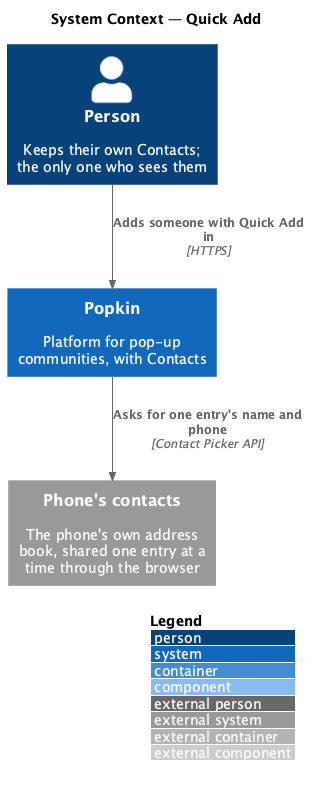
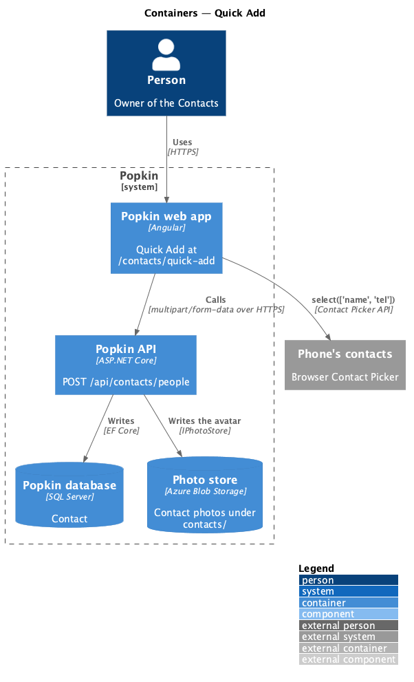
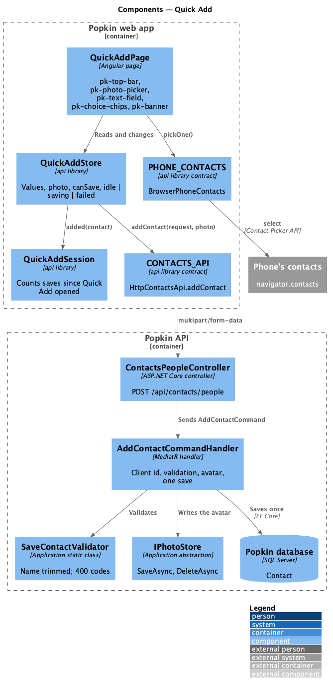
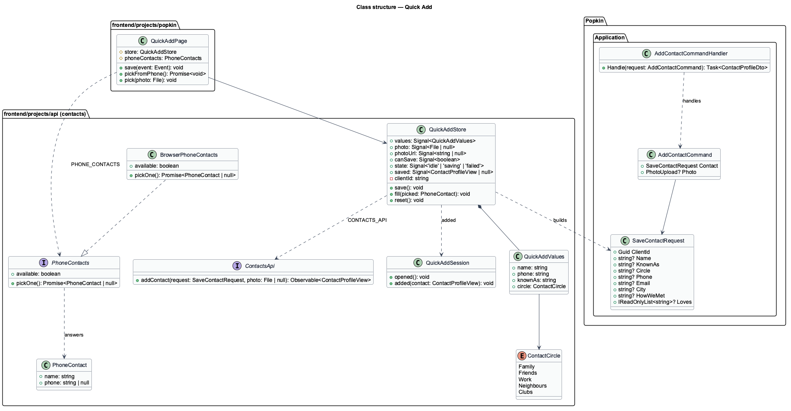
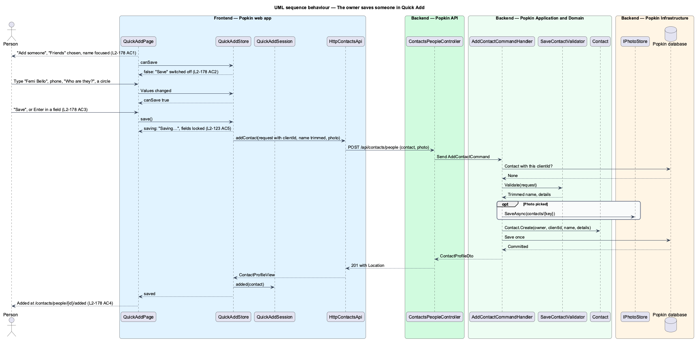
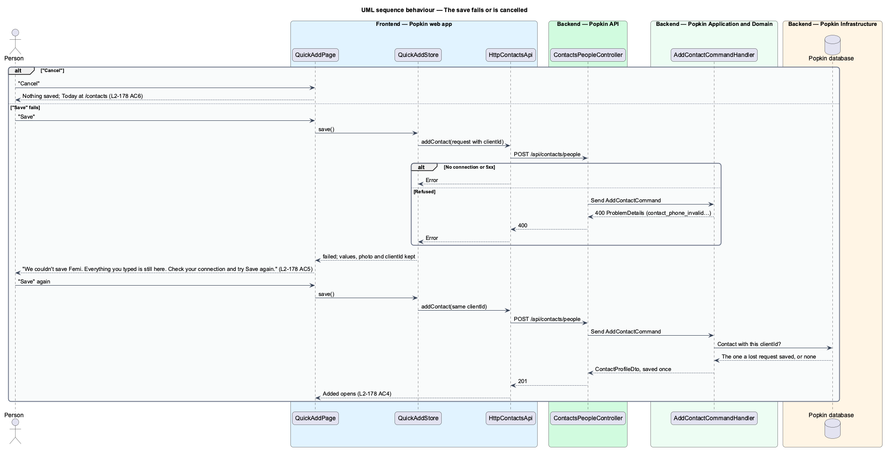
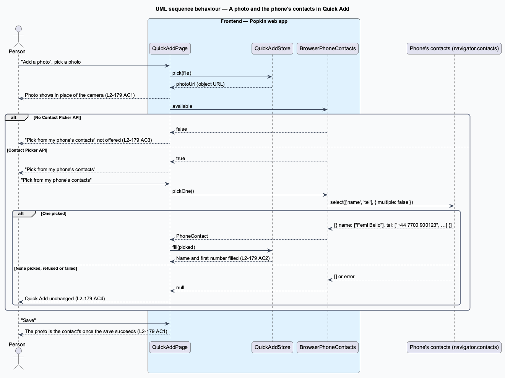

# Quick Add

## Overview

Popkin is a platform for pop-up communities. Contacts (L1-029) is a person's own address book in
the Popkin web app. Quick Add (L1-043) adds someone to it in moments: it asks for a name only, and
everything else is optional. It opens from the "Add someone" shortcut on Popkin's icon
([Reach Quick Add](../reach-quick-add/README.md)) at `/contacts/quick-add`, and after a save it
opens Added ([Added and add another](../contact-added/README.md)). The full form, with dates,
connections, groups and details, stays [Add someone](../add-contact/README.md); Quick Add is a
shorter screen over the same endpoint and adds no API.

- **owner** — signed-in `Person` whose Contacts Quick Add writes to
- **circle** — one of Family, Friends, Work, Neighbours and Clubs (`ContactCircle`), the kind of tie the owner has with a contact
- **"Who are they?"** — free text saying how the owner knows the contact, kept as the contact's `knownAs`
- **phone's contacts** — the address book of the phone itself, outside Popkin, which some browsers share one entry of through the Contact Picker API
- **Contact Picker API** — browser interface `navigator.contacts.select(properties, options)` that lets the person pick entries from the phone's contacts and gives the page only the chosen properties
- **client id** — identifier the web app gives each save, so that a resend saves once

Nothing about a contact is shared with anyone, and nobody is told (L2-122 AC3).

## Description

### Screens and states

Popkin web app, `docs/mocks/pages/quick-add/`, route `/contacts/quick-add`:

- `default.html` — the top bar "Cancel", "Add someone" and "Save"; "Add a photo" (the blank
  `xl` picker with a camera) beside the name ("Their name"); "Phone" ("Optional"); "Who are
  they?" ("Neighbour, Grace's fiancé…"); the radio group "Circle" of "Family", "Friends", "Work",
  "Neighbours" and "Clubs" with "Friends" chosen; and "Pick from my phone's contacts"
  (L2-178 AC1). The name field is focused (L2-177 AC2).
- `filled.html` — a name typed: "Save" is on (L2-178 AC3).
- `submitting.html` — "Save" reads "Saving…" and is disabled, every field is locked, and
  "Cancel" stays (L2-178 AC3, L2-123 AC5).
- `error.html` — the danger banner "We couldn't save Femi. Everything you typed is still here.
  Check your connection and try Save again.", every value and the photo kept (L2-178 AC5).
- With no name, or a name of spaces only, "Save" is switched off (L2-178 AC2).
- A picked photo shows in place of the camera (L2-179 AC1).
- Where the browser cannot share the phone's contacts, "Pick from my phone's contacts" is not
  offered (L2-179 AC3).

### Conflicts between the mocks and L2-178

The mocks were drawn before L2-178 and L2-179. The design follows the requirements, and the mocks
changed on 17 November 2026 (known gap 158):

- **"Who are they?"** The mocks label the field "How you know them" ("Sister, neighbour, old
  boss…"), as Add someone does; L2-178 AC1 names it "Who are they?" ("Neighbour, Grace's
  fiancé…"). It is the same field, `knownAs`.
- **"Save" with no name.** The mocks' notes keep "Save" on and draw `invalid.html` ("One thing to
  fix", "Name: add a name so you can find them later."). L2-178 AC2 switches "Save" off, so
  Quick Add has no invalid state and `invalid.html` is withdrawn.
- **Enter.** `filled.html` notes that Return on the name moves to "Phone". L2-178 AC3 saves on
  Enter in any field, so every field carries `enterkeyhint="done"`.
- **"Phone".** The mock's placeholder is "+44"; L2-178 AC1 gives "Phone" with "Optional", the
  tag of an optional field, and no placeholder.

### Rulings

- **The request** is the `SaveContactRequest` Add someone sends, with Quick Add's fields only:
  `clientId`, `name` trimmed, `phone`, `knownAs` ("Who are they?"), `circle`, and every other
  field null or empty (`email`, `city`, `howWeMet`, `loves: []`, no `keyDates`, `connect`,
  `disconnect` or `groupIds`). `contactRequestOf` of `contact-form-store.ts` builds it. A circle
  is always chosen: the chips start at "Friends" and one stays chosen.
- **A resend saves once.** The client id is made when Quick Add opens and kept until a save
  succeeds, so "Save" again after a failure carries the same id and the API answers the contact a
  lost first request made (shared Contacts rule, `ClientWrites.FindAsync`).
- **A refusal.** A `400` (`contact_phone_invalid`, `contact_field_too_long`,
  `photo_type_not_allowed`, `photo_too_large`) shows the same failure banner and keeps every
  value, as Add someone does ([Add someone](../add-contact/README.md)). Quick Add shows no
  message per field: the banner says it, as for any failed save.
- **Offline** (L2-123 AC4, known gap 157, settled as proposed). Added (L2-178 AC4) needs the saved
  contact, which an add kept in `ContactsOutbox` does not yet have. Offline, "Save" keeps the add in
  `ContactsOutbox` through `keepAdd`, shows "You're offline" and "What you add is kept on this
  phone and saved when you're back.", and Quick Add opens empty for the next person, with no
  Added and no count.
- **"Cancel" while saving.** "Cancel" opens Today and leaves the request to finish; a request
  already sent may still add the contact. L2-178 AC6 speaks of "Cancel" before a save.
- **The phone's contacts.** The page asks for `name` and `tel` of one entry
  (`{ multiple: false }`). The first value of the entry's `name` list fills the name and its first number
  fills "Phone"; an entry with no number leaves "Phone" as it was (L2-179 AC2 does
  not say). No pick, a refusal or an error leaves Quick Add unchanged (L2-179 AC4). Nothing from
  the phone's contacts reaches the API until "Save".
- **Built in steps.** The form, "Save" and "Cancel" first (L2-178); then the photo; then the
  phone's contacts (L2-179).

### Backend

Nothing new. `ContactsPeopleController.Add` (`POST /api/contacts/people`, `multipart/form-data`,
rate-limited by `RateLimitPolicyNames.Photos`) takes the part `contact` as `SaveContactRequest`
JSON and the optional part `photo`, and sends one `AddContactCommand`.
`AddContactCommandHandler` (`Popkin.Application/Contacts/People/AddContact.cs`) requires Contacts
on (`ContactsSwitch.Require`), answers the saved contact for a known `(OwnerId, ClientId)`,
validates with `SaveContactValidator` (the name trimmed, `400` `contact_name_required` for a blank
one, `contact_phone_invalid`, `contact_circle_not_allowed`, `contact_field_too_long`), makes the
avatar with `IPhotoProcessor`, writes it through `IPhotoStore`, adds the `Contact` and saves once.
It answers `201` `ContactProfileDto`, with `Location` `/api/contacts/people/{id}`. A failed save
deletes the photo it wrote. Logs and metrics carry the route template and status only.

### Frontend (Popkin web app)

- **`QuickAddPage`** (`app/pages/quick-add/quick-add.page.ts` and `.html`), route
  `/contacts/quick-add` ([Reach Quick Add](../reach-quick-add/README.md)), data
  `{ shell: 'bare', page: 'quick-add' }`. It composes `pk-screen`, `pk-top-bar` (`backLabel`
  "Cancel", `backIcon` "close", `back` `/contacts`, `heading` "Add someone", and in the `end`
  slot `pk-button` "Save" / "Saving…", `variant="primary"`, `size="sm"`, `type="submit"`,
  `form="quick-add"`, `[disabled]` while the name is blank, `[busy]` while saving); a `<form
  id="quick-add" novalidate>` whose submit saves, so Enter in any field saves (L2-178 AC3);
  `pk-photo-picker` ("Add a photo", `size="xl"`) with the name's `pk-text-field` projected;
  `pk-text-field` "Phone" (`type="tel"`, `optional` "Optional") and "Who are they?"
  (`placeholder` "Neighbour, Grace's fiancé…"); `pk-choice-chips` "Circle" (`outline`);
  `pk-button` "Pick from my phone's contacts" only when `PHONE_CONTACTS.available`; and
  `pk-banner variant="danger"` for the failure. It focuses the name after its first render. On a
  saved contact it navigates to `/contacts/people/{id}/added` (L2-178 AC4).
- **Library changes** — `pk-text-field` gains `variant="display"` (the large name of the mock,
  `input--display`), `hideLabel` (the label "Name" kept for screen readers only, as the mock
  draws it) and an `enterkeyhint` input; its parity spec covers each.
- **`QuickAddStore`** (`frontend/projects/api/src/lib/api/contacts/quick-add-store.ts`, provided
  by the page) — the values (`name`, `phone`, `knownAs`, `circle`, default `Friends`), the
  picked photo and its object URL, `canSave` (the name trimmed is not empty), the client id and
  `idle | saving | failed`. `save()` does nothing while `canSave` is false or a save is under
  way; it sends `CONTACTS_API.addContact(request, photo)` at once, not through the outbox, so
  Added has the saved contact. Success hands the contact to `QuickAddSession.added` and sets
  `saved`; failure sets `failed` and keeps everything. `fill(picked)` puts a phone contact into
  the name and "Phone". `reset()` empties the form, revokes the object URL and makes a new client
  id. Unit tested (ADR 0011).
- **`PhoneContacts`** (`frontend/projects/api/src/lib/api/contacts/phone-contacts.ts`) — the
  contract `PhoneContacts { readonly available: boolean; pickOne(): Promise<PhoneContact | null> }`,
  `PhoneContact { name: string; phone: string | null }`, the token `PHONE_CONTACTS`, and
  `BrowserPhoneContacts`. `available` is true when `navigator.contacts` has `select`; `pickOne`
  calls `navigator.contacts.select(['name', 'tel'], { multiple: false })` and answers null for
  an empty pick or an error. `app.config.ts` provides `BrowserPhoneContacts` for the token.
- **`QuickAddSession`** ([Added and add another](../contact-added/README.md)) — told of each
  save; Quick Add calls `opened()` as it opens.
- **Words.** The failure banner reuses `saveFailedHeading(name)` and `SAVE_FAILED_TEXT` of
  `contact-form-text.ts`, which L2-178 AC5 and L2-129 AC6 word alike.

### Tests

- API acceptance (InMemory, ADR 0005), in `Popkin.Api.Tests/Contacts/AddContactTests.cs`: Quick
  Add's request, a name with spaces around it, a phone, "Who are they?", a circle and a photo,
  answers `201` with the name trimmed and the others kept; a name of spaces only answers `400`
  `contact_name_required`. A resend under one client id is already proven there.
- Unit tests of `QuickAddStore`, one case per row: blank and spaces-only names cannot save; the
  request is trimmed and carries the circle; a failure keeps the values, the photo and the client
  id; a success makes a new client id; a phone contact fills the name and phone; no pick changes
  nothing.
- Playwright, `e2e/tests/quick-add.spec.ts` through the `QuickAddPage` page object, on recorded
  responses: "Save" off until a name is typed; "Saving…"; a failed save shows the message and
  keeps the values; a saved contact opens Added; "Cancel" opens Today; a picked photo shows;
  "Pick from my phone's contacts" hidden without the API and filling the fields with it.
  `navigator.contacts` is stubbed by an init script in `e2e/fixtures/stubs.ts`. `routes.ts` keys
  `quick-add` default, filled, submitting and error.
- Parity: `pk-text-field` for the changes above.

## Requirements

| L2 ID | Refines (L1) | Requirement |
|-------|--------------|-------------|
| `L2-178` | `L1-043` | Quick Add: Quick Add asks for a name only; everything else is optional. (AC1–AC6) |
| `L2-179` | `L1-043` | A photo and the phone's contacts in Quick Add: Quick Add can take a photo and can fill itself from the phone's own address book. (AC1–AC4) |

## Diagrams

### System context

The owner adds a contact in Popkin, optionally picking one entry from the phone's contacts; the
contact is not told.

### Containers

The web app sends one multipart request to the API, which writes the photo to the photo store and
the contact to the database.

### Components

`QuickAddPage` holds its form in `QuickAddStore`, reads the phone's contacts through
`PHONE_CONTACTS`, and saves through `CONTACTS_API` to `ContactsPeopleController`, whose handler is
Add someone's.

### Class structure

`QuickAddStore` builds a `SaveContactRequest` and tells `QuickAddSession` of each save;
`BrowserPhoneContacts` implements `PhoneContacts`.

### Behaviour — the owner saves someone

"Save" is off until a name is typed; a save sends the trimmed name, phone, "Who are they?",
circle and photo, then opens Added.

### Behaviour — the save fails or is cancelled

A failed save keeps everything typed and the client id; "Cancel" saves nothing and opens Today.

### Behaviour — a photo and the phone's contacts

A picked photo shows in place of the camera; a picked phone contact fills the name and "Phone",
and no pick leaves Quick Add unchanged.

