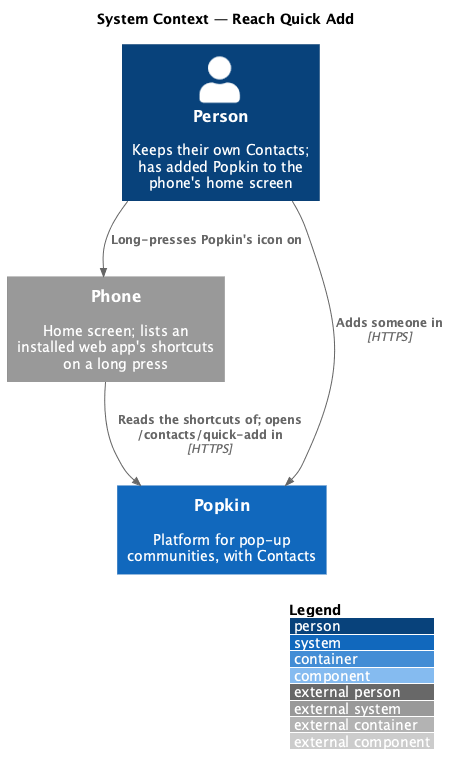
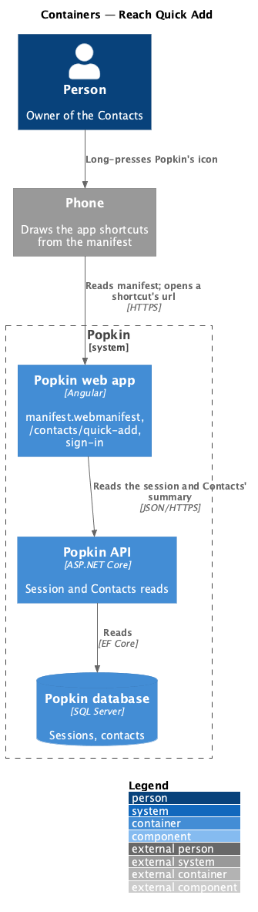
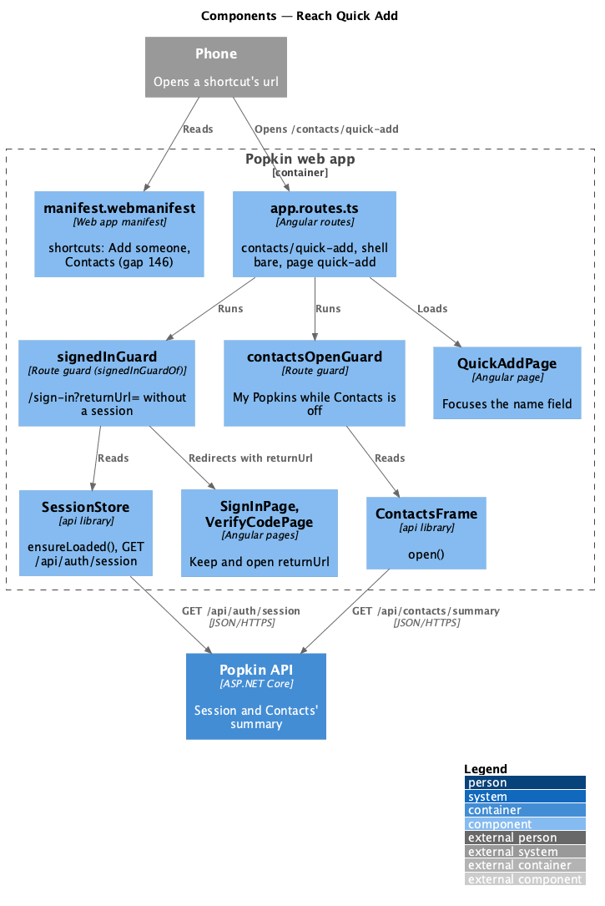
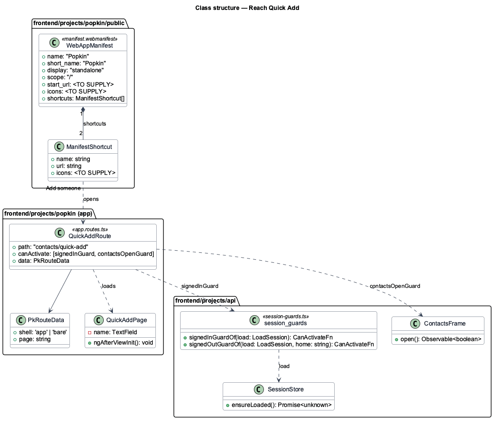
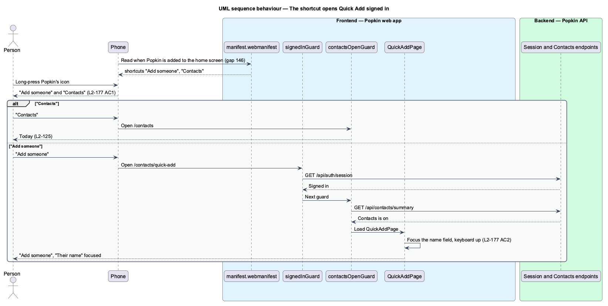
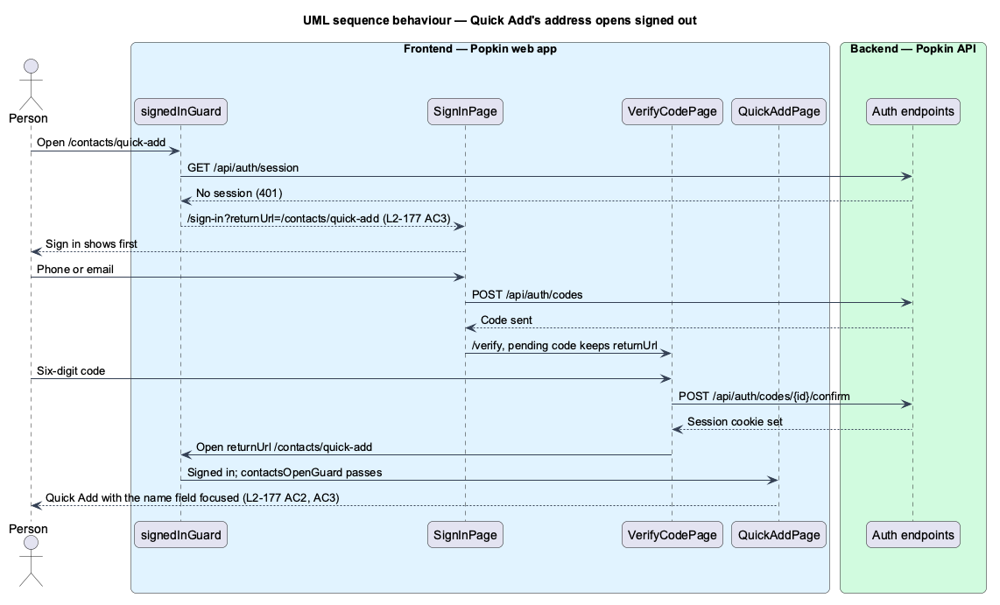

# Reach Quick Add

## Overview

Popkin is a platform for pop-up communities. Contacts (L1-029) is a person's own address book in
the Popkin web app, and Quick Add (L1-043) adds someone to it with only a name, in moments,
straight from the phone's home screen. Meeting people is what a pop-up community is for; Quick
Add keeps them before the name is forgotten. This design covers the way in: the shortcuts on
Popkin's icon, Quick Add's own address, and what happens when that address opens signed in or
signed out. The form itself is [Quick Add](../quick-add/README.md), and the screen after a save is
[Added and add another](../contact-added/README.md).

- **home screen** — phone's launcher screen, where Popkin's icon sits once the person has added Popkin to it from the browser
- **app shortcut** — entry the phone lists when an installed web app's icon is long-pressed, drawn by the phone from the `shortcuts` of the web app manifest
- **web app manifest** — JSON file the web app links from its page, naming the app, its icons, the address it starts at (`start_url`) and its shortcuts
- **Quick Add's address** — route `/contacts/quick-add` of the Popkin web app
- **return address** — the `returnUrl` query parameter of sign-in, the screen opened once the person is signed in

The phone draws the shortcuts, not Popkin. Android and desktop Chrome and Edge list them; Safari
on iPhone lists none, so there Quick Add's address is reached from a link or a bookmark, and Add
someone stays a tap away on Today and People. The home-screen widget the Magic Patterns design
also draws needs a native app and is not part of L2-177.

## Description

### Screens and states

`docs/mocks/pages/app-shortcuts/default.html` draws the phone's own menu over Popkin's icon: the
shortcuts as a `role="menu"` named "Popkin shortcuts", each an icon and its name. The phone draws
it, so the web app builds nothing for it; the manifest's entries decide what it lists.

- **"Add someone"** opens `/contacts/quick-add` (L2-177 AC1).
- **"Contacts"** opens Today, `/contacts` (L2-177 AC1, L2-125).
- The mock draws a third shortcut, "Log a conversation". L2-177 AC1 names two, and a conversation
  is logged for a contact, so its address needs a contact. The manifest lists the two of L2-177,
  and the mock now draws two (known gap 158).

Quick Add opens with the name field focused, so the phone's keyboard is up and a name can be
typed at once (L2-177 AC2, `docs/mocks/pages/quick-add/default.html`).

### The web app manifest (known gap 146)

The Popkin web app has no manifest: `frontend/projects/popkin/src/index.html` links none, and
`frontend/projects/popkin/public/` holds only `images/` and `push-worker.js`. A manifest makes the
web app installable, which is a change of what Popkin is on a phone, so it needs its own ADR
(gap 146). ADR 0033 settles it, as below.

- **`manifest.webmanifest`** (`frontend/projects/popkin/public/`, served at
  `/manifest.webmanifest`) — `name` "Popkin", `short_name` "Popkin", `display` "standalone",
  `scope` "/", `start_url` "/popkins", `icons` the mark on coral at 192 and 512 pixels and a maskable 512
  (`public/icons/`), `theme_color` the coral accent and `background_color` the paper canvas, and
  `shortcuts`:
  - `{ "name": "Add someone", "url": "/contacts/quick-add", "icons": [shortcut-add-someone.png] }`
  - `{ "name": "Contacts", "url": "/contacts", "icons": [shortcut-contacts.png] }`
- **`index.html`** links it with `<link rel="manifest" href="manifest.webmanifest">`.
- **Which host.** Every address host is its own origin (shared architecture), so a manifest
  installed from `lakeside-weekend.popkin.community` would start on that host. Every host serves the
  same manifest (ADR 0033).
- **A service worker.** The web app registers `push-worker.js` only when phone reminders are
  turned on (ADR 0028). Installing needs no worker of its own (ADR 0033).
- The shortcuts' names are the spec's words. A renamed shortcut reaches a phone only when the
  phone reads the manifest again, which the phone decides.

### Routing

- **`/contacts/quick-add`** (`app.routes.ts`) — `canActivate: [signedInGuard, contactsOpenGuard]`,
  `loadComponent` `QuickAddPage` ([Quick Add](../quick-add/README.md)), data
  `{ shell: 'bare', page: 'quick-add' }`, title "Add someone · Contacts · Popkin". It sits beside
  `contacts/people/new`, the full Add someone, which it does not replace.
- **Signed out** (L2-177 AC3) — `signedInGuard` is `signedInGuardOf` of
  `frontend/projects/api/src/lib/api/auth/session-guards.ts`: with no session it answers the URL
  tree `/sign-in?returnUrl=%2Fcontacts%2Fquick-add`. Sign-in keeps the return address (`safeReturnUrl`) with
  the pending code, and "Enter your code" (`/verify`, `pages/verify-code/verify-code.page.ts`)
  opens it once the person is signed in, so Quick Add opens next with nothing new built.
- **Contacts switched off** — `contactsOpenGuard` opens My Popkins while the API says Contacts is
  off (ADR 0023), as on every Contacts route.
- **Focus** (L2-177 AC2) — `QuickAddPage` focuses the name field after its first render through
  `TextField.focus()` of `pk-text-field`. The input also carries `autofocus`, so the phone raises
  its keyboard when the page opens from the shortcut.

### Backend

Nothing. Reaching Quick Add sends no request of its own; the session read of `signedInGuard`
(`SessionStore.ensureLoaded`) and the Contacts read of `contactsOpenGuard` (`ContactsFrame.open`)
are the ones every Contacts route makes.

### Tests

- Playwright, `e2e/tests/quick-add.spec.ts` through the `QuickAddPage` page object
  (`e2e/pages/quick-add.page.ts`), on recorded responses: opening `/contacts/quick-add` signed in
  shows "Add someone" with the name field focused (L2-177 AC2); opening it signed out shows
  sign-in, and after the code Quick Add opens (L2-177 AC3). `routes.ts` keys `quick-add`.
- The phone's menu cannot be driven from a browser test. The manifest's `shortcuts` are checked by
  requesting `/manifest.webmanifest` and reading its two entries' names and addresses
  (L2-177 AC1), a behaviour test (ADR 0033).
- No backend test: no endpoint is added.

## Requirements

| L2 ID | Refines (L1) | Requirement |
|-------|--------------|-------------|
| `L2-177` | `L1-043` | Reach Quick Add: Quick Add opens from a shortcut on Popkin's icon on the home screen, at its own address. (AC1–AC3) |

## Diagrams

### System context

The person reaches Quick Add from the phone, which draws Popkin's shortcuts from the web app
manifest.

### Containers

The phone reads the manifest from the web app; the web app asks the API for the session before
Quick Add shows.

### Components

The route `/contacts/quick-add` runs `signedInGuard` and `contactsOpenGuard` before `QuickAddPage`
loads; sign-in carries the return address.

### Class structure

The manifest lists two `ManifestShortcut` entries; the route's guards come from
`signedInGuardOf` in the `api` library.

### Behaviour — the shortcut opens Quick Add signed in

A long press lists "Add someone" and "Contacts"; "Add someone" opens Quick Add with the name
field focused.

### Behaviour — Quick Add's address opens signed out

Without a session, sign-in opens with Quick Add as the return address, and Quick Add opens once
the code is entered.

