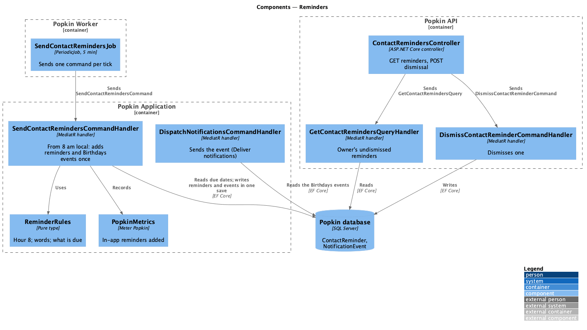
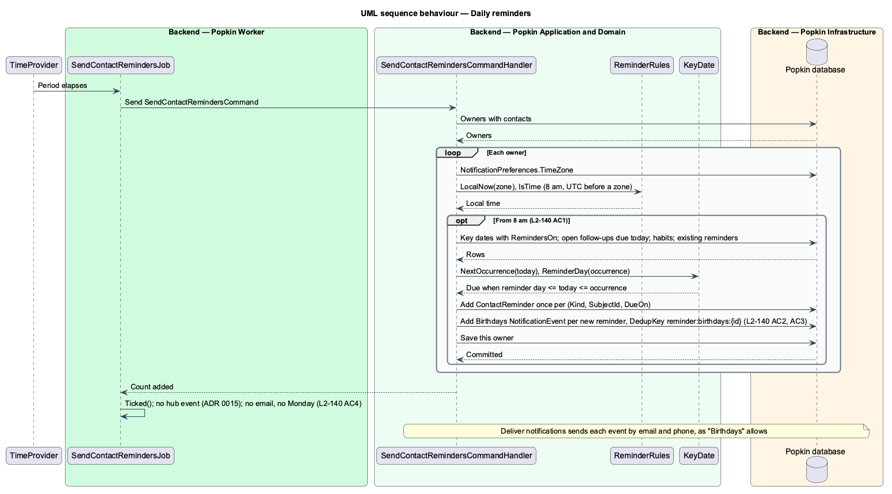
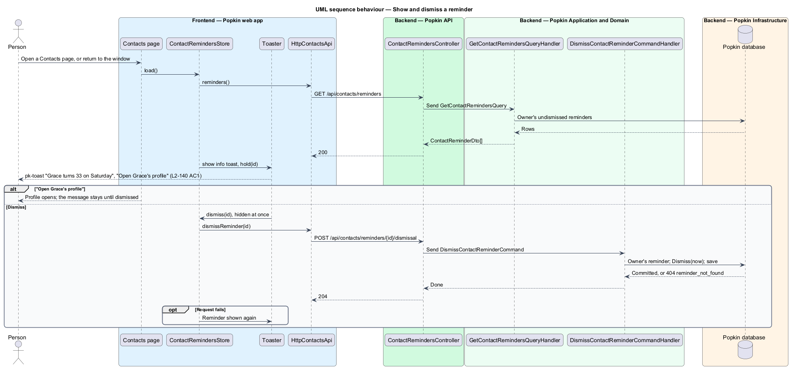

# Reminders

## Overview

A key date is worth keeping only if the person hears of it in time (L1-033). Reminders brings
each key date's reminder to its owner as a message in Contacts at 8 am on the reminder day
(L2-140 AC1). On the same day it records the reminder as a "Birthdays" notification, which
[Send reminders](../../notifications/send-reminders/README.md) sends by email and phone as the
owner's notification settings say (L2-140 AC2, AC3). Follow-ups and habits remind the same way:
a message in Contacts, and a phone alert with no email. The dates and their lead times are those
of [Key dates](../key-dates/README.md). Whether a date reminds at all is its switch under
Notifications › People ([Birthday reminders by person](../../notifications/birthday-reminders-by-person/README.md)).

**Changed on 17 November 2026.** L2-140 was rewritten when the notification designs were
adopted:

- the reminder comes at 8 am, not 9 am;
- the Monday email of the week ahead is withdrawn;
- the "Phone notifications" and "Monday email" switches leave Dates;
- email and phone pass to the notifications subsystem as the "Birthdays" kind (gap 126).

The parts of this design that the change removes are listed under "To be removed".

The Popkin Worker adds reminders. `SendContactRemindersJob` is a `PeriodicJob`: on each tick it
sends one command, and the handler decides what is due. The Worker holds no hub connection and
sends no hub events ([ADR 0015](../../../adr/0015-the-worker-sends-no-hub-events.md)), so the web
app learns of a new reminder by reading it.

- **reminder** — message that names a coming key date, a follow-up or a habit, due on its reminder day
- **reminder day** — occurrence of a key date minus its lead time ([Key dates](../key-dates/README.md))
- **in-app reminder** — `ContactReminder` row that Contacts shows as a message until the owner dismisses it
- **reminder event** — `NotificationEvent` of the "Birthdays" kind that hands the same reminder to email and phone ([Send reminders](../../notifications/send-reminders/README.md))

Everything a reminder says is private to its owner (L2-122); no contact is told anything.

## Description

### Screens and states

- `docs/mocks/notifications/contacts-toast/info.html` — over Today, an info message "Grace turns
  33 on Saturday" and "Open Grace's profile", with a dismiss button. It arrives at 8 am on its
  reminder day and stays until dismissed (L2-140 AC1, L2-124 AC1).
- `docs/mocks/pages/contacts-dates/default.html`:
  - Under "Reminders" there are only the three default lead times
    ([Key dates](../key-dates/README.md)).
  - The mock still draws "Phone notifications" and "Monday email". They are withdrawn (L2-140
    AC4), and the mock changes to match.
- `docs/mocks/notifications/contacts-toast/blocked.html` — the warning "Notifications are blocked
  in this browser". Under the change it belongs to the phone switches of Notifications
  ([Notification settings](../../notifications/notification-settings/README.md), L2-157 AC5).
- The reminder email is `docs/mocks/notifications/email-birthday/`
  ([Send reminders](../../notifications/send-reminders/README.md)).

### Rulings

**Known gaps 104 and 114, settled on 17 November 2026.** Where the change to L2-140 made the
same day supersedes a ruling, the ruling is marked.

- **The phone channel is Web Push** ([ADR 0028](../../../adr/0028-phone-reminders-by-web-push.md)).
  *Superseded in part:* the subscription is no longer tied to a switch on Dates. A device
  subscribes from the phone switches of Notifications, and Web Push serves every notification
  kind.
- **"9 am" is 9 am where the person is.** *Superseded:*
  - the hour is 8 am (L2-140 AC1);
  - the zone moves from `ReminderPreferences.TimeZone` to `NotificationPreferences.TimeZone`;
  - the web app saves it when it starts, with `PUT /api/me/time-zone`, not only when Contacts
    opens.

  UTC applies before a zone is saved, as before.
- **What reminds** (still stands, at 8 am). Three things, each once, on its day:
  - a key date on its reminder day, "{what} {when}", only when its `RemindersOn` is true
    (L2-159 AC4);
  - a follow-up on its due day: "{text} is due today" (a promise's "Remind me {day}" is its due
    day, L2-133 AC2);
  - a habit on its due day, "{what} with {first name} is due today", and again the day after if
    not kept, "{what} with {first name} is overdue" (L2-145 AC4).

  Each reaches Contacts as a message. A key date also reaches email and phone, and a follow-up
  or a habit reaches the phone only, all through the "Birthdays" kind (L2-140 AC2).
- **The words of a date** (still stand). `{what}` is "{first name} turns {n}" for a birthday
  whose year is known, "{first name}'s birthday", "{first name}'s anniversary", or the date's own
  title. `{when}` is "today", "tomorrow", "on {weekday}" within the next 6 days, and otherwise
  "on {day} {month}" ("on 19 September").
- **No second line** (still stands). A date's reminder lists no follow-up. The follow-up reminds
  on its own day.
- **The Monday email.** *Superseded and withdrawn* (L2-140 AC4). No email of the week ahead is
  sent on any day. Each key date's reminder email takes its place
  ([Send reminders](../../notifications/send-reminders/README.md)).
- **Seeing it** (still stands). An open Contacts page reads reminders when it opens and when the
  window regains focus; it does not poll. No hub event is added (ADR 0015).
- **The job** (still stands). It runs every 5 minutes. A key date added after its reminder day
  and before its occurrence reminds at the next tick.

### API

`ContactRemindersController` (`Popkin.Api/Controllers/Contacts/`), default authenticated policy.

- `GET /api/contacts/reminders` — `200` `ContactReminderDto[]`, the owner's undismissed in-app
  reminders, oldest first: `id`, `kind` (`KeyDate`, `FollowUp`, `Habit`), `contactId?`,
  `firstName?`, `words` and `dueOn`.
- `POST /api/contacts/reminders/{reminderId}/dismissal` — `204`. Dismissing twice is a `204`
  that changes nothing. Anyone else's answers `404` `reminder_not_found`.
- `PUT /api/contacts/time-zone`, `GET /api/contacts/push-key`, and
  `POST`/`DELETE /api/contacts/push-subscriptions` move to `PUT /api/me/time-zone`,
  `GET /api/me/push-key` and `POST`/`DELETE /api/me/push-subscriptions`. Every notification
  uses them, not only Contacts
  ([Notification settings](../../notifications/notification-settings/README.md)).

### Backend

- **`ContactReminder`** (Domain, unchanged) — `Id`, `OwnerId`, `Kind`, `SubjectId` (the key date,
  follow-up or habit), `ContactId?`, `DueOn`, `Words`, `CreatedAt`, `NotifiedAt?` and
  `DismissedAt?`; `Dismiss(now)` and `MarkNotified(now)`.
  - A unique index on (`Kind`, `SubjectId`, `DueOn`) adds one day's reminder once, however many
    ticks run.
  - `NotifiedAt` now records only that the reminder event was added.
  - Removing a contact, a key date, a follow-up or a habit removes its rows (`ContactRemoval`).
- **`KeyDate.RemindersOn`** (Domain, new, default `true`) — the date's switch. Turning it off
  stops its reminder in Contacts and on every channel. The date stays.
- **`ReminderRules`** (Application) — the words of each reminder and what is due on a day.
  `Hour` becomes `8`. `WeekOf` is removed. It is tested one case per row.
- **`SendContactRemindersCommand`** / **`SendContactRemindersCommandHandler`**
  (`Popkin.Application/Contacts/Reminders/`), changed:
  - For each owner with Contacts it reads the local now in `NotificationPreferences.TimeZone`.
  - From 8 am it adds the day's reminders that do not exist yet: key dates whose `RemindersOn`
    is true, follow-ups and habits (L2-140 AC1, L2-133 AC2, L2-145 AC4).
  - In the same save it adds one "Birthdays" `NotificationEvent` per new reminder, with
    `Facts.reminder` and `DedupKey` `reminder:birthdays:{contactReminderId}`.
  - It saves after each owner, so one failure stops one owner only.
  - It calls no sender. [Deliver notifications](../../notifications/deliver-notifications/README.md)
    sends the event.
- **`SendContactRemindersJob`** (`Popkin.Worker/Jobs/`, unchanged) — `PeriodicJob` every 5
  minutes whose command is `SendContactRemindersCommand`.
- **`GetContactRemindersQueryHandler`** and **`DismissContactReminderCommandHandler`** — the
  owner's rows only.
- **Telemetry** (`PopkinMetrics`, meter `Popkin`):
  - `popkin.contacts.reminders.sent` by `channel` keeps `in_app` only. The phone and email
    counts move to `popkin.notifications.deliveries`.
  - `popkin.contacts.reminders.send_failures` is removed.

  No dimension or log carries an owner, a contact, the words or an address.

### To be removed

The change to L2-140 removes code that is built today:

- **Domain:**
  - `ReminderPreferences.PhoneNotifications`, `ReminderPreferences.MondayEmail` and
    `ReminderPreferences.TimeZone` (moved);
  - the entity `ContactWeeklyEmail` and its table, in a migration.
- **Application:**
  - `IContactsEmailSender`, `WeekAheadEmail` and `ReminderRules.WeekOf`;
  - the Monday branch of `SendContactRemindersCommandHandler`;
  - `PhoneReminder`, which becomes `PhoneAlert` ([Send reminders](../../notifications/send-reminders/README.md)).
- **Infrastructure:** `EmailContactsSender`, `NoContactsEmailSender`, and their registration in
  `DependencyInjection.cs`.
- **API and DTOs:** `phoneNotifications` and `mondayEmail` in `ReminderPreferencesDto`
  ([Key dates](../key-dates/README.md)).
- **Settings:** `App:Origin` of the Worker (`docs/deployment.md`). The `Push:*` settings stay
  and now serve every notification.
- **Frontend:**
  - the two switches of `pk-reminder-defaults`;
  - `DatesStore`'s `phoneNotifications` and `mondayEmail` and its push subscription;
  - the Dates page object's switch locators;
  - the switches in `e2e/tests/parity/reminder-defaults.spec.ts`.
- **Tests:**
  - the Monday cases of `KeyDateTests` and the handler's tests;
  - the 9 am cases, which become 8 am.

### Frontend (Popkin web app)

- **`ContactRemindersStore`** (`frontend/projects/api/src/lib/api/contacts/`, unchanged) — reads
  `reminders()` when a Contacts page opens and on focus. It shows each new reminder through
  `Toaster` as an info toast held until dismissed, with "Open {first name}'s profile" for one
  that names a contact. It dismisses optimistically and puts the toast back when the request
  fails. It is unit tested.
- **`contactsOpenGuard`** opens the store as each Contacts page opens. Saving the device's zone
  moves to the app's start ([Notification settings](../../notifications/notification-settings/README.md)).
- **`Toaster`** — `show(…, { lasting, dismissed })`: an info toast that stays until dismissed and
  says so.
- **`CONTACTS_API`** — `reminders()` and `dismissReminder(id)`. The zone and push methods move
  with their endpoints.

### Tests

- **`ReminderRules` and the handler** on InMemory with `FakeTimeProvider`, one case per row:
  - before 8 am nothing; at 8 am on the reminder day one reminder and one event;
  - a second tick adds neither;
  - each lead time;
  - a date added late;
  - `RemindersOn` false gives neither;
  - a follow-up on its due day, and a habit due and the day after, each with its event's `Facts`;
  - no week-ahead email on a Monday;
  - one owner whose save throws stops that owner only.

  No test sleeps (ADR 0010).
- **`JobTests`** (Worker): advancing the clock by 5 minutes sends one
  `SendContactRemindersCommand`.
- **API acceptance:**
  - the reminders read returns the owner's reminders only;
  - dismissing hides one;
  - another person's answers `404` `reminder_not_found`.
- **Unit specs** (`api`): `Toaster` and `ContactRemindersStore`.
- **Playwright:** `tests/contacts-reminders.spec.ts`, through the `Toasts` page object, covers
  the message, "Open {first name}'s profile" and dismissing.
- The email and the phone alert are tested in
  [Send reminders](../../notifications/send-reminders/README.md).

## Requirements

| L2 ID | Refines (L1) | Requirement |
|-------|--------------|-------------|
| `L2-140` | `L1-033` | Reminders reach the person: A reminder arrives in Contacts, and by email and phone alert as the person's notification settings say. (AC1, AC4; AC2 and AC3 through [Send reminders](../../notifications/send-reminders/README.md)) |

## Diagrams

### System context

Contacts shows the reminder to its owner. The notifications subsystem carries the same reminder
to email and phone.

### Containers

The Worker writes the in-app reminder and its event to the database. The API reads and dismisses
reminders for the web app. No hub event joins the two.

### Components

`SendContactRemindersJob` sends one command per tick. Its handler holds the rules of what is due
and calls no sender.

### Class structure

### Behaviour

At 8 am on a reminder day the job adds the in-app reminder and its "Birthdays" event, once each.

Contacts shows the reminder until the owner dismisses it.

