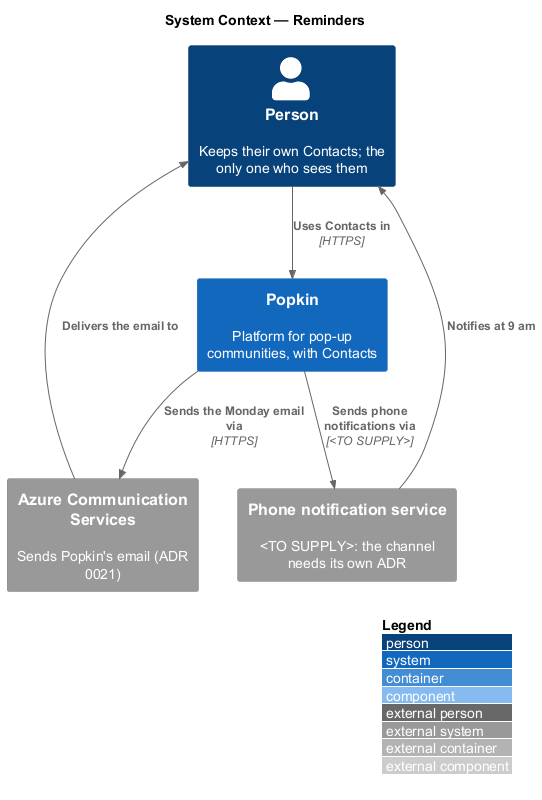
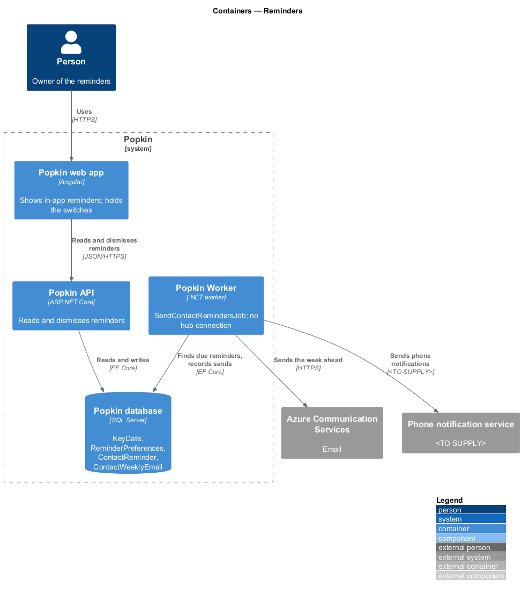
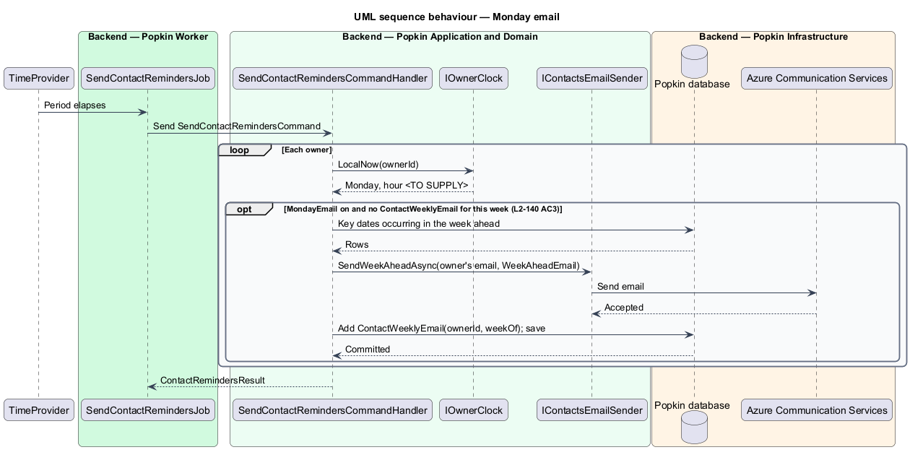

# Reminders

## Overview

A key date is worth keeping only if the person hears of it in time (L1-033). Reminders bring each
key date's reminder to its owner three ways: a message in Contacts at 9 am on the reminder day, a
phone notification at the same time, and an email of the week ahead every Monday (L2-140). The
dates and their lead times are those of [Key dates](../key-dates/README.md); the two switches
live on its Dates page.

The Popkin Worker sends reminders. `SendContactRemindersJob` is a `PeriodicJob`: on each tick it
sends one command, and the handler decides what is due. The Worker holds no hub connection and
sends no hub events ([ADR 0015](../../../adr/0015-the-worker-sends-no-hub-events.md)), so the web
app learns of a new reminder by reading it.

- **reminder** — message that names a coming key date, due on its reminder day
- **reminder day** — occurrence of a key date minus its lead time ([Key dates](../key-dates/README.md))
- **in-app reminder** — `ContactReminder` row that Contacts shows as a message until the owner dismisses it
- **phone notification** — reminder delivered to the owner's phone at 9 am on the reminder day, over a channel not yet chosen
- **Monday email** — email to the owner each Monday listing the key dates of the week ahead
- **week ahead** — the seven days from that Monday

Everything a reminder says is private to its owner (L2-122); no contact is told anything.

## Description

### Screens and states

- `docs/mocks/notifications/contacts-toast/info.html` — over Today, an info message "Grace turns
  33 on Saturday", "The card and the wine are on your list for Friday." and "Open Grace's
  profile", with a dismiss button. It arrives at 9 am on its reminder day and stays until
  dismissed (L2-140 AC1, L2-124 AC1).
- `docs/mocks/pages/contacts-dates/default.html` — under "Reminders", the switches "Phone
  notifications" ("At 9 am on reminder days") and "Monday email" ("The week ahead, every
  Monday"), both on at the first visit (L2-140 AC2 to AC4). The empty Dates page shows neither
  (L2-137 AC4).
- No mock draws the phone notification or the email.

### Conflicts and gaps

- **The phone notification channel** is not chosen (known gap 104). Popkin is a web app: a
  notification on the phone needs Web Push (a service worker, a subscription per device and a
  key pair) or a text message by Azure Communication Services. Either is a new delivery channel
  and needs its own ADR: `<TO SUPPLY>` (ADR for phone notifications). Until it is accepted,
  `IPhoneNotificationSender` has one implementation that sends nothing, and the switch is kept.
- **The email** — Azure Communication Services sends Popkin's email (known gap 1, settled by
  [ADR 0021](../../../adr/0021-codes-and-invites-by-azure-communication-services.md)). What the
  Monday email says, where it goes for a person who signs in with a phone number, at what hour of
  Monday it is sent and whether an empty week sends one are known gap 104: `<TO SUPPLY>`.
- **"9 am"** is 9 am in the owner's time zone, which is known gap 104: `<TO SUPPLY>`. `IOwnerClock`
  answers it ([Key dates](../key-dates/README.md)).
- **The message's words** for a kind other than a birthday with a year, and for a lead time of a
  week or more (where a weekday is ambiguous), are `<TO SUPPLY>`.
- **"Any follow-ups for it".** The mock's second line names follow-ups for the date; a
  `FollowUp` names a contact, not a key date. Which follow-ups belong to a reminder is
  `<TO SUPPLY>` (known gap 104, with whether follow-ups and habits notify, and how a promise's
  "Remind me {day}" reaches the person). Until it is settled the message has no second line.
- **A date added late.** A key date added after its reminder day and before its occurrence gets
  its reminder at the next tick, so it is never silent. This reading is to be confirmed in gap
  104.
- **Seeing it at 9 am.** An open Contacts page reads reminders when it opens and when the window
  regains focus; whether it also polls, and how often, is `<TO SUPPLY>`. No hub event is added.

### API

`ContactRemindersController` (`Popkin.Api/Controllers/Contacts/`), default authenticated policy.

- `GET /api/contacts/reminders` — `200` `ContactReminderDto[]`, the owner's undismissed in-app
  reminders, oldest first: `id`, `keyDateId`, `contactId`, `firstName`, `kind`, `occursOn`,
  `years`.
- `POST /api/contacts/reminders/{reminderId}/dismissal` — `204`; dismissing twice is a `204` that
  changes nothing. `404` `reminder_not_found` for anyone else's.
- The switches are saved with `PUT /api/contacts/reminder-preferences`
  ([Key dates](../key-dates/README.md)).

### Backend

- **`ContactReminder`** (Domain, new table) — `Id`, `OwnerId`, `KeyDateId`, `OccursOn`, `DueOn`,
  `CreatedAt`, `NotifiedAt?`, `DismissedAt?`; `Dismiss(now)`, `MarkNotified(now)`. Unique index on
  (`KeyDateId`, `OccursOn`), so one occurrence has one reminder whatever the number of ticks.
  Removing a key date removes its rows.
- **`ContactWeeklyEmail`** (Domain, new table) — `OwnerId`, `WeekOf` (the Monday), `SentAt`; key
  (`OwnerId`, `WeekOf`), so one week has one email.
- **`SendContactRemindersCommand`** / **`SendContactRemindersCommandHandler`**
  (`Popkin.Application/Contacts/Reminders/`) — for each owner with a key date, reads
  `IOwnerClock.LocalNow(ownerId)`. From 9 am, for each key date whose next occurrence is on or
  after today and whose reminder day is on or before today, it adds a `ContactReminder` when none
  exists for that occurrence (L2-140 AC1). For each reminder not yet notified it calls
  `IPhoneNotificationSender` when `PhoneNotifications` is on, and marks it notified either way
  (AC2). On a Monday, when `MondayEmail` is on and no `ContactWeeklyEmail` exists for the week, it
  sends the week ahead through `IContactsEmailSender` and records it (AC3). It saves after each
  owner, so one failure stops one owner only, and finishes the owner in hand when stopping is
  asked.
- **`IPhoneNotificationSender`** (Application) — `SendAsync(ownerId, PhoneReminder,
  CancellationToken)`. Implementation `<TO SUPPLY>` (ADR); `NoPhoneNotificationSender` until then.
- **`IContactsEmailSender`** (Application) — `SendWeekAheadAsync(destination, WeekAheadEmail,
  CancellationToken)`, implemented by Azure Communication Services email as `ICrewInviteSender`
  is. Nothing it is given is logged (L2-054 AC3).
- **`SendContactRemindersJob`** (`Popkin.Worker/Jobs/`) — `PeriodicJob<ContactRemindersResult>`
  whose `NewCommand()` is `SendContactRemindersCommand`. Period `<TO SUPPLY>`. Registered in
  `Program.cs` and in `JobCatalogue` ([Jobs](../../admin-operations/jobs/README.md)).
- **`GetContactRemindersQueryHandler`**, **`DismissContactReminderCommandHandler`** — read and
  dismiss the owner's rows only.
- **Telemetry** (`PopkinMetrics`, meter `Popkin`) — `popkin.contacts.reminders.sent` and
  `popkin.contacts.reminders.send_failures`, by `channel` (`in_app`, `phone`, `email`);
  `popkin.contacts.reminders.lateness`, now minus 9 am of the owner's day when an in-app reminder
  is added; `popkin.contacts.reminders.last_tick`. No dimension or log carries an owner, a
  contact, a title or an address.
- **Settings** (ADR 0013), listed in `docs/deployment.md` in the same change: the Worker gains
  `Communication:Endpoint`, `Communication:EmailSender` and `Communication:ClientId` (API only
  today) and `Addresses:BaseDomain` for the email's link; the owner's zone and the phone channel's
  settings are `<TO SUPPLY>`.

### Frontend (Popkin web app)

- **`ContactRemindersStore`** (`frontend/projects/api/src/lib/api/contacts/`) — reads
  `reminders()` when a Contacts page opens and on focus, holds the undismissed ones, and dismisses
  one optimistically, putting it back when the request fails. Unit tested.
- **`contact-reminder-text.ts`** — "{first name} turns {n} on {weekday}" and "Open {first name}'s
  profile"; the other kinds are `<TO SUPPLY>`.
- Each Contacts page loads the store when it opens, beside `ContactsFrame.refresh()`
  ([Open Contacts](../open-contacts/README.md)). The store shows each reminder through `Toaster`
  as an info `pk-toast` (`heading`, `action`) held until dismissed (`Toaster.hold`); its action
  opens the profile and its dismiss calls the store.
- **`CONTACTS_API`** — `reminders()`, `dismissReminder(id)`.

### Tests

- Handler tests of `SendContactRemindersCommandHandler` on InMemory with `FakeTimeProvider`, one
  case per row: before 9 am nothing; at 9 am on the reminder day one reminder; a second tick adds
  none; each lead time; a date added late; phone switch on and off; Monday with the switch on,
  off and already sent; a sender that throws stops one owner. No test sleeps (ADR 0010).
- `JobTests` (Worker): advancing the clock by the period sends one `SendContactRemindersCommand`.
- API acceptance: the reminders read returns the owner's only; dismiss hides one; another
  person's answers `404` `reminder_not_found`.
- Playwright: `tests/contacts-reminders.spec.ts` with a `ContactReminderToast` page object on a
  recorded reminder: the message, "Open Grace's profile", dismiss. Dates' switches are kept on.

## Requirements

| L2 ID | Refines (L1) | Requirement |
|-------|--------------|-------------|
| `L2-140` | `L1-033` | Reminders reach the person: A reminder arrives in the app, on the phone and in a weekly email. (AC1–AC4) |

## Diagrams

### System context

The Worker brings reminders to the owner in the app, by email through Azure Communication
Services and, once its ADR is accepted, by a phone notification service.

### Containers

The Worker writes in-app reminders to the database; the API reads and dismisses them for the web
app. No hub event joins the two.

### Components

`SendContactRemindersJob` sends one command per tick; its handler holds every rule of what is due.

### Class structure

### Behaviour

At 9 am on a reminder day the job adds the in-app reminder once and sends the phone notification
when it is on.

On a Monday the job sends the week ahead once.

Contacts shows the reminder until the owner dismisses it.

