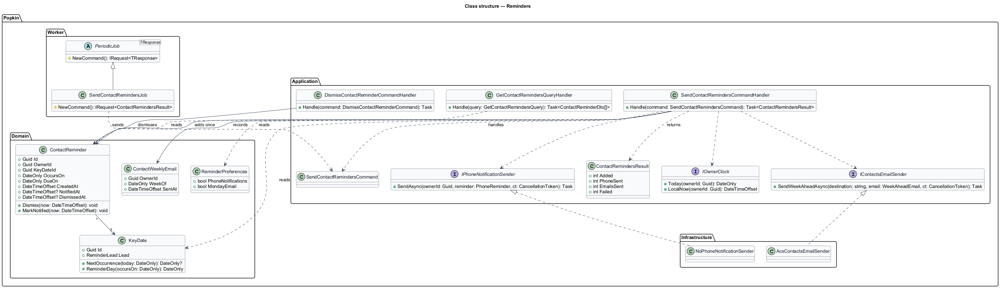

# Reminders

## Overview

A key date is worth keeping only if the person hears of it in time (L1-033). Reminders bring each
key date's reminder to its owner three ways: a message in Contacts at 9 am on the reminder day, a
phone notification at the same time, and an email of the week ahead every Monday (L2-140). The
dates and their lead times are those of [Key dates](../key-dates/README.md); the two switches
live on its Dates page.

The Popkin Worker sends reminders. `SendContactRemindersJob` is a `PeriodicJob`: on each tick it
sends one command, and the handler decides what is due. The Worker holds no hub connection and
sends no hub events ([ADR 0015](../../../adr/0015-the-worker-sends-no-hub-events.md)), so the web
app learns of a new reminder by reading it.

- **reminder** — message that names a coming key date, due on its reminder day
- **reminder day** — occurrence of a key date minus its lead time ([Key dates](../key-dates/README.md))
- **in-app reminder** — `ContactReminder` row that Contacts shows as a message until the owner dismisses it
- **phone notification** — reminder delivered to the owner's phone at 9 am on the reminder day by Web Push (ADR 0028)
- **Monday email** — email to the owner each Monday listing the key dates of the week ahead
- **week ahead** — the seven days from that Monday

Everything a reminder says is private to its owner (L2-122); no contact is told anything.

## Description

### Screens and states

- `docs/mocks/notifications/contacts-toast/info.html` — over Today, an info message "Grace turns
  33 on Saturday" and "Open Grace's profile", with a dismiss button. It arrives at 9 am on its reminder day and stays until
  dismissed (L2-140 AC1, L2-124 AC1).
- `docs/mocks/pages/contacts-dates/default.html` — under "Reminders", the switches "Phone
  notifications" ("At 9 am on reminder days") and "Monday email" ("The week ahead, every
  Monday"), both on at the first visit (L2-140 AC2 to AC4). The empty Dates page shows neither
  (L2-137 AC4).
- `docs/mocks/notifications/contacts-toast/blocked.html` — the warning "Notifications are
  blocked in this browser", "Allow them for Popkin in your browser’s settings to get reminders on
  this device." (ADR 0028).
- No mock draws the phone notification or the email.

### Rulings (known gaps 104 and 114, settled 2026-11-17)

- **The phone channel is Web Push** ([ADR 0028](../../../adr/0028-phone-reminders-by-web-push.md)).
  A device subscribes when "Phone notifications" is turned on there; turning it off removes that
  device's subscription. With no `Push:PrivateKey` nothing is sent and the reminder is still marked
  notified.
- **"9 am" is 9 am where the person is.** Each time Contacts opens, the web app saves the
  device's IANA zone (`Intl.DateTimeFormat().resolvedOptions().timeZone`) with
  `PUT /api/contacts/time-zone`; the Worker reads 9 am in the zone last saved, or in UTC before
  one is.
- **What reminds.** Three things, each once, at 9 am on its day, in the app and by phone:
  - a key date on its reminder day: "{what} {when}";
  - a follow-up on its due day: "{text} is due today" (a promise's "Remind me {day}" is its due
    day, L2-133 AC2);
  - a habit on its due day, "{what} with {first name} is due today", and again the day after if
    not kept, "{what} with {first name} is overdue" (L2-145 AC4).
- **The words of a date.** `{what}` is "{first name} turns {n}" for a birthday whose year is
  known, "{first name}'s birthday", "{first name}'s anniversary", or the date's own title.
  `{when}` is "today", "tomorrow", "on {weekday}" within the next 6 days, else "on {day}
  {month}" ("on 19 September"), so a lead of a week or more names no ambiguous weekday.
- **No second line.** A follow-up names a contact, not a date, so a date's reminder lists none;
  the follow-up reminds on its own day. The toast mock is redrawn without the line, and L2-140
  AC1 drops "with any follow-ups for it".
- **The Monday email** goes from 9 am on Monday where the person is, to the account's email
  address; an account that signs in by phone only gets none. It is sent only when the week
  ahead, Monday to Sunday, holds a key date: its subject is "Your week in Contacts", and it lists
  each date's words, soonest first, with a link to Dates. It names nobody but the owner's own
  contacts and goes to the owner only.
- **Seeing it.** An open Contacts page reads reminders when it opens and when the window regains
  focus; it does not poll. No hub event is added (ADR 0015).
- **The job** runs every 5 minutes; a key date added after its reminder day and before its
  occurrence reminds at the next tick. `JobCatalogue` is not built yet ([Jobs](../../admin-operations/jobs/README.md)):
  the job is registered in the Worker's `Program.cs` beside the other five.

### API

`ContactRemindersController` (`Popkin.Api/Controllers/Contacts/`), default authenticated policy.

- `GET /api/contacts/reminders` — `200` `ContactReminderDto[]`, the owner's undismissed in-app
  reminders, oldest first: `id`, `kind` (`KeyDate`, `FollowUp`, `Habit`), `contactId?`,
  `firstName?`, `words`, `dueOn`.
- `POST /api/contacts/reminders/{reminderId}/dismissal` — `204`; dismissing twice is a `204` that
  changes nothing. `404` `reminder_not_found` for anyone else's.
- `PUT /api/contacts/time-zone` `{ zone }` — `204`; `400` `invalid_time_zone` for a zone the
  server does not know.
- `GET /api/contacts/push-key` — `200` `{ publicKey }`, empty when no key is configured.
- `POST /api/contacts/push-subscriptions` `{ endpoint, p256dh, auth }` — `204`, once per
  endpoint; `DELETE /api/contacts/push-subscriptions?endpoint=…` — `204`.
- The switches are saved with `PUT /api/contacts/reminder-preferences`
  ([Key dates](../key-dates/README.md)).

### Backend

- **`ContactReminder`** (Domain, new table) — `Id`, `OwnerId`, `Kind`, `SubjectId` (the key date,
  follow-up or habit), `ContactId?`, `DueOn`, `Words`, `CreatedAt`, `NotifiedAt?`,
  `DismissedAt?`; `Dismiss(now)`, `MarkNotified(now)`. Unique index on (`Kind`, `SubjectId`,
  `DueOn`), so one day's reminder is added once whatever the number of ticks; a habit's
  overdue reminder is due the day after its due day. Removing a
  contact, a key date, a follow-up or a habit removes its rows (`ContactRemoval`).
- **`ContactWeeklyEmail`** (Domain, new table) — `OwnerId`, `WeekOf` (the Monday), `SentAt`; key
  (`OwnerId`, `WeekOf`), so one week has one email.
- **`PushSubscription`** (Domain, new table) — `Id`, `PersonId`, `Endpoint` (unique), `P256dh`,
  `Auth`, `CreatedAt`.
- **`ReminderPreferences.TimeZone`** — the IANA zone last saved, null until one is.
- **`ReminderRules`** (Application) — the words of each reminder and of the week ahead, and what
  is due on a day; tested one case per row.
- **`SendContactRemindersCommand`** / **`SendContactRemindersCommandHandler`**
  (`Popkin.Application/Contacts/Reminders/`) — for each owner with Contacts, reads the local now in
  their zone. From 9 am it adds the day's reminders that do not exist yet (L2-140 AC1, L2-133
  AC2, L2-145 AC4). For each reminder not yet notified it calls `IPhoneNotificationSender` when
  `PhoneNotifications` is on, and marks it notified either way (AC2). On a Monday, when
  `MondayEmail` is on, the account has an email and no `ContactWeeklyEmail` exists for the week,
  it sends the week ahead through `IContactsEmailSender` and records it (AC3). It saves after each
  owner, so one failure stops one owner only.
- **`IPhoneNotificationSender`** (Application) — `SendAsync(personId, PhoneReminder,
  CancellationToken)`; `WebPushPhoneNotificationSender` (Infrastructure) sends to each of the
  person's subscriptions and removes one answered `404` or `410` (ADR 0028).
- **`IContactsEmailSender`** (Application) — `SendWeekAheadAsync(email, WeekAheadEmail,
  CancellationToken)`, implemented by Azure Communication Services email as `ICrewInviteSender`
  is. Nothing it is given is logged (L2-054 AC3).
- **`SendContactRemindersJob`** (`Popkin.Worker/Jobs/`) — `PeriodicJob` every 5 minutes whose
  command is `SendContactRemindersCommand`, registered in `Program.cs`.
- **`GetContactRemindersQueryHandler`**, **`DismissContactReminderCommandHandler`**,
  **`SaveTimeZoneCommandHandler`**, **`SavePushSubscriptionCommandHandler`** — the owner's rows only.
- **Telemetry** (`PopkinMetrics`, meter `Popkin`) — `popkin.contacts.reminders.sent` and
  `popkin.contacts.reminders.send_failures`, by `channel` (`in_app`, `phone`, `email`). No
  dimension or log carries an owner, a contact, the words or an address.
- **Settings** (ADR 0013), listed in `docs/deployment.md`: the Worker gains
  `Features:Contacts`, `Communication:Endpoint`, `Communication:EmailSender`,
  `Communication:ClientId` and `App:Origin` (the email's link to Dates); the API and the Worker
  gain `Push:PublicKey`, `Push:PrivateKey` (the secret `PUSH_PRIVATE_KEY`) and `Push:Subject`.

### Frontend (Popkin web app)

- **`ContactRemindersStore`** (`frontend/projects/api/src/lib/api/contacts/`) — reads
  `reminders()` when a Contacts page opens and on focus, shows each new one through `Toaster` as an
  info toast held until dismissed, with "Open {first name}'s profile" for one that names a
  contact, and dismisses it optimistically, putting it back when the request fails. Unit tested.
- **`contactsOpenGuard`** opens the store as each Contacts page opens; the store's first open
  saves the device's zone (`PUT /api/contacts/time-zone`).
- **`PUSH_SUBSCRIBER`** (`api`, `BrowserPushSubscriber`) — asks the browser's permission,
  registers `push-worker.js` and saves or removes the subscription when `DatesStore` turns
  "Phone notifications" on or off; when refused, Dates shows the warning toast "Notifications are
  blocked in this browser" (`docs/mocks/notifications/contacts-toast/blocked.html`).
- **`Toaster`** — `show(…, { lasting, dismissed })`: an info toast that stays until dismissed and
  says so.
- **`CONTACTS_API`** — `reminders()`, `dismissReminder(id)`, `saveTimeZone(zone)`, `pushKey()`,
  `savePushSubscription(...)`, `removePushSubscription(endpoint)`.

### Tests

- `ReminderRules` and the handler on InMemory with `FakeTimeProvider`, one case per row: before 9
  am nothing; at 9 am on the reminder day one reminder; a second tick adds none; each lead time;
  a date added late; a follow-up on its due day; a habit due and the day after; phone switch on
  and off; Monday with the switch on, off, no email and already sent; an empty week; a sender
  that throws stops one owner. No test sleeps (ADR 0010).
- `JobTests` (Worker): advancing the clock by 5 minutes sends one `SendContactRemindersCommand`.
- API acceptance: the reminders read returns the owner's only; dismiss hides one; another
  person's answers `404` `reminder_not_found`; the zone is saved and a wrong one refused.
- `Toaster`, `ContactRemindersStore` and `DatesStore` unit specs (`api`).
- Playwright: `tests/contacts-reminders.spec.ts` through the `Toasts` page object: the message,
  "Open {first name}'s profile", dismiss, the zone saved when Contacts opens, and notifications
  blocked on Dates.

## Requirements

| L2 ID | Refines (L1) | Requirement |
|-------|--------------|-------------|
| `L2-140` | `L1-033` | Reminders reach the person: A reminder arrives in the app, on the phone and in a weekly email. (AC1–AC4) |

## Diagrams

### System context

The Worker brings reminders to the owner in the app, by email through Azure Communication
Services and, once its ADR is accepted, by a phone notification service.

### Containers

The Worker writes in-app reminders to the database; the API reads and dismisses them for the web
app. No hub event joins the two.

### Components

`SendContactRemindersJob` sends one command per tick; its handler holds every rule of what is due.

### Class structure

### Behaviour

At 9 am on a reminder day the job adds the in-app reminder once and sends the phone notification
when it is on.

On a Monday the job sends the week ahead once.

Contacts shows the reminder until the owner dismisses it.

