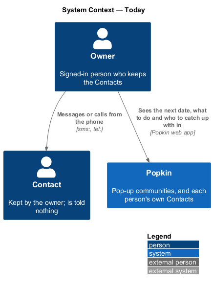
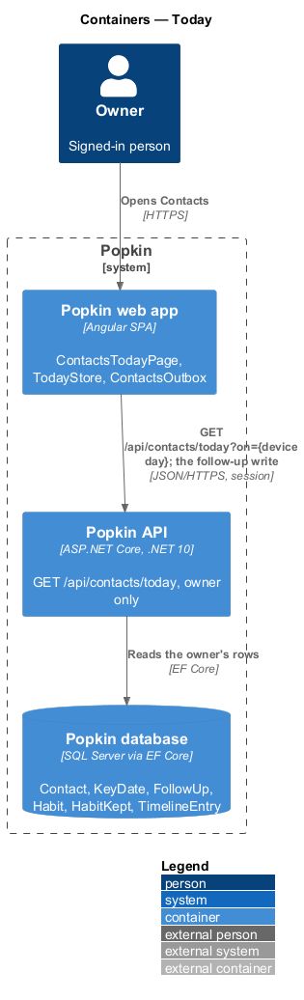
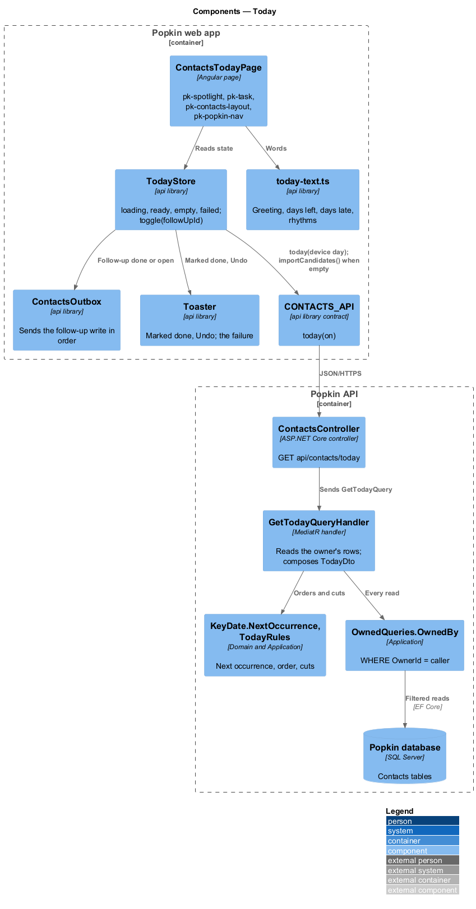
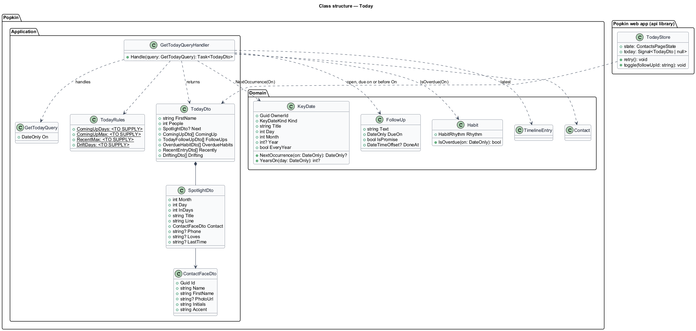
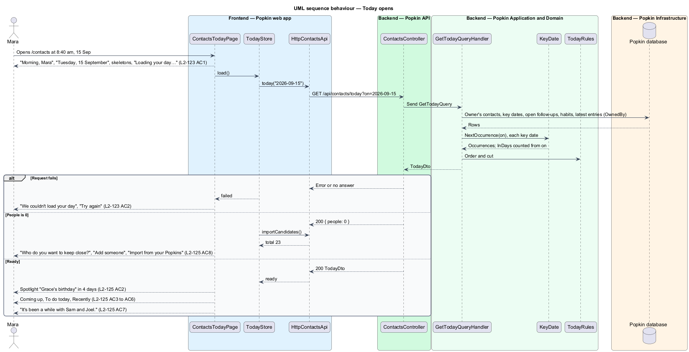
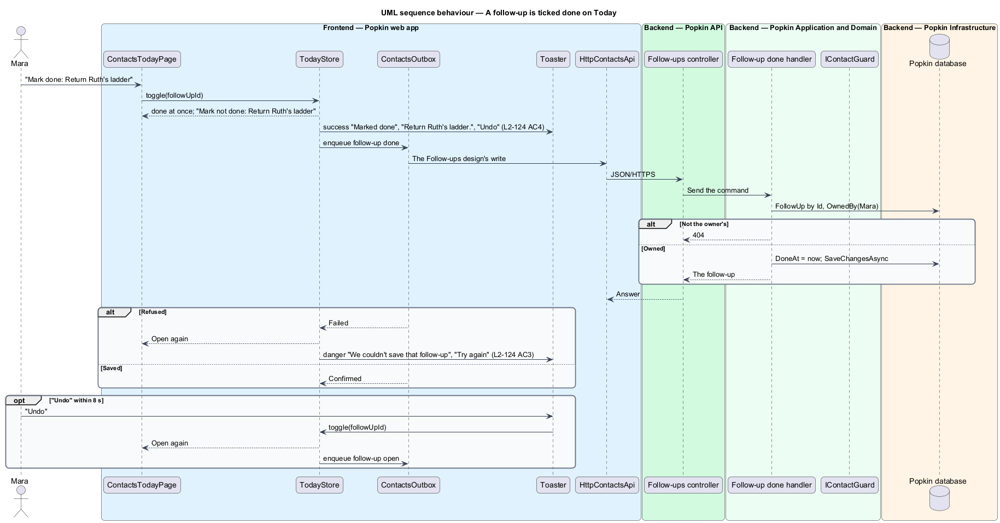

# Today

## Overview

Popkin is a platform for pop-up communities. Contacts is a signed-in person's own address book
(L1-029), and Today is the page it opens on (`/contacts`, L2-121 AC2). Today shows, in one place,
the next date that matters, what is coming up, what to do today, what was logged recently and who
the person has not talked to in a while (L1-030). It is read in one request and changes nothing
itself; ticking a follow-up done uses the write the [Follow-ups](../follow-ups/README.md) design defines (L2-142).

- **next date** — soonest key date on or after the device day, which leads the page as the spotlight
- **coming up** — key dates after the next date, soonest first
- **to do today** — open follow-ups due on or before the device day, then the habits that are overdue
- **recently** — latest conversations and milestones logged, newest first
- **drifting contact** — contact whose last logged conversation is long enough ago to show under "It's been a while"
- **device day** — calendar date on the person's device ([Open Contacts](../open-contacts/README.md))
- **occurrence** — next day on or after the device day on which a key date falls, with its days left (`KeyDate.NextOccurrence`, [Key dates](../key-dates/README.md))

The page reads `GET /api/contacts/today?on={device day}`. The API counts every "days left", "days
late" and "days since" from `on`, so a recording and a test fix the day, and the person sees the
day their device shows. The greeting and the date line are the device's own.

## Description

### Screens and states

`docs/mocks/pages/contacts-today/`, Mara at 8:40 am on Tuesday 15 September 2026:

- `default.html` — the page head "Morning, Mara", "Tuesday, 15 September" and "Add someone",
  which opens Add someone (`/contacts/people/new`) (L2-125 AC1). Then two columns from wide
  screens, one on a phone (L2-125 AC9):
  - The spotlight: "Saturday · in 4 days", Grace's photo linking to her profile (named "Grace
    Adeyemi's profile"), "Grace's birthday", "Turns 33 · Best friend from uni", "Grace is into
    pottery, natural wine and Sunday markets.", "Last time: …", "Message Grace" (an `sms:` link to
    her phone) and "Open profile" (L2-125 AC2).
  - "Coming up" with "All dates" (to `/contacts/dates`): each row a date tile ("Sep 26"), the
    contact's or contacts' faces ("Chidi and Tomás"), the title and line ("Chidi & Tomás's
    anniversary", "5 years married") and the days left ("11 days"); each opens the profile
    (L2-125 AC3).
  - "To do today": each open follow-up with "Mark done: {text}", its text, "2 days late · You
    promised" or "Today · You promised", and the contact's face (L2-125 AC4); then "Lunch with
    Chidi is overdue" linking to Habits, "Every 2 weeks · the last one was Aug 30" and "Call" (a
    `tel:` link) (L2-125 AC5); then "All follow-ups".
  - "Recently": each entry the contact's face, a kind dot, "Ada · Sunday call", the note and when
    ("Sun", "Sep 11"); each opens the profile (L2-125 AC6).
  - "It's been a while with Sam and Joel. Log a catch-up when you talk.", with a chip per contact,
    "Sam · 59 days", opening Log a conversation with them (`/contacts/people/{id}/log`) (L2-125
    AC7).
- `done.html` — "Return Ruth's ladder" ticked: struck through at once, its button `aria-pressed`
  and named "Mark not done: Return Ruth's ladder", and the toast "Marked done" / "Return Ruth's
  ladder." / "Undo" (L2-142, L2-124 AC4). "Undo" or ticking again opens it.
- `loading.html` — the page head stays; skeletons and "Loading your day…" (L2-123 AC1).
- `error.html` — "We couldn't load your day", "Nothing you saved is lost. Check your connection
  and try again." and "Try again" (L2-123 AC2, AC3).
- `empty.html` — no page-head action; "Who do you want to keep close?", "Add the people who
  matter. Popkin remembers their birthdays, what you talked about and what you promised, then
  tells you when it's time.", "Add someone", "Import from your Popkins" (opens the import dialog,
  L2-151) and "23 people from your Popkins are ready to import. Only you can see your contacts."
  (L2-125 AC8).

A section with nothing to show is left out: no spotlight without a key date, no "Coming up"
without a second, no "To do today", "Recently" or "It's been a while" without entries.

### Conflicts and gaps

- **What counts as "a while", how far "Coming up" looks and how many it shows, and what "Last
  time:" quotes** are open (known gap 99). The mocks show Sam at 59 days and Joel at 33, and not
  Ben at 11 days or Grace at 10.
- **The greeting.** Only "Morning" at 8:40 am is drawn; the greeting at other hours is `<TO
  SUPPLY>`.
- **How many "Recently" shows.** The mock shows 5; the number is `<TO SUPPLY>`.
- **When an entry happened.** "Recently" reads "Sun" and "Sat" for this week, but "Sep 11" (a
  Friday, 4 days ago) beside them; the rule for a weekday against a date is `<TO SUPPLY>`.
- **Lines and titles of key dates.** "Turns 33" needs the birthday's year (known gap 102); "Mum's
  birthday" is Ada's by her relation, while Grace's is "Grace's birthday"; "Iris is one month
  old" is a one-off date (known gap 103). Who writes a date's title and line is `<TO SUPPLY>`;
  this design shows the title and line the key date holds.
- **"in 4 days" and "Tomorrow".** The words for a date today or tomorrow are `<TO SUPPLY>`.
- **No phone.** "Message {first name}" and "Call" are links to the contact's phone; with no phone
  they are left out `<TO SUPPLY>`.
- **The import count** "{n} people from your Popkins are ready to import" is the `total` of
  `GET /api/contacts/import` ([Import from your Popkins](../import-from-popkins/README.md));
  whether wrapped-up Popkins count is open (known gap 110). With none, the line is left out
  (L2-125 AC8).
- **Overdue habit.** When a habit is overdue is the Habits rule (known gap 105).
- **Pronouns.** "Last time: she asked you…" is a pronoun; see [Only you see your
  Contacts](../contacts-privacy/README.md).

### API

On `ContactsController` (`api/contacts`), one MediatR request:

- `GET /api/contacts/today?on=2026-09-15` — `200` `TodayDto`; `400` `invalid_date`.
  - `firstName` — the owner's first name, for "Morning, Mara".
  - `people` (int) — 0 draws the empty state.
  - `next` (`SpotlightDto?`): `keyDateId`, `month`, `day`, `inDays`, `title`, `line`, `contact`
    (`ContactFaceDto`: `id`, `name`, `firstName`, `photoUrl`, `initials`, `accent`), `phone`,
    `loves`, `lastTime`.
  - `comingUp` (`ComingUpDto[]`): `keyDateId`, `month`, `day`, `inDays`, `title`, `line`,
    `contacts` (`ContactFaceDto[]`), `contactId` (the profile it opens).
  - `followUps` (`TodayFollowUpDto[]`): `id`, `text`, `dueOn`, `daysLate`, `isPromise`, `done`,
    `contact` (`ContactFaceDto`).
  - `overdueHabits` (`OverdueHabitDto[]`): `habitId`, `title`, `rhythm` (`HabitRhythm`),
    `lastKeptOn`, `contact`, `phone`.
  - `recently` (`RecentEntryDto[]`): `entryId`, `kind` (conversation or milestone), `title`,
    `note`, `on`, `contact`.
  - `drifting` (`DriftingDto[]`): `contact`, `daysSince`.
- Photo addresses expire, as the album's do (ADR 0022). Nothing of another owner is read (L2-122).

### Backend

- **`GetTodayQuery(DateOnly On)`** / **`GetTodayQueryHandler`**
  (`Popkin.Application/Contacts/Today/`) — reads through `OwnedBy(PersonId)` only: the owner's
  `Person.Name`, their contacts, key dates, open follow-ups, habits with their last `HabitKept`,
  and the latest timeline entries. It composes `TodayDto` and writes nothing.
- **`KeyDate.NextOccurrence(on)`** (Domain, defined by [Key dates](../key-dates/README.md)) —
  the day the date next falls on or after `on`, or null for a one-off date that has passed; the
  handler counts `InDays` from it. `KeyDate.YearsOn(day)` gives "Turns 33" and "5 years married".
  29 February in a year without it is `<TO SUPPLY>`.
- **`TodayRules`** (Application) — the order and the cuts: the next date is the soonest
  occurrence; "Coming up" takes the following ones up to `TodayRules.ComingUpDays` and
  `TodayRules.ComingUpMax`; follow-ups due on or before `on` are ordered most late first;
  "Recently" takes `TodayRules.RecentMax`; a contact is drifting after `TodayRules.DriftDays`.
  Each value is `<TO SUPPLY>` (known gap 99).
- **Overdue habits** come from the Habits rule `Habit.IsOverdue(on)` (known gap 105).
- **`ContactsDayValidator`** validates `on` (`400` `invalid_date`).

### Frontend (Popkin web app)

- **`ContactsTodayPage`** (`pages/contacts-today/contacts-today.page.ts` and `.html`, route
  `/contacts`, `shell: 'app'`, `page: 'contacts-today'`) — composes `pk-app-screen`,
  `pk-popkin-nav` for Contacts with `today` current, `pk-contacts-layout` (`lead` grid),
  `pk-page-head`, and by state: `pk-skeleton` shapes beside the status line, `pk-empty-state`
  with "Try again" as an alert, the empty section, or the page.
- **`TodayStore`** (`api/src/lib/api/contacts/today-store.ts`) — `ContactsPageState`, loads with
  the device day, reads the import candidates' `total` only when `people` is 0, `retry()`, and `toggle(followUpId)`, which marks the follow-up done or open at
  once, writes it through `ContactsOutbox` (`PUT /api/contacts/follow-ups/{id}/done`, defined by
  [Follow-ups](../follow-ups/README.md)), shows "Marked done" with "Undo", and on refusal puts
  it back with the danger toast "We couldn't save that follow-up" (L2-124 AC3). Unit tested.
- **`today-text.ts`** (api library) — the greeting, "Tuesday, 15 September", "Saturday · in 4
  days", "{n} days", "{n} days late", "Today", "You promised", "Every 2 weeks · the last one was
  Aug 30", "{first name} is into", "It's been a while with {names}.", "{name} · {n} days". Names
  are first names joined with "and". Unit tested.
- **`CONTACTS_API`** — `today(on)`; `importCandidates()` and `setFollowUpDone(id, done)` of the
  Import and Follow-ups designs.
- **Components** — `pk-spotlight` with `pk-date-tile` (backlog row 19), `pk-task` (row 17) for
  follow-ups and the overdue habit, `pk-contacts-layout` (row 22), `pk-avatar-stack` (faces of a
  coming-up row), `pk-avatar`, `pk-page-head`, `pk-button`, `pk-empty-state`, `pk-skeleton`. The
  coming-up and recent rows are the design system's `list-row` and the drifting chips its
  `who-chip` as a link; neither is built.

### Tests

- API acceptance tests (InMemory): with Mara's cast seeded, `today?on=2026-09-15` leads with
  Grace's birthday in 4 days, lists Chidi & Tomás's anniversary at 11 days, the two follow-ups
  with "2 days late" and today, Lunch with Chidi overdue, and Sam and Joel drifting; Lena's
  Contacts add nothing to Mara's Today; a person with no contacts gets `people` 0.
- Direct test of `TodayRules`, one case per row: the soonest date leads; a date today; ordering
  of "Coming up"; each cut; follow-ups most late first. `KeyDate.NextOccurrence` is tested by Key
  dates.
- Unit tests: `TodayStore` (states, toggle, undo, refusal) and `today-text.ts`.
- Playwright: `tests/contacts-today.spec.ts` through `ContactsTodayPage`
  (`pages/contacts-today.page.ts`) with the page clock at 08:40 on 15 September 2026: the page as
  drawn; ticking a follow-up and undoing it; a drifting chip opens Log; loading, failed with "Try
  again", and empty. Recorded responses add `GET /api/contacts/today`; `stubs.ts` adds the empty
  day and the delayed and failed answers; `routes.ts` gains `contactsToday`, `contactsTodayDone`,
  `contactsTodayLoading`, `contactsTodayEmpty` and `contactsTodayError`.
- Parity: `spotlight`, `date-tile`, `task` and `contacts-layout`.

## Requirements

| L2 ID | Refines (L1) | Requirement |
|-------|--------------|-------------|
| `L2-125` | `L1-030` | Today: Today greets the person and shows what matters now. (AC1–AC9) |

## Diagrams

### System context

The owner opens Contacts on Today and acts on it; a contact is messaged or called from the
person's own phone, outside Popkin.

### Containers

The web app reads Today in one request with the device day; the API reads only the owner's rows.

### Components

`TodayStore` loads `TodayDto` through `CONTACTS_API`; `GetTodayQueryHandler` reads the owner's
rows and orders them with `KeyDate.NextOccurrence` and `TodayRules`.

### Class structure

`TodayDto` and its parts, the handler, and the two rules it orders by.

### Behaviour — Today opens

Mara opens Contacts; the page shows the skeleton, reads Today for her device day, and draws each
section that has something in it.

### Behaviour — a follow-up is ticked done

The follow-up is struck through at once, saved through the outbox, and "Undo" opens it again.

