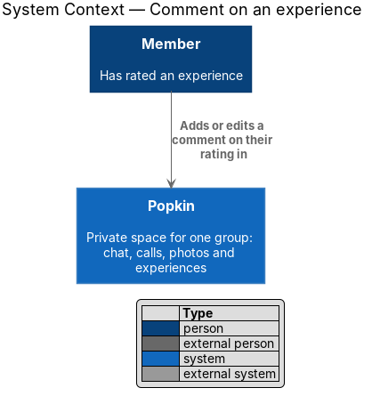
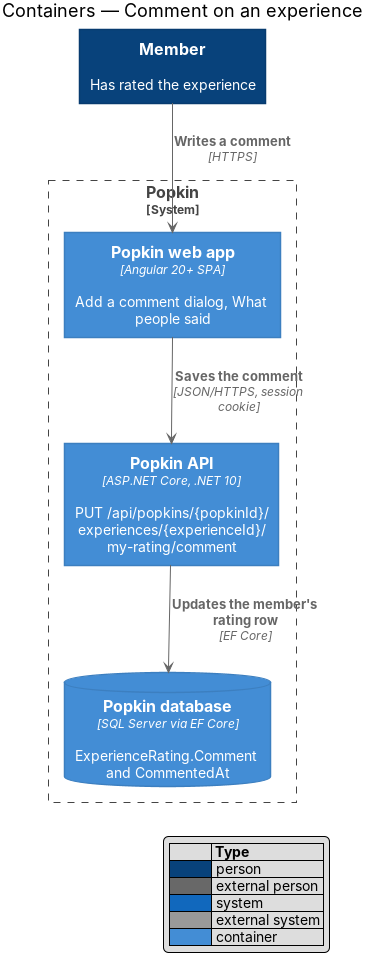
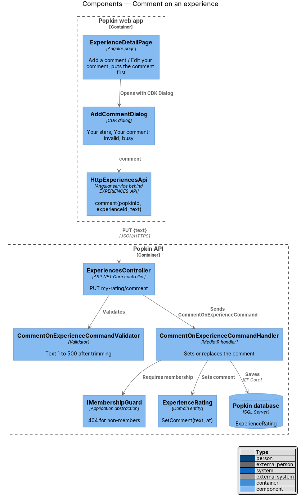
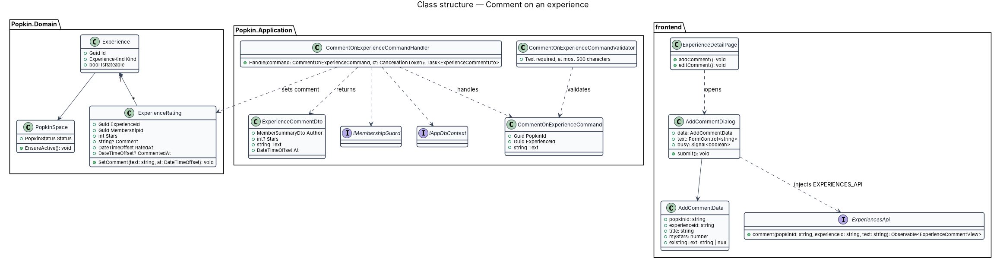
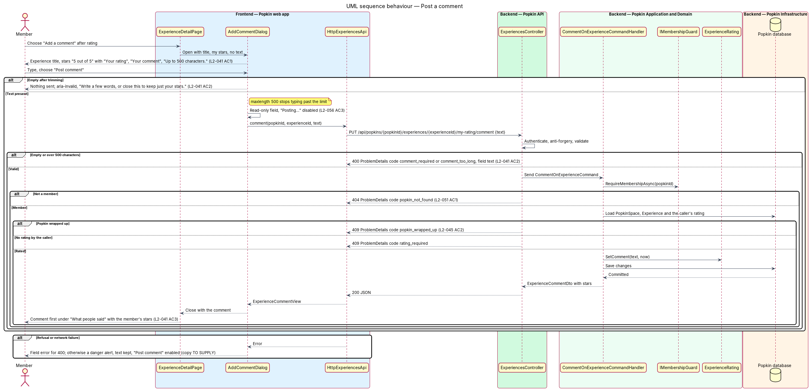
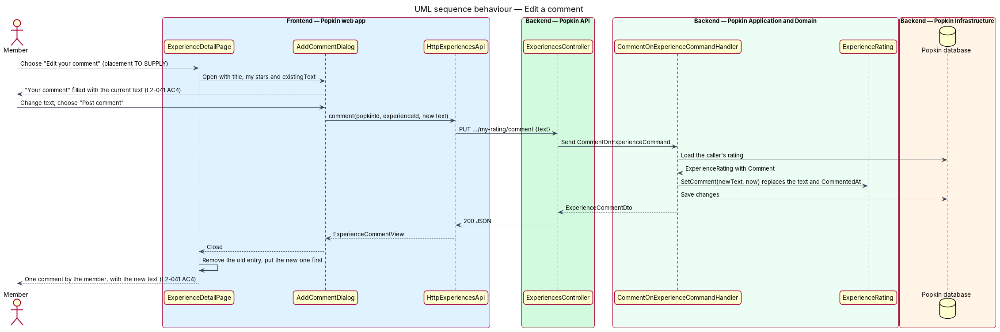

# Comment on an experience

## Overview

Popkin is a free platform for pop-up communities. Members of a *Popkin*, a private space for one
group, rate the experiences the group shares from one to five stars
([Rate an experience](../rate-experience/README.md)). This feature lets a member who has rated
an experience add a few words to that rating, and change them later.

- **comment** — short text a member attaches to their own rating of an experience; at most one
  per member and experience
- **What people said** — list of comments on the experience detail page, the newest first, each
  with the author's avatar, first name and stars

A comment belongs to a rating: it has no stars of its own and no existence without the rating.
The design therefore stores it on the member's `ExperienceRating` row rather than in a separate
table. [View an experience](../view-experience/README.md) lists the comments; this feature adds
and replaces them. A wrapped-up Popkin accepts no new comment (L2-045).

## Description

### Screens and states

- `docs/mocks/pages/experience-detail/rated.html` — after rating, the panel offers "Add a
  comment".
- `docs/mocks/dialogs/add-comment/default.html` — dialog titled with the experience ("Sunrise
  canoe to Heron Point"), the member's stars ("5 out of 5") with "Your rating", the "Your
  comment" field with the hint "Up to 500 characters." and "Post comment".
- `docs/mocks/dialogs/add-comment/invalid.html` — empty comment: the field `aria-invalid` and
  "Write a few words, or close this to keep just your stars."
- `docs/mocks/dialogs/add-comment/busy.html` — field read-only, "Posting…" disabled with
  `aria-busy`.
- "Edit your comment" (L2-041 AC4) has no mock: the rating panel offers it in the place of "Add
  a comment" once the member has one. A failed save has no mock: the dialog shows the alert "We
  couldn't post that. Your words are still here. Try again."

### API

- `PUT /api/popkins/{popkinId}/experiences/{experienceId}/my-rating/comment` with
  `{ "text": "…" }` → `200` with `ExperienceCommentDto`. The same call adds and replaces the
  comment. Refusals:
  - `400` `comment_required` (empty after trimming) or `comment_too_long` (over 500
    characters), naming the field `text` (L2-041 AC2, L2-052 AC1);
  - `401` without a session;
  - `404` `popkin_not_found` (L2-051) or `experience_not_found`;
  - `409` `rating_required` when the caller has not rated the experience, or when it is a
    "Want to do" experience, which has no ratings;
  - `409` `popkin_wrapped_up` (L2-045 AC2);
  - `429` `rate_limited` past the limit.
- The endpoint is under the `messages` policy
  ([Abuse limits](../../security/abuse-limits/README.md)), counted with rating and with the
  messages the person sends.
- A comment is not cleared: L2-041 does not ask for it, and an empty text is refused.

### Frontend (`frontend/projects/`)

- **`AddCommentDialog`** — `popkin/src/app/dialogs/add-comment/add-comment.dialog.ts` with its
  `.html`, opened with CDK `Dialog` by `ExperienceDetailPage` from "Add a comment" or "Edit your
  comment". It receives `AddCommentData`: the experience title, the member's stars and the
  existing text, if any (L2-041 AC1, AC4).
  - The `textarea` carries `maxlength="500"`, so the field cannot exceed the limit.
  - "Post comment" with an empty or blank comment sends nothing, shows the invalid state and
    returns focus to the field (L2-041 AC2).
  - While saving, the field is read-only and the button reads "Posting…" and is disabled.
  - A `400` puts its message under the field; other failures show the alert, keep the text and
    enable the button again.
  - On success the dialog closes with the saved `ExperienceCommentView`.
- **`commentProblem`** (`api/src/lib/api/experiences/experience-rules.ts`) — why a text will not
  save, or what the API's refusal of it means; a pure helper with unit tests.
- **`ExperienceStore`** — `commentDraft` is what the dialog opens with, null before a rating.
  The panel's `comment` is "Add a comment" when the member has rated and has no comment, and
  "Edit your comment" when they have one. `commented(comment)` removes the member's earlier
  entry, if any, and puts the returned comment first under "What people said" (L2-041 AC3).
- **`ExperiencesApi.comment(popkinId, experienceId, text)`**.
- **Components**: `pk-dialog`, `pk-stars` (the member's stars with `role="img"` and "Your
  rating"), `pk-textarea` with its hint and error, `pk-alert`, `pk-button` (Popkin, block);
  `pk-comments` and `pk-comment` for the list.

### Backend (`backend/src/`)

- **`ExperiencesController.Comment`** — sends `CommentOnExperienceCommand`. It is under
  `RateLimitPolicyNames.Messages`.
- **`ExperienceFields.Comment`** — the text is not empty after trimming and is at most 500
  characters. There is no validator class and no validation library.
- **`CommentOnExperienceCommandHandler`** —
  1. calls `IMembershipGuard.RequireActiveMemberAsync(popkinId)` (`404`, or `409`
     `popkin_wrapped_up`);
  2. checks the text;
  3. loads the `Experience` within the Popkin and the caller's `ExperienceRating`, and refuses
     a caller without one, or a "Want to do" experience, with `409` `rating_required`;
  4. calls `ExperienceRating.SetComment(text, now)`, which replaces any earlier text and sets
     `CommentedAt` from `TimeProvider`;
  5. saves and returns the comment with the author's first name, avatar and stars.
- **`ExperienceRating.Comment`** — at most 500 characters; `CommentedAt` orders "What people
  said". The text is stored as typed, less the white space around it, and rendered by Angular
  interpolation, so HTML or script shows as text (L2-052 AC2).

### Tests

- API integration tests on InMemory: `CommentOnExperienceTests`, in
  `Popkin.Api.Tests/Experiences/`; `ExperienceFieldsTests` for the rule of the text.
- Unit tests of `commentProblem` and of `ExperienceStore.commented`.
- Playwright: "Commenting on an experience" in `e2e/tests/experience-detail.spec.ts`.

### Built in journey 8

Everything above. Decided in the build:

- "Edit your comment" is in the rating panel, where "Add a comment" was.
- The copy of a failed save.
- A member may not clear their comment.
- The limit: the `messages` policy.
- No validation library.

Gaps found, each in [the register](../../README.md#known-gaps):

- `docs/mocks/pages/experience-detail/want.html` shows comments without stars on a "Want to do"
  experience, which has no rating. Nothing is built for them: the page lists none and the API
  answers `409` `rating_required`. How a member comments there, and where such a comment
  lives, is decided with journey 20 (gap 43).
- A new comment does not show on other members' screens until they open the page again
  (gap 38).

The diagrams below were not redrawn (gap 44). They show a
`CommentOnExperienceCommandValidator` and an "Edit your comment" placement still to supply.

## Requirements

| L2 ID | Refines (L1) | Requirement |
|-------|--------------|-------------|
| `L2-041` | `L1-010` | Comment on an experience: A member adds a few words to their rating. |
| `L2-045` | `L1-011` | A wrapped-up Popkin is read-only: Nothing new is added to a Popkin that has ended. |
| `L2-052` | `L1-012` | Input is validated and output is encoded: Nothing a person types can harm another person or the system. |

## Diagrams

### System context

A member who has rated an experience adds or edits a comment in Popkin. No external system takes
part.

### Containers

The web app saves the comment through the Popkin API, which updates the member's rating row in
the Popkin database.

### Components

`ExperienceDetailPage` opens `AddCommentDialog`, which calls `HttpExperiencesApi`. The validator
checks the text and the handler sets it on the member's `ExperienceRating`.

### Class structure

The comment is a field of `ExperienceRating`, set through `SetComment`. The dialog receives the
member's stars and any existing text in `AddCommentData`.

### Behaviour — post a comment

An empty comment is refused in the dialog and by the API. A caller without a rating receives
`409` `rating_required`; a wrapped-up Popkin receives `409` `popkin_wrapped_up`. A saved comment
is first under "What people said" with the member's stars (L2-041 AC3).

### Behaviour — edit a comment

"Edit your comment" opens the dialog with the current text; saving replaces it and moves it to
the top (L2-041 AC4).

