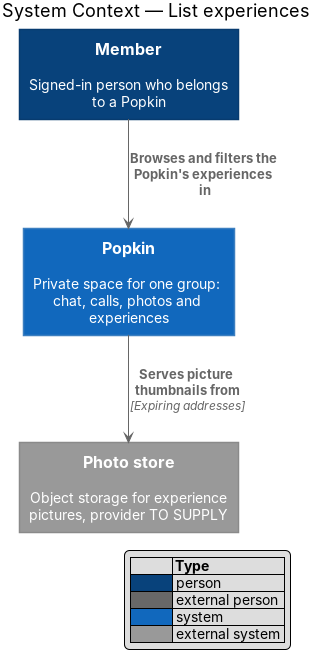
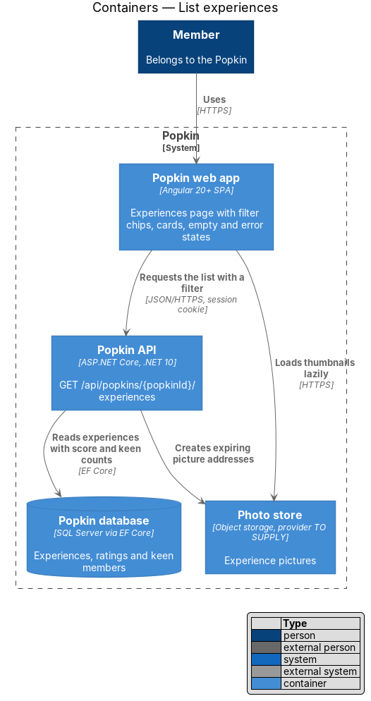
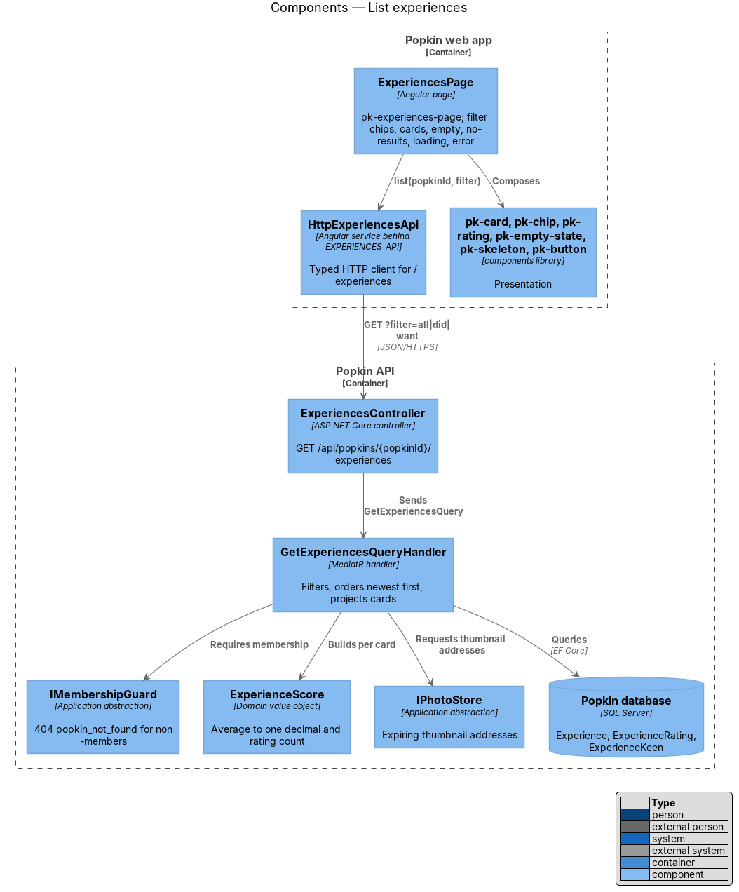
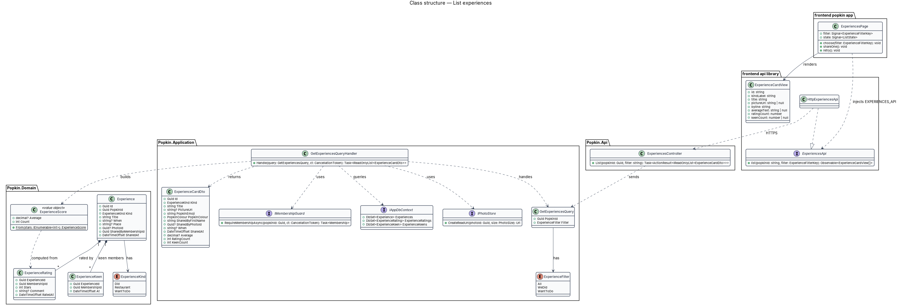
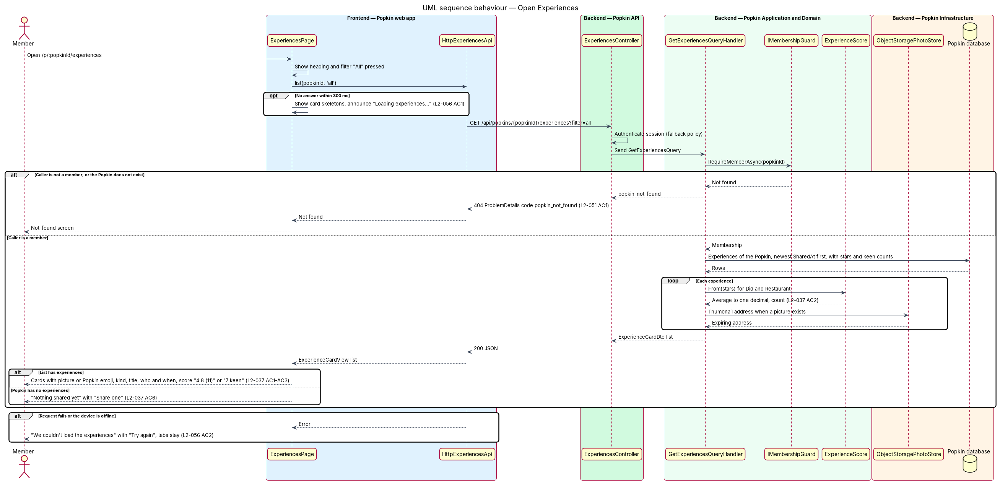
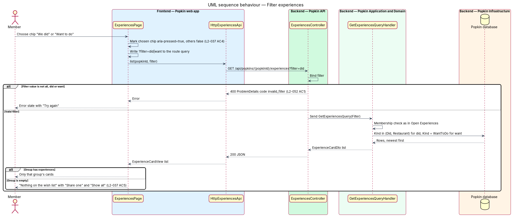

# List experiences

## Overview

Popkin is a free platform for pop-up communities. A *Popkin* is a private space for one group,
with a name, an emoji, a colour, members and a length. Inside a Popkin, members chat, call, share
photos and share experiences.

- **experience** — something the group did, a restaurant, or something the group wants to do,
  which members rate and comment on
- **kind** — category of an experience, shown as "Something we did", "Restaurant" or "Want to do"
- **score** — average of the members' star ratings of an experience, to one decimal, with the
  number of ratings
- **keen** — interest a member shows in a "Want to do" experience (see
  [Say you are keen](../say-keen/README.md))

This feature is the Experiences tab of a Popkin. It lists every experience of the Popkin as a
card, the newest first, and lets a member narrow the list to what the group did or to what it
wants to do. A card for something the group did shows its score; a card for something the group
wants to do shows how many members are keen. The list is the entry point to the other features of
the Experiences subsystem: choosing a card opens [View an experience](../view-experience/README.md)
and "Share one" opens [Share an experience](../share-experience/README.md).

The list is private to the Popkin's members (L2-051). A person who is not a member receives the
same answer as for a Popkin that does not exist.

## Description

The slice runs from the Experiences page to the database. Journey 8, Rate an experience, built
it; what it left is under [Built in journey 8](#built-in-journey-8).

### Screens and states

- `docs/mocks/pages/experiences/default.html` — filter "All": four cards, three with a score
  (4.7, 4.6 and 4.3, each what its counts give) and one with "7 keen".
- `docs/mocks/pages/experiences/did.html` — filter "We did": things done and restaurants.
- `docs/mocks/pages/experiences/want.html` — filter "Want to do".
- `docs/mocks/pages/experiences/no-results.html` — "Want to do" with nothing in it: "Nothing on
  the wish list", "Share one" and "Show all". An empty "We did" has no mock: it reads "Nothing
  done yet", "Share what the group did or where you ate, and everyone can rate it.", with the
  same two buttons.
- `docs/mocks/pages/experiences/empty.html` — a Popkin with no experiences: "Nothing shared yet"
  and "Share one". The filters are not shown.
- `docs/mocks/pages/experiences/loading.html` — card skeletons and the hidden status "Loading
  experiences…".
- `docs/mocks/pages/experiences/error.html` — "We couldn't load the experiences" with "Try
  again"; the tabs stay.

### API

- `GET /api/popkins/{popkinId}/experiences?filter=all|did|want` → `200` with a list of
  `ExperienceCardDto`, the newest first. No filter is `all`. Refusals: `401` without a session
  (L2-050), `404` `popkin_not_found` for a non-member or an unknown Popkin (L2-051), `400`
  `invalid_filter`, naming the field `filter`, for any other value (L2-052).

### Frontend (`frontend/projects/`)

- **`ExperiencesPage`** — `popkin/src/app/pages/experiences/experiences.page.ts` with
  `experiences.page.html`, selector `pk-experiences-page`, OnPush. Route
  `/p/:popkinId/experiences` with route data `{ shell: 'app', page: 'experiences' }`, behind
  `signedInGuard`; a `404` from the API opens the not-found screen, so a person who is not a
  member cannot tell the Popkin exists (L2-051 AC1). The page is a container. It reads the
  filter from the address (`?filter=did` or `?filter=want`; anything else is "All"), so a
  filtered list is the same after a reload. Choosing a chip, or "Show all", writes the address
  and the list follows it. "Share one" opens `ShareExperienceDialog`: in the header from
  768 px, floating below it, and in the empty states.
- **`ExperiencesStore`** — `api/src/lib/api/experiences/experiences-store.ts`, one per screen,
  provided by the route. It holds the logic, not the page (ADR 0011). `open(popkinId, filter)`
  reads the list; a filter chosen later cancels the read of an earlier one. `state` is
  `loading`, `ready`, `empty` (no experiences under "All"), `no-results` (none under a filter),
  `error` or `not-found`. `cards` maps each `ExperienceCardView` to what a card draws, and
  `nothing` is the heading and text of an empty list. `added(card)` puts a newly shared
  experience first and answers false when the filter leaves it out; `removed(id)` takes one
  away.
- **`ExperiencesApi`**, **`EXPERIENCES_API`**, **`HttpExperiencesApi`** —
  `api/src/lib/api/experiences/experiences-api.ts`. Contract, injection token and HTTP
  implementation: `getSummary`, `list`, `get`, `rate`, `comment`, `share`, `edit` and `remove`.
- **`ExperienceCardView`** and **`ExperienceFilter`** (`'all' | 'did' | 'want'`) —
  `api/src/lib/models/experiences.ts`. The view is the API's answer as it is; the kind is
  `'Did' | 'Restaurant' | 'Want'`.
- **`experience-text.ts`** — the words, as pure helpers with unit tests: `kindLabel`, the chip
  labels "All", "We did" and "Want to do" (`EXPERIENCE_FILTERS`), `filterOf`, `nothingHere`,
  `averageText` ("5.0" included) and `byline`. A byline is "Mara · Sat morning". Without a
  "when", a "Want to do" card says "Ellie · Idea", as the mock does, and any other card says
  the day it was shared ("Sam · Nov 13").
- **Components** (`components` library): `pk-tab-header` for the heading, its lead "What we
  did, and what we want to do next.", the filter chips and "Share one"; `pk-chip` for each
  filter (`aria-pressed` on the chosen one, in a group named "Filter", L2-037 AC4);
  `pk-experiences` for the body and its loading state; `pk-experience-grid` and
  `pk-experience-card` for the cards, each one whole-card link with a picture or the Popkin's
  emoji, a kind tag, a title and a foot with `pk-avatar` and `pk-rating` ("4.7 (11)") or the
  keen count; `pk-empty-state` for the empty, no-results and error states; `pk-fab` for the
  floating "Share one"; `pk-popkin-nav` for the tabs.

### Backend (`backend/src/`)

- **`ExperiencesController`** (`Popkin.Api`) — route `/api/popkins/{popkinId}/experiences`.
  `List` passes `filter` as text to `GetExperiencesQuery`. The controller holds no business
  rule.
- **`GetExperiencesQuery`** and **`GetExperiencesQueryHandler`** (`Popkin.Application`) — the
  handler calls `IMembershipGuard.RequireMemberAsync(popkinId)`, which answers `404`
  `popkin_not_found` for a non-member. It refuses an unknown filter with `400`
  `invalid_filter`. It reads the Popkin's experiences in one query, newest `SharedAt` first,
  then by id. `did` keeps every kind but `Want`, so restaurants are in it; `want` keeps `Want`
  (L2-037 AC4).
- **`ExperienceCards`** and **`ExperienceScores`** — build the cards. The sharers are read in
  one query, whether or not they are still members. The database counts the ratings per
  experience and star value in one query, so no rating is read into memory.
- **`ExperienceScore`** (`Popkin.Domain`) — value object built from the count per star value:
  `Count`, `Average` rounded to one decimal with halfway rounding up (4.25 is 4.3), `null` when
  there are no ratings, and `CountFor(stars)`. A "Want to do" experience has no score.
- **`ExperienceCardDto`** — id, `Kind`, `Title`, `PictureUrl`, the Popkin's `Emoji` and
  `Colour` (shown in the picture's place when there is no picture, L2-040 AC5), `SharedBy`
  (membership id, first name and avatar), `When`, `SharedAt`, `Average`, `RatingCount` and
  `KeenCount`. The first name is the part of `Membership.DisplayName` before its first space.
  `KeenCount` is 0 until journey 20.
- **`IPhotoStore`** — answers an expiring, unguessable address for the picture's thumbnail
  (L2-051 AC2, L2-055 AC4).
- **Entities** — `Experience` (`PopkinId`, `SharerMembershipId`, `Kind`, `Title`, `When`,
  `Place`, `PictureKey`, `PictureThumbnailKey`, `SharedAt`) and `ExperienceRating`.
  `ExperienceKind` is `Did`, `Restaurant` or `Want`, stored as text. `When` is free text of at
  most 40 characters and `Place` at most 80 (L2-040 AC3). `IAppDbContext` gains
  `DbSet<Experience>` and `DbSet<ExperienceRating>`; `ExperienceConfiguration` indexes
  `(PopkinId, SharedAt)`. The migration is `AddExperiences`. There is no `ExperienceKeen`
  yet.

### Tests

- API integration tests on InMemory, in `Popkin.Api.Tests/Experiences/`: `ListExperiencesTests`
  and, for the home, `ExperiencesSummaryTests`. `ExperienceScoreTests`
  (`Popkin.Application.Tests`) has one case per row of the score's rule.
- Unit tests of `ExperiencesStore` and of `experience-text.ts`.
- Playwright: `e2e/tests/experiences.spec.ts`, against the recorded answers.

### Built in journey 8

Everything above. Decided in the build:

- The filter is in the address, and the store, not the page, holds the list.
- The byline of a card without a "when": "Idea" for a "Want to do" card, the day it was shared
  otherwise.
- An empty "We did" reads "Nothing done yet".
- The block the mocks call `tab-header` is `pk-tab-header`.
- The list is not sent over the hub. `IPopkinNotifier` gained no event, and L2-037 asks for
  none.

Gaps found, each in [the register](../../README.md#known-gaps):

- The list does not change when another member shares, rates, edits or deletes; it is read
  again when the screen opens (gap 38).
- The list has no paging: one answer carries every experience of the Popkin (gap 39).
- A "Want to do" card reads "0 keen": nobody can say they are keen until journey 20 (gap 42).
- "Share one" is still offered in a wrapped-up Popkin (gap 36).
- The skeletons show at once, not after the 300 ms of
  [Loading, failure and offline](../../reliability/loading-failure-offline/README.md).
- The seeder adds no experiences (gap 40).

The diagrams below were not redrawn (gap 44). They show `ExperienceKeen`, a filter the page
holds, a filter the controller checks and `ObjectStoragePhotoStore`, where there are now
`ExperiencesStore`, a filter the handler checks and no keen record.

## Requirements

| L2 ID | Refines (L1) | Requirement |
|-------|--------------|-------------|
| `L2-037` | `L1-010` | List experiences: Experiences collects what the group did and what it wants to do. |
| `L2-051` | `L1-012` | Popkins are private to their members: Membership decides everything a person sees. |
| `L2-056` | `L1-013` | Loading, failure and offline are always explained: A person is never left guessing. |

## Diagrams

### System context

A member browses the Popkin's experiences in Popkin. Pictures come from the photo store through
expiring addresses.

### Containers

The web app requests the list from the Popkin API, which reads experiences, ratings and keen
members from the Popkin database and signs picture addresses for the photo store.

### Components

`ExperiencesPage` composes `pk-*` components and calls `HttpExperiencesApi`.
`ExperiencesController` sends `GetExperiencesQuery`; its handler checks membership, queries the
database and builds an `ExperienceScore` per card.

### Class structure

An `Experience` owns its ratings and keen records. The handler projects each into an
`ExperienceCardDto`, and the web app maps that to an `ExperienceCardView`.

### Behaviour — open Experiences

The handler refuses a non-member with `404` `popkin_not_found` (L2-051 AC1), otherwise returns
cards newest first with a score or a keen count. The page shows skeletons after 300 ms, the empty
state for a Popkin with no experiences, and the error state with "Try again" when the request
fails.

### Behaviour — filter experiences

Choosing a chip marks it pressed and requests that group; "We did" includes restaurants
(L2-037 AC4). An empty group shows its message with "Share one" (L2-037 AC5).

