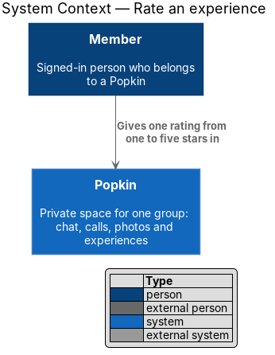
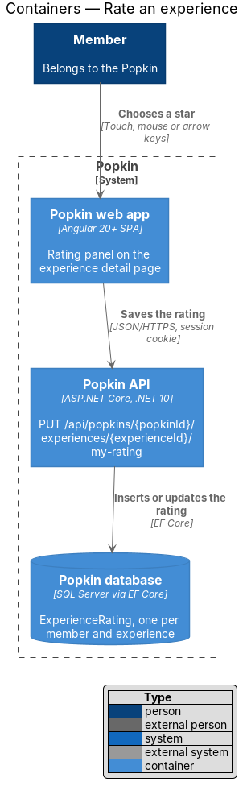
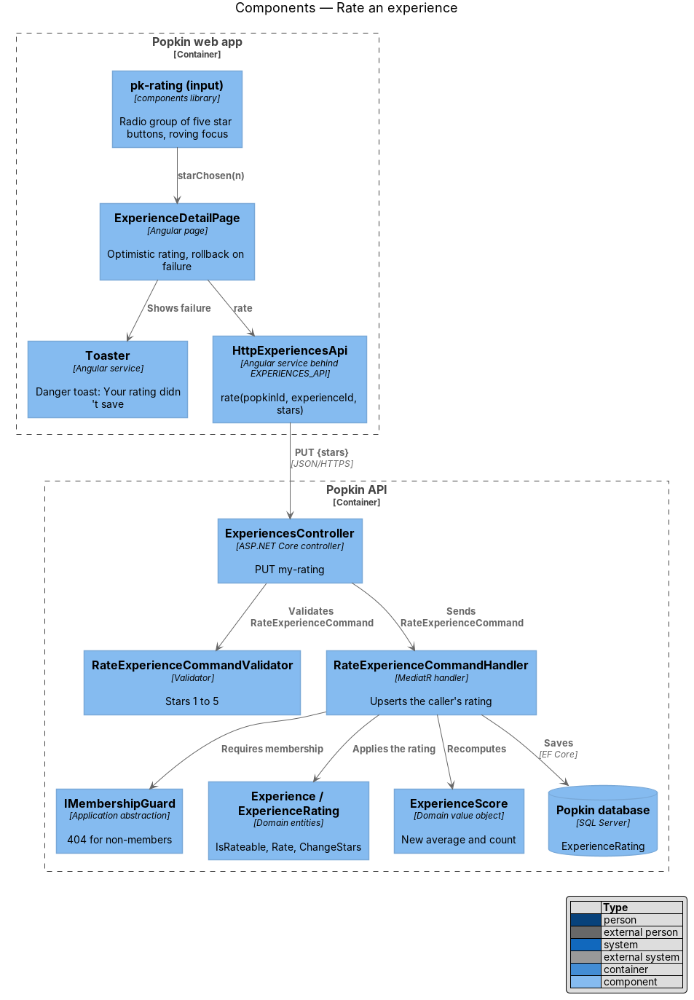
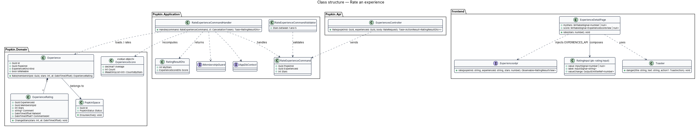
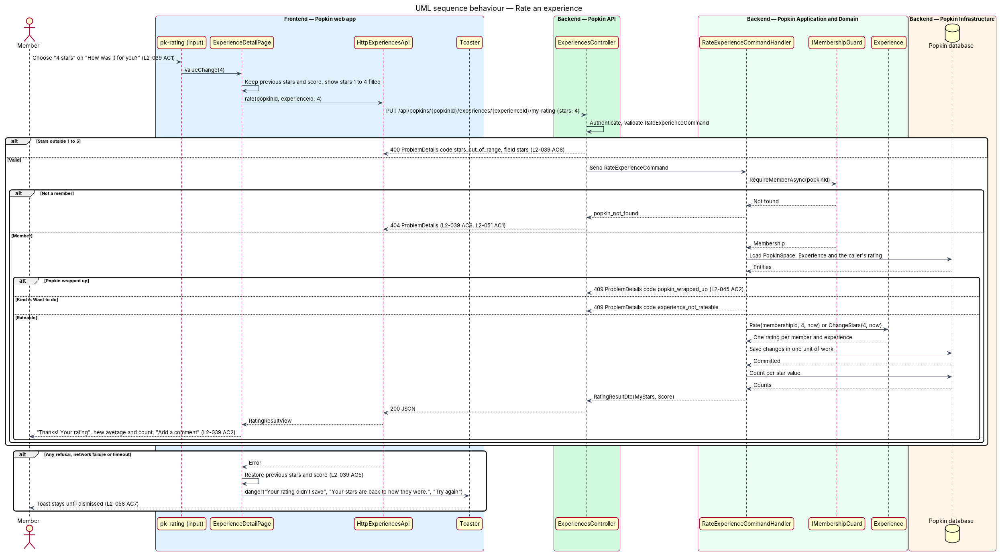
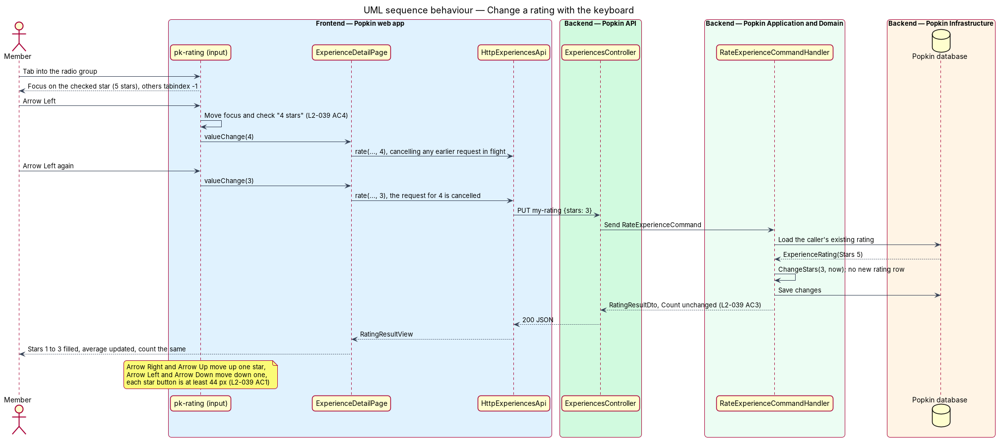

# Rate an experience

## Overview

Popkin is a free platform for pop-up communities. Members of a *Popkin*, a private space for one
group, share *experiences* and rate them. This feature lets a member give an experience their
own rating and change it later.

- **rating** — one member's judgement of one experience, from one to five stars; a member holds
  at most one rating per experience
- **rating panel** — tinted card on the experience detail page that asks "How was it for you?"
  and holds five star buttons
- **rateable experience** — experience of kind "Something we did" or "Restaurant"; a "Want to
  do" experience has no rating panel and is not rateable until it becomes "Something we did"
  (see [Say you are keen](../say-keen/README.md))

The rating panel sits on the page described in [View an experience](../view-experience/README.md),
below the score card. Every rating feeds the group score that page shows. After rating, the panel
offers "Add a comment", which opens the dialog of
[Comment on an experience](../comment-on-experience/README.md).

The page applies a rating as soon as the member chooses a star and puts it back if saving fails.
The member sees the result at once and never loses track of what was saved.

## Description

### Screens and states

- `docs/mocks/pages/experience-detail/default.html` — not yet rated: "How was it for you?" with
  five unchecked star buttons ("1 star" to "5 stars") in a radio group.
- `docs/mocks/pages/experience-detail/rated.html` — rated: "Thanks! Your rating", the stars up to
  the chosen one checked, the count raised from 11 to 12 and "Add a comment".
- `docs/mocks/notifications/toast/danger.html` — the failure toast: "Your rating didn't save",
  "Your stars are back to how they were." and "Try again".

### API

- `PUT /api/popkins/{popkinId}/experiences/{experienceId}/my-rating` with `{ "stars": 1..5 }` →
  `200` with `RatingResultDto` (the caller's stars and the new group score). The verb is `PUT`
  because the call sets the caller's single rating and repeating it has the same effect.
  Refusals:
  - `400` `stars_out_of_range` when `stars` is missing or outside one to five (L2-039 AC6,
    L2-052 AC1);
  - `401` without a session; the anti-forgery or same-site proof of L2-050 AC2 applies;
  - `404` `popkin_not_found` for a non-member (L2-039 AC6, L2-051 AC1);
  - `404` `experience_not_found` for an experience not in the Popkin;
  - `409` `experience_not_rateable` for a "Want to do" experience;
  - `409` `popkin_wrapped_up` for a wrapped-up Popkin (L2-045 AC2).
- A rate limit for this endpoint is `<TO SUPPLY>`; L2-053 sets none.

### Frontend (`frontend/projects/`)

- **`ExperienceDetailPage`** — shows the rating panel when `CanRate` is true. Its `rate(stars)`
  method:
  1. keeps the current stars and score;
  2. sets the chosen stars at once (optimistic update);
  3. calls `ExperiencesApi.rate` through a `switchMap`, so a later choice cancels an earlier
     request still in flight and the last choice wins;
  4. on success, replaces the score with the server's, changes the panel heading to "Thanks!
     Your rating" and shows "Add a comment" (L2-039 AC2);
  5. on any failure, restores the kept stars and score and asks `Toaster` for the danger toast
     with "Try again", which repeats the same rating (L2-039 AC5).
- **`pk-rating` (input variant)** — `star-btns` with `role="radiogroup"` labelled by the panel
  heading; five `star-btn` buttons with `role="radio"`, `aria-checked`, accessible names "1
  star" to "5 stars" and a target of at least 44 px (L2-039 AC1). It uses roving `tabindex`:
  only the checked star, or the first when none is checked, is in the tab order. The arrow keys
  move and check the next or previous star, as a radio group does (L2-039 AC4). It emits
  `valueChange` and holds no data access.
- **`ExperiencesApi.rate(popkinId, experienceId, stars)`** — returns `RatingResultView`.
- **`Toaster`** (`popkin/src/app/toasts/`) — shows `pk-toast`; a failure toast stays until
  dismissed (L2-056 AC7).
- **`pk-button`** in its Popkin variant for "Add a comment".

### Backend (`backend/src/`)

- **`ExperiencesController.Rate`** — binds the body into `RateExperienceCommand` and sends it.
- **`RateExperienceCommandValidator`** — `Stars` between 1 and 5. The validation library is
  `<TO SUPPLY>`.
- **`RateExperienceCommandHandler`** —
  1. calls `IMembershipGuard.RequireMemberAsync(popkinId)`;
  2. loads `PopkinSpace`, `Experience` and the caller's `ExperienceRating`;
  3. refuses a wrapped-up Popkin through `PopkinSpace.EnsureActive()` (`409`
     `popkin_wrapped_up`) and a non-rateable experience (`409` `experience_not_rateable`);
  4. calls `Experience.Rate(membershipId, stars, now)` when no rating exists, otherwise
     `ExperienceRating.ChangeStars(stars, now)`, so the count does not change (L2-039 AC3);
  5. saves in one unit of work and returns the new `ExperienceScore` as in
     [View an experience](../view-experience/README.md).
  It reads the time from `TimeProvider`.
- **`ExperienceRating`** — primary key `(ExperienceId, MembershipId)`, which keeps one rating per
  member and experience even when two requests race. A key conflict on insert is retried once
  as an update. `ExperienceRatingConfiguration` adds a check constraint `Stars BETWEEN 1 AND 5`.
- Live updates of the score on other members' screens are `<TO SUPPLY>`; L2-039 does not ask for
  them.

## Requirements

| L2 ID | Refines (L1) | Requirement |
|-------|--------------|-------------|
| `L2-039` | `L1-010` | Rate an experience: Each member gives one rating from one to five stars. |
| `L2-045` | `L1-011` | A wrapped-up Popkin is read-only: Nothing new is added to a Popkin that has ended. |
| `L2-051` | `L1-012` | Popkins are private to their members: Membership decides everything a person sees. |

## Diagrams

### System context

A member gives an experience one rating from one to five stars in Popkin. No external system
takes part.

### Containers

The web app saves the rating through the Popkin API, which inserts or updates one
`ExperienceRating` row in the Popkin database.

### Components

The `pk-rating` input reports a chosen star to `ExperienceDetailPage`, which saves it and shows a
toast on failure. In the API, the validator checks the range and the handler applies the rating
to the experience and recomputes the score.

### Class structure

`Experience` creates the first `ExperienceRating` of a member; later changes go through
`ExperienceRating.ChangeStars`. The handler returns the caller's stars and the new score.

### Behaviour — rate an experience

The page applies the star at once. The API refuses an out-of-range value with `400`, a
non-member with `404`, a wrapped-up Popkin or a "Want to do" experience with `409`. On any
failure the page restores the previous stars and shows the danger toast (L2-039 AC5).

### Behaviour — change a rating with the keyboard

The arrow keys move the checked star by one. Each change cancels the request before it, and the
handler updates the existing rating, so the count stays the same (L2-039 AC3, AC4).

