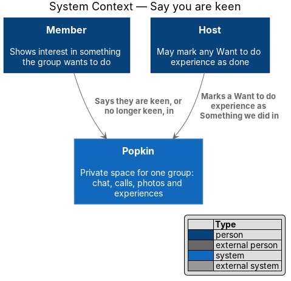
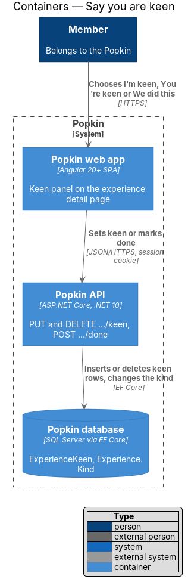
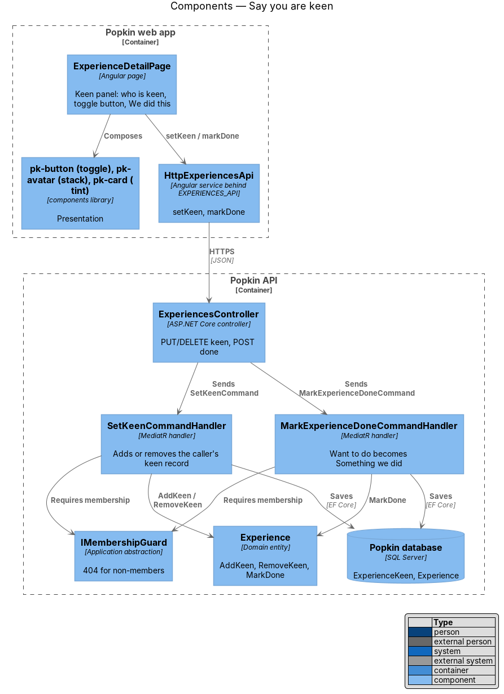
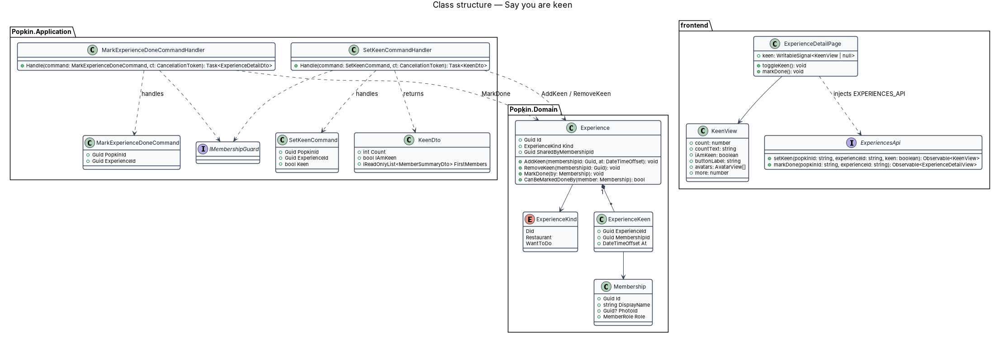
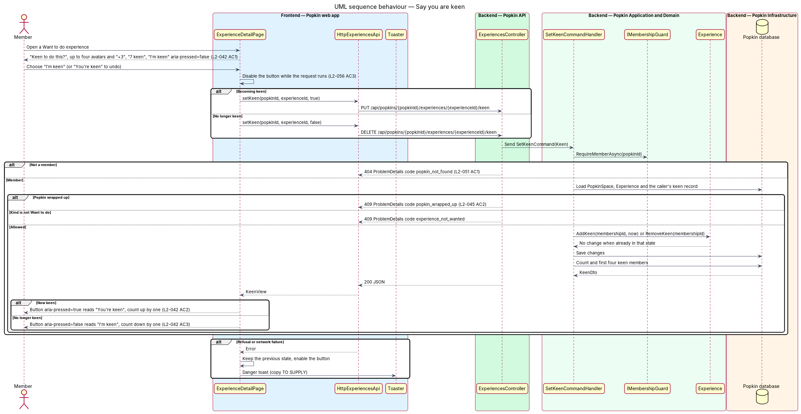
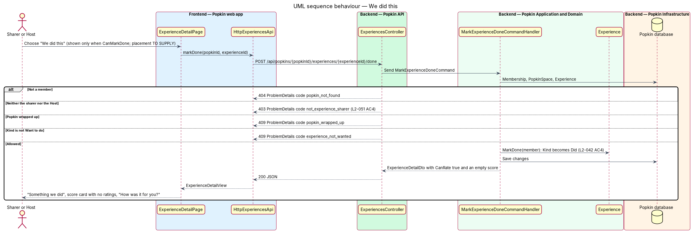

# Say you are keen

## Overview

Popkin is a platform for pop-up communities. Members of a *Popkin*, a private space for one
group, share *experiences*. Some are things the group did; others are ideas for next time, of
kind "Want to do". An idea has nothing to rate yet, so instead of a score it collects the members
who are keen on it. This feature lets a member say they are keen, take it back, and lets the
sharer or the Host record that the group did it.

- **keen** — interest one member shows in one "Want to do" experience; a member is keen or not,
  never more than once
- **keen panel** — tinted card on the detail page of a "Want to do" experience that asks "Keen
  to do this?", shows who is keen and holds the keen button
- **We did this** — action that turns a "Want to do" experience into "Something we did", after
  which members can rate it

The keen panel takes the place of the rating panel of
[Rate an experience](../rate-experience/README.md) on the page described in
[View an experience](../view-experience/README.md). Cards in
[List experiences](../list-experiences/README.md) show the keen count ("7 keen") instead of a
score.

Journey 20 builds it. Where the mock and L2-042 left a detail open, the decisions are listed
under "Decisions" below, and the mocks now draw every state.

## Description

### Screens and states

- `docs/mocks/pages/experience-detail/want.html` — "Beach day next summer?", "Want to do ·
  Idea", "Shared by Ellie"; the keen panel with "Keen to do this?", a stack of four avatars
  ending "+3", "7 keen" and "I'm keen" with `aria-pressed="false"`. Joel, a member who neither
  shared it nor is the Host, is reading.
- `docs/mocks/pages/experience-detail/want-keen.html` — Joel has chosen "I'm keen": the toggle
  has `aria-pressed="true"` and reads "You're keen", and the count reads "8 keen" ("+4").
- `docs/mocks/pages/experience-detail/want-own.html` — Ellie, who shared it and is keen, reads
  it: "Experience actions" over the picture, and "We did this" (secondary, with a tick) beside
  "You're keen" in the panel. The Host sees the same.
- `docs/mocks/pages/experiences/default.html` and `want.html` — the card foot reads "7 keen".
- After "We did this" the page is the page of something the group did
  (`experience-detail/default.html`): "Something we did", the score card with no ratings and
  "How was it for you?".
- A change that does not save is a danger toast with "Try again", drawn by
  `docs/mocks/notifications/toast/danger.html`; its words are under "Decisions".
- "What people said" on an idea: the mock shows two comments without stars, but a comment
  belongs to a rating ([Comment on an experience](../comment-on-experience/README.md)) and an
  idea has none, so the page shows no comments there. See "Open points".

### Form factors

The panel takes the rating panel's place in `.detail__cards`, so it follows the page's layout
(L2-058 AC2, AC3, AC11): one column below 1024 px, under the picture; from 1024 px it is in the
right-hand column beside the picture. The keen count sits in the card foot of the list in every
column count, one to four (AC7). Nothing in the panel reads the viewport width.

### API

- `GET /api/popkins/{popkinId}/experiences/{experienceId}` — `ExperienceDetailDto` gains
  `keen` (`KeenDto`, null unless the kind is "Want to do"), `canKeen` (an idea in an active
  Popkin) and `canMarkDone` (an idea in an active Popkin, for its sharer or the Host).
  `keenCount` and the list's `keenCount` are the real count.
- `PUT /api/popkins/{popkinId}/experiences/{experienceId}/keen` → `200` with `KeenDto`
  (`count`, `mine`, `members`: the first four keen members, the earliest first, each a
  membership id, a first name and an avatar). Repeating it changes nothing.
- `DELETE /api/popkins/{popkinId}/experiences/{experienceId}/keen` → `200` with `KeenDto`.
  Repeating it changes nothing.
- `POST /api/popkins/{popkinId}/experiences/{experienceId}/done` → `200` with
  `ExperienceDetailDto`.
- Refusals: `401` without a session; `404` `popkin_not_found` (L2-051) or
  `experience_not_found`; `409` `experience_not_wanted` when the kind is not "Want to do"; `409`
  `popkin_wrapped_up` (L2-045 AC2); for `done`, `403` `not_experience_sharer` when the caller is
  neither the sharer nor the Host (L2-051 AC4), the code editing and deleting use. Keen and
  done are counted with messages and ratings (60 a minute per person).

### Frontend (`frontend/projects/`)

- **`ExperienceDetailPage`** — for kind "Want to do", renders `pk-keen-panel` in place of the
  rating panel and the score card (L2-042 AC1).
- **`ExperienceStore`** (`api`) — its `view` has `keen` (a `KeenPanel`) for an idea.
  - `toggleKeen()` disables the toggle while the request runs, calls
    `ExperiencesApi.setKeen(..., !mine)` and replaces the keen state with the answer.
  - On failure the previous state stays and `keenFailed$` tells the page, which shows the danger
    toast.
  - `markDone()` disables "We did this" while it runs and replaces the whole experience with the
    answer, so the rating panel and an empty score card appear (L2-042 AC4); on failure
    `doneFailed$` tells the page.
- **`KeenPanel`** — the count in words ("7 keen"), whether the member is keen, the toggle's
  label ("I'm keen" or "You're keen"), up to four faces and the "+N" remainder, whether the
  toggle is offered and whether "We did this" is.
- **`ExperiencesApi.setKeen`, `.markDone`**.
- **Components**: `pk-keen-panel` (`docs/design-system/components/rating.html#keen-panel`), a
  tinted centred card like `pk-rating-panel`, composing `pk-avatar-stack` and a `pk-button`
  (Popkin) toggle with `aria-pressed`; its default slot holds "We did this" (`pk-button`,
  secondary). The avatar stack is hidden from assistive technology; the count text carries the
  information. The pressed Popkin button is outlined in the Popkin's colour on the surface
  (`docs/design-system/components/button.html#toggle`), and its words change too.

### Backend (`backend/src/`)

- **`SetKeenCommand`** / **`SetKeenCommandHandler`** —
  1. calls `IMembershipGuard.RequireActiveMemberAsync(popkinId)`, which refuses a wrapped-up
     Popkin with `409`;
  2. loads the `Experience` and the caller's `ExperienceKeen`;
  3. refuses a kind other than `Want` with `409` `experience_not_wanted`;
  4. adds the record (`Experience.AddKeen(membershipId, now)`) or removes it; nothing happens
     when the member is already in the requested state, so a repeated request is safe;
  5. saves and returns the count and the first four keen members, earliest `At` first.
- **`ExperienceKeen`** — primary key `(ExperienceId, MembershipId)`, which keeps one keen record
  per member and experience, even when two requests race; it goes with its experience.
- **`MarkExperienceDoneCommand`** / **`MarkExperienceDoneCommandHandler`** — refuses a
  wrapped-up Popkin, allows the sharer or the Host (`Experience.CanBeMarkedDoneBy`, the same rule
  as deleting), refuses a kind other than `Want`, calls `Experience.MarkDone`, which sets `Kind`
  to `Did`, and answers the experience as `GetExperienceQuery` does.
- **`KeenOf`** — reads the keen count and first four members of one or many experiences in one
  query each, for the list, the detail and the answers above.

### Decisions

These were `<TO SUPPLY>`; journey 20 settled each with the simplest option that fits.

- "We did this" sits in the keen panel beside the toggle, for the sharer and the Host only
  (`want-own`). Anyone else is refused with `403` `not_experience_sharer`, the code editing and
  deleting already use.
- Sharing a "Want to do" experience does not make the sharer keen; they say so like anyone else.
- Keen records stay when the experience is marked done; the page of something the group did
  shows no keen. They go when the experience is deleted.
- A member who leaves the Popkin is still counted among who is keen, as their ratings and
  comments stay ([Leave a Popkin](../../popkins/leave-popkin/README.md), L2-047).
- The failure toasts: "Your keen didn't save" / "It's back to how it was." with "Try again", and
  "That didn't save" / "It's still something you want to do." with "Try again".
- In a wrapped-up Popkin an idea's panel keeps who is keen and the count, and offers neither
  button (L2-045).

### Open points

- How a member comments on a "Want to do" experience is `<TO SUPPLY>`. The mock shows comments
  without stars there, and a comment otherwise belongs to a rating
  ([Comment on an experience](../comment-on-experience/README.md)).
- Whether the keen count updates live for other members is `<TO SUPPLY>`; they see it the next
  time the experience or the list is read.

## Requirements

| L2 ID | Refines (L1) | Requirement |
|-------|--------------|-------------|
| `L2-042` | `L1-010` | Say you are keen: Members show interest in something the group wants to do. |
| `L2-045` | `L1-011` | A wrapped-up Popkin is read-only: Nothing new is added to a Popkin that has ended. |
| `L2-051` | `L1-012` | Popkins are private to their members: Membership decides everything a person sees. |

## Diagrams

### System context

A member says they are keen on an idea in Popkin; the sharer or the Host marks it as done. No
external system takes part.

### Containers

The web app sets keen or marks done through the Popkin API, which writes `ExperienceKeen` rows
and the experience's kind to the Popkin database.

### Components

`ExperienceDetailPage` composes the keen panel and calls `HttpExperiencesApi`. Two handlers,
`SetKeenCommandHandler` and `MarkExperienceDoneCommandHandler`, apply the change to
`Experience`.

### Class structure

An `Experience` owns its `ExperienceKeen` records and exposes `AddKeen`, `RemoveKeen` and
`MarkDone`. The page shows a `KeenView` built from `KeenDto`.

### Behaviour — say keen

`PUT` adds the caller's keen record and `DELETE` removes it. The button's pressed state, label
and the count follow the answer (L2-042 AC2, AC3). A "Want to do" kind and an active Popkin are
required.

### Behaviour — "We did this"

The sharer or the Host turns the experience into "Something we did"; anyone else receives `403`.
The page then shows the rating panel (L2-042 AC4).

