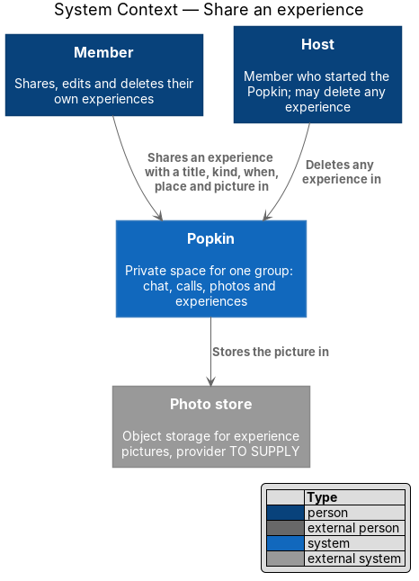
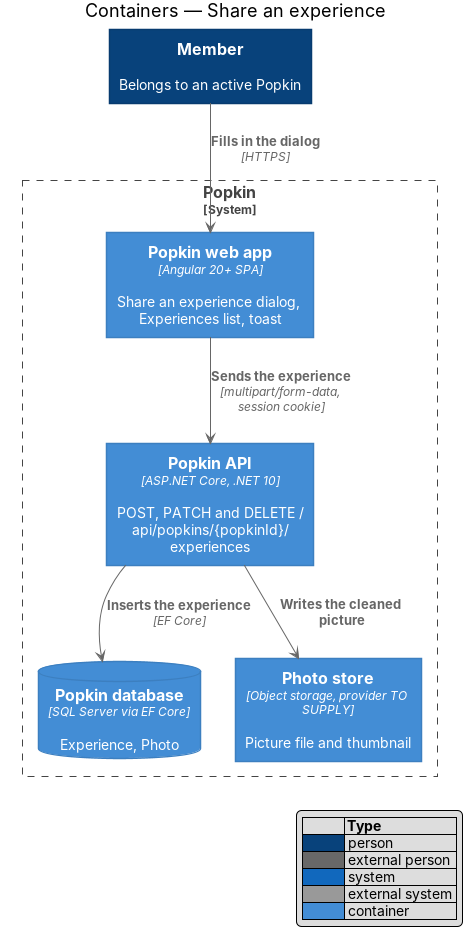
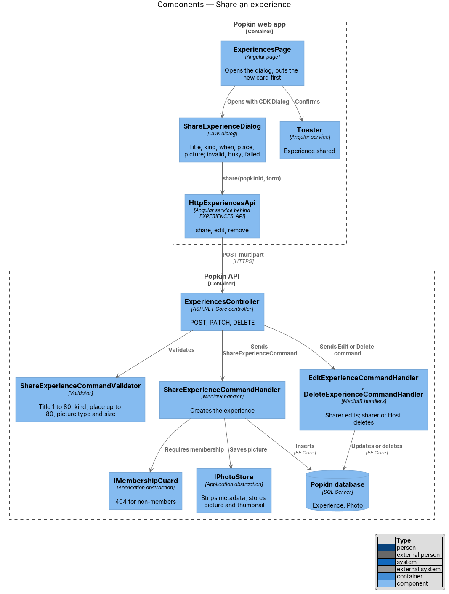
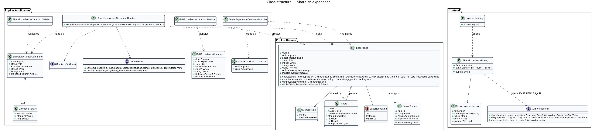
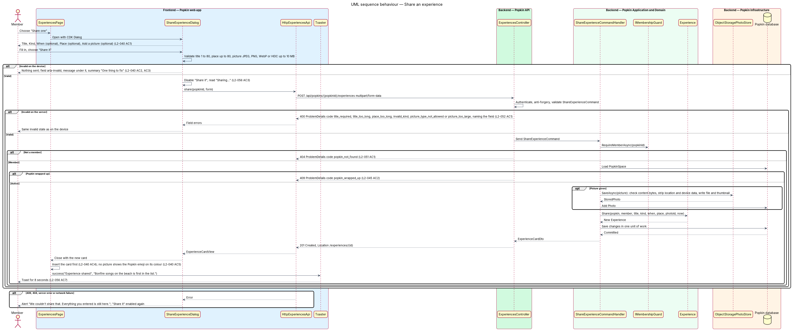
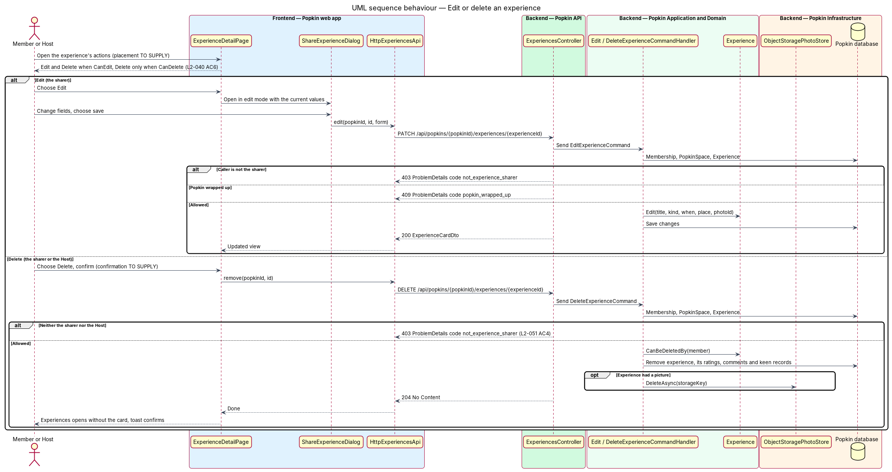

# Share an experience

## Overview

Popkin is a free platform for pop-up communities. Members of a *Popkin*, a private space for one
group, collect *experiences*: things the group did, restaurants, and things the group wants to
do. This feature is how an experience gets into a Popkin. Any member of an active Popkin shares
one from Experiences. The sharer may later edit or delete it, and the Host may delete any
experience.

- **share** — act of adding an experience to a Popkin, with a title, a kind and, optionally, a
  picture, a "when" and a place
- **kind** — one of "Something we did", "Restaurant" or "Want to do"
  (`ExperienceKind` `Did`, `Restaurant`, `Want`)
- **when** — free text that says when the experience happened, such as "Sat night"
- **sharer** — member who shared an experience
- **Host** — member who started the Popkin

Once shared, the experience is first in [List experiences](../list-experiences/README.md) and has
its own page ([View an experience](../view-experience/README.md)). A "Something we did" or
"Restaurant" experience can be rated; a "Want to do" experience collects keen members instead
([Say you are keen](../say-keen/README.md)). A wrapped-up Popkin accepts no new experience
(L2-045).

## Description

### Screens and states

- `docs/mocks/dialogs/share-experience/default.html` — "Share an experience": "Title", "Kind" (a
  radio group of three chips), "When (optional)", "Place (optional)" with the placeholder "Where
  it was", "Add a picture (optional)" and "Share it". Under 640 px the dialog is a bottom sheet.
- `docs/mocks/dialogs/share-experience/invalid.html` — empty title: summary "One thing to fix"
  with the link "Title: give it a name.", the field `aria-invalid` and "Give it a name." under
  it.
- `docs/mocks/dialogs/share-experience/busy.html` — fields read-only, "Sharing…" disabled with
  `aria-busy`.
- `docs/mocks/dialogs/share-experience/failed.html` — alert "We couldn't share that. Everything
  you entered is still here."
- `docs/mocks/notifications/toast/success.html` — "Experience shared", "Bonfire songs on the
  beach is first in the list." with "Undo". "Undo" deletes what was just shared.
- `docs/mocks/pages/experience-detail/own.html` — the sharer's page, with the "Experience
  actions" button over the picture (L2-040 AC6).
- `docs/mocks/dialogs/experience-actions/default.html` and `host.html` — the menu, titled with
  the experience: "Edit" and "Delete" for the sharer, "Delete" alone for the Host on someone
  else's.
- `docs/mocks/dialogs/share-experience/edit.html` — the same dialog as "Edit experience", filled
  with what the experience has, with "Save changes".
- `docs/mocks/dialogs/delete-experience/default.html`, `busy.html` and `failed.html` — "Delete
  this experience?", "Its ratings and comments go with it. This can't be undone.", "Delete" and
  "Keep it"; "Deleting…" while it is sent; "We couldn't delete that. It's still here. Try
  again."
- The other messages have no mock: "Keep the title to 80 characters.", "Keep the place to 80
  characters.", "Keep this to 40 characters." for "when", and, for a picture, the messages of a
  photo that is the wrong type or too large ([Add photos](../../photos/add-photos/README.md)).
  A failed edit reads "We couldn't save that." and a failed "Undo" is a danger toast, "We
  couldn't undo that".

### API

- `POST /api/popkins/{popkinId}/experiences` (`multipart/form-data`: `title`, `kind`, `when?`,
  `place?`, `picture?`) → `201 Created` with `ExperienceCardDto` and a `Location` header.
  `kind` is `Did`, `Restaurant` or `Want`.
- `PATCH /api/popkins/{popkinId}/experiences/{experienceId}` (same fields, plus
  `removePicture`) → `200` with `ExperienceCardDto`. Sharer only. A field that is not sent stays
  as it is; a "when" or a place sent empty is cleared.
- `DELETE /api/popkins/{popkinId}/experiences/{experienceId}` → `204`. Sharer or Host.
- Refusals: `400` with `code` `title_required`, `title_too_long`, `when_too_long`,
  `place_too_long`, `invalid_kind`, `picture_type_not_allowed` or `picture_too_large`, naming
  the field (L2-040 AC2, AC3, L2-052 AC1); `401` without a session; `403`
  `not_experience_sharer` for an edit by anyone but the sharer or a delete by anyone but the
  sharer or the Host; `404` `popkin_not_found` (L2-051) or `experience_not_found`; `409`
  `popkin_wrapped_up` (L2-045 AC2); `429` `rate_limited` past the limit.
- "When" is at most 40 characters. The specs give no limit; 40 holds "Sat morning" and a date
  with room to spare.
- Sharing and editing are under the `photos` policy
  ([Abuse limits](../../security/abuse-limits/README.md)): 60 a minute per person, counted with
  the photos they add, because each may carry a picture. Deleting is not limited.

### Frontend (`frontend/projects/`)

- **`ShareExperienceDialog`** — `popkin/src/app/dialogs/share-experience/share-experience.dialog.ts`
  with its `.html`, opened with CDK `Dialog`. `ExperiencesPage` opens it from "Share one";
  `ExperienceDetailPage` opens it with `editing`, the experience to change, and it is then
  "Edit experience" with "Save changes", "Saving…" and "We couldn't save that." It holds:
  - `title` — required, at most 80 characters (`maxlength="80"`);
  - `kind` — "Something we did" preselected;
  - `when` — optional, at most 40 characters;
  - `place` — optional, at most 80 characters (`maxlength="80"`);
  - `picture` — one file, with a preview drawn on the device and "Remove picture".
  On submit with something wrong it sends nothing, marks each field, and shows the form
  summary, whose links go to the fields. While the request runs, the fields are read-only and
  the button reads "Sharing…" and is disabled, so the request cannot be sent twice
  (L2-056 AC3). A `400` puts its message under its field. Any other failure shows the danger
  alert and keeps every value. On success the dialog closes with the `ExperienceCardView`.
- **`experience-rules.ts`** (`api/src/lib/api/experiences/`) — the rules, as pure helpers with
  unit tests: `draftProblems` (what is wrong, field by field; a picture is checked as a photo
  is, JPEG, PNG, WebP or HEIC and at most 10 MB), `fixSummary` ("One thing to fix", "2 things
  to fix") and `refusedField` (the field a `code` of the API is about).
- **`ExperiencesPage`** — after a share, asks `ExperiencesStore.added(card)` to put the card
  first (L2-040 AC4); when the filter leaves the new kind out, it shows "All". It then shows
  the success toast, for 8 seconds (L2-056 AC7), with the action "Undo". "Undo" calls
  `ExperiencesApi.remove` and takes the card out of the list.
- **`ExperienceDetailPage`** — shows "Experience actions" over the picture when `canEdit` or
  `canDelete` is true. It opens **`ExperienceActionsDialog`**
  (`dialogs/experience-actions/`), a menu that closes with `edit` or `delete`. "Edit" opens
  `ShareExperienceDialog`, and a saved edit reads the experience again. "Delete" opens
  **`DeleteExperienceDialog`** (`dialogs/delete-experience/`), which asks first, with focus on
  "Keep it"; once deleted, the page goes back to Experiences and a success toast says
  "Experience deleted".
- **`ExperiencesApi.share`, `.edit`, `.remove`** — build the multipart body and return the
  answer.
- **Components**: `pk-dialog` (bottom sheet under 640 px, Escape closes), `pk-text-field` for
  Title, When and Place, with its "(optional)" mark, `pk-choice-chips` for Kind (a radio group
  of `pk-chip`), `pk-picture-field` for "Add a picture", `pk-form-summary`, `pk-alert`
  (danger), `pk-button`, `pk-menu-list` and `pk-menu-item` for the actions, and `pk-toast`.

### Backend (`backend/src/`)

- **`ExperiencesController.Share`, `.Edit`, `.Delete`** — bind the form, wrap the file in
  `PhotoUpload`, and send `ShareExperienceCommand`, `EditExperienceCommand` or
  `DeleteExperienceCommand`. The body may be up to twice the largest picture, so a picture over
  10 MB is refused with its own message and not by the server's size limit. `Edit` reads the
  form itself, because a field sent empty is not a field that was not sent.
- **`ExperienceFields`** (`Popkin.Application`) — the rules of the text, for sharing and for
  editing: `Title` trimmed, 1 to 80 characters; `Kind` one of the three names; `When` at most
  40 characters; `Place` at most 80; an empty "when" or place is none. There is no validator
  class and no validation library; a refusal is a `ProblemException`.
- **`ExperiencePictures`** — the picture of an experience keeps the limits of a photo and goes
  through the same processing and the same store ([Add photos](../../photos/add-photos/README.md)):
  the type is decided from the file's own bytes (L2-052 AC3), `IPhotoProcessor` makes a display
  image and a thumbnail without location or device data (L2-031 AC6), and `IPhotoStore` keeps
  both under one random name, `popkins/{popkinId}/experiences/{name}`. It is not a photo of the
  album: no `Photo` row is added, and Photos does not show it.
- **`ShareExperienceCommandHandler`** —
  1. calls `IMembershipGuard.RequireActiveMemberAsync(popkinId)` (`404`, or `409`
     `popkin_wrapped_up`);
  2. checks every field before a file is written;
  3. stores the picture, when one is given;
  4. creates the experience with `Experience.Share(...)`, `SharedAt` from `TimeProvider`;
  5. saves and returns the `ExperienceCardDto`.
  When the save fails after the files are written, the handler deletes them.
- **`EditExperienceCommandHandler`** — allows only the sharer (`Experience.CanBeEditedBy`),
  under the rules of sharing. A new picture replaces the one it had and `removePicture` leaves
  it with none; the old files are deleted only after the save. The kind may change, whatever
  ratings the experience has.
- **`DeleteExperienceCommandHandler`** — allows the sharer or the Host
  (`Experience.CanBeDeletedBy`); removes the experience with its ratings, and the comments
  they carry, in one save, then the picture's files.
- Titles, places and "when" are stored as typed, less the white space around them, and
  rendered by Angular interpolation, so HTML or script shows as text (L2-052 AC2).

### Tests

- API integration tests on InMemory, in `Popkin.Api.Tests/Experiences/`: `ShareExperienceTests`,
  `ExperiencePictureTests`, `EditExperienceTests`, `DeleteExperienceTests`,
  `RefusedExperienceTests` and `ExperienceRateLimitTests`. `ExperienceFieldsTests`
  (`Popkin.Application.Tests`) has one case per row of the rules.
- Unit tests of `experience-rules.ts` and of `ExperiencesStore`.
- Playwright: `e2e/tests/share-experience.spec.ts` and `e2e/tests/experience-actions.spec.ts`.

### Built in journey 8

Everything above. Decided in the build:

- "When" is at most 40 characters.
- The limit: the `photos` policy, for sharing and editing.
- A picture uses the photo store and its processing and is not a photo of the album.
- "Undo" deletes what was shared.
- Edit and delete open from "Experience actions" over the picture into a menu; edit reuses the
  share dialog; delete asks first. Their mocks were drawn before the build.
- The "Add a picture" control is `pk-picture-field`, with a preview and "Remove picture".
- The kind of an experience that has ratings may change.

Gaps found, each in [the register](../../README.md#known-gaps):

- "Share one" is still offered in a wrapped-up Popkin. The API refuses with `409`
  `popkin_wrapped_up`, which the dialog shows as the general failure, "We couldn't share that."
  Wrap up is journey 9 (gap 36).
- An experience edited to "Want to do" keeps its ratings, hidden (gap 37).
- A HEIC picture has no preview in the dialog in a browser that cannot draw it; the picture is
  still sent and stored as a JPEG (gap 41).
- Other members' lists do not change when an experience is shared, edited or deleted
  (gap 38).

The diagrams below were not redrawn (gap 44). They show a `ShareExperienceCommandValidator`,
`UploadedPicture`, a `Photo` row for the picture, kind `WantToDo` and an actions placement
still to supply.

## Requirements

| L2 ID | Refines (L1) | Requirement |
|-------|--------------|-------------|
| `L2-040` | `L1-010` | Share an experience: Any member shares an experience. |
| `L2-045` | `L1-011` | A wrapped-up Popkin is read-only: Nothing new is added to a Popkin that has ended. |
| `L2-052` | `L1-012` | Input is validated and output is encoded: Nothing a person types can harm another person or the system. |

## Diagrams

### System context

A member shares experiences in Popkin and the Host may delete any of them. Pictures go to the
photo store.

### Containers

The web app sends the experience as `multipart/form-data` to the Popkin API, which writes the
cleaned picture to the photo store and the experience to the Popkin database.

### Components

`ShareExperienceDialog` calls `HttpExperiencesApi`; `ExperiencesPage` puts the result first and
shows the toast. In the API, the validator checks each field, and the handlers create, edit or
delete the experience.

### Class structure

`Experience.Share` creates the experience for a member of a `PopkinSpace`, optionally with a
`Photo`. `CanBeEditedBy` and `CanBeDeletedBy` hold the sharer and Host rules.

### Behaviour — share an experience

The dialog refuses an invalid form without sending it. The API repeats every check, refuses a
non-member with `404` and a wrapped-up Popkin with `409`. On success the card is first and a
toast confirms it; on failure the dialog keeps everything entered.

### Behaviour — edit or delete an experience

The sharer edits through the same dialog; the sharer or the Host deletes. Anyone else receives
`403` `not_experience_sharer` (L2-040 AC6).

