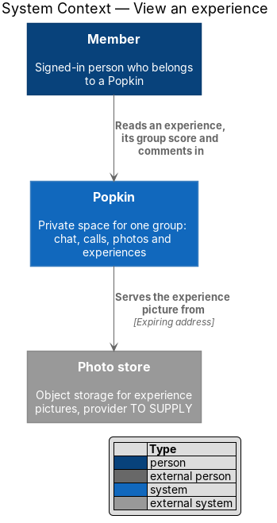
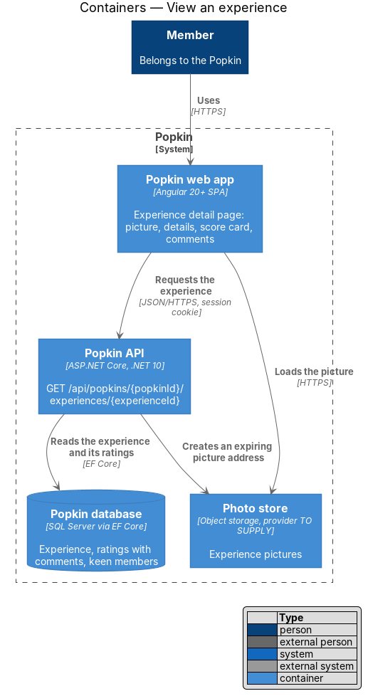
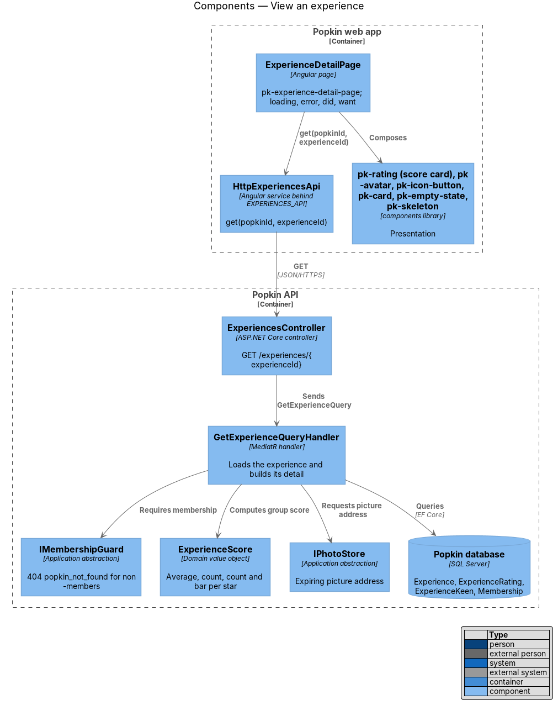
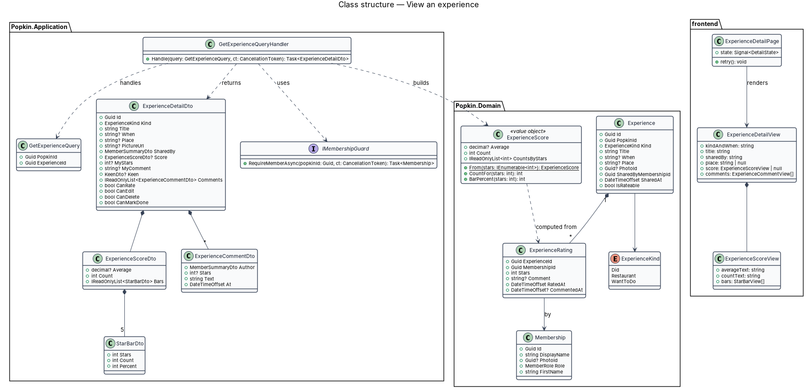
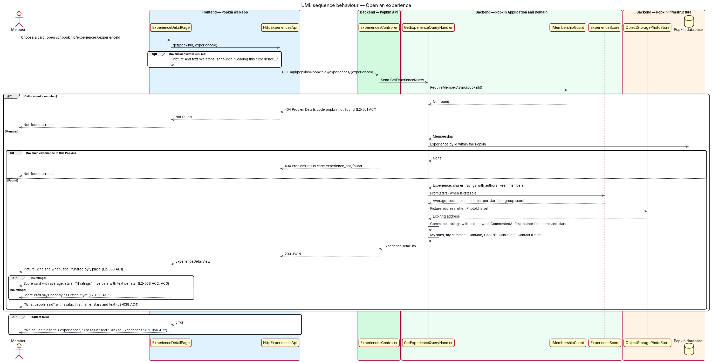
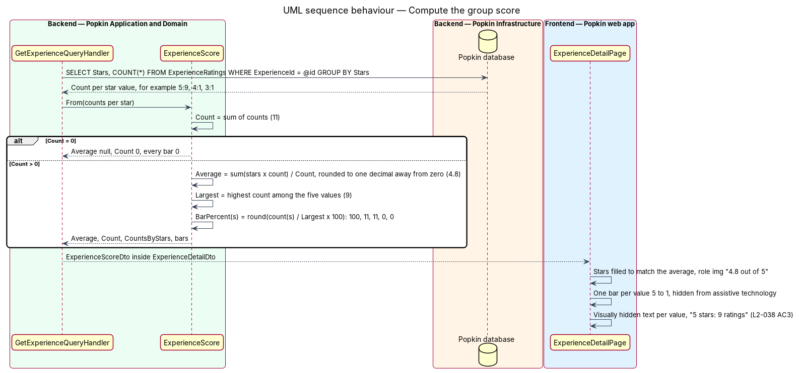

# View an experience

## Overview

Popkin is a free platform for pop-up communities. Members of a *Popkin*, a private space for one
group, share *experiences*: things the group did, restaurants, and things the group wants to do.
[List experiences](../list-experiences/README.md) shows them as cards. This feature is the page
a card opens.

- **experience detail** — page of one experience: its picture, kind, when, title, sharer and
  place, the group score and what members said about it
- **group score** — summary of every member's rating of one experience: the average to one
  decimal, the number of ratings and the count for each star value from five to one
- **score card** — card that presents the group score with filled stars and one bar per star
  value
- **comment** — words a member adds to their own rating (see
  [Comment on an experience](../comment-on-experience/README.md))

The page is shared by three neighbouring features. The panel under the score card belongs to
[Rate an experience](../rate-experience/README.md) for kinds "Something we did" and
"Restaurant", and to [Say you are keen](../say-keen/README.md) for "Want to do". This design
covers what the page shows and how the group score is computed. Like every read in a Popkin, the
page is private to its members (L2-051).

## Description

### Screens and states

- `docs/mocks/pages/experience-detail/default.html` — "Sunrise canoe to Heron Point": picture
  with a "Back" button, "Something we did · Sat morning", title, "Shared by Mara", "Heron Point,
  Lake Ossia", score card 4.8 from 11 ratings, the rating panel, and three comments under "What
  people said".
- `docs/mocks/pages/experience-detail/want.html` — a "Want to do" experience: no score card; the
  keen panel takes its place.
- `docs/mocks/pages/experience-detail/loading.html` — picture and text skeletons with the hidden
  status "Loading this experience…".
- `docs/mocks/pages/experience-detail/error.html` — "We couldn't load this experience" with "Try
  again" and "Back to Experiences".
- An experience nobody has rated has no mock of its own; the manifest records that its score
  card says so. The exact copy is `<TO SUPPLY>`.

### API

- `GET /api/popkins/{popkinId}/experiences/{experienceId}` → `200` with `ExperienceDetailDto`.
  Refusals: `401` without a session, `404` `popkin_not_found` for a non-member or an unknown
  Popkin (L2-051), `404` `experience_not_found` for an experience that is not in this Popkin.

### Frontend (`frontend/projects/`)

- **`ExperienceDetailPage`** — `popkin/src/app/pages/experience-detail/experience-detail.page.ts`
  with its `.html`, selector `pk-experience-detail-page`, OnPush. Route
  `/p/:popkinId/experiences/:experienceId` with route data
  `{ shell: 'app', page: 'experience-detail' }`, behind `signedInGuard` and `memberGuard`. It
  loads the detail through `EXPERIENCES_API`, holds it in a signal, and renders the loading,
  error and loaded states. The rating panel, the keen panel and the comment actions are the
  subject of the neighbouring designs and read from the same signal.
- **`ExperiencesApi.get(popkinId, experienceId)`** — maps `ExperienceDetailDto` to
  `ExperienceDetailView`. **`ExperienceScoreView`** carries the average text ("4.8"), the count
  text ("11 ratings", singular "1 rating") and five `StarBarView`s, each with its percent and
  its accessible text ("5 stars: 9 ratings"). The mocks write "1 ratings"; the design uses the
  singular for one.
- **Components**: `pk-rating` in its score-card variant (`score-card`, `stars`, `score-bars`,
  `meter`) and in its inline variant for each comment's stars; `pk-avatar`; `pk-card` (`card`,
  `card--tint`) for the panels; `pk-icon-button` for "Back" over the picture; `pk-top-bar` in
  the error state; `pk-empty-state` for the error; `pk-skeleton` for loading. The picture block
  (`hero-media`) and the comment row (`comment`) have no design-system page; their component
  names are `<TO SUPPLY>`.

### Backend (`backend/src/`)

- **`ExperiencesController.Get`** — sends `GetExperienceQuery`.
- **`GetExperienceQuery`** / **`GetExperienceQueryHandler`** — calls
  `IMembershipGuard.RequireMemberAsync`, loads the experience within the Popkin (an id from
  another Popkin answers `404` `experience_not_found`), its sharer, its ratings with their
  authors and, for "Want to do", its keen members. It builds:
  - the group score through `ExperienceScore` when `Experience.IsRateable` (kinds `Did` and
    `Restaurant`);
  - the comments: every `ExperienceRating` with a `Comment`, newest `CommentedAt` first, each
    with the author's avatar, first name and stars (L2-038 AC4);
  - the caller's own stars and comment, and the flags `CanRate`, `CanEdit`, `CanDelete` and
    `CanMarkDone` the neighbouring features use. Each flag is false when the Popkin is wrapped
    up (L2-045).
- **`ExperienceScore`** (`Popkin.Domain`) — value object built from the count per star value.
  - `Count` is the sum of the five counts.
  - `Average` is the sum of stars times count divided by `Count`, rounded to one decimal with
    `MidpointRounding.AwayFromZero`; `null` when `Count` is 0.
  - `CountFor(stars)` returns the count for one value.
  - `BarPercent(stars)` is the count for that value divided by the largest count of the five,
    times 100, rounded. This follows the mock, whose bars read 100, 11, 11, 0 and 0 for counts
    9, 1, 1, 0 and 0. L2-038 AC2 asks for bars "in proportion to its share"; whether the bar
    scales to the largest count (mock) or to the total (82 % for 9 of 11) is `<TO SUPPLY>`.
  - The database groups the ratings by star value, so the computation reads five numbers, not
    every rating.
- **`ExperienceRating.CommentedAt`** — this design adds the time a comment was last written, so
  "What people said" orders by it rather than by `RatedAt`.
- **First name** — the part of `Membership.DisplayName` before its first space.
- **Accessible score** — the page states the average as an image label ("4.8 out of 5"), the
  count as text and each value's count as visually hidden text; the bars are hidden from
  assistive technology (L2-038 AC3).

### Open points

- The mock's "Want to do" page lists comments without stars (Walt, Ruth). How a member comments
  without rating is `<TO SUPPLY>`; see [Say you are keen](../say-keen/README.md).
- The page has no mock for a wrapped-up Popkin; it shows the experience and its score read-only.
  The layout of that state is `<TO SUPPLY>`.

## Requirements

| L2 ID | Refines (L1) | Requirement |
|-------|--------------|-------------|
| `L2-038` | `L1-010` | See an experience and the group's score: An experience has a page of its own. |
| `L2-051` | `L1-012` | Popkins are private to their members: Membership decides everything a person sees. |
| `L2-056` | `L1-013` | Loading, failure and offline are always explained: A person is never left guessing. |

## Diagrams

### System context

A member reads one experience, its group score and its comments in Popkin; its picture comes
from the photo store.

### Containers

The web app requests the experience from the Popkin API, which reads it and its ratings from the
Popkin database.

### Components

`ExperienceDetailPage` calls `HttpExperiencesApi`. `GetExperienceQueryHandler` checks membership,
reads the database and builds the group score through `ExperienceScore`.

### Class structure

`ExperienceScore` is computed from the experience's ratings and travels to the web app as an
`ExperienceScoreDto` with five `StarBarDto`s; comments are ratings that carry text.

### Behaviour — open an experience

A non-member receives `404` `popkin_not_found`; an id from another Popkin receives `404`
`experience_not_found`. A member sees the details, the score card or its no-ratings message, and
the comments. A failed request keeps a way back to Experiences.

### Behaviour — compute the group score

The database returns one count per star value. `ExperienceScore` derives the count, the average
to one decimal and a bar per value; the page renders the bars for sight and the counts as text
for assistive technology.

