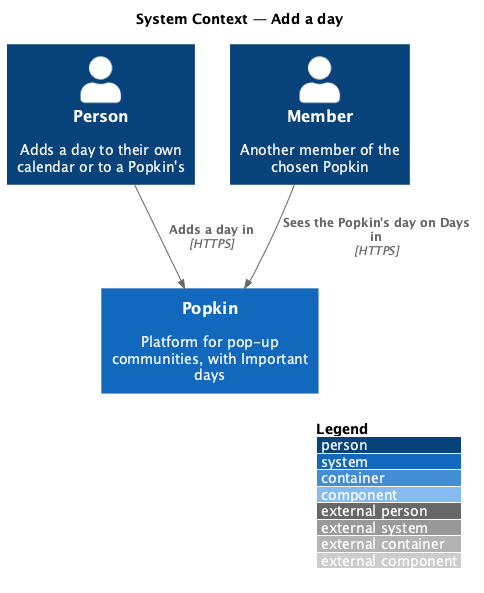
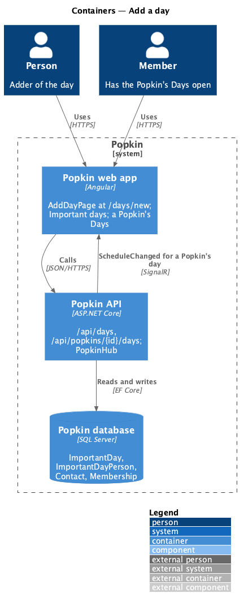
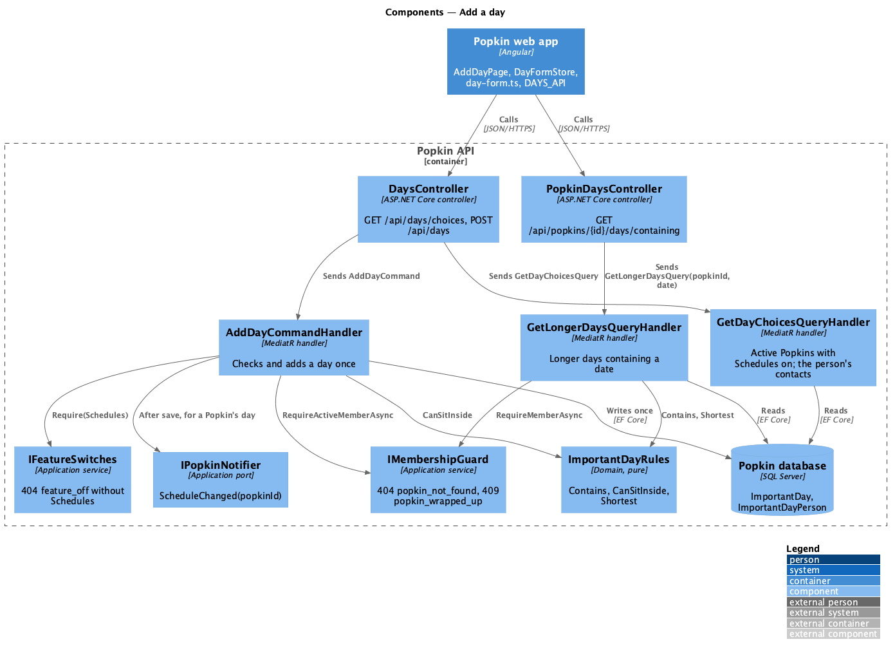
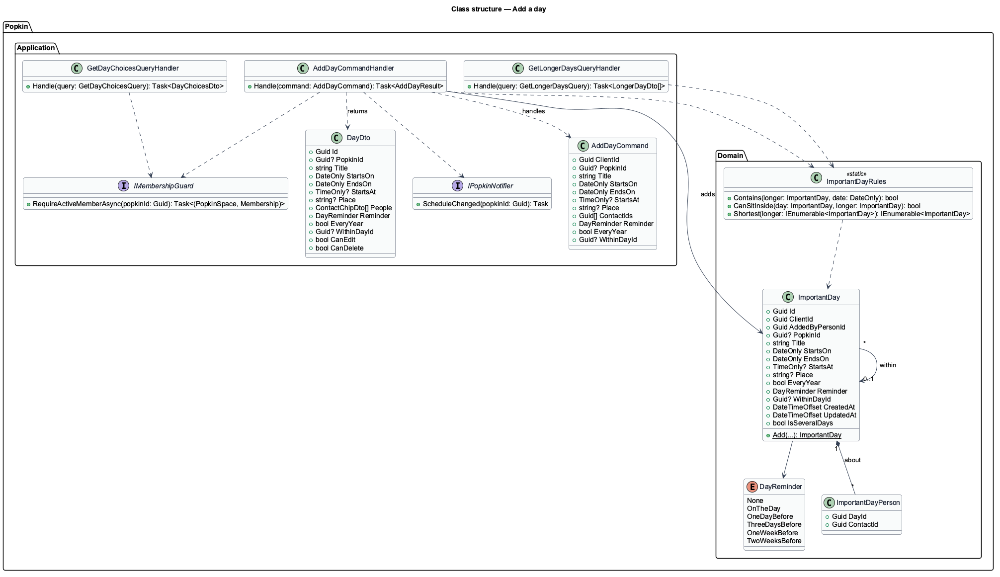
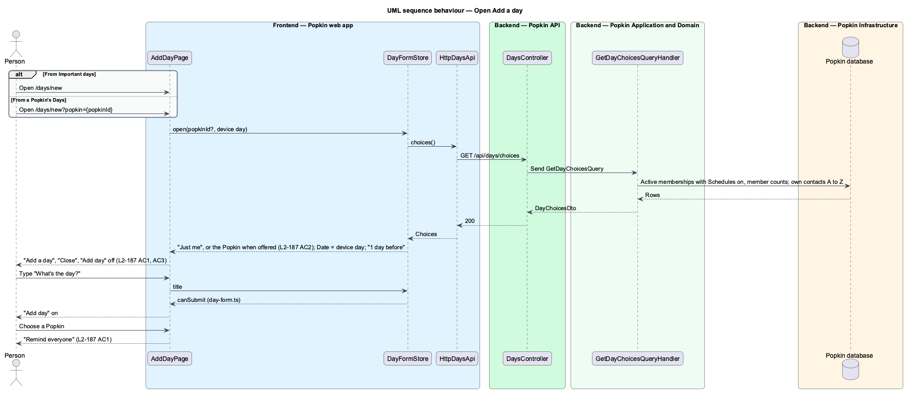
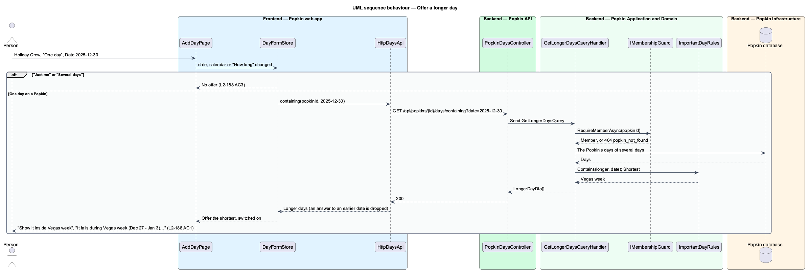
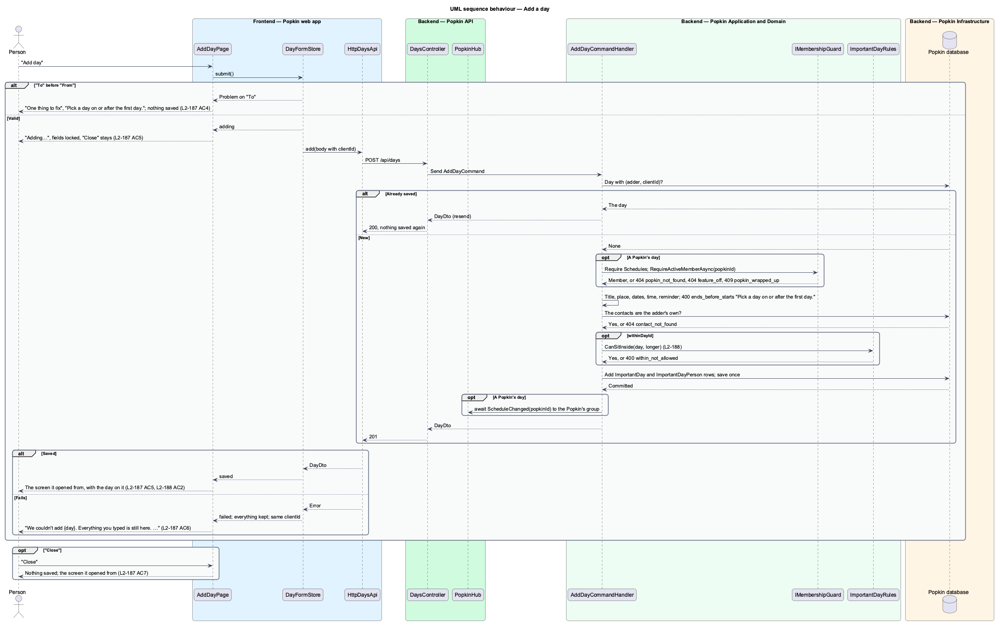

# Add a day

## Overview

Important days keeps the days that matter to a person, on their own calendar or on one of their
Popkins so the whole group plans around them (L1-044). Add a day is the screen that makes one.
It opens from Important days (`/days`) and from a Popkin's Days (`/p/:popkinId/schedule/days`),
and it returns to the screen it opened from with the new day on it (L2-187). The same screen,
filled in, edits a day ([Edit and delete a day](../edit-and-delete-a-day/README.md)); the
reminder it sets is sent by [Reminders for a day](../day-reminders/README.md).

- **day** — `ImportantDay` a person keeps: a title, one date or a span of dates, an optional time and place, a calendar, a reminder and whether it comes round every year
- **own day** — day with no `PopkinId`, on the person's own calendar, seen by its adder alone
- **Popkin's day** — day with a `PopkinId`, seen by every member of that Popkin on its Days
- **adder** — person who added a day, `ImportantDay.AddedByPersonId`
- **calendar** — where a day sits: "Just me" (the own calendar) or one of the person's Popkins
- **day of several days** — day whose `EndsOn` is after its `StartsOn`; it has no time
- **longer day** — day of several days on a Popkin that a single day on the same Popkin may sit inside (L2-188)
- **day inside** — single day whose `WithinDayId` names its longer day; it shows under it and reads "During {longer day}"
- **people it is about** — the adder's own contacts chosen in "Who's it about?", kept as `ImportantDayPerson` rows and never told (L2-195 AC3)

The shared rules of Important days, its entity, its endpoints and who sees a day are in
[Important days and holiday calendars](../../README.md#important-days-and-holiday-calendars). A
day is a "day", never an "event" or a "trip" (AGENTS.md).

## Description

### Screens and states

`docs/mocks/pages/add-day/` (on the branch `mocks/important-days`, PR #103, gap 148), the
`AddDayPage` at `/days/new`, `shell: 'bare'`:

- `default.html` — opened from Important days. The top bar has "Close" (an icon button), "Add a
  day" and "Add day", which is switched off. The form has these parts (L2-187 AC1, AC2, AC3):
  - "What's the day?", empty and focused, with "e.g. Picture day, holiday party, Vegas week".
  - "When", a radio group named "How long" of "One day" (chosen) and "Several days"; "Date"
    (the device day) and "Time" ("Leave empty for all day").
  - "Where", "Optional".
  - "Whose calendar?", "Keep it to yourself, or put it on a Popkin so everyone in it plans
    around it.", a radio group of option cards: "Just me" ("Only you see it, on your Important
    days", chosen) and one card per Popkin with its tile ("Holiday Crew", "All 6 members see it
    on the Popkin's Days").
  - "Who's it about?", "Optional", "From your contacts. They aren't told.", one pressed-button
    chip per contact with its avatar ("Ava", "Leo", "Mum").
  - "Remind me", "A notification at 9 am", a select of "No reminder", "On the day", "1 day
    before" (chosen), "3 days before", "1 week before" and "2 weeks before".
  - "Every year", "For birthdays and anniversaries", a switch, off.
- `popkin.html` — opened from Holiday Crew's Days, so Holiday Crew is chosen (L2-187 AC2).
  "Usher concert" on Tue 30 December at 20:00, "Dolby Live, Park MGM". The tinted card "Show it
  inside Vegas week", "It falls during Vegas week (Dec 27 – Jan 3), so it'll sit on that trip in
  everyone's calendar." with its switch on (L2-188 AC1). "Remind me" reads "Remind everyone".
- `several.html` — "Several days" chosen: "From" and "To" replace "Date" and "Time" ("School
  winter break", 22 December to 2 January, about Ava and Leo). "Show it inside" does not show
  (L2-188 AC3).
- `invalid.html` — "To" before "From". A form summary "One thing to fix" with the link "To: pick
  a day on or after the first day.", which focuses "To"; under "To", "Pick a day on or after the
  first day." with `aria-invalid` (L2-187 AC4). Focus moves to the summary.
- `submitting.html` — "Adding…", busy; every field is switched off and "Close" stays
  (L2-187 AC5).
- `error.html` — a danger banner "We couldn't add Usher concert. Everything you typed is still
  here. Check your connection and try again.", everything typed kept; "Add day" tries again
  (L2-187 AC6).
- `edit.html` — designed in [Edit and delete a day](../edit-and-delete-a-day/README.md).

### Where the mocks and the requirements differ

1. **"Trip".** L2-188 AC1 and the mock read "so it'll sit on that trip in everyone's calendar".
   AGENTS.md names nothing "trip". The words are the requirement's; whether L2-188 AC1 changes
   to "on that day" is `<TO SUPPLY>` by its owner, and the page shows the requirement's words
   until then.
2. **A note.** Popkin's Days draws a day's note (L2-191 AC1), and Add a day offers no field to
   write one. Add a day adds no note field (gap 142).

### Rules of the form

- **Where it opens from.** `/days/new` chooses "Just me". `/days/new?popkin={popkinId}` chooses
  that Popkin (L2-187 AC2) and returns to its Days. A Popkin the person cannot add to (not a
  member, wrapped up, Schedules off) is not offered, and `?popkin` naming one chooses "Just me".
- **"Add day" is off** until "What's the day?" has a non-blank name (L2-187 AC3). With a name it
  is on, and the other checks run when it is chosen.
- **When.** "One day" sends `StartsOn = EndsOn` = "Date" and `StartsAt` = "Time" or none (all
  day). "Several days" sends "From" and "To" and no time. Switching back and forth keeps what was
  typed in each. "To" starts at "From" when "Several days" is first chosen (`<TO SUPPLY>`: the
  mock does not draw it).
- **To before From.** Nothing is saved; the summary and the field read "Pick a day on or after
  the first day." (L2-187 AC4). The API refuses it as well, with the same words.
- **"Remind me" or "Remind everyone".** "Remind everyone" when a Popkin is chosen, "Remind me"
  for "Just me" (L2-187 AC1). It starts at "1 day before", as the mock draws.
- **"Every year"** is offered for a day of several days too (gap 147, proposed).
- **"Show it inside {longer day}"** shows only for "One day" on a Popkin whose date falls within
  a longer day on that Popkin (L2-188 AC1, AC3). It starts on, as the mock draws. Changing the
  date, the calendar or "How long" asks again. When more than one longer day contains the date,
  the shortest is offered (`<TO SUPPLY>`: no requirement or mock covers it). A switched-on choice
  that no longer shows is not sent.
- **"Who's it about?"** lists the person's own contacts, A to Z by first name. Any number may be
  pressed. How the chips scale past a screenful is `<TO SUPPLY>` (the mock draws three).
  Whoever is chosen is not told (L2-195 AC3); who else sees them is gap 141.
- **"Adding…"** locks every field and "Add day" until the save answers; "Close" stays
  (L2-187 AC5).
- **Saved.** The page returns to the screen it opened from, which shows the day (L2-187 AC5):
  `/days`, or the Popkin's Days. A Popkin's day reaches its other members' open Days by
  `ScheduleChanged`.
- **Failure.** A failed save shows the danger banner of `error.html` with the day's name and
  keeps everything typed (L2-187 AC6). "Add day" sends again with the same `clientId`, so a save
  whose answer was lost is kept once.
- **Close.** Nothing is saved; the page returns to the screen it opened from (L2-187 AC7).
  Leaving with changes asks nothing, since no requirement asks it to.
- **Limits.** "What's the day?" takes 80 characters and "Where" 120, as the entity's columns
  (shared section). The fields stop at the limit, so the limit is not an error the person sees.
  Add a day sets no earliest or latest date (`<TO SUPPLY>`: no requirement does).

### API

`DaysController` (`Popkin.Api/Controllers/Days/`) and `PopkinDaysController`, behind the
default authenticated policy. Each action sends one MediatR request.

- `GET /api/days/choices` — `200` `DayChoicesDto`: `popkins` (`DayCalendarDto[]`: `id`, `name`,
  `emoji`, `accent`, `memberCount`), the person's active Popkins with Schedules on, in the order
  of My Popkins; and `contacts` (`ContactChipDto[]`: `id`, `firstName`, `avatar`), A to Z. The
  form reads it when it opens.
- `GET /api/popkins/{popkinId}/days/containing?date=yyyy-MM-dd` — `200` `LongerDayDto[]`
  (`id`, `title`, `startsOn`, `endsOn`), the longer days of that Popkin whose dates contain the
  date, shortest first. `400` `invalid_date`; `404` `popkin_not_found`, `404` `feature_off`.
- `POST /api/days` — body `AddDayRequest` `{ clientId, popkinId?, title, startsOn, endsOn,
  startsAt?, place?, contactIds[], reminder, everyYear, withinDayId? }`. `201` `DayDto` with a
  `Location` of `/api/days/{dayId}`. A resend with the same `clientId` answers `200` with the
  day already saved, and changes nothing. Refusals (ProblemDetails with `code` and the field):
  - `400` `title_required`, `title_too_long` (80), `place_too_long` (120);
  - `400` `ends_before_starts`, detail "Pick a day on or after the first day.", field `endsOn`
    (L2-187 AC4);
  - `400` `time_on_several_days` (a time with `EndsOn` after `StartsOn`), `invalid_reminder`;
  - `400` `within_not_allowed` (the longer day is not a day of several days on the same Popkin
    containing this one day, or the day is own or of several days, L2-188 AC3);
  - `404` `contact_not_found` (a contact of anyone else, L2-122);
  - `404` `popkin_not_found`, `404` `feature_off`, `409` `popkin_wrapped_up`.

`DayDto` is the one shape a day takes on the wire: `id`, `popkinId?`, `title`, `startsOn`,
`endsOn`, `startsAt?`, `place?`, `people` (`ContactChipDto[]`, filled for the adder only, gap
141), `reminder`, `everyYear`, `withinDayId?`, `addedBy` (`firstName`, `avatar`), `canEdit` and
`canDelete`. The two flags are computed by the API from the rules of
[Edit and delete a day](../edit-and-delete-a-day/README.md), so a screen never decides them.

### Backend

- **`ImportantDay`** (Domain) — as in the shared section. `Add(addedBy, clientId, popkinId?,
  title, startsOn, endsOn, startsAt?, place?, reminder, everyYear, withinDayId?, now)` builds a
  day the handler has checked. `People` is its `ImportantDayPerson` collection.
  It does not implement `IClientWrite`, whose owner is `OwnerId`; `AddDayCommandHandler` looks
  the `clientId` up on (`AddedByPersonId`, `ClientId`), the same pattern as
  `ClientWrites.FindAsync` of Contacts.
- **`DayReminder`** (Domain enum) — `None`, `OnTheDay`, `OneDayBefore`, `ThreeDaysBefore`,
  `OneWeekBefore`, `TwoWeeksBefore`.
- **`ImportantDayPerson`** (Domain) — `DayId`, `ContactId`; key (`DayId`, `ContactId`).
- **`ImportantDayRules`** (Domain, pure) — for this slice `Contains(longer, date)` and
  `CanSitInside(day, longer)`: one day on the same Popkin, the longer day of several days, the
  date within it. `Shortest(longerDays)` orders the offer. Tested one case per row.
- **`GetDayChoicesQueryHandler`** — reads the person's active memberships whose Popkin has
  Schedules on (`IFeatureSwitches` and the Host's choice), with the member counts, and the
  person's contacts.
- **`GetLongerDaysQueryHandler`** — `features.Require(Feature.Schedules)`,
  `IMembershipGuard.RequireMemberAsync`, then the Popkin's days with `EndsOn` after `StartsOn`
  whose span contains the date, as `ImportantDayRules.Contains` says.
- **`AddDayCommandHandler`** (`Popkin.Application/ImportantDays/AddDay.cs`):
  1. returns the saved `DayDto` for a known (`AddedByPersonId`, `ClientId`), with `200`;
  2. for a Popkin's day, `features.Require(Feature.Schedules, popkinId)` and
     `IMembershipGuard.RequireActiveMemberAsync(popkinId)` (`404` `popkin_not_found`, `409`
     `popkin_wrapped_up`);
  3. checks the title, the place, the order of the dates, that a time is on one day only and the
     reminder, and answers `ProblemException.Invalid` with the codes above, as
     `SetEventCommandHandler` does;
  4. reads each contact id among the person's own contacts (`404` `contact_not_found` for any
     other);
  5. checks the longer day with `ImportantDayRules.CanSitInside`;
  6. adds the `ImportantDay` and its `ImportantDayPerson` rows and saves once;
  7. for a Popkin's day, awaits `IPopkinNotifier.ScheduleChanged(popkinId)` after the save, so an
     open Days reads again (shared section, "Live updates"). An own day sends no event.
- **No notification event.** Whether a Popkin's new day records a `ScheduleChanges` event for
  the other members is `<TO SUPPLY>`: L2-154 names "Someone books time off or the week shifts",
  and no requirement names a day. Until it is settled the handler records none.
- **Telemetry.** The route is recorded as its template. No log, metric dimension or span carries
  a title, a place, a contact or a date.
- Unique index on (`AddedByPersonId`, `ClientId`). A second save racing the first fails the
  index, and the handler answers the row already saved.

### Frontend (Popkin web app)

- **`AddDayPage`** (`pages/add-day/add-day.page.ts` + `.html`, routes `/days/new` with data
  `{ shell: 'bare', page: 'add-day', mode: 'add' }`) — a container composing:
  - `pk-top-bar` with an icon `pk-button` "Close", the title and a primary small `pk-button`
    "Add day" / "Adding…";
  - `pk-form-summary` and `pk-banner` (danger) above the form;
  - `pk-text-field` for the name, "Date", "Time", "From", "To" and "Where", in `pk-form-pair`;
  - `pk-segmented-control` for "How long";
  - `pk-choice-card` for "Whose calendar?". It renders the mock's `option-card` and today takes
    an emoji icon; it is widened to take the lock icon and a Popkin's tile with its accent
    (`docs/component-backlog.md`, a row added with it);
  - `pk-card` (tinted with the Popkin's accent) with `pk-setting-row` and `pk-switch` for "Show
    it inside";
  - `pk-toggle-chips` with `pk-avatar` for "Who's it about?";
  - `pk-select-field` for the reminder and `pk-setting-row` with `pk-switch` for "Every year".

  It holds no rule itself; it reads and drives `DayFormStore`.
- **`DayFormStore`** (`frontend/projects/api/src/lib/api/days/day-form-store.ts`) — the form's
  state: the choices, every field, `idle | adding | failed`, the summary's problems, the longer
  day offered, and the `clientId` made once per opening. It asks `containing` again when the
  date, the calendar or "How long" changes, and ignores an answer to an earlier question.
- **`day-form.ts`** (same folder, pure) — `canSubmit`, `validate` (the To-before-From rule and
  its words), `remindLabel(calendar)`, `toRequest(form)` and the words of the banner. Unit
  tested with `DayFormStore` (ADR 0011).
- **`DAYS_API`** (`days-api.ts`) — `choices()`, `containing(popkinId, date)`, `add(body)`, and
  the calls of the other Important days designs; `HttpDaysApi` implements it and
  `app.config.ts` provides it.
- **Return.** `AddDayPage` navigates to `/days`, or to `/p/{popkinId}/schedule/days` when it
  opened with `?popkin`. The screen there reads its days on arrival.

### Tests

- **API acceptance** (InMemory, ADR 0005), through `POST /api/days`:
  - an own day saved answers `201` and shows on the person's `GET /api/days`;
  - a Popkin's day answers `201`, and a member's SignalR client connected to `ApiFactory`
    receives `ScheduleChanged` (ADR 0010);
  - "To" before "From" answers `400` `ends_before_starts` with "Pick a day on or after the first
    day." and saves nothing;
  - a resend with the same `clientId` answers `200` and leaves one day;
  - a Popkin the person is not in answers `404` `popkin_not_found`; another person's contact
    answers `404` `contact_not_found`;
  - a day inside a longer day saves its `withinDayId`; a longer day on another Popkin answers
    `400` `within_not_allowed`.
- **Direct tests** of `ImportantDay.Add` and `ImportantDayRules`, one case per row: one day,
  several days, a time on several days, To before From, blank and long titles; inside on the
  first day, the last day, outside, on another Popkin, own, and of several days; the shortest of
  two longer days.
- **Unit tests** of `day-form.ts` and `DayFormStore`: "Add day" off without a name, the
  label "Remind everyone", the offer shown and hidden, a late `containing` answer ignored, the
  `clientId` kept across a retry.
- **Playwright** `tests/add-day.spec.ts` through the `AddDayPage` page object, on recorded
  responses: opened from Important days and from a Popkin's Days; "Add day" off without a name;
  the invalid dates; "Adding…"; the failure banner with everything kept; "Close"; the offer
  inside Vegas week. `routes.ts` keys each state of the mock (`add-day/default` … `error`).

## Requirements

| L2 ID | Refines (L1) | Requirement |
|-------|--------------|-------------|
| `L2-187` | `L1-044` | Add a day: Add a day makes a day on the person's own calendar or on a Popkin's. (AC1–AC7) |
| `L2-188` | `L1-044` | A day inside a longer day: A day that falls during a longer day on the same Popkin can sit inside it. (AC1–AC3) |

## Diagrams

### System context

A person adds a day in Popkin, to their own calendar or to a Popkin's; the people it is about
are not told.

### Containers

The web app reads the form's choices and saves the day through the API, which keeps it in the
database and tells the Popkin's open Days through the hub.

### Components

`DaysController` and `PopkinDaysController` send one MediatR request each. The add handler
checks the Popkin with `IMembershipGuard`, the contacts, and the longer day with
`ImportantDayRules`, then saves once and raises `ScheduleChanged`.

### Class structure

`ImportantDay` holds the rules of a single day; `ImportantDayRules` decides whether it may sit
inside a longer day.

### Behaviour

Add a day opens with the calendar it was opened from and keeps "Add day" off until the day has
a name.

A single day on a Popkin is offered the longer day its date falls in.

"Add day" refuses "To" before "From", saves once by its `clientId`, keeps everything on failure
and returns to where it opened.

