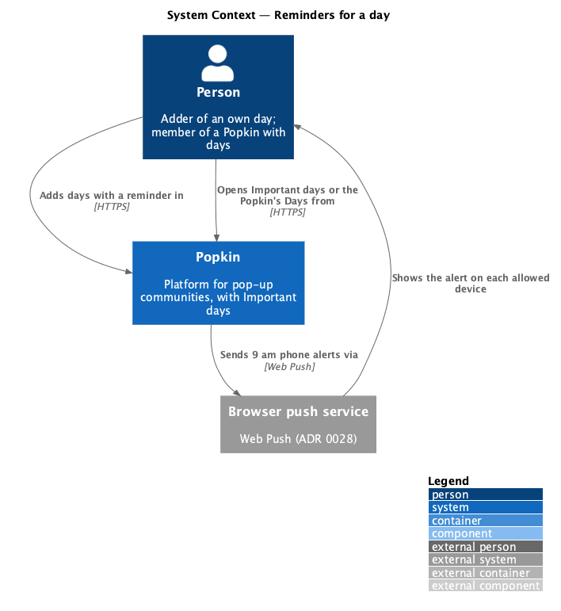
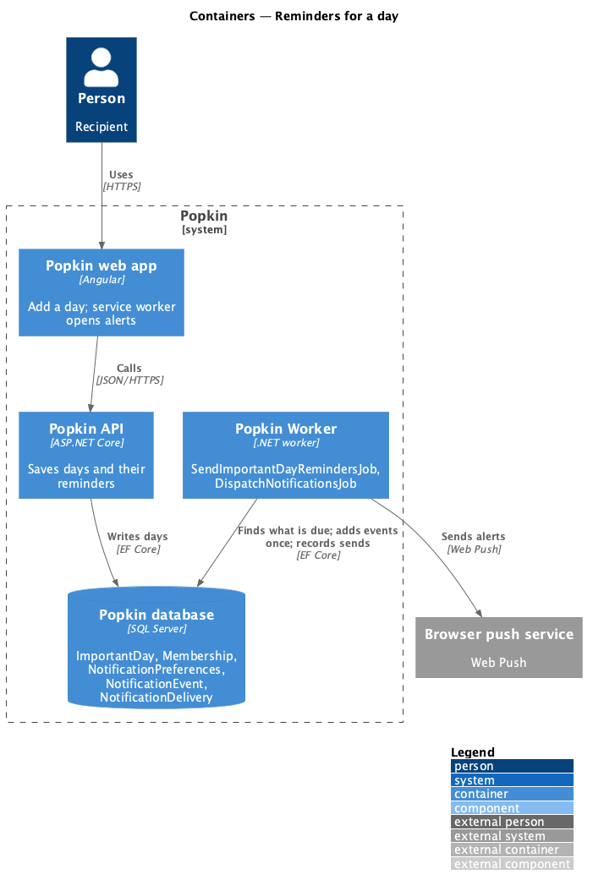
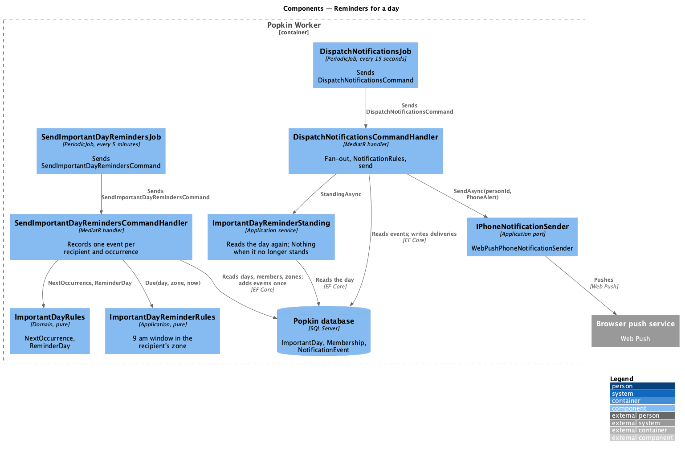
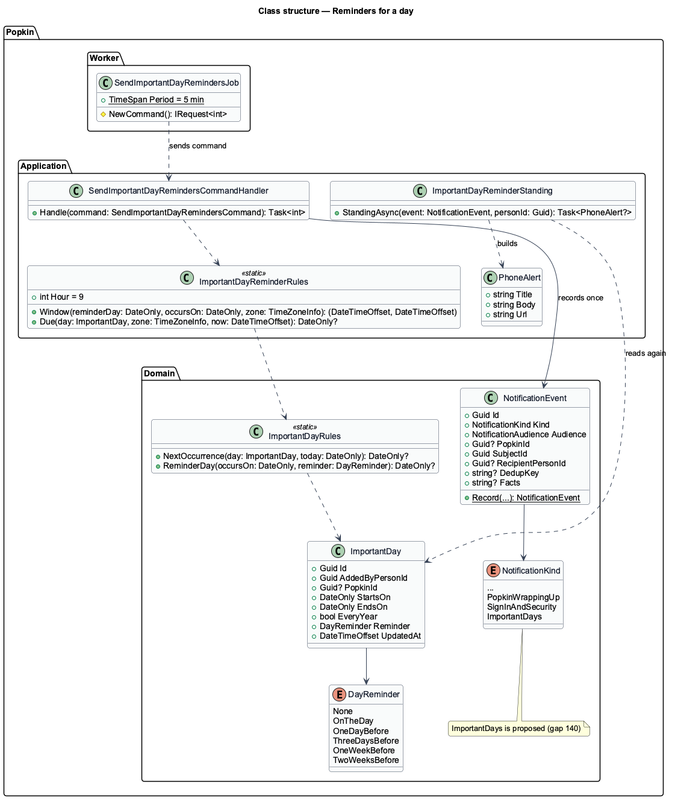
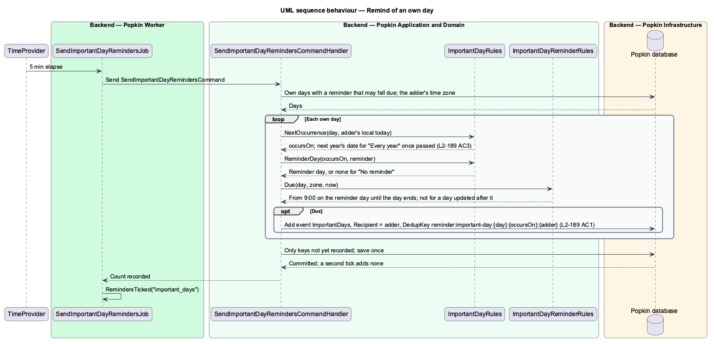
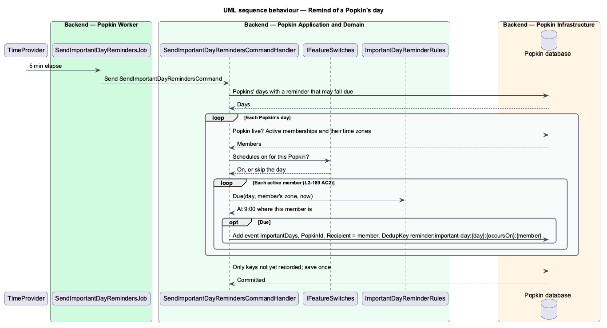
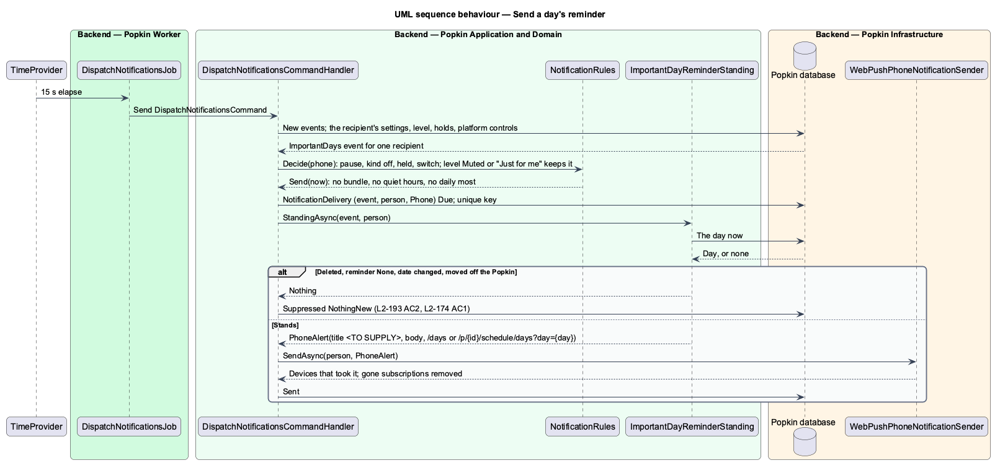

# Reminders for a day

## Overview

A day kept in Important days may carry a reminder: "On the day", "1 day before", "3 days
before", "1 week before" or "2 weeks before" (L2-187). The reminder arrives as a notification at
9 am where the recipient is (L1-044, L2-189). An own day reminds its adder; a Popkin's day
reminds every member. A day kept "Every year" comes round on the same date the next year, with
its reminder.

This feature finds the reminders that are due and records each one once as a
`NotificationEvent` with its recipient. The notification pipeline of
[Deliver notifications](../../notifications/deliver-notifications/README.md) then checks it
against the person's settings and the platform's controls and sends it, as it does the
reminders of [Send reminders](../../notifications/send-reminders/README.md). The day and its
reminder are set on [Add a day](../add-a-day/README.md) and changed or removed by
[Edit and delete a day](../edit-and-delete-a-day/README.md). The Worker sends no hub events
([ADR 0015](../../../adr/0015-the-worker-sends-no-hub-events.md)).

- **reminder** — `DayReminder` of a day, from `None` to `TwoWeeksBefore`
- **occurrence** — one coming round of a day: its `StartsOn` for a day not kept every year, or the same month and day in the year at hand for a day kept every year
- **reminder day** — occurrence minus the reminder's lead: 0, 1, 3, 7 or 14 days
- **reminder moment** — 9:00 on the reminder day in the recipient's time zone (`NotificationPreferences.TimeZone`, UTC before one is saved)
- **recipient** — person a reminder is for: the adder of an own day, or each active member of a Popkin's day
- **day reminder event** — `NotificationEvent` for one occurrence and one recipient, kept once by its `DedupKey`

Which notification kind a day's reminder belongs to is open (gap 140): L2-154 names twelve
kinds and none of them covers it, so no setting turns it off or picks its channel. The proposal
is a thirteenth kind, "Important days", in the "Reminders" group, phone on and email off. This
design writes it as `NotificationKind.ImportantDays` and builds on that proposal. Nothing here
is built until gap 140 is settled and L2-154 changes.

## Description

### Screens and states

This feature has no screen. "Remind me" ("Remind everyone" on a Popkin) and "A notification at
9 am" are on Add a day (`docs/mocks/pages/add-day/`, branch `mocks/important-days`, gap 148).
No mock draws the notification itself, by phone or by email. Its words are `<TO SUPPLY>` below,
and a mock comes before it is built.

### What is due and when (L2-189)

- **Owner.** `SendImportantDayRemindersJob` (`Popkin.Worker/Jobs/`), a `PeriodicJob<int>` every
  5 minutes, sends `SendImportantDayRemindersCommand`. It records the heartbeat
  `metrics.RemindersTicked("important_days", now)`, as the other reminder jobs do.
- **Which days.** Days whose `Reminder` is not `None`:
  - an own day (`PopkinId` null), for its adder (L2-189 AC1);
  - a Popkin's day, for each active member of that Popkin at the tick, the adder among them
    (L2-189 AC2). The Popkin is live (not wrapped up) and has Schedules on; otherwise the job
    records nothing for it.
- **When.** For each recipient, the handler takes the recipient's local today, the day's next
  occurrence on or after it, and its reminder day. The reminder is due from the reminder moment
  until the occurrence's first day ends where the recipient is. Each recipient of a Popkin's day
  is reminded at their own 9 am.
- **A late tick.** A reminder due while the Worker was down is recorded at the next tick, as long
  as the occurrence's first day has not ended, as [Send reminders](../../notifications/send-reminders/README.md)
  does for key dates.
- **A day made after its moment.** A day whose `UpdatedAt` is after the reminder moment of its
  occurrence is not reminded for that occurrence. A day added on Monday afternoon for Tuesday
  with "1 week before" sends nothing, rather than a reminder the moment it is saved. This
  follows "A short Popkin" of Send reminders; whether L2-189 wants it is `<TO SUPPLY>`.
- **Every year** (L2-189 AC3). A day kept every year has an occurrence each year on its month
  and day, and each occurrence has its reminder. A day of several days keeps its length (gap
  147, proposed). A day not kept every year has one occurrence; once it has passed, nothing is
  due. 29 February in a year without it is `<TO SUPPLY>`; Contacts' key dates fall on 28
  February ([Key dates](../../contacts/key-dates/README.md)). The row's "Every year" is drawn by
  [The Important days list](../important-days-list/README.md).
- **The event.** One per recipient and occurrence:
  - `Kind` = `ImportantDays` (gap 140), `Audience` = `Recipient`, `RecipientPersonId` = the
    recipient;
  - `PopkinId` = the day's Popkin, or null; `ActorPersonId` null; `SubjectId` = the day;
  - `Facts` `{"occursOn":"2025-12-30"}`;
  - `DedupKey` `reminder:important-day:{dayId}:{occursOn}:{personId}` (shared section).
- **Once only.** The handler reads the keys already recorded and adds only new ones, in one
  save. The unique filtered index on `NotificationEvent.DedupKey` stops a second tick, or a run
  racing it, from adding another. An email, when the kind has one, takes the `OutgoingEmail` key
  `reminder:{kind}:{subjectId}:{dueOn}:{personId}`.

### What the dispatcher applies

The event goes through `DispatchNotificationsCommandHandler` and `NotificationRules` unchanged,
as a reminder kind (L2-161 AC4, AC6):

- it is sent at once: not bundled, not held for a digest, not counted towards the daily most, and
  not held by quiet hours;
- it applies the pause, the kind off for everyone, holds, "Email" off, and the person's switch
  for the kind and channel;
- a Popkin's level "Muted" or "Just for me" keeps it, as it keeps the other reminders
  (L2-158 AC2, AC3);
- rule 3 (`WrappedUp`) and rule 4 (`FeatureOff`, with Schedules as the kind's feature) apply to
  a Popkin's day only. The kind's feature in `NotificationCatalogue` is `<TO SUPPLY>` with gap
  140.

### Read again when it is sent

`ImportantDayReminderStanding` (Application) reads the day as it is now when the dispatcher
sends, and answers `Nothing` when the reminder no longer stands. The delivery is then suppressed
as `NothingNew` (L2-174 AC1):

- the day is deleted: its reminder goes for everyone who saw it (L2-193 AC2);
- its reminder is now `None`;
- its occurrence is no longer `Facts.occursOn`, because its date changed (the new date has its
  own key and reminds on its own);
- a Popkin's day moved to "Just me", and the recipient is not its adder;
- the recipient is no longer an active member (rule 2 already covers it).

### What it says

- **Phone alert** (`PhoneAlert`: `Title`, `Body`, `Url`), sent through
  `IPhoneNotificationSender` by Web Push ([ADR 0028](../../../adr/0028-phone-reminders-by-web-push.md)):
  - words `<TO SUPPLY>`, proposed from the story-due alert ("Due tomorrow: {story}"): `Title`
    the Popkin's name, or "Important days" for an own day; `Body` "{title} is today", "{title}
    is tomorrow", or "{title} is on {weekday}, {date}" from the words of `days-text.ts`;
  - `Url` `/days` for an own day; `/p/{popkinId}/schedule/days?day={dayId}` for a Popkin's day,
    which opens its details ([A Popkin's Days](../popkin-days/README.md)).

  A day's title is text a member wrote, and an alert shows on a locked phone. The story-due
  alert already shows a story's title. Whether a day's title may show the same way under
  L2-174 AC3 is `<TO SUPPLY>`.
- **Email.** Under gap 140's proposal the kind's email is off. No mock draws an Important days
  email. Until one is drawn and specified, the catalogue offers this kind on the phone alone, as
  it does for follow-ups and habits under "Birthdays".
- **Privacy.** A reminder of an own day reaches its adder only. A reminder of a Popkin's day names
  nobody it is about (gap 141). Nobody the day is about is told (L2-195 AC3).

### Backend

- **`ImportantDayRules`** (Domain, pure) — adds `NextOccurrence(day, today)` (on or after today,
  or null for a passed day not kept every year) and `ReminderDay(occursOn, reminder)` (null for
  `None`). Tested one case per row.
- **`ImportantDayReminderRules`** (Application, pure) — `Hour = 9`;
  `Window(reminderDay, occursOn, zone)` gives 9:00 on the reminder day, local, until the end of
  the occurrence's day there. A time skipped by a clock change reads as the hour after, as in
  `PopkinReminderRules`. `Due(day, recipientZone, now)` puts them together with the `UpdatedAt`
  rule.
- **`SendImportantDayRemindersCommand`** / **`SendImportantDayRemindersCommandHandler`**
  (`Popkin.Application/ImportantDays/Reminders/SendImportantDayReminders.cs`):
  1. reads the days with a reminder that may fall due within 15 days of now: one-off days by
     `StartsOn`, days kept every year by month and day;
  2. for a Popkin's day, reads the Popkin's live state, whether Schedules is on
     (`IFeatureSwitches`, `IPlatformSnapshot`) and its active memberships;
  3. reads each recipient's zone from `NotificationPreferences` (`LocalClock.ZoneOf`);
  4. asks `ImportantDayReminderRules.Due` per recipient, and builds one
     `NotificationEvent.Record(...)` per due reminder;
  5. adds only keys not yet recorded, saves once, and answers how many it recorded.

  It sends nothing itself.
- **`NotificationKind.ImportantDays`** and its `NotificationCatalogue` entry — group `Reminders`,
  email off, phone on, not required, feature `<TO SUPPLY>` (gap 140). Adding a kind changes the
  catalogue every reader shares; [Notification settings](../../notifications/notification-settings/README.md)
  shows the new row with the rest.
- **`ImportantDayReminderStanding`** — as above, used by the dispatcher to build the phone
  alert, as the composers' `StandingAsync` are for stories and Popkins.
- **`SendImportantDayRemindersJob`** — registered in the Worker's `Program.cs` beside
  `SendPopkinRemindersJob`.
- **Telemetry.** `popkin.notifications.events` by `kind` gains `important_days`;
  `popkin.notifications.reminders.last_tick` gains `job` = `important_days`. No log, metric
  dimension or span carries a title, a place, a date, a person or a contact.
- **Settings.** No new setting.

### Frontend

No new screen. The service worker of ADR 0028 opens the alert's `Url`: Important days, or the
Popkin's Days with the day's details.

### Tests

- **Direct tests** of `ImportantDayRules.NextOccurrence` and `ReminderDay`, one case per row:
  a one-off day before, on and after; a day every year this year and next; a day of several days
  every year; each of the five leads; `None`.
- **Direct tests** of `ImportantDayReminderRules.Window` and `Due`: 9:00 in UTC, in
  `Europe/London` across the clock change, and in `Pacific/Auckland`; the end of the occurrence's
  day; a day updated after its moment.
- **Handler tests** (`SendImportantDayRemindersCommandHandler`) on InMemory with
  `FakeTimeProvider` (ADR 0005, ADR 0010):
  - an own day: before 9:00 nothing, at 9:00 one event for the adder, a second tick none;
  - a Popkin's day: one event per active member, each at their own 9:00 in two zones; none for a
    member who left;
  - a day every year reminds again the next year with a new key;
  - none for `None`, for a passed one-off day, for a wrapped-up Popkin, and for Schedules off.
- **Dispatcher tests**, in [Deliver notifications](../../notifications/deliver-notifications/README.md)'s
  suite: a deleted day, a day whose date changed and a day whose reminder is now `None` are
  suppressed as `NothingNew`; a muted Popkin still reminds; the kind off sends nothing.
- **Acceptance test through the API and Worker:** a day added through `POST /api/days` with "1
  day before" reaches its adder's fake phone sender once at 9:00 the day before; a Popkin's day
  reaches each member once. No test sleeps (ADR 0010).

## Requirements

| L2 ID | Refines (L1) | Requirement |
|-------|--------------|-------------|
| `L2-189` | `L1-044` | Reminders for a day: a day with a reminder on the person's own calendar notifies the person at 9 am on its reminder day; on a Popkin, every member; a day kept "Every year" comes round on the same date the next year, with its reminder, and its row shows "Every year". (AC1–AC3) |

## Diagrams

### System context

Popkin reminds the adder of an own day, or every member of a Popkin's day, by a phone alert
through the browser's push service.

### Containers

The API saves the days; the Worker finds the reminders due, records each once, and sends it
through the notification pipeline. No hub event is sent.

### Components

`SendImportantDayRemindersJob` records the day reminder events; the dispatcher of Deliver
notifications decides and sends each one, reading the day again through
`ImportantDayReminderStanding`.

### Class structure

`ImportantDayRules` gives the occurrence and the reminder day; `ImportantDayReminderRules` turns
them into each recipient's 9 am window.

### Behaviour

At 9 am on its reminder day, an own day's reminder is recorded once for its adder; a day kept
every year comes round with a new key.

A Popkin's day is recorded once for each active member, each at their own 9 am.

The dispatcher reads the day again and sends the phone alert, or suppresses a reminder that no
longer stands.

