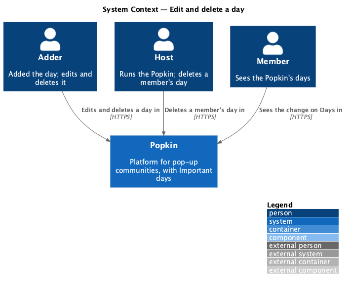
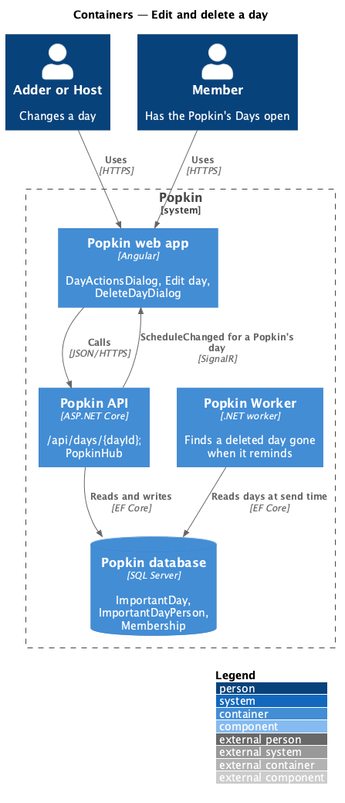
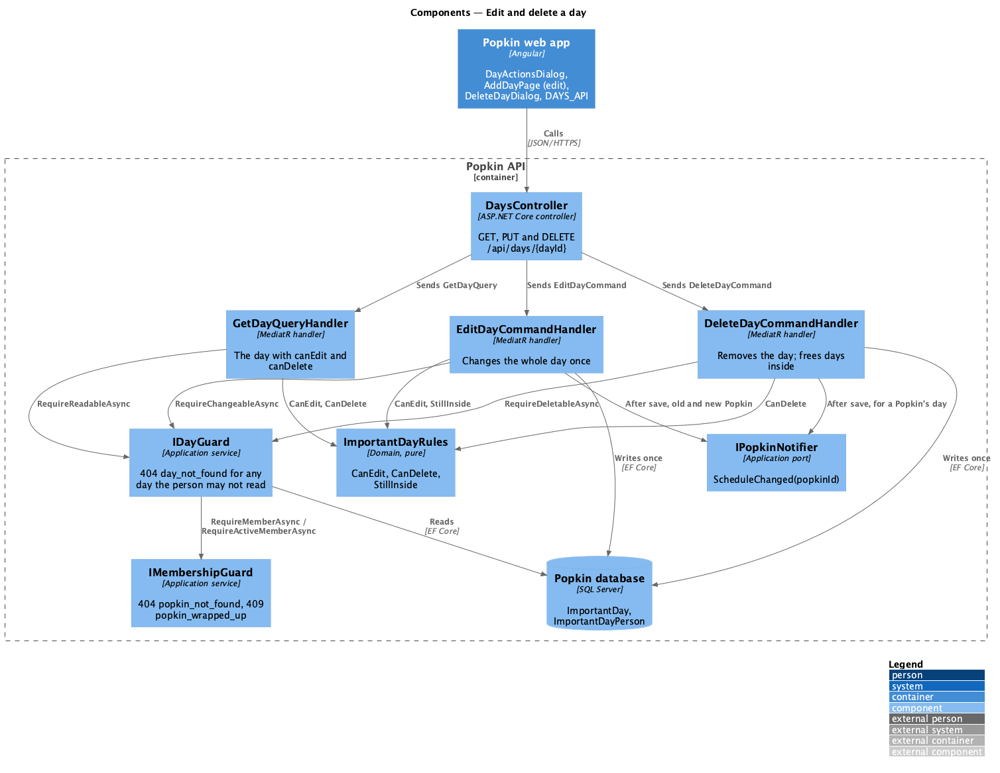
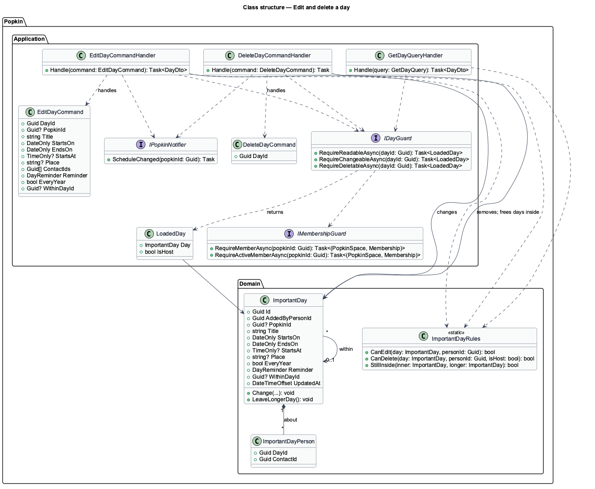
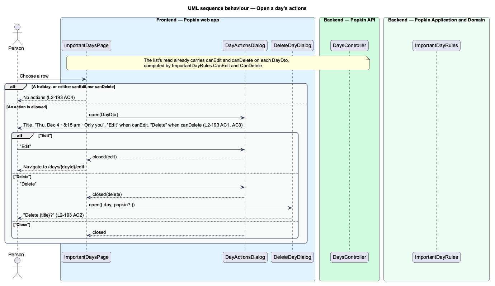
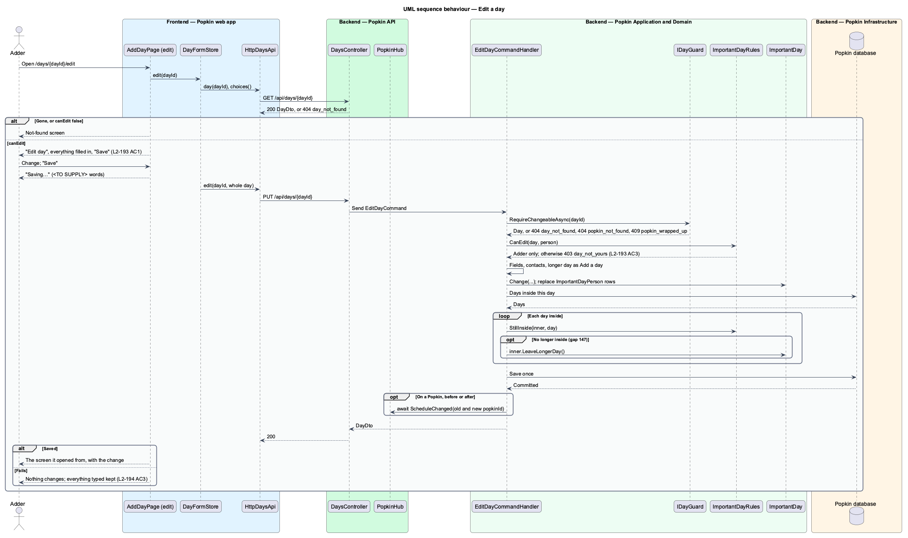
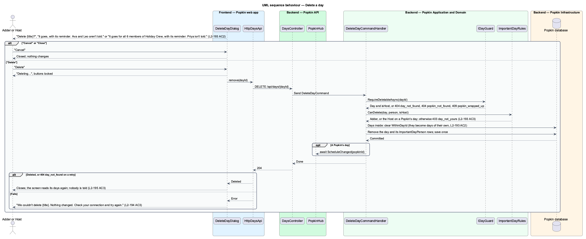

# Edit and delete a day

## Overview

A day kept in Important days changes or goes away as plans change (L1-044). This feature lets
the person who added a day edit it on the Add a day screen, filled in, and lets them delete it
after a question (L2-193 AC1, AC2). On a Popkin, the Host may also delete a member's day, but
not edit it (AC3). A holiday comes from the Popkin's holiday calendar and is neither edited nor
deleted here (AC4). A failed change or delete changes nothing and keeps what was typed
(L2-194 AC3).

The form is the one of [Add a day](../add-a-day/README.md); the reminder that goes with a day is
sent by [Reminders for a day](../day-reminders/README.md); who sees a day at all is
[Who sees a day](../who-sees-a-day/README.md).

- **day** — `ImportantDay` a person keeps, as defined in [Add a day](../add-a-day/README.md)
- **adder** — person who added a day, `ImportantDay.AddedByPersonId`, the only person who edits it
- **Host** — member of a Popkin who runs it; deletes any day on it
- **day actions** — `DayActionsDialog`, the sheet of "Edit" and "Delete" a day's row opens on Important days
- **day inside** — single day whose `WithinDayId` names a longer day on the same Popkin (L2-188)
- **day of its own** — day inside whose longer day is deleted, or no longer contains it; its `WithinDayId` is cleared
- **holiday** — `Holiday` of the Popkin's holiday calendar (L2-192), not an `ImportantDay`

Who may do what, by the shared rules
([Important days and holiday calendars](../../README.md#important-days-and-holiday-calendars)):

| Day | Viewer | Edit | Delete |
|---|---|---|---|
| Own day | Its adder | Yes | Yes |
| Own day | Anyone else | `404` `day_not_found` | `404` `day_not_found` |
| A Popkin's day | Its adder, a member | Yes | Yes |
| A Popkin's day | The Host, not its adder | `403` `day_not_yours` | Yes |
| A Popkin's day | Another member | `403` `day_not_yours` | `403` `day_not_yours` |
| A Popkin's day | Not a member | `404` `day_not_found` | `404` `day_not_found` |
| A Popkin's day, Popkin wrapped up | Anyone | `409` `popkin_wrapped_up` | `409` `popkin_wrapped_up` |
| A holiday | Anyone | Not offered; no endpoint | Not offered; no endpoint |

## Description

### Screens and states

From the branch `mocks/important-days` (PR #103, gap 148):

- `docs/mocks/dialogs/day-actions/default.html` — over Important days, for one of Mara's own
  days. Its title is the day's title, "Picture day at Lincoln Elementary", with "Close". Under it
  is "Thu, Dec 4 · 8:15 am · Only you". A menu list holds "Edit" and "Delete" (danger)
  (L2-193 AC1). The mock's note: a member's day on a Popkin offers only "Delete", to the Host;
  a holiday offers neither.
- `docs/mocks/pages/add-day/edit.html` — Add a day as "Edit day", with everything filled in
  ("Picture day at Lincoln Elementary", Thu 4 December at 08:15, "Lincoln Elementary", "Just
  me", Ava and Leo) and "Save" in place of "Add day" (L2-193 AC1).
- `docs/mocks/dialogs/delete-day/`:
  - `default.html` — "Delete Picture day at Lincoln Elementary?", "It goes, with its reminder.
    Ava and Leo aren't told.", "Delete" (danger) and "Cancel" (L2-193 AC2).
  - `popkin.html` — over Holiday Crew's Days, with Usher concert's details ("Added by Priya",
    "Talk about it", "Delete"). Mara is the Host. "Delete Usher concert?", "It goes for all 6
    members of Holiday Crew, with its reminder. Priya isn't told." (L2-193 AC3).
  - `busy.html` — "Deleting…", busy; "Delete" and "Cancel" switched off.
  - `failed.html` — a danger banner "We couldn't delete Picture day at Lincoln Elementary.
    Nothing changed. Check your connection and try again."; "Delete" tries again (L2-194 AC3).

The mocks draw no busy or failed state for "Edit day" and no state while the day to edit loads.
Their words are below, marked where no mock or requirement gives them.

### Rules

- **What is offered.** The API computes `canEdit` and `canDelete` on every `DayDto` by the table
  above, and the screens show only what they say. A row or details with neither offers nothing:
  `DayActionsDialog` does not open for it, and a holiday never carries either (L2-193 AC4).
- **Where the actions are.** On Important days, choosing a row with an action opens
  `DayActionsDialog`. On a Popkin's Days, the details show "Edit" and "Delete" beside "Talk
  about it" ([A Popkin's Days](../popkin-days/README.md)). "Edit" navigates to
  `/days/{dayId}/edit`, with `?popkin={popkinId}` from a Popkin's Days. "Delete" opens
  `DeleteDayDialog`.
- **Edit day.** `AddDayPage` in edit mode reads the day and the form's choices, fills in every
  field, and reads "Edit day" with "Save" (L2-193 AC1). Every rule of
  [Add a day](../add-a-day/README.md) applies, the offer of a longer day included.
- **Saving.** "Save" reads "Saving…" while it saves, with the fields locked
  (`<TO SUPPLY>`: no mock draws it). Saved, the page returns to the screen it opened from.
- **Edit fails.** Nothing changes and everything typed is kept (L2-194 AC3). The banner reads
  "We couldn't save {day}. Everything you typed is still here. Check your connection and try
  again." (`<TO SUPPLY>`: proposed from L2-187 AC6; no requirement gives the words).
- **The day cannot be edited.** A day that is gone, or one the person may not edit, opened by
  its address, shows the web app's not-found screen.
- **Changing the calendar.** "Whose calendar?" stays open in edit (the mock draws it). Moving a
  day to "Just me" or to another Popkin takes it off the first Popkin. Its days inside become
  days of their own there, and both Popkins get `ScheduleChanged`. Whether a day may change
  calendar at all is `<TO SUPPLY>`: L2-193 AC1 says "everything filled in" and no requirement
  says more.
- **A longer day changed** (gap 147, proposed). When a longer day's dates change so that a day
  inside falls outside, or it becomes one day, that day becomes a day of its own, as on delete
  (L2-193 AC2).
- **Delete.** "Delete {title}?" with "Delete" and "Cancel" (L2-193 AC2). The description is the
  mock's:
  - own day: "It goes, with its reminder." and, when it is about people, "{Ava and Leo} aren't
    told." (the adder alone sees them, gap 141);
  - a Popkin's day: "It goes for all {n} members of {Popkin}, with its reminder.", and, when the
    Host deletes a member's day, "{adder's first name} isn't told.";
  - a Popkin's day of the adder's that is about people: `<TO SUPPLY>` (no mock draws it).

  "Deleting…" locks both buttons. The day, its `ImportantDayPerson` rows and its reminder go for
  everyone who saw it, and each day inside it becomes a day of its own (L2-193 AC2). The dialog
  closes and the screen behind reads its days again.
- **Delete fails.** The banner of `failed.html`; the day stays and "Delete" tries again
  (L2-194 AC3). A `404` `day_not_found` on a retry means the first delete went through, and the
  dialog closes as deleted.
- **Nobody is told.** The people a day is about, and the adder when the Host deletes their day,
  are not told (L2-195 AC3). No notification event is recorded.

### API

`DaysController` (`Popkin.Api/Controllers/Days/`), behind the default authenticated policy;
each action sends one MediatR request.

- `GET /api/days/{dayId}` — `200` `DayDto` ([Add a day](../add-a-day/README.md)) for a person
  who may read it; `404` `day_not_found` for any day the person may not read: another person's
  own day, a Popkin's day of a Popkin they are not in, or a day that is gone. Edit day reads it
  with `GET /api/days/choices`.
- `PUT /api/days/{dayId}` — body `EditDayRequest` `{ popkinId?, title, startsOn, endsOn,
  startsAt?, place?, contactIds[], reminder, everyYear, withinDayId? }`, the whole day. `200`
  `DayDto`. Refusals: every refusal of `POST /api/days`, and `404` `day_not_found`, `403`
  `day_not_yours`, `409` `popkin_wrapped_up` (for the day's Popkin and for a Popkin it moves to).
  A resend of the same body changes nothing more, so the request needs no `clientId`.
- `DELETE /api/days/{dayId}` — `204`. Refusals: `404` `day_not_found`, `403` `day_not_yours`,
  `409` `popkin_wrapped_up`.

A holiday has no endpoint under `/api/days`; a holiday's id there answers `404` `day_not_found`.

### Backend

- **`ImportantDay`** (Domain) — adds `Change(popkinId?, title, startsOn, endsOn, startsAt?,
  place?, reminder, everyYear, withinDayId?, now)`, which sets `UpdatedAt`, and
  `LeaveLongerDay()`, which clears `WithinDayId`.
- **`ImportantDayRules`** (Domain, pure) — adds `CanEdit(day, personId)` (the adder) and
  `CanDelete(day, personId, isHost)` (the adder, or the Host on a Popkin's day), and
  `StillInside(inner, longer)` (one day on the same Popkin, within its dates). Tested one case
  per row of the table above and of gap 147's cases.
- **`IDayGuard`** (Application, defined in [Who sees a day](../who-sees-a-day/README.md)) — the
  one place every Important days handler loads a day through, as `IContactGuard` is for
  Contacts. `RequireReadableAsync(dayId)` answers `404` `day_not_found` for any day the person
  may not read; `RequireChangeableAsync(dayId)` adds the active-member check (`409`
  `popkin_wrapped_up`) and the adder check, and `RequireDeletableAsync(dayId)` the adder-or-Host
  check, each `403` `day_not_yours` otherwise. Each answers the day with whether the person is
  the Host.
- **`GetDayQueryHandler`** — `IDayGuard.RequireReadableAsync`, then the `DayDto` with `canEdit` and
  `canDelete`.
- **`EditDayCommandHandler`** (`Popkin.Application/ImportantDays/EditDay.cs`):
  1. loads through `IDayGuard.RequireChangeableAsync` (`403` `day_not_yours` unless its adder);
  2. checks the new Popkin, when it changes, as Add a day does (Schedules on, an active member);
  3. checks the fields, the contacts and the longer day as `AddDayCommandHandler` does;
  4. calls `Change` and replaces the `ImportantDayPerson` rows;
  5. clears `WithinDayId` on each day inside that is no longer `StillInside`, or on all of them
     when the calendar changed (gap 147);
  6. saves once, then awaits `ScheduleChanged` for the Popkin the day was on and the one it is
     on now.
- **`DeleteDayCommandHandler`** (`Popkin.Application/ImportantDays/DeleteDay.cs`):
  1. loads through `IDayGuard`; refuses with `403` `day_not_yours` unless `CanDelete`;
  2. clears `WithinDayId` on each day inside it (L2-193 AC2);
  3. removes the day and its `ImportantDayPerson` rows and saves once;
  4. for a Popkin's day, awaits `ScheduleChanged(popkinId)`.

  A reminder event already recorded for the day is not removed here; the Worker finds the day
  gone when it sends and suppresses it ([Reminders for a day](../day-reminders/README.md)).
- **Telemetry.** Routes are recorded as their templates (`/api/days/{dayId}`). No log, metric
  dimension or span carries a title, a place, a contact or a date.

### Frontend (Popkin web app)

- **`DayActionsDialog`** (`dialogs/day-actions/day-actions.dialog.ts` + `.html`) — CDK Dialog
  opened by `ImportantDaysPage` with the row's `DayDto`. It composes `pk-dialog` (title, "Close"),
  the line from `days-text.ts` ("Thu, Dec 4 · 8:15 am · Only you", or the Popkin's name) and
  `pk-menu-list` with `pk-menu-item` "Edit" and, danger, "Delete", each shown by `canEdit` and
  `canDelete`. It closes with `edit` or `delete`; the page then navigates to Edit day or opens
  `DeleteDayDialog`.
- **`DeleteDayDialog`** (`dialogs/delete-day/delete-day.dialog.ts` + `.html`) — CDK Dialog opened
  with `{ day: DayDto, popkin?: { name, memberCount } }`. Where the opener reads the member count
  is `<TO SUPPLY>` with [The Important days list](../important-days-list/README.md) and
  [A Popkin's Days](../popkin-days/README.md). It composes `pk-dialog`, `pk-banner` (danger) and
  two `pk-button`s, "Delete" (danger) / "Deleting…" and "Cancel" (quiet). It calls
  `DAYS_API.remove(dayId)` and closes with `deleted`.
- **`AddDayPage`** in edit mode — route `/days/:dayId/edit`, data `{ shell: 'bare', page:
  'add-day', mode: 'edit' }`. `DayFormStore.edit(dayId)` reads `DAYS_API.day(dayId)` and
  `choices()`, then `DAYS_API.edit(dayId, body)` on "Save".
- **`delete-day-text.ts`** (`frontend/projects/api/src/lib/api/days/`, pure) — the question, the
  descriptions by case, "Deleting…" and the failure words, unit tested (ADR 0011). The edit
  words join `day-form.ts`.
- **`DAYS_API`** — adds `day(dayId)`, `edit(dayId, body)` and `remove(dayId)`.

### Tests

- **API acceptance** (InMemory, ADR 0005):
  - the adder edits an own day and reads it back changed; another person gets `404`
    `day_not_found` for it;
  - the Host's `PUT` on a member's day answers `403` `day_not_yours`; the Host's `DELETE` on it
    answers `204`, and a member's SignalR client receives `ScheduleChanged` (ADR 0010);
  - another member's `DELETE` answers `403` `day_not_yours`;
  - deleting a longer day leaves its day inside on the Popkin with no `withinDayId`;
  - a wrapped-up Popkin's day answers `409` `popkin_wrapped_up` to both.
- **Direct tests** of `ImportantDayRules.CanEdit`, `CanDelete` and `StillInside`, one case per
  row of the table above and of gap 147's cases (dates moved out, several days to one day,
  calendar changed).
- **Unit tests** of `delete-day-text.ts`: each description, and the names joined ("Ava and
  Leo").
- **Playwright** `tests/edit-and-delete-a-day.spec.ts` through the `DayActionsDialog`,
  `AddDayPage` and `DeleteDayDialog` page objects, on recorded responses: "Edit" and "Delete"
  for an own day; "Edit day" filled in and saved; delete, busy and failed; the Host's details
  with "Delete" and no "Edit"; a holiday with no action. `routes.ts` keys `day-actions/default`,
  `add-day/edit` and the four `delete-day` states.

## Requirements

| L2 ID | Refines (L1) | Requirement |
|-------|--------------|-------------|
| `L2-193` | `L1-044` | Edit and delete a day: the adder edits and deletes a day; "Delete {title}?" removes it and its reminder for everyone, and days inside it become days of their own; the Host deletes but does not edit a member's day; a holiday is neither. (AC1–AC4) |
| `L2-194` | `L1-044` | Loading and errors in Important days: Given a change or a delete fails, when it is reported, then nothing changes, a message says it didn't go through, and anything typed is kept. (AC3; AC1 and AC2 in the list and Days designs) |

## Diagrams

### System context

The adder edits or deletes a day; on a Popkin, the Host may delete it too. Members see the
change, and the people the day is about are not told.

### Containers

The web app edits and deletes through the API, which keeps the days in the database and sends
`ScheduleChanged` to a Popkin's open Days.

### Components

`DaysController` sends one request per action. Every handler loads the day through `IDayGuard`,
and `ImportantDayRules` decides who may edit or delete it.

### Class structure

`ImportantDay` changes itself and leaves its longer day; the rules of access and nesting are
pure.

### Behaviour

A row's day actions offer only what `canEdit` and `canDelete` allow.

Edit day fills in the form, saves the whole day, and frees days inside that no longer fall
within it.

Delete asks first, removes the day and its people, makes its days inside days of their own, and
keeps the day when it fails.

