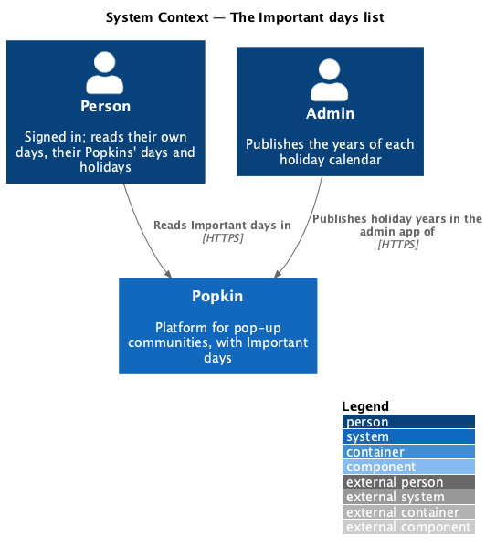
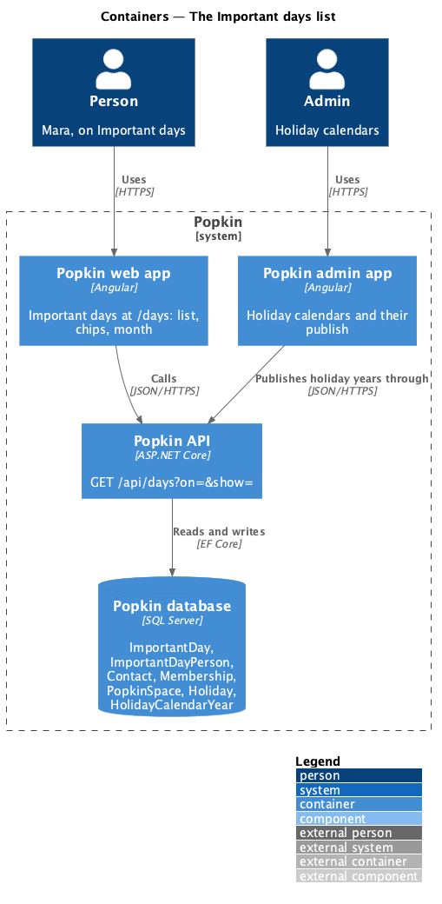
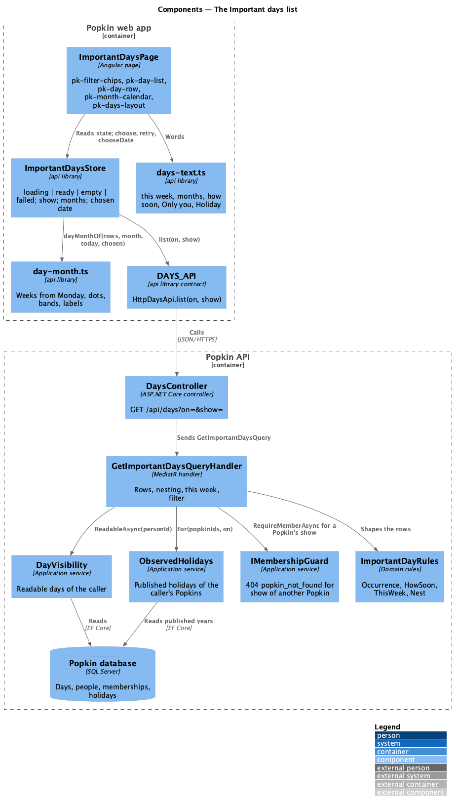
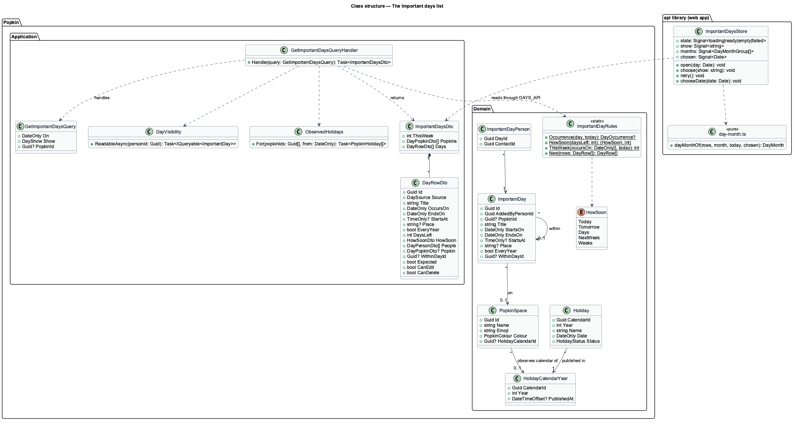
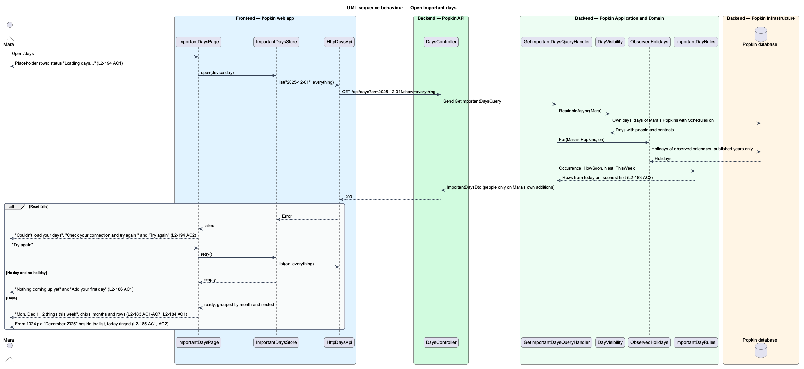
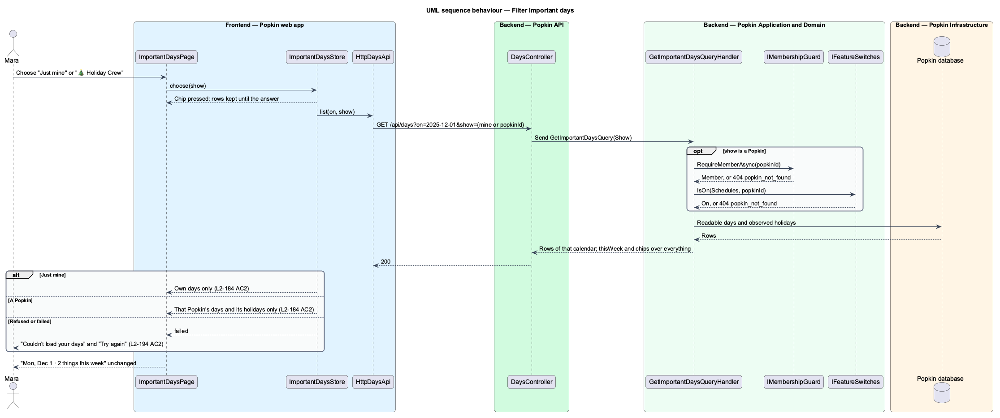
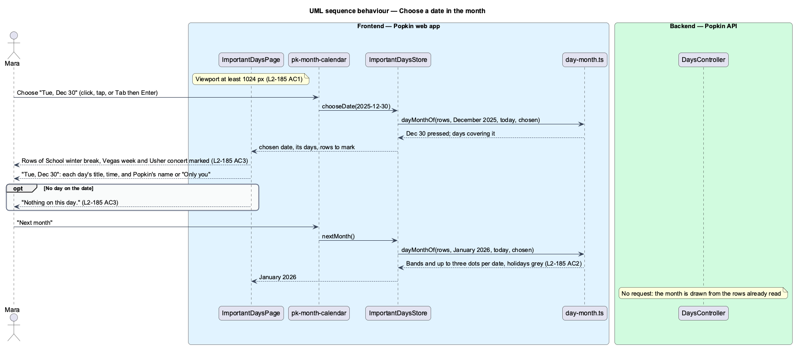

# The Important days list

## Overview

Important days (`/days`) is where a signed-in person sees every day that matters to them from
today on, in one list: their own days, the days of the Popkins they belong to, and the holidays
those Popkins observe (L1-044). It opens from My Popkins
([Reach Important days](../reach-important-days/README.md)). The list groups the days by month,
soonest first, and reads how soon each one is. Chips narrow it to the person's own days or to one
Popkin. From 1024 px a month calendar sits beside it, and choosing a date there highlights the
days that cover it. This design covers the list, its filter, the month, and the empty, loading
and failed states; adding, changing and deleting a day are [Add a day](../add-a-day/README.md)
and [Edit and delete a day](../edit-and-delete-a-day/README.md).

- **day** — `ImportantDay` the person may read ([Who sees a day](../who-sees-a-day/README.md)): their own, or one on a Popkin they belong to
- **own day** — day with no `PopkinId`; its row reads "Only you"
- **Popkin's day** — day with a `PopkinId`; its row shows the Popkin's emoji and name
- **holiday** — `Holiday` of the calendar a Popkin observes (`PopkinSpace.HolidayCalendarId`), in a year whose `HolidayCalendarYear.PublishedAt` is set
- **occurrence** — dates a day covers on or after the device day: `StartsOn` to `EndsOn`, or for a day kept every year its next round; none once it has ended
- **longer day** — day of several days (`EndsOn` after `StartsOn`)
- **day inside** — day whose `WithinDayId` names a longer day on the same Popkin (L2-188), listed under it
- **how soon** — words for the days between the device day and an occurrence: "Today", "Tomorrow", "In {n} days" up to six, "Next week" up to 13, "In {n} weeks" after
- **show** — the filter: `everything`, `mine` or one Popkin's id
- **chosen date** — date marked in the month beside the list, today until another is chosen
- **device day** — the person's today, sent as `?on=yyyy-MM-dd` ([Important days and holiday calendars](../../README.md#important-days-and-holiday-calendars))

The screens are drawn on the requirements' cast: Mara on Monday 1 December 2025, in Holiday Crew
🎄 (Mara its Host) and Tigers U9 Parents ⚽; Ava and Leo are Mara's children and "Mum" is Ada,
all three among Mara's contacts (L2-182).

## Description

### Screens and states

`docs/mocks/pages/important-days/` (on the mocks branch until PR #103 merges, gap 148), route
`/days`, data `{ shell: 'bare', page: 'important-days' }`:

- `default.html` — the top bar holds "Your Popkins" ([Reach Important days](../reach-important-days/README.md))
  and the primary "Add a day". The heading "Important days" over "Mon, Dec 1 · 2 things this
  week" (L2-183 AC1). The chips (`chips chips--scroll`, a group named "Show", each
  `aria-pressed`): "Everything" (pressed), "Just mine", "🎄 Holiday Crew" and "⚽ Tigers U9
  Parents" (L2-184 AC1). One section per month, its heading "December", then "January 2026"
  (`day-list__month`) (L2-183 AC2). Each row (`day-row`) is the date tile ("Thu" / "4"), the
  title, a meta line and, from 640 px, an end column (`day-row__end`) with where the day lives
  (`day-where`: "Only you", or the Popkin's tile and name) and how soon ("In 3 days", "Next
  week", "In 3 weeks"). Below 640 px the end column is hidden and the Popkin's name, or "Only
  you", shows under the title instead (`day-row__where`) (L2-183 AC5). The meta line holds, as
  they apply, the people's faces and first names ("Ava & Leo"), "Dec 22 – Jan 2 · 12 days" for
  a longer day, the time ("8:15 am") and the place ("Lincoln Elementary"), and "Every year" for a
  day kept every year ("Mum's birthday") (L2-183 AC3). "Vegas week" (Dec 27 – Jan 3) holds,
  indented in a list named "During Vegas week" with a line in Holiday Crew's colour
  (`day-list__inside`), "Usher concert" and the holidays "New Year's Eve" and "New Year's Day"
  (L2-183 AC6). "Christmas Eve" and "Christmas Day" are holidays: a quieter title, the outlined
  tile `date-tile--holiday` and the meta "Holiday" (`day-row--holiday`) (L2-183 AC7). From 1024
  px the aside "Month" (`days-layout__aside`) holds "December 2025" with "Previous month" and
  "Next month", weeks from Monday, today ringed (`aria-current="date"`), dots and bands; Tue,
  Dec 30 is chosen (`aria-pressed`), the rows covering it are marked (`aria-current="true"`), and
  under the month "Tue, Dec 30" lists "School winter break · Only you", "Vegas week · Holiday
  Crew" and "Usher concert · 8 pm · Holiday Crew" (`days-layout__focus`) (L2-185).
- `mine.html` — "Just mine" pressed; only Mara's own days (L2-184 AC2).
- `popkin.html` — "🎄 Holiday Crew" pressed; only its days and its holidays (L2-184 AC2).
- `empty.html` — the line under the heading reads "Yours, and the ones your Popkins are planning
  around."; "Nothing coming up yet", "Add the days you don't want to miss: a holiday party,
  picture day, a trip. Keep them to yourself, or add them to a Popkin so the whole group plans
  around them." and "Add your first day", which opens Add a day (L2-186 AC1). The chips are
  hidden; the month shows with no day and today chosen.
- `loading.html` — the heading, line and chips as last shown, placeholder rows and month
  (`pk-skeleton`), and "Loading days…" in a polite status for assistive technology (L2-194 AC1).
- `error.html` — an alert with "Couldn't load your days", "Check your connection and try again."
  and "Try again", which loads them again; the month's aside is empty (L2-194 AC2).

Rows that offer an action open `docs/mocks/dialogs/day-actions/default.html` ("Picture day at
Lincoln Elementary", "Thu, Dec 4 · 8:15 am · Only you", "Edit", "Delete"); the dialog and its
rules are [Edit and delete a day](../edit-and-delete-a-day/README.md). A row with no action is not
a control. The Popkin's name in a row is a link to the Popkin's Days,
`/p/:popkinId/schedule/days` ([A Popkin's Days](../popkin-days/README.md)) (L2-183 AC4).

### Conflicts with the mocks

- **Tigers U9 Parents' link.** The mock's "Last game and trophy party" links its Popkin's name to
  the Popkin's home; L2-183 AC4 opens the Popkin's Days, and the design follows the requirement.
- **The Host's rows.** The mock draws Holiday Crew's "Secret Santa draw" as no control, while
  Mara is Holiday Crew's Host, whom L2-193 AC3 lets delete a member's day. The row is a control
  whenever the API marks it `canDelete` or `canEdit`; the mock is right only if Mara is not the
  Host or the day is not a member's (`<TO SUPPLY>` by the mocks' owner).
- **The month's bands.** The mock draws only "School winter break" as a band from Dec 22, with
  "Vegas week" from Dec 27 sharing its dates. Two longer days on the same dates are two bands
  (L2-185 AC2); how they stack is `<TO SUPPLY>` (the mock's `month-cal__band` holds one).

### Rulings this design takes

- **One occurrence per day.** A day kept every year lists once, at its next occurrence on or after
  the device day ("Mum's birthday", Jan 9 2026), as Contacts' Dates does. A one-off day lists
  while its `EndsOn` is on or after the device day (L2-183 AC2). No horizon limits one-off days;
  holidays come from every published year from the device day on.
- **A day that has begun.** A longer day whose `StartsOn` is before the device day and whose
  `EndsOn` is not lists under today's month with "Today" (`<TO SUPPLY>`: no requirement says, new
  open question 1 below).
- **"{n} things this week".** The count is every row of "Everything", holidays and days inside
  included, whose occurrence starts 0 to 6 days after the device day: "nothing", "one thing",
  "{n} things" (L2-183 AC1). It does not follow the filter: the mocks read "2 things this week"
  under every chip.
- **"In {n} weeks"** is the days left divided by seven, rounded to the nearest whole week: 15
  days is "In 2 weeks", 26 is "In 4 weeks", 39 is "In 6 weeks", as the mock reads.
- **Order.** Soonest occurrence first; on the same date, all-day first, then by `StartsAt`, then
  own days before Popkins' days, then by title (`<TO SUPPLY>` confirm the order of ties).
- **The year in a month's heading** is shown when the month's year is not the device day's year
  ("January 2026") (L2-183 AC2).
- **Nesting.** A day with a `WithinDayId` sits under its longer day, both on the same Popkin
  (L2-188). Following the mock, a holiday of a Popkin's calendar whose date falls within a longer
  day of that Popkin sits under it too ("New Year's Eve" under "Vegas week"); a holiday is never
  nested under an own day. A day inside whose longer day is not listed (filtered out, or ended)
  lists on its own. Rows inside a longer day show no end column and no "where": they share their
  longer day's.
- **Holidays.** A holiday is one row per Popkin that observes its calendar, carrying that Popkin's
  emoji, name and link, so each Popkin's chip shows its own holidays (L2-184 AC2). Two Popkins on
  the same calendar list each holiday twice (`<TO SUPPLY>`, new open question 2 below). A
  holiday whose `Status` is `Estimated` reads "Holiday · expected" (L2-192 AC4; `<TO SUPPLY>` the
  exact words). A holiday offers no action (L2-193 AC4).
- **People.** The faces and first names show only on the rows of days the person added, as gap
  141 proposes ([Who sees a day](../who-sees-a-day/README.md)). A day about three or more people
  reads "Ava, Leo & Ada" (`<TO SUPPLY>` beyond two, which the mock draws).
- **The chips.** "Everything", "Just mine", then one chip per Popkin with at least one day or
  holiday from the device day on, in the order of My Popkins (`<TO SUPPLY>` confirm the order).
  "Just mine" shows even when the person has no own day. With "Just mine" or a Popkin chosen and
  nothing to show, the list reads "Nothing here yet." (`<TO SUPPLY>`: no mock draws it).
- **Which Popkins.** Days and holidays come from the Popkins the person belongs to
  (`Membership.LeftAt` null) whose Schedules are on (`IFeatureSwitches.IsOn(Feature.Schedules,
  popkinId)`), as a Popkin's Days needs Schedules ([shared section](../../README.md#important-days-and-holiday-calendars)).
  A wrapped-up Popkin's days still list, read-only (`<TO SUPPLY>`, new open question 3 below).
- **The month.** It is drawn in the web app from the rows already read for the chosen filter: no
  further request. Weeks start on Monday and today is ringed (L2-185 AC1). A longer day is a band
  across its dates in its Popkin's colour, an own day's band in the "mine" style; other days are
  dots under their date, at most three, in their Popkin's colour, a holiday's grey, an own day's
  in the "mine" style (L2-185 AC2). "Previous month" and "Next month" move the month without a
  request. A month before the device day's month holds no day, since the list holds none that
  ended (`<TO SUPPLY>` whether earlier months read past days, new open question 4 below). The
  month shows from 1024 px only (`only-l-up`); below it, nothing replaces it.
- **The chosen date.** Choosing a date marks it (`aria-pressed`), marks the rows of the days that
  cover it (`aria-current="true"`, the mock's highlight), and lists under the month its date
  ("Tue, Dec 30") with each day on it: its title, its time when it has one, and its Popkin's
  name or "Only you"; with none it reads "Nothing on this day." (L2-185 AC3). The chosen date
  starts as today and is kept while the month moves.
- **Keyboard and touch.** Each date of the month is a button in a grid named by its date and
  its days ("Thu, Dec 4: Picture day at Lincoln Elementary"); Tab reaches each date and Space or
  Enter chooses it. A colour is never alone: a holiday also reads "Holiday", a Popkin's day also
  reads its name, an own day "Only you".
- **Not live.** Important days reads when it opens, after "Try again", after a change made from
  it, and when the filter changes. It does not listen for `ScheduleChanged` (`<TO SUPPLY>` whether
  it should, new open question 5 below).

### API

`DaysController` (`Popkin.Api/Controllers/DaysController.cs`, `[Route("api/days")]`), behind the
default authenticated policy; the action sends one MediatR request.

- `GET /api/days?on={device day}&show={everything|mine|popkinId}` — `200` `ImportantDaysDto`:
  - `thisWeek` (`int`) — the count of "{n} things this week", over everything.
  - `popkins` (`DayPopkinDto[]`: `id`, `emoji`, `name`, `colour`) — the Popkins with days, for the
    chips, whatever the filter.
  - `days` (`DayRowDto[]`, soonest first, flat): `id`, `source` (`own` | `popkin` | `holiday`),
    `title`, `occursOn`, `endsOn`, `startsAt` (null for all day), `place`, `everyYear`,
    `daysLeft` (0 for a day that has begun), `howSoon` (`HowSoonDto` `{ kind: today | tomorrow |
    days | nextWeek | weeks, n }`), `people` (`DayPersonDto[]`: `contactId`, `firstName`,
    `avatar`; empty unless the caller added the day), `popkin` (`DayPopkinDto`, null for an own
    day), `withinDayId` (the row it sits under, holidays included), `expected` (a holiday's
    estimate), `canEdit` and `canDelete` (from [Edit and delete a day](../edit-and-delete-a-day/README.md);
    both false for a holiday).
  - Refusals: `400` `invalid_date` for an `on` that is not `yyyy-MM-dd`; `400` `invalid_show` for
    a `show` that is neither a word above nor a `Guid`; `404` `popkin_not_found` for a Popkin the
    caller does not belong to, or one whose Schedules are off, so a Popkin's existence is never
    disclosed (L2-051); `401` without a session.
- A person with no day and no holiday gets `{ thisWeek: 0, popkins: [], days: [] }`; the web app
  shows the empty state only when `show` is `everything`.

### Backend

- **`GetImportantDaysQuery`** (`Popkin.Application/ImportantDays/List/`) — `DateOnly On`,
  `DayShow Show` (`Everything`, `Mine`, `Popkin`) and `Guid? PopkinId`. The controller parses
  `show` into it.
- **`GetImportantDaysQueryHandler`** — reads the caller's readable days through
  `DayVisibility.ReadableAsync(personId)` ([Who sees a day](../who-sees-a-day/README.md)) with their
  `ImportantDayPerson` rows and contacts, and the holidays through
  `ObservedHolidays.For(popkinIds, on)`. It computes each occurrence with
  `ImportantDayRules.Occurrence`, drops those that ended, nests with `ImportantDayRules.Nest`,
  words nothing, counts `thisWeek` over everything, then filters by `Show`. For a Popkin it first
  checks membership through `IMembershipGuard.RequireMemberAsync` and Schedules through
  `IFeatureSwitches.IsOn`, answering `404` `popkin_not_found` for both. `canEdit` and `canDelete`
  come from `DayPermissions` ([Edit and delete a day](../edit-and-delete-a-day/README.md)). One
  query per table; no read per row.
- **`ObservedHolidays`** (Application, `Popkin.Application/ImportantDays/Holidays/`) —
  `For(IReadOnlyCollection<Guid> popkinIds, DateOnly from)`: the `Holiday` rows of each Popkin's
  `HolidayCalendarId`, in years with `PublishedAt` set, dated on or after `from`, paired with each
  Popkin observing the calendar. Shared with [A Popkin's holidays](../popkin-holidays/README.md).
- **`ImportantDayRules`** (Domain, shared, pure) — `Occurrence(day, today)`; `HowSoon(daysLeft)`
  (`Today` 0, `Tomorrow` 1, `Days` 2–6, `NextWeek` 7–13, `Weeks` 14 and over with
  `n = round(daysLeft / 7)`); `ThisWeek(occurrences, today)` (starts 0–6 days ahead);
  `Nest(rows)` (a day under its `WithinDayId`, a holiday under the longer day of its Popkin
  covering its date). Tested directly, one case per row.
- **`ImportantDaysDto`**, **`DayRowDto`**, **`DayPersonDto`**, **`HowSoonDto`**,
  **`DayPopkinDto`** (Application) — the answer above.
- **Telemetry.** The route is recorded as `/api/days`; no query string is recorded, so neither the
  device day nor a Popkin's id. No log, metric dimension or span carries a day's title, place, the
  people it is about or a holiday's name (ADR 0012).

### Frontend (Popkin web app)

- **`ImportantDaysPage`** (`pages/important-days/important-days.page.ts` and `.page.html`, route
  `/days`, data `{ shell: 'bare', page: 'important-days' }`) — composes `pk-page-screen` with
  heading "Important days"; the header `pk-top-bar` with "Your Popkins" and "Add a day" (`a
  pk-button variant="primary" size="sm" routerLink="/days/new"`); a `p` with the line under the
  heading; `pk-filter-chips` labelled "Show"; `pk-days-layout` holding the months
  (`pk-day-list` per month, its rows `pk-day-row`) and, in its aside, `pk-month-calendar` with
  its chosen date's list; `pk-skeleton` and a polite status "Loading days…" while loading;
  `pk-empty-state` for empty and, as an alert, for failed. It provides `ImportantDaysStore`. A row
  with `canEdit` or `canDelete` opens `DayActionsDialog` through CDK Dialog
  ([Edit and delete a day](../edit-and-delete-a-day/README.md)); the store reads again when the
  dialog closes with a change.
- **`ImportantDaysStore`** (`frontend/projects/api/src/lib/api/days/important-days-store.ts`) —
  `state` (`loading | ready | empty | failed`), `show`, `months` (rows grouped by month, nested),
  `chips`, `line` ("Mon, Dec 1 · 2 things this week"), `month` and `chosen` with the chosen date's
  list. `open(day = new Date())`, `choose(show)` (reads again with the new `show`; keeps the rows
  shown until the answer), `retry()`, `previousMonth()`, `nextMonth()`, `chooseDate(date)`. In
  `loading` the heading, line and chips stay as last shown. Unit tested (ADR 0011).
- **`day-month.ts`** (same folder, pure) — `dayMonthOf(rows, month, today, chosen)`: the weeks
  from Monday, each date's dots (up to three) and band segments (start, middle, end, per week),
  `today`, `chosen`, and each date's label for assistive technology. Unit tested, one case per
  rule.
- **`days-text.ts`** (same folder, shared) — "{n} things this week" with "nothing" and "one
  thing", the month heading with its year, "Mon, Dec 1", "Thu, Dec 4", "Dec 22 – Jan 2 · 12
  days", "8:15 am", "Ava & Leo", "Every year", "Holiday", "Only you", the how-soon words from
  `HowSoonDto`, "Nothing on this day.", the empty and failed copy. Unit tested.
- **`DAYS_API`** (`days-api.ts`, `DaysApi` and `HttpDaysApi`, shared) — `list(on, show):
  Observable<ImportantDaysView>`.
- **Components** (new rows of [the component backlog](../../../component-backlog.md),
  `<TO SUPPLY>` row numbers; each with its parity spec, ADR 0008), keeping the mocks' BEM classes:
  - `pk-day-list` (`ul.day-list` under an `h2.day-list__month`, inside `pk-section`) and
    `pk-day-row` (`day-row`, `day-row--holiday`, `day-row--inside`, its parts `__main`, `__title`,
    `__meta`, `__where`, `__end`), a link, a button or a plain row by its input `action`
    (`'dialog' | 'none'`), with one `ng-template` for its slots in every branch; the inside list
    `day-list__inside` with its `data-accent` line.
  - `pk-day-where` (`day-where`, `day-where--mine`): "Only you", or the Popkin's `pk-popkin-tile`
    and name as a link.
  - `pk-month-calendar` (`month-cal`, `month-cal__head`, `__name`, `__grid`, `__wd`, `__day`,
    `__num`, `__dots`, `__dot`, `__dot--mine`, `__dot--holiday`, `__band`, `__band--start`,
    `__band--end`, `__band--mine`) with "Previous month" and "Next month" as `pk-icon-button`.
  - `pk-days-layout` (`days-layout`, `__aside`, `__sticky`, `__focus`): the list with the month
    beside it from 1024 px.
  - `pk-date-tile` gains `kind` and `small` ([Reach Important days](../reach-important-days/README.md)).
  - `pk-filter-chips` gains an `emoji` per option and a `scroll` input (`chips--scroll`, one line
    that scrolls sideways).

### Tests

- API acceptance (`ImportantDaysTests`, InMemory, ADR 0005), one or two paths per rule: Mara's
  list holds her own days, Holiday Crew's and Tigers U9 Parents' days and Holiday Crew's
  published holidays, soonest first, with `thisWeek` 2; a day that ended yesterday is left out;
  an unpublished year's holiday is left out; `show=mine` and `show={Holiday Crew}` narrow it;
  `show` of a Popkin Mara does not belong to answers `404` `popkin_not_found`; a member who did
  not add a day gets it without its people; `on=bad` answers `400` `invalid_date`.
- Direct tests of `ImportantDayRules`, one case per row: `HowSoon` for 0, 1, 2, 6, 7, 13, 14,
  15, 26 and 39 days; `Occurrence` for a one-off day before, on and after its date, a longer day
  begun, ended and to come, a day kept every year before and after its date, and 29 February;
  `ThisWeek` at 0, 6 and 7 days; `Nest` for a day inside, a holiday inside a longer day of its
  Popkin, a holiday during an own longer day (not nested) and a day inside whose longer day is
  absent.
- Unit tests: `ImportantDaysStore` (states, filter, retry, chosen date), `day-month.ts` (weeks
  from Monday, three dots at most, a holiday's grey, bands across a week's end), `days-text.ts`.
- Playwright: `e2e/tests/important-days.spec.ts` through the `ImportantDaysPage` page object
  (`e2e/pages/important-days.page.ts`), on recorded responses: the heading and "2 things this
  week"; the months and "January 2026"; a row's people, longer-day line, time and place; a
  Popkin's name opens its Days; how soon from 640 px and the Popkin's name under the title below
  it; "Vegas week" with its days inside; a holiday reads "Holiday"; "Just mine" and a Popkin's
  chip; choosing a date at 1280 px marks its rows and lists "Tue, Dec 30"; empty with "Add your
  first day"; loading announces "Loading days…"; failed with "Try again", which loads them.
  The loading, empty and failed answers are stubbed in `stubs.ts`; `routes.ts` gains
  `importantDays`, `importantDaysMine`, `importantDaysPopkin`, `importantDaysEmpty`,
  `importantDaysLoading` and `importantDaysError`, with page-object regions for the sweeps
  (written, not run, ADR 0006).
- Parity: `pk-day-list`, `pk-day-row` (own, Popkin, holiday, inside), `pk-day-where`,
  `pk-month-calendar` (today, chosen, dots, band), `pk-days-layout`, and the chips' scroll.

### Open questions

1. A longer day that has begun before the device day: whether it lists under today with "Today",
   and which date its tile shows.
2. A holiday of two of the person's Popkins on the same calendar: one row per Popkin, as designed,
   or one row naming both.
3. Whether a wrapped-up Popkin's days and holidays list on Important days.
4. Whether "Previous month" before the device day's month shows days that have ended, which the
   list leaves out (L2-183 AC2) and would need a further read.
5. Whether an open Important days reads again on `ScheduleChanged` for a change to one of its
   Popkins' days.

## Requirements

| L2 ID | Refines (L1) | Requirement |
|-------|--------------|-------------|
| `L2-183` | `L1-044` | The Important days list: Important days lists every day from today on: the person's own days, those of their Popkins, and the holidays their Popkins observe. (AC1–AC7) |
| `L2-184` | `L1-044` | Filter Important days: The list can show one calendar at a time. (AC1–AC2) |
| `L2-185` | `L1-044` | The month beside Important days: From large screens a month calendar sits beside the list. (AC1–AC3) |
| `L2-186` | `L1-044` | No important days yet. (AC1) |
| `L2-194` | `L1-044` | Loading and errors in Important days. (AC1, AC2) |

## Diagrams

### System context

The person reads their own days, their Popkins' days and those Popkins' holidays in Popkin; an
admin publishes the holidays they see.

### Containers

The web app reads the list from the API, which reads days, memberships and published holidays
from the database. The admin app publishes the holiday years; the Worker plays no part.

### Components

`DaysController` sends `GetImportantDaysQuery`; its handler reads through `DayVisibility` and
`ObservedHolidays` and shapes the rows with `ImportantDayRules`. In the web app,
`ImportantDaysStore` holds the list and the filter, and `day-month.ts` draws the month.

### Class structure

`ImportantDay` and `Holiday` become `DayRowDto` rows through `ImportantDayRules`; the web app
groups them by month and draws the month from the same rows.

### Behaviour — open Important days

Important days announces "Loading days…", then shows the list, the empty state, or the failure
with "Try again".

### Behaviour — filter the list

A chip reads the list again with its `show`; a Popkin the person does not belong to is refused as
not found.

### Behaviour — choose a date in the month

From 1024 px, choosing a date marks it and the rows that cover it and lists its days under the
month, with no request.

