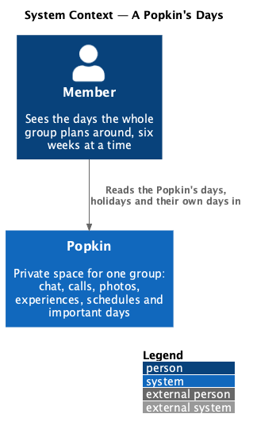
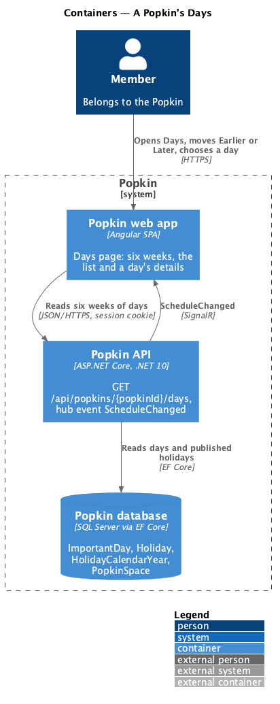
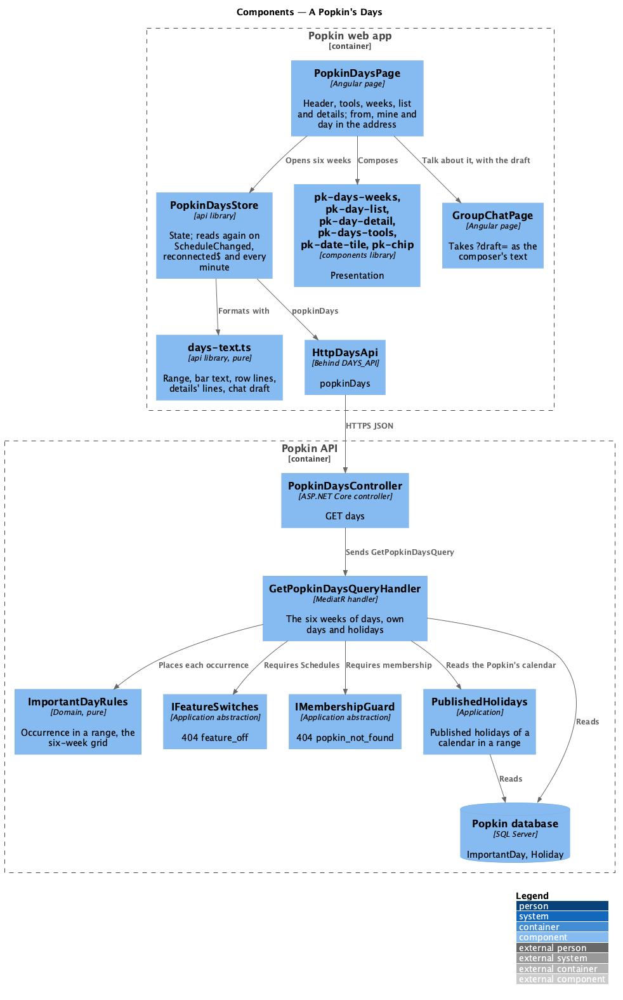
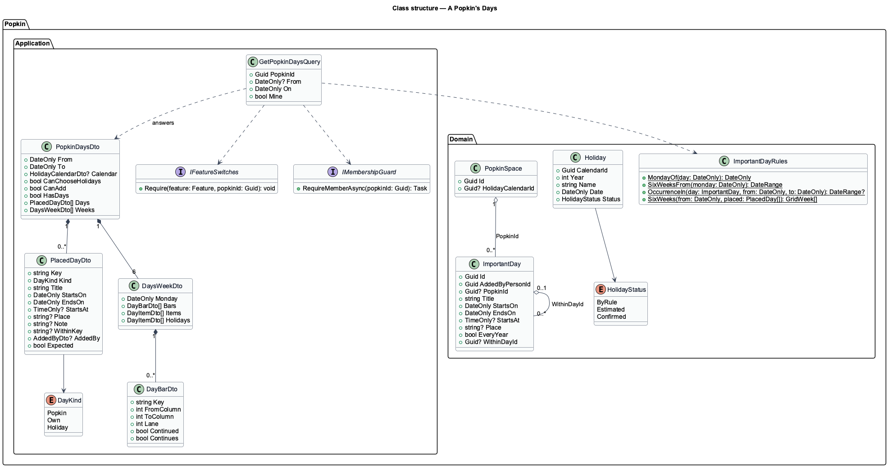
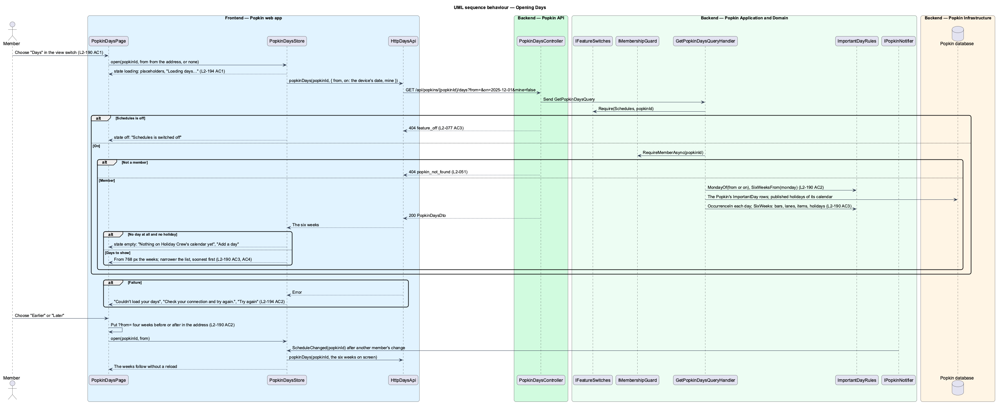
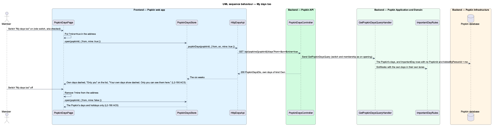
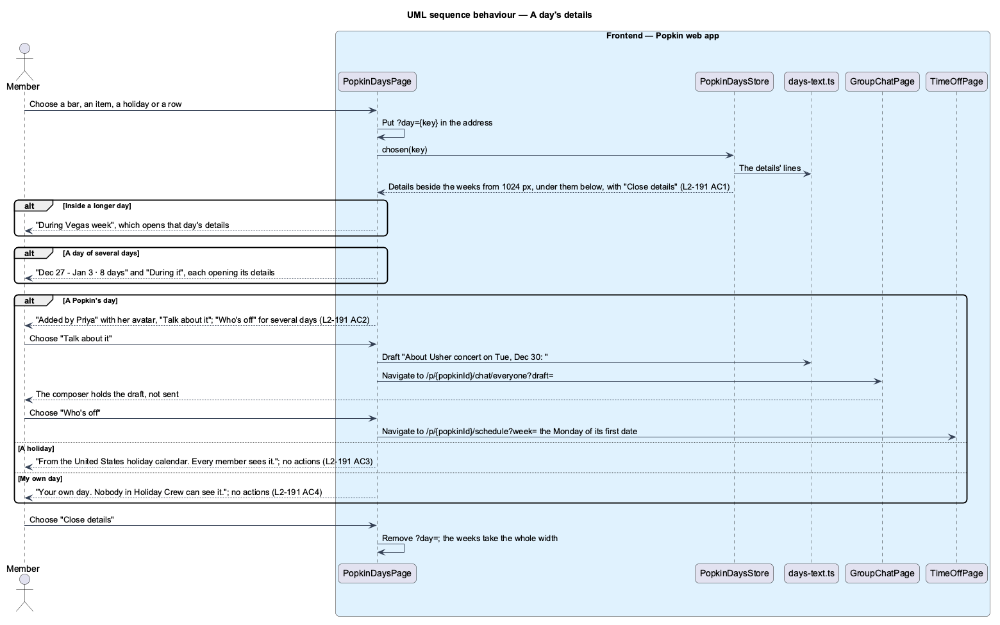

# A Popkin's Days

## Overview

Popkin is a platform for pop-up communities. When Schedules is on, the Schedule tab of a
*Popkin*, a private space for one group, has a third view beside
[Time off](../../schedules/time-off/README.md) and [This week](../../schedules/this-week/README.md):
**Days**, "What the whole group is planning around". It shows the group's important days six
weeks at a time, with the holidays the Popkin observes, and opens any of them to its details,
from which the group can talk about it in chat or see who is off.

- **important day** — a date, or a run of dates, that a person keeps, either to themselves or on
  one of their Popkins (L1-044); the designs and the screens call it a "day"
- **the Popkin's day** — an important day kept on the Popkin, which every member sees
- **own day** — an important day the member keeps to themselves, which only they see
- **day of several days** — an important day whose last date is after its first ("Vegas week",
  Dec 27 – Jan 3)
- **day inside a longer day** — an important day that sits within a day of several days
  ("Usher concert" during "Vegas week", L2-188)
- **holiday** — a date of the holiday calendar the Popkin observes
  ([A Popkin's holidays](../popkin-holidays/README.md))
- **six weeks** — the 42 dates Days shows, Monday to Sunday, from this week's Monday on
- **details** — one day's facts and actions, beside the weeks or under them

Days is one of the Important days designs (L1-044), which share one architecture: the entity
`ImportantDay`, the pure rules `ImportantDayRules` and the controllers in
[the shared section](../../README.md#important-days-and-holiday-calendars). Days exists only
while Schedules is on for the Popkin ([Schedules switch](../../schedules/schedules-switch/README.md),
[Choose a Popkin's features](../../popkins/choose-features/README.md)). Adding a day belongs to
[Add a day](../add-a-day/README.md), deleting one from the details to
[Edit and delete a day](../edit-and-delete-a-day/README.md), and who may read which day to
[Who sees a day](../who-sees-a-day/README.md).

## Description

### Screens and states

The mocks are `docs/mocks/pages/popkin-days/`, drawn on the cast of L2-182: Mara, the Host of
Holiday Crew 🎄 (Leaf, 6 members), on Monday 1 December 2025.

- `default.html` — the view switch ("Days" current, "Time off", "This week"), "Days", "What the
  whole group is planning around" and "Add a day"; "Earlier", "Dec 1 – Jan 11" and "Later";
  "Holidays" with the Host's choice ([A Popkin's holidays](../popkin-holidays/README.md)) and
  "My days too" off. From 768 px, six weeks (`ul.days-weeks__list`, "Six weeks of days"), each
  `li.days-week` named "Week of Dec 1": Saturday and Sunday shaded (`days-week__cell--weekend`),
  today `aria-current="date"`, "Dec" and "Jan" under the first date of each month, the holidays
  "Christmas Eve", "Christmas Day", "New Year’s Eve" and "New Year’s Day" under their dates
  (`days-week__holiday`), "Secret Santa draw" under Saturday 6 with "7 pm", the bar "Vegas week"
  over Sat 27 and Sun 28 (`days-week__bar--start`, named "Vegas week, Dec 27 – Jan 3") and
  "Vegas week, continued" over Mon 29 to Sat 3 (`--end`), and "Usher concert" with "8 pm"
  under Tue 30, edged (`days-week__item--inside`). Narrower, the list "Coming up"
  (`ul.day-list`): a date tile ("Sat", "6"), the title and a line ("7 pm · Video call",
  "Holiday", "Dec 27 – Jan 3 · Las Vegas"), with "Usher concert", "New Year’s Eve" and "New
  Year’s Day" in `ul.day-list__inside` "During Vegas week". "Usher concert" is chosen: its
  details read "During Vegas week", "Usher concert", "Close details", "Tue, Dec 30 · 8 pm",
  "Dolby Live, Park MGM", a note, "Added by Priya" with her avatar and "Talk about it". The
  "Delete" beside it is the Host's ([Edit and delete a day](../edit-and-delete-a-day/README.md)).
- `vegas.html` — "Vegas week" chosen: "Dec 27 – Jan 3 · 8 days", "Las Vegas", a note, "During
  it" (`ul.day-detail__inside`: "Tue 30 Usher concert", "Wed 31 New Year’s Eve", "Thu 1 New
  Year’s Day", each opening its details), "Added by Dev", "Talk about it" and "Who’s off".
- `holiday.html` — "Christmas Day" chosen: "Thu, Dec 25" and "From the United States holiday
  calendar. Every member sees it."; no actions (L2-191 AC3).
- `mine.html` — "My days too" on (`role="switch"`, `aria-checked="true"`) and "Your own days show
  dashed. Only you can see them here."; Mara's own days dashed (`days-week__item--mine`,
  `days-week__bar--mine`, `date-tile--mine`), "School winter break" as a bar in its own lane,
  "Only you" on each own row of the list; "Picture day at Lincoln Elementary" chosen: "Thu,
  Dec 4 · 8:15 am", its place, a note and "Your own day. Nobody in Holiday Crew can see it.";
  no actions (L2-191 AC4).
- `member.html` — a member who is not the Host: "Holidays United States" as text, and the
  details of "Usher concert" with "Talk about it" alone.
- `closed.html` — nothing chosen: the weeks take the whole width and no details show.
- `holidays-off.html` — the Popkin observes no calendar: no holiday on the weeks or the list.
- `loading.html` — placeholders (`pk-skeleton`) and "Loading days…" for assistive technology
  only (`role="status"`, L2-194 AC1).
- `empty.html` — holidays off and no day added: "Nothing on Holiday Crew’s calendar yet", "Add
  the days the group is planning around: a trip, a party, a deadline. Everyone in Holiday Crew
  sees them." and "Add a day"; the range, "Holidays" and "My days too" stay.
- `error.html` — `role="alert"`: "Couldn’t load your days", "Check your connection and try
  again." and "Try again" (L2-194 AC2); the view switch and "Add a day" stay.

### Form factors

From 768 px the six weeks show as rows of seven columns, and they scroll sideways inside their
own region below 520 px of width (`min-width: 32.5rem`); the page does not (L2-190 AC3, L2-058).
Below 768 px the list replaces them (`only-m-up`, `only-below-m`, L2-190 AC4). From 1024 px the
details are an `aside` beside the weeks, 20 rem wide; below that they are a region under the
weeks or the list (`only-l-up`, `only-below-l`, L2-191 AC1). The tabs follow `pk-popkin-nav`
(L2-058 AC8). Nothing reads the viewport width.

### API

- `GET /api/popkins/{popkinId}/days?from=2025-12-01&on=2025-12-01&mine=false` → `200`
  `PopkinDaysDto`:
  - `from` — the Monday of the first week; another date is moved back to its Monday, and without
    `from` it is the Monday of `on` (L2-190 AC2). `to` — the Sunday of the sixth week.
  - `calendar` — the holiday calendar the Popkin observes (`id`, `name`) or null, and
    `canChooseHolidays` — the viewer is the Host of an active Popkin
    ([A Popkin's holidays](../popkin-holidays/README.md)).
  - `canAdd` — the Popkin is active; "Add a day" shows only then.
  - `hasDays` — the Popkin has at least one day, at any date; `false` with no holiday in the six
    weeks is the empty state.
  - `days` — every day with a date in the six weeks, soonest first, each a `key`, a `kind`
    (`Popkin`, `Own` or `Holiday`), a `title`, `startsOn`, `endsOn`, `startsAt` ("19:00") or
    null, `place` or null, `note` (null, gap 142), `withinKey` (the longer day it sits inside)
    or null, `addedBy` (`firstName` and `avatar`: `initials`, `accent`, `photoUrl`) for a
    Popkin's day, and `expected` for a holiday whose date is an estimate (L2-192 AC4). A day
    kept "Every year" appears on its date in the six weeks.
  - `weeks` — six, each a `monday` and the placements `ImportantDayRules.SixWeeks` computes:
    `bars` (`key`, `fromColumn` and `toColumn` 1 to 7, `lane`, `continued` when the bar is not
    the day's first week, `continues` when the day goes on after the week), `items` (`key` and
    `column`, by time, an all-day day first) and `holidays` (`key` and `column`).
  - Only the adder sees the people a day is about (gap 141); `days` carries none.
- `mine=true` adds the viewer's own days (L2-190 AC5). The handler reads them by
  `AddedByPersonId`, so no other member's own day is ever read.
- Refusals: `401` without a session; `404` `feature_off` while Schedules is off for the Popkin,
  checked first (L2-077 AC3); `404` `popkin_not_found` for anyone not a member (L2-051); `400`
  `invalid_date` on `on` when it is missing or not a date, and on `from` when it is not a date.
- Hub: `ScheduleChanged(popkinId)` after any change to a Popkin's day or to its holiday calendar.
  Its recovery read is the `GET` of the six weeks on screen.

### Frontend (`frontend/projects/`)

- **`PopkinDaysPage`** (`/p/:popkinId/schedule/days`, `data-page="popkin-days"`, `shell: 'app'`,
  title "Days · Popkin", providers `PopkinFrame` and `PopkinDaysStore`) — composes
  `pk-app-screen`, `pk-plan-header` with `pk-view-nav`, "Add a day", the tools, the weeks, the
  list, the details and `pk-popkin-nav` with `current="schedule"`. The address keeps the six
  weeks (`?from=2025-12-29`), "My days too" (`?mine=true`) and the chosen day (`?day={key}`), so
  a reload keeps them. "Add a day" navigates to Add a day with the Popkin chosen;  it opens
  `/days/new?popkin={popkinId}`, the parameter [Add a day](../add-a-day/README.md) reads.
- **`TimeOffPage`, `ThisWeekPage`** — their `views` gain "Days" (`/p/:popkinId/schedule/days`).
  The order is the mock's: "Days", "Time off", "This week" (L2-190 AC1). The Schedule tab still
  opens on Time off (L2-072 AC1).
- **`PopkinDaysStore`** (`api`, `days/popkin-days-store.ts`) — `open(popkinId, { from, mine })`,
  `earlier()`, `later()`, `state` (`loading`, `ready`, `empty`, `error`, `off`, `not-found`),
  the `view` and `chosen(key)`. It sends the device's date as `on`. It reads the six weeks again
  on `ScheduleChanged` for its Popkin, on `reconnected$` and every 60 seconds while open, so a
  switch turned off reaches an open screen within a minute (L2-077 AC4).
- **`days-text.ts`** (`api`, `days/`, pure, unit-tested) — the range ("Dec 1 – Jan 11"), "Week of
  Dec 1", a bar's text ("Vegas week" or "Vegas week, continued") and name ("Vegas week, Dec 27 –
  Jan 3"), a row's line ("7 pm · Video call", "Dec 27 – Jan 3 · Las Vegas", "Holiday", "Only
  you"), the details' date ("Tue, Dec 30 · 8 pm", "Dec 27 – Jan 3 · 8 days"), "During {title}",
  "Added by {first name}", the holiday line "From the {calendar} holiday calendar. Every member
  sees it.", the own line "Your own day. Nobody in {Popkin} can see it.", and the chat draft
  "About {title} on {when}: ". `{when}` is the details' date without its time ("Tue, Dec 30",
  "Dec 27 – Jan 3").
- **Details actions** — for a Popkin's day: "Talk about it" navigates to the Everyone thread
  (`/p/:popkinId/chat/everyone?draft=`), whose composer takes the draft as its text and sends
  nothing (`GroupChatPage.draft`, as This week does, L2-191 AC2); "Who’s off", for a day of
  several days only, navigates to Time off on the week of the day's first date
  (`/p/:popkinId/schedule?week=2025-12-22`). A holiday and an own day offer none (L2-191 AC3,
  AC4). "Close details" removes `?day=`.
- **`DAYS_API`** / **`HttpDaysApi`** (`api`, `days/days-api.ts`) — `popkinDays(popkinId, { from,
  on, mine })`, beside the calls of the other Important days designs.
- **Components** (`components`, each `name.ts`, `name.html`, `name.scss`, with a parity spec):
  - `pk-days-weeks` — the weekday heads and `ul.days-weeks__list` of six `li.days-week`, each with
    its cells, dates (`days-week__num`, `days-week__month`, `aria-current="date"`), holidays,
    bars (links, `days-week__bar--start`, `--end`, `--mine`) and items (links, `--inside`,
    `--mine`); a chosen bar or item has `aria-current="true"`. It takes the `weeks` and `days` of
    the view and emits nothing: every bar, item and holiday is a link to `?day=`.
  - `pk-day-list` — `ul.day-list` of `a.day-row` (`--holiday`, `--inside`) with a nested
    `ul.day-list__inside` named "During {title}".
  - `pk-day-detail` — `day-detail__head` with "During {title}" and the heading, "Close details"
    (`pk-icon-button`), `__when`, `__place`, `__note`, "During it" (`__inside`), `__by` with
    `pk-avatar`, and the slot `actions`. The page renders it twice, in the `only-l-up` aside and
    the `only-below-l` region, as the mock does.
  - `pk-date-tile` gains `kind` (`popkin`, `holiday`, `mine`) and `small`
    (`date-tile--popkin`, `--holiday`, `--mine`, `--sm`).
  - `pk-days-tools` — `days-tools__range` ("Earlier", the range, "Later", each a
    `pk-icon-button` link) and the slot `end` for "Holidays" and "My days too".
  - `pk-chip` gains a switch form (`button[pk-chip]` with `role="switch"` and `aria-checked`) for
    "My days too"; the mock's link stands in for it.
  - `pk-skeleton`, `pk-empty-state`, `pk-view-nav`, `pk-plan-header`, `pk-popkin-nav` as they
    are.

### Backend (`backend/src/`)

- **`PopkinDaysController`** (`Popkin.Api`, `api/popkins/{popkinId:guid}`) — `GET days` sends
  `GetPopkinDaysQuery`; `PUT holidays` belongs to [A Popkin's holidays](../popkin-holidays/README.md).
- **`GetPopkinDaysQuery`** (`PopkinId`, `From?`, `On`, `Mine`) / **`GetPopkinDaysQueryHandler`**
  (`Popkin.Application/ImportantDays/`) — `IFeatureSwitches.Require(Feature.Schedules, popkinId)`,
  then `IMembershipGuard.RequireMemberAsync`; reads the Popkin's `ImportantDay` rows, the
  viewer's own when `Mine`, and the published holidays of `PopkinSpace.HolidayCalendarId`
  (`PublishedHolidays`, [A Popkin's holidays](../popkin-holidays/README.md)); keeps those that
  occur in the six weeks (`ImportantDayRules.OccurrenceIn`); lays them out
  (`ImportantDayRules.SixWeeks`); and reads the adders' first names and avatars.
- **`ImportantDayRules`** (`Popkin.Domain`, pure, one test per case) — `MondayOf(day)`,
  `SixWeeksFrom(monday)`, `OccurrenceIn(day, from, to)` (a day kept "Every year" moved to the
  year of the range; a 29 February in a year without one, `<TO SUPPLY>` in the shared rules), and
  `SixWeeks(from, placed)`: a bar per week a day of several days touches, cut at Monday and
  Sunday, its lane the lowest free one by first date; single days as items by time; holidays
  under their dates.
- **What sits inside what** — a day's `WithinDayId` places it inside its longer day. A holiday
  sits inside the Popkin's day of several days whose dates hold it, as the mock lists "New
  Year’s Eve" during "Vegas week"; an own day is never a longer day for anything else.
- **`PopkinDaysDto`**, **`PlacedDayDto`**, **`DaysWeekDto`** — the answer above.

### Decisions

- `on` is required, as the shared rule asks of every read that depends on today; the server's
  date is never used for today.
- A day of several days that starts before the six weeks reads "{title}, continued" in the first
  week shown, since that week is after its first.
- The six weeks, "My days too" and the chosen day are in the address, as Time off keeps its
  week.
- "Who’s off" opens Time off on the week of the day's first date.
- The details are a region of the page, not a dialog; "Close details" removes the choice.

### Open points

- Which of the six weeks' days the list shows below 768 px: L2-190 AC4 says "from today on",
  which leaves "Earlier" on a phone with nothing before today. `<TO SUPPLY>`.
- How an estimated holiday "reads as expected" on Days (L2-192 AC4): no Days mock draws it, so
  the words on a holiday and in its details are `<TO SUPPLY>`.
- How many columns a bar needs before it shows its place ("with its place when there is room",
  L2-190 AC3), `<TO SUPPLY>`; the mock's bars show only the title.
- A holiday inside two overlapping days of several days: which one it is listed under is
  `<TO SUPPLY>`.
- The empty state's copy names "a trip", a word AGENTS.md keeps out of Popkin.
- People a day is about are not shown on Days (gap 141), and no day has a note yet (gap 142).

## Requirements

| L2 ID | Refines (L1) | Requirement |
|-------|--------------|-------------|
| `L2-190` | `L1-044` | A Popkin's Days: Days is a view of a Popkin's Schedule tab: the days the whole group plans around, six weeks at a time. |
| `L2-191` | `L1-044` | A day's details: a day chosen on Days shows its details beside or under the weeks, with who added it, "Talk about it" and "Who's off"; a holiday and the member's own day offer no actions. |
| `L2-194` | `L1-044` | Loading and errors in Important days: placeholders and "Loading days…" while Days loads, and "Couldn't load your days. Check your connection and try again." with "Try again" (AC1, AC2). |
| `L2-077` | `L1-019` | A feature that is off: A feature that is off is not there. |
| `L2-051` | `L1-012` | Popkins are private to their members: Membership decides everything a person sees. |

## Diagrams

The system context: a member reads the group's days, and their own beside them, in Popkin.

The web app reads six weeks from the API, which reads the database and tells the other members
through the hub when a day or the holiday calendar changes.

The page, its store, the pure text helpers and the components on the web side; the controller,
the query handler, the switch, the guard and the pure rules on the API side.

`ImportantDay` belongs to a person and, for a Popkin's day, to the Popkin; `ImportantDayRules`
places each occurrence in the six weeks the DTO carries.

Opening Days, moving four weeks at a time, and following a change without a reload.

Switching "My days too" on and off.

Choosing a day, its details, and taking it to chat or to Time off.

