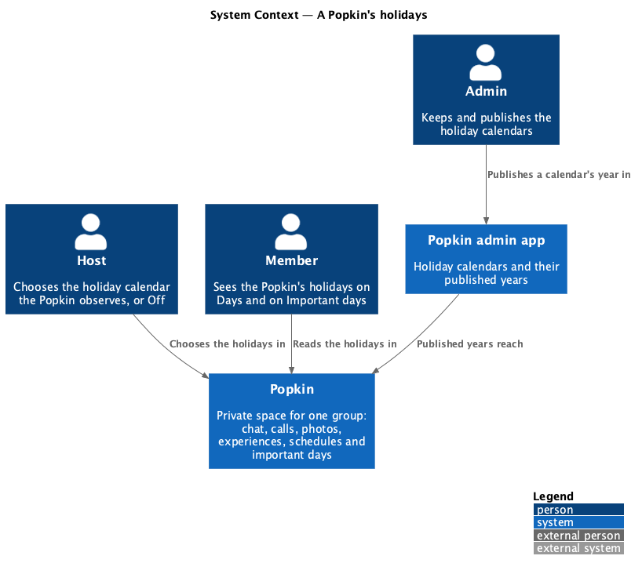
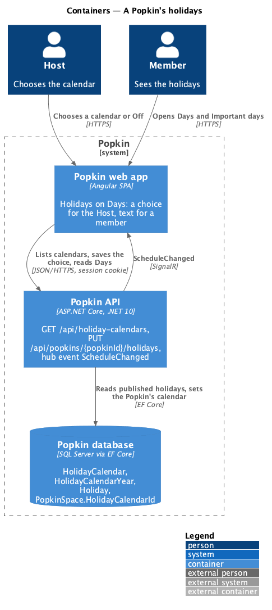
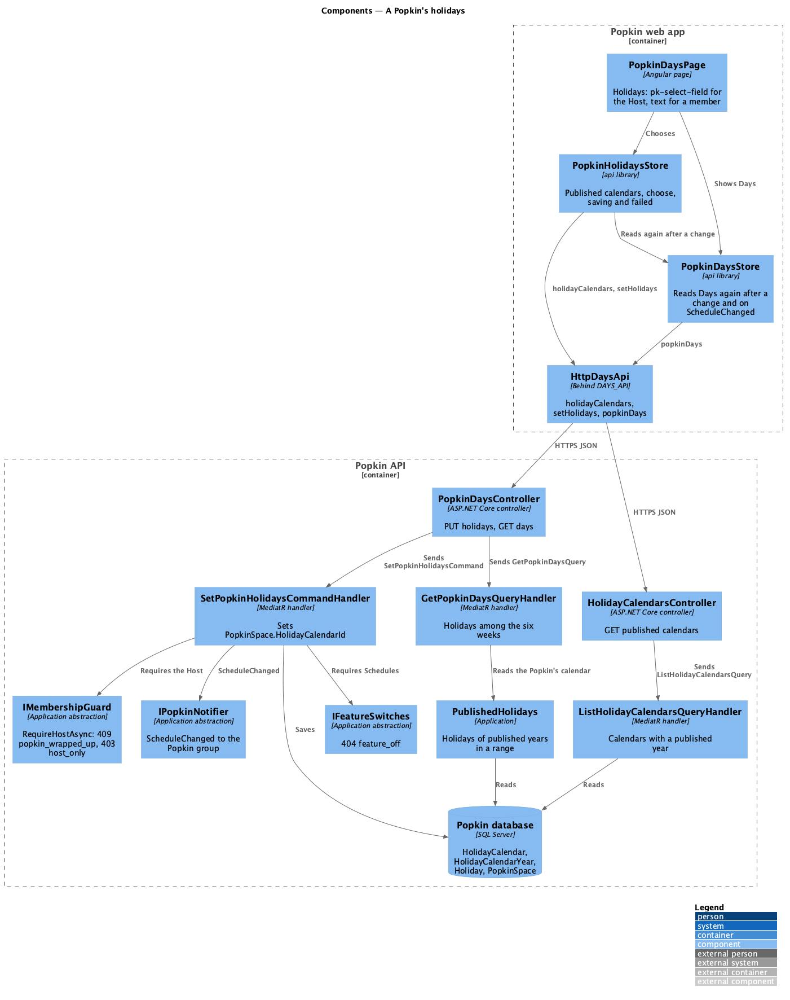
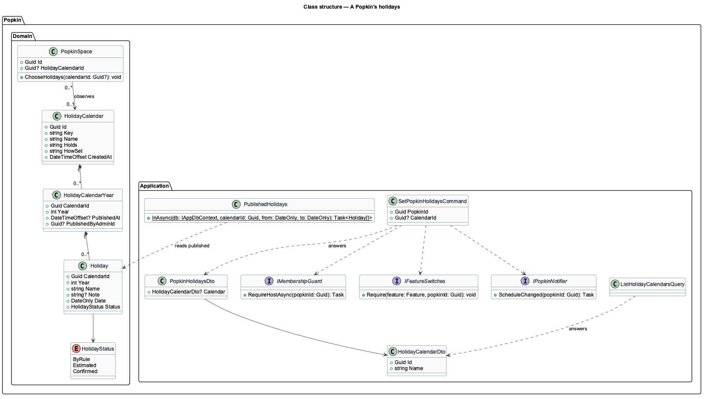
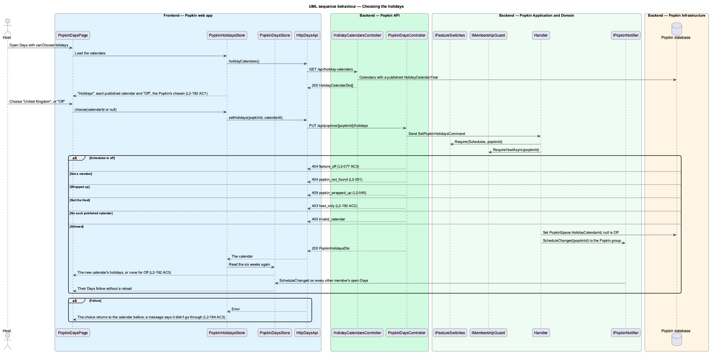
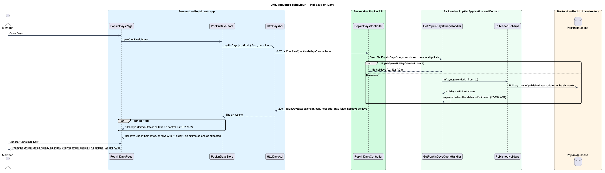

# A Popkin's holidays

## Overview

Popkin is a platform for pop-up communities. A *Popkin*, a private space for one group, observes
one holiday calendar, or none (L2-192). The Host chooses it under "Holidays" on
[Days](../popkin-days/README.md), the Schedule tab's view of the days the whole group plans
around; every other member sees the choice and cannot change it. The chosen calendar's holidays
then show for every member, on Days and on each member's Important days.

- **holiday calendar** — a named set of holidays an admin keeps in the admin app, such as
  "United States" or "Islamic holidays" ([Holiday calendars](../../admin-platform/holiday-calendars/README.md), L2-196)
- **published year** — a year of a calendar an admin has published
  ([Confirm and publish holiday dates](../../admin-platform/publish-holiday-dates/README.md),
  L2-197); people and Popkins see only published years
- **holiday** — one dated entry of a published year ("Christmas Day", Thu, Dec 25)
- **estimated holiday** — a holiday whose date is still an estimate, such as one set by the moon
  that an admin has not yet confirmed; members see it as "expected" (L2-192 AC4)
- **Off** — the choice of no calendar: the Popkin shows no holiday

The design is one of the Important days designs (L1-044) and keeps
[the shared decisions](../../README.md#important-days-and-holiday-calendars): the entities
`HolidayCalendar`, `HolidayCalendarYear` and `Holiday`, the Popkin's
`PopkinSpace.HolidayCalendarId?`, the controllers `PopkinDaysController` and
`HolidayCalendarsController`, and `ScheduleChanged` after a change. The choice lives on Days,
so it exists only while Schedules is on for the Popkin
([Schedules switch](../../schedules/schedules-switch/README.md)).

## Description

### Screens and states

The mocks are the `docs/mocks/pages/popkin-days/` states, on the cast of L2-182: Mara, the Host
of Holiday Crew 🎄, on Monday 1 December 2025.

- `default.html` — the Host: in `days-tools__end`, the label "Holidays" and a `select` with
  "United States" chosen, then "United Kingdom", "Canada", "Islamic holidays", "Jewish
  holidays", "Hindu festivals", "Lunar New Year & festivals" and "Off" (L2-192 AC1). The six
  weeks show "Christmas Eve", "Christmas Day", "New Year’s Eve" and "New Year’s Day" under their
  dates, and the list below 768 px shows them as rows with "Holiday" (L2-192 AC3).
- `member.html` — a member who is not the Host: "Holidays" and "United States" as text
  (`
`, the name in bold), with no control (L2-192 AC2).
- `holiday.html` — "Christmas Day" chosen: "Thu, Dec 25" and "From the United States holiday
  calendar. Every member sees it."; no actions (L2-191 AC3).
- `holidays-off.html` — "Off": no holiday on the weeks, on the list or in "During it"; the mock
  notes "With holidays off, no holidays show for any member, here or on Important days."
- `empty.html` — holidays off and no day added: the empty state of
  [Days](../popkin-days/README.md).
- `docs/mocks/pages/important-days/default.html` and `popkin.html` — on Important days, the
  Popkin's holidays are rows with "Holiday" and the Popkin's tag "🎄 Holiday Crew".
- No mock draws an estimated holiday on Days or Important days, a member's view of "Off", or a
  change that fails.

### Form factors

The choice sits in the Days tools at every width, after the range and before "My days too"; it
wraps under the range on a narrow screen (`days-tools`). Nothing reads the viewport width.

### API

- `GET /api/holiday-calendars` → `200` `HolidayCalendarDto[]`: each calendar with at least one
  published year, `id` and `name` (L2-192 AC1). Their order is `<TO SUPPLY>`; the mock's is
  "United States", "United Kingdom", "Canada", "Islamic holidays", "Jewish holidays", "Hindu
  festivals", "Lunar New Year & festivals". The list names no person and no Popkin.
- `PUT /api/popkins/{popkinId}/holidays` with `{ calendarId }`, a calendar's `id` or `null` for
  "Off" → `200` `PopkinHolidaysDto` (`calendar`: `id` and `name`, or null).
- Refusals, in this order: `401` without a session; `404` `feature_off` while Schedules is off
  for the Popkin (L2-077 AC3); `404` `popkin_not_found` for anyone not a member (L2-051); `409`
  `popkin_wrapped_up` (L2-045); `403` `host_only` for a member who is not the Host
  (L2-192 AC2); `400` `invalid_calendar` on `calendarId` for a calendar that does not exist or
  has no published year. The write is counted with messages (`RateLimitPolicyNames.Messages`),
  as setting the event is.
- `GET /api/popkins/{popkinId}/days` ([Days](../popkin-days/README.md)) answers the Popkin's
  `calendar` and `canChooseHolidays` (the viewer is the Host of an active Popkin), and the
  holidays in the six weeks as days of kind `Holiday`, each with `expected` when its status is
  `Estimated` (L2-192 AC3, AC4).
- Hub: `ScheduleChanged(popkinId)` after a change. Its recovery read is the `GET` of Days on
  screen. Important days, a person's own screen, reads the holidays again when it next loads.

### Frontend (`frontend/projects/`)

- **`PopkinDaysPage`** — with `canChooseHolidays`, puts `pk-select-field` (`variant="toolbar"`,
  `fieldId="holidays"`, label "Holidays") in the tools' `end` slot, its options the published
  calendars and "Off", the Popkin's own calendar chosen (L2-192 AC1). Without it, the label and
  the calendar's name as text, `text-sm` and `text-muted` utilities only (L2-192 AC2). A member
  sees "Off" as the name when the Popkin observes none, a word no mock draws.
- **`PopkinHolidaysStore`** (`api`, `days/popkin-holidays-store.ts`) — `calendars` (read once
  when the Host opens Days), `choose(calendarId | null)` and `state` (`idle`, `saving`,
  `failed`). On success the Days store reads the six weeks again. On failure the choice returns
  to the calendar before, and a message says the change didn't go through (L2-194 AC3); its
  words are `<TO SUPPLY>`, since no mock draws it.
- **`days-text.ts`** (`api`, pure, unit-tested) — the holiday's line "Holiday" and its details
  "From the {calendar} holiday calendar. Every member sees it.", and the words for an
  estimated holiday, `<TO SUPPLY>` (L2-192 AC4).
- **`DAYS_API`** / **`HttpDaysApi`** — `holidayCalendars()` and `setHolidays(popkinId,
  calendarId | null)`, beside `popkinDays`.
- **Important days** ([The Important days list](../important-days-list/README.md)) shows the
  holidays of each Popkin the person belongs to, with the Popkin's tag, from the same reader.

### Backend (`backend/src/`)

- **`PopkinSpace.HolidayCalendarId`** (Domain, `Guid?`) — null is "Off", and a new Popkin starts
  with null (gap 143). `ChooseHolidays(calendarId)` sets it.
- **`HolidayCalendar`**, **`HolidayCalendarYear`**, **`Holiday`** (Domain) — as the shared
  section defines them; the admin designs own their writes.
- **`HolidayCalendarsController`** (`Popkin.Api`, `api/holiday-calendars`) — `GET` sends
  `ListHolidayCalendarsQuery`, whose handler reads each calendar with a `HolidayCalendarYear`
  whose `PublishedAt` is set.
- **`PopkinDaysController`** (`api/popkins/{popkinId:guid}`) — `PUT holidays` sends
  `SetPopkinHolidaysCommand`.
- **`SetPopkinHolidaysCommand`** (`PopkinId`, `CalendarId?`) / handler
  (`Popkin.Application/ImportantDays/`) — `IFeatureSwitches.Require(Feature.Schedules,
  popkinId)`, then `IMembershipGuard.RequireHostAsync`, which refuses a wrapped-up Popkin with
  `409` and another member with `403`; checks the calendar has a published year; sets the
  Popkin's calendar; saves; sends `ScheduleChanged`; answers `PopkinHolidaysDto`.
- **`PublishedHolidays`** (Application) — `InAsync(db, calendarId, from, to)`: the `Holiday`
  rows of the calendar whose year is published and whose date falls in the range, read from the
  database on each request, so a publish reaches every member on their next read (L2-196 AC2).
  `GetPopkinDaysQueryHandler` and the Important days list both use it.
- No log, metric dimension or span carries a calendar's or a holiday's name.

### Decisions

- The choice is saved as soon as the Host picks it; there is no "Save".
- Only a calendar with a published year can be chosen, and the API refuses any other with
  `400` `invalid_calendar`.
- The Host's choice needs Schedules on, as everything on Days does.
- A change sends `ScheduleChanged` and adds no notification; no requirement asks one.

### Open points

- Whether a Popkin's holidays show on Important days while Schedules is off for that Popkin:
  the choice cannot then be changed, and L2-192 AC3 does not say. `<TO SUPPLY>`.
- How an estimated holiday reads "expected" on Days and on Important days. `<TO SUPPLY>`.
- On Important days, a holiday of two Popkins that observe the same calendar: one row or two.
  `<TO SUPPLY>`, for [The Important days list](../important-days-list/README.md).
- The order of the published calendars in the choice. `<TO SUPPLY>`.
- A calendar whose published years end before the dates on screen shows no holiday there;
  L2-196 AC3 warns the admins, and Days says nothing to members.

## Requirements

| L2 ID | Refines (L1) | Requirement |
|-------|--------------|-------------|
| `L2-192` | `L1-044` | A Popkin's holidays: A Popkin observes one holiday calendar, or none. |
| `L2-077` | `L1-019` | A feature that is off: A feature that is off is not there. |
| `L2-045` | `L1-011` | A wrapped-up Popkin is read-only: Nothing new is added to a Popkin that has ended. |
| `L2-051` | `L1-012` | Popkins are private to their members: Membership decides everything a person sees. |

## Diagrams

The system context: the Host chooses the Popkin's holiday calendar, every member sees its
holidays, and admins publish the calendars in the admin app.

The web app lists the published calendars and saves the Host's choice through the API, which
tells the other members through the hub.

The page and the holidays store on the web side; two controllers, two handlers, the switch, the
guard and the published-holidays reader on the API side.

A Popkin observes one calendar or none; a calendar has years, and a published year's holidays
are what members see.

The Host choosing a calendar or "Off", and another member's Days following without a reload.

A member seeing the holidays on Days, read-only, with an estimated date as expected.

