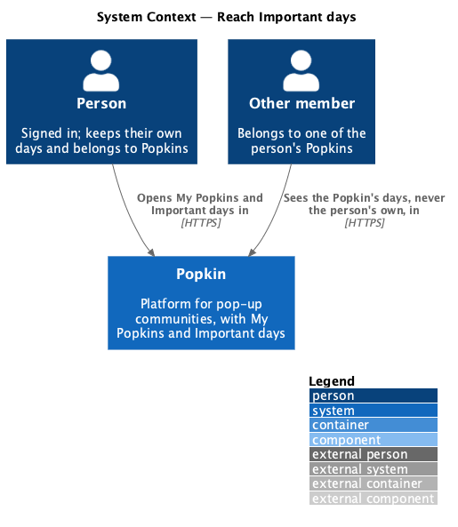
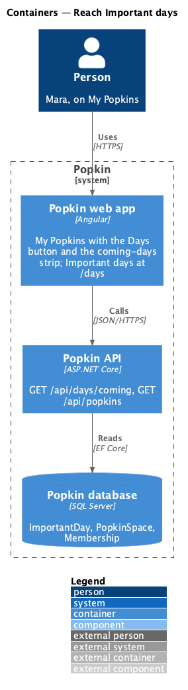
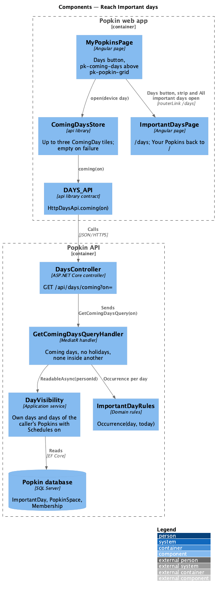
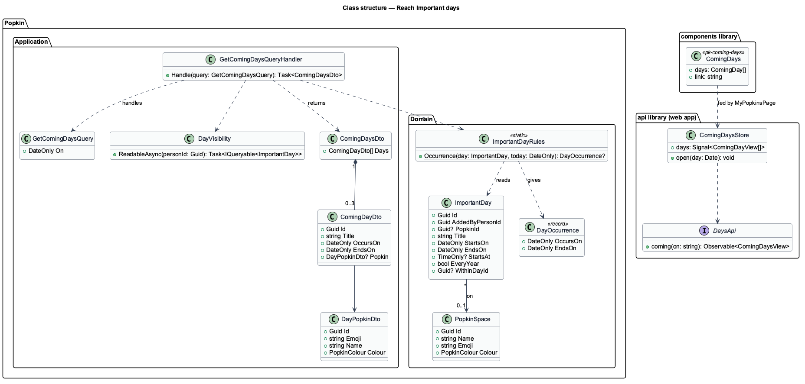
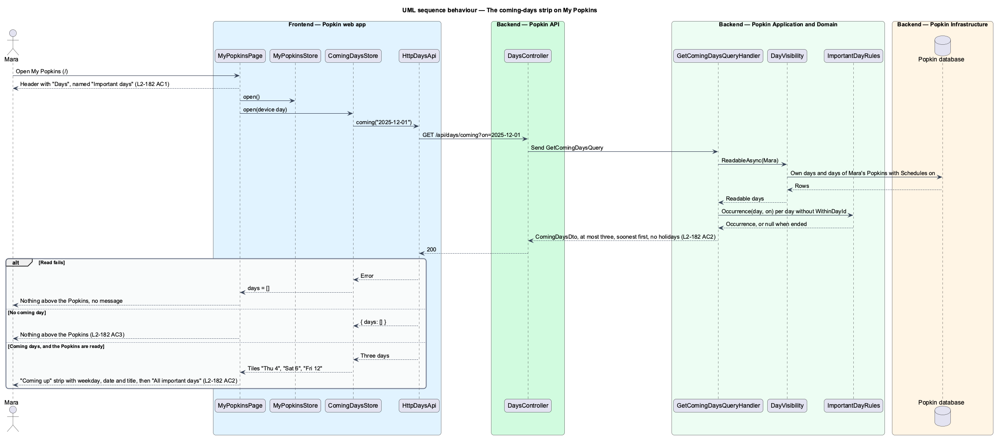
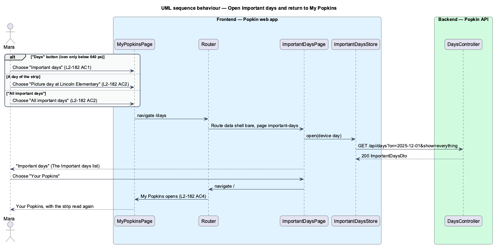

# Reach Important days

## Overview

Important days is the one place where a signed-in person keeps the days that matter, their own
and those of their Popkins, with the holidays their Popkins observe (L1-044). This design is the
way in: My Popkins, the person's starting screen ([My Popkins](../../popkins/my-popkins/README.md)),
gains a "Days" button in its header and, above the Popkins, a strip of the next few days. Each
leads to Important days at `/days`, whose "Your Popkins" leads back. The list itself is
[The Important days list](../important-days-list/README.md); who may see each day is
[Who sees a day](../who-sees-a-day/README.md).

- **day** — `ImportantDay` the person may read: one of their own, with no Popkin, or one on a Popkin they belong to
- **own day** — day with no `PopkinId`, read by its adder alone ("Only you")
- **Popkin's day** — day with a `PopkinId`, read by every member of that Popkin
- **holiday** — date of the holiday calendar a Popkin observes, in a published year (L2-192)
- **day inside another** — day whose `WithinDayId` names a longer day it sits inside (L2-188)
- **coming day** — day that has not ended by the device day, is not a holiday and is not inside another
- **coming-days strip** — up to three coming days, soonest first, above the Popkins on My Popkins, followed by "All important days"
- **device day** — the person's today, `yyyy-MM-dd`, sent by the web app as `?on=` ([Important days and holiday calendars](../../README.md#important-days-and-holiday-calendars))

The screens are drawn on the requirements' cast: Mara on Monday 1 December 2025, in Holiday Crew
🎄 (6 members, Mara its Host) and Tigers U9 Parents ⚽ (22 members) (L2-182). The rest of My
Popkins keeps its September cast; only the strip is in December.

## Description

### Screens and states

`docs/mocks/pages/my-popkins/coming-up.html` (on the mocks branch until PR #103 merges, gap
148), route `/`, data `{ shell: 'bare', page: 'my-popkins' }`:

- **"Days" button.** The header holds, between "New Popkin" and "Contacts", a quiet link with the
  calendar-heart icon and the text "Days", named "Important days" for assistive technology
  (`aria-label`). On screens narrower than 640 px (XS) the mock draws a second link, an icon
  button named and titled "Important days", in its place (L2-182 AC1). Both open `/days`.
- **Coming-days strip.** Under the heading "Your Popkins" and above the Popkin cards, a list named
  "Coming up" (`coming-days`) of up to three links (`coming-days__day`). Each holds a date tile
  (`date-tile`, weekday over date: "Thu" / "4") and the day's title ("Picture day at Lincoln
  Elementary"). An own day's tile is `date-tile--mine`; a Popkin's day's tile is
  `date-tile--popkin` in the Popkin's colour (`data-accent`). After the list, the accent text link
  "All important days" with a chevron (L2-182 AC2). Each of the four opens `/days`.
- **No coming day.** Nothing shows above the Popkins: no strip, no heading and no "All important
  days" (L2-182 AC3). The default mocks of My Popkins (`default.html`, `active-only.html`) are
  this state.

`docs/mocks/pages/important-days/default.html` (and every other state of Important days):

- The top bar starts with the quiet button "Your Popkins", which opens My Popkins (`/`)
  (L2-182 AC4), and ends with the primary "Add a day" ([Add a day](../add-a-day/README.md)).

The tile's date is the day's occurrence: its `StartsOn`, or for a day kept every year its next
occurrence on or after the device day. A day of several days that has begun and not yet ended is
still a coming day; its tile shows its first date (`<TO SUPPLY>` whether the tile shows the first
date or today, new open question 1 below).

### Rulings this design takes

- **Which days.** The strip reads the same days the list of Important days shows under
  "Everything" ([Who sees a day](../who-sees-a-day/README.md)): the person's own days and the days
  of every Popkin they belong to (`Membership.LeftAt` null) whose Schedules are on, less holidays
  and days inside another (L2-182 AC2). A Popkin's day therefore never shows on the strip of
  someone outside it (L2-195 AC2).
- **States of My Popkins.** The strip shows only while My Popkins shows its list (`ready`). It is
  absent while the Popkins load, when they fail, when the person is offline with a saved list, and
  in the empty state "No Popkins yet" (`<TO SUPPLY>` for the empty state: L2-182 AC2 places the
  strip "above the Popkins", and no mock draws it without Popkins, new open question 2 below).
- **A failed read is quiet.** The strip is extra to My Popkins: when its read fails, nothing shows
  above the Popkins and My Popkins reads as without it, as "Contacts" does when its summary fails
  (`contactsOpen`). No message, no retry.
- **One read, not live.** The strip is read once each time My Popkins opens. A day added or
  changed on another device, or by another member, shows on the next open. No hub event reaches
  it (shared section: a person's own days send no event).
- **The two links of the header button.** The mock draws a text link hidden below 640 px
  (`only-s-up`) and an icon-only link shown only below 640 px (`only-below-s`). The library has no
  `only-below-s` utility (`components/src/lib/styles/ui.css` has `only-below-m` and
  `only-below-l`); the first change that needs it adds it, beside the others. Contacts in the same
  header is one link whose text alone is hidden below 640 px; whether Days follows the mock's two
  links or Contacts' one is `<TO SUPPLY>` by the mocks' owner (new open question 3 below). The
  design follows the mock.

### API

`DaysController` (`Popkin.Api/Controllers/DaysController.cs`, `[Route("api/days")]`), behind the
default authenticated policy; the action sends one MediatR request.

- `GET /api/days/coming?on={device day}` — `200` `ComingDaysDto` `{ days: ComingDayDto[] }`, at
  most three, soonest first: `id`, `title`, `occursOn` (`DateOnly`), `endsOn` (`DateOnly`) and
  `popkin` (`DayPopkinDto` `{ id, emoji, name, colour }`, null for an own day). Ties on the same
  date are ordered by `StartsAt` (all-day first), then by title (`<TO SUPPLY>` confirm the order
  of ties, which no requirement gives). A person with no coming day gets `{ days: [] }`.
  Refusals: `400` `invalid_date` for an `on` that is not `yyyy-MM-dd`; `401` without a session.
- The answer carries no place, time, note or people: the strip shows none of them.

### Backend

- **`GetComingDaysQuery`** (`Popkin.Application/ImportantDays/Coming/`) — `DateOnly On`.
- **`GetComingDaysQueryHandler`** — reads the readable days of the caller through
  `DayVisibility.ReadableAsync(personId)` ([Who sees a day](../who-sees-a-day/README.md)), keeps those
  with no `WithinDayId`, computes each occurrence with `ImportantDayRules.Occurrence(day, on)`,
  drops a day whose occurrence has ended before `on` (null), orders by occurrence and takes three.
  It reads no holiday table. It joins `PopkinSpace` for the emoji, name and colour of a Popkin's
  day.
- **`ImportantDayRules.Occurrence(day, today)`** (Domain, shared) — the occurrence of a day on or
  after `today`: `StartsOn`..`EndsOn` while `EndsOn` is on or after `today`; for a day kept every
  year, the next round of its day and month; null otherwise. Tested one case per row
  ([The Important days list](../important-days-list/README.md)).
- **`ComingDaysDto`**, **`ComingDayDto`**, **`DayPopkinDto`** (Application) — the answer above.
  `DayPopkinDto` is shared with the list.
- **Telemetry.** The route is recorded as `/api/days/coming`; the query string, and with it the
  device day, is not recorded. No log, metric dimension or span carries a day's title (ADR 0012).

### Frontend (Popkin web app)

- **`MyPopkinsPage`** (`pages/my-popkins/my-popkins.page.ts` and `.page.html`, built) — gains the
  "Days" links in the header (`a pk-button variant="quiet" size="sm" class="only-s-up"
  routerLink="/days" aria-label="Important days"` with `svg pk-icon name="calendar-heart"`, and
  `a pk-icon-button class="only-below-s" icon="calendar-heart" label="Important days"
  routerLink="/days"`), and, inside the `@default` (ready) case before `pk-popkin-grid`, one
  `pk-coming-days` when the strip has days. It provides `ComingDaysStore` and opens it with
  `MyPopkinsStore`. The icon `calendar-heart` is added to `components/src/lib/icon/icons.ts`
  (`<TO SUPPLY>` confirm the name; the mock draws Lucide's calendar-heart).
- **`ComingDaysStore`** (`frontend/projects/api/src/lib/api/days/coming-days-store.ts`) —
  `open(day = new Date())` reads `DAYS_API.coming(dayParam(day))`; `days` is a signal of
  `ComingDayView[]` (`top` "Thu", `day` "4", `title`, `mine`, `accent`), empty before the answer
  and after a failure. Unit tested: three days map to their tiles, an own day is `mine`, a
  Popkin's day takes `accentOf(colour)`, a failure leaves `days` empty.
- **`DAYS_API`** (`frontend/projects/api/src/lib/api/days/days-api.ts`, `DaysApi` and
  `HttpDaysApi`, shared) — `coming(on): Observable<ComingDaysView>`; the composition root
  (`app.config.ts`) provides `HttpDaysApi`.
- **`pk-coming-days`** (`components/src/lib/coming-days/`, new; `ul[pk-coming-days]` inside a
  `div` block `coming-days`) — input `days` (`ComingDay[]`: `top`, `day`, `title`, `mine`,
  `accent`) and `link`; renders the list named "Coming up", each item an `a.coming-days__day` with
  `pk-date-tile` and the title, and the accent `pk-link` "All important days" with its chevron.
  It keeps the mock's BEM classes. Parity spec `e2e/tests/parity/coming-days.spec.ts`
  (ADR 0008).
- **`pk-date-tile`** (built) — gains the inputs `kind` (`'mine' | 'popkin' | 'holiday'`, the
  modifiers `date-tile--mine`, `date-tile--popkin`, `date-tile--holiday`), `accent` and `small`
  (`date-tile--sm`), drawn on the mocks branch's `components.css`. The list uses `holiday` and
  `small`.
- **`ImportantDaysPage`** (`pages/important-days/important-days.page.ts`, route `/days`, data
  `{ shell: 'bare', page: 'important-days' }`, shared) — its top bar's first action is `a
  pk-button variant="quiet" size="sm" routerLink="/"` "Your Popkins" (L2-182 AC4). The page
  itself is [The Important days list](../important-days-list/README.md).
- **Words.** "Days", "Important days", "Coming up", "All important days" and "Your Popkins" live
  in `days-text.ts` (`frontend/projects/api/src/lib/api/days/`).
- **Component backlog.** `pk-coming-days` and the date tile's kinds are new rows of
  [the component backlog](../../../component-backlog.md) (`<TO SUPPLY>` row numbers).

### Tests

- API acceptance (`ComingDaysTests`, InMemory, ADR 0005): Mara's three coming days come soonest
  first, with Holiday Crew's emoji and colour on its day; a fourth is left out; a holiday, a day
  inside another and a day that ended yesterday are left out; a day of a Popkin Mara left, and
  another person's own day, are left out; `on=12/1/2025` answers `400` `invalid_date`.
- Direct tests of `ImportantDayRules.Occurrence`, one case per row, are owned by
  [The Important days list](../important-days-list/README.md).
- Playwright: `e2e/tests/reach-important-days.spec.ts` through the `MyPopkinsPage` and
  `ImportantDaysPage` page objects (`e2e/pages/`), on recorded responses: the "Days" button named
  "Important days" opens Important days; with three coming days the strip lists them with
  weekday, date and title and "All important days"; each opens Important days; with none,
  nothing shows above the Popkins; "Your Popkins" opens My Popkins. The icon-only button at the
  narrowest width is a region of `responsive.spec.ts` (written, not run, ADR 0006).
- Recording. Every recorded state of My Popkins gains an answer for `GET /api/days/coming`, or
  each existing My Popkins test fails on an unanswered request; `routes.ts` gains
  `myPopkinsComingUp`. Re-record against the local API in the same change.
- Unit tests: `ComingDaysStore` (above).
- Parity: `pk-coming-days` and the date tile's `mine`, `popkin` and `holiday` kinds.

### Open questions

1. A day of several days that has begun before the device day: which date its tile shows on the
   strip, and how soon the list reads it (also [The Important days list](../important-days-list/README.md)).
2. Whether the strip shows on My Popkins' empty state "No Popkins yet" for a person with own days
   and no Popkin.
3. Whether the header's "Days" is the mock's two links (with a new `only-below-s` utility) or one
   link whose text is hidden below 640 px, as Contacts is.

## Requirements

| L2 ID | Refines (L1) | Requirement |
|-------|--------------|-------------|
| `L2-182` | `L1-044` | Reach Important days: Important days opens from My Popkins, which also shows the next few days. (AC1–AC4) |

## Diagrams

### System context

The person reaches Important days from My Popkins; a Popkin's day reaches only the members of
that Popkin.

### Containers

The web app reads the coming days from the API, which reads the days from the database. The
Worker plays no part in this slice.

### Components

`DaysController` sends `GetComingDaysQuery`; its handler reads only the days `DayVisibility`
allows and orders them by `ImportantDayRules.Occurrence`. `ComingDaysStore` feeds the strip of
`MyPopkinsPage`.

### Class structure

`ImportantDay` holds the days; the handler shapes at most three into `ComingDayDto`, and the web
app maps each into a `ComingDay` tile.

### Behaviour — the coming-days strip

My Popkins opens, reads its Popkins and the coming days side by side, and shows the strip only
when there are coming days and its list is ready.

### Behaviour — open Important days and go back

The "Days" button, a day of the strip and "All important days" each open `/days`; "Your Popkins"
returns to My Popkins.

