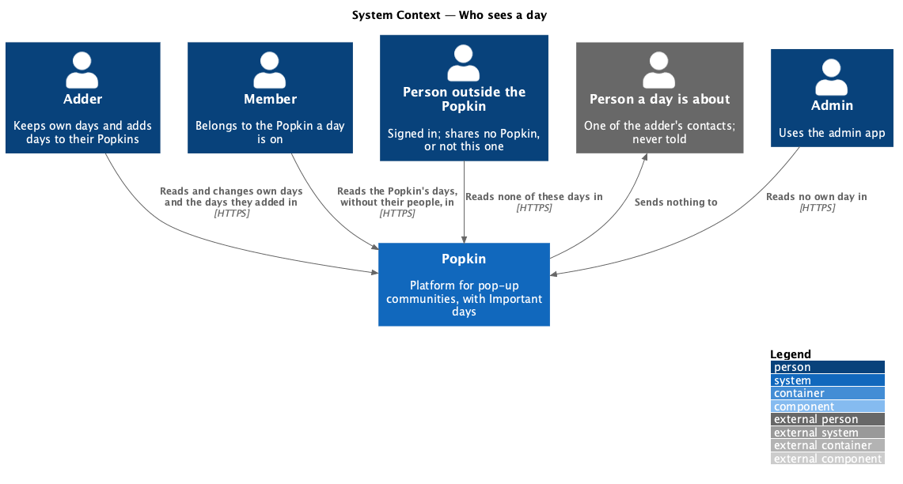
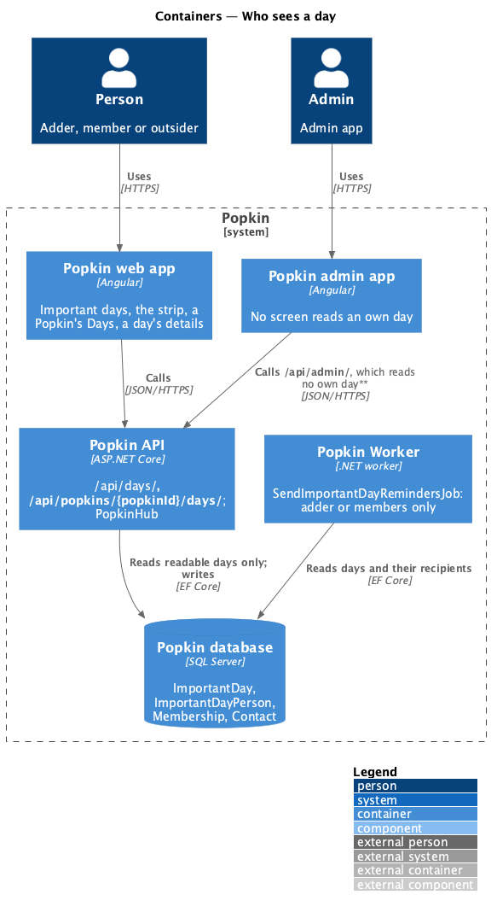
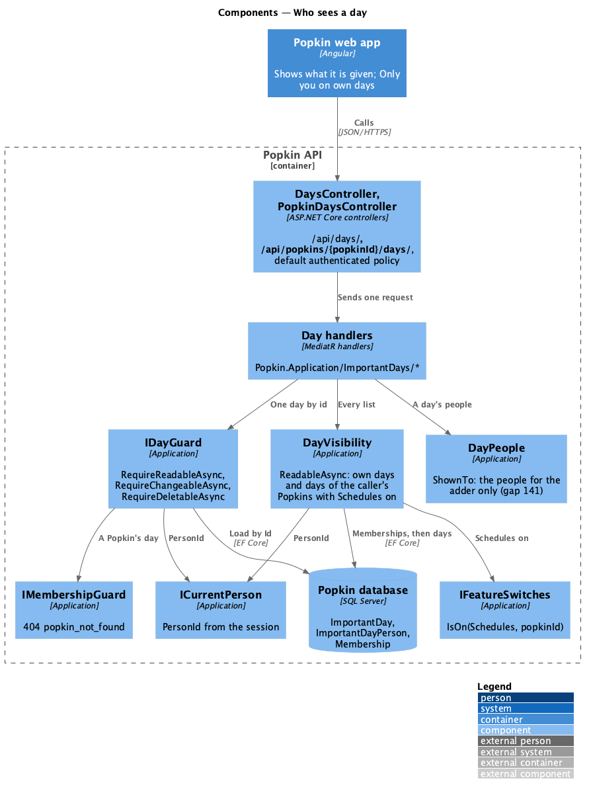
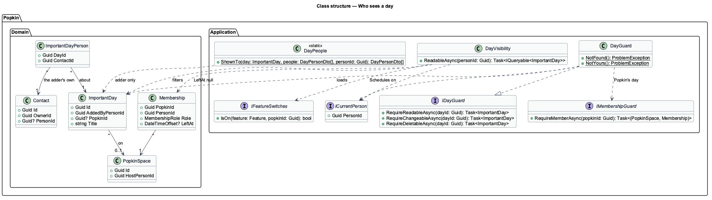
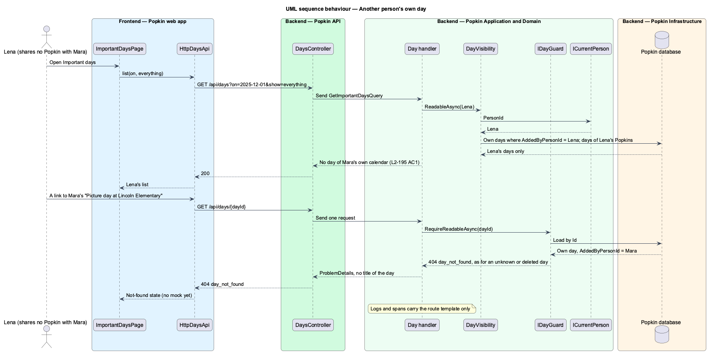
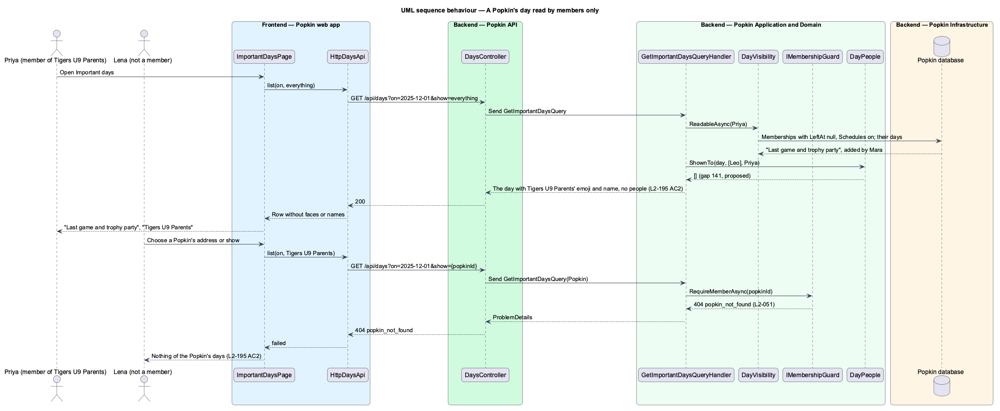
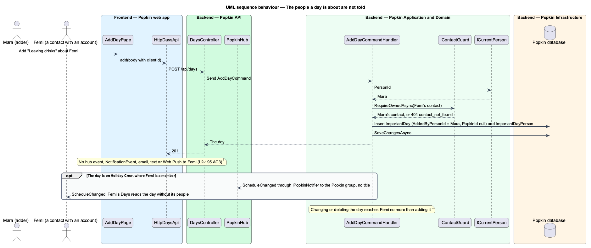

# Who sees a day

## Overview

Important days keeps the days that matter to a signed-in person, either to themselves or on one
of their Popkins so the whole group plans around them (L1-044). Each day therefore has exactly
one audience. A day on the person's own calendar is theirs alone: no other person, no member of a
Popkin they share and no admin sees it. A day on a Popkin is seen by every member of that Popkin
and by nobody outside it. The people a day is about, who come from the adder's Contacts, are never
told. This design fixes how the API enforces that on every read and change of a day, and what
each reader receives.

- **adder** — `Person` whose `Id` a day carries as `AddedByPersonId`
- **own day** — `ImportantDay` with no `PopkinId`, on its adder's own calendar; its row reads "Only you"
- **Popkin's day** — `ImportantDay` with a `PopkinId`, on that Popkin's calendar
- **member** — person with a `Membership` of the Popkin whose `LeftAt` is null
- **readable day** — own day of the caller, or Popkin's day of a Popkin the caller is a member of whose Schedules are on
- **people a day is about** — `ImportantDayPerson` rows of a day, each naming one of the adder's own contacts
- **day guard** — `IDayGuard`, the service that loads one day by id for the caller or refuses it

The rule follows the two the API already keeps. A person who is not a member of a Popkin gets
`404` `popkin_not_found` from `IMembershipGuard`, so a Popkin's existence is never disclosed
(L2-051). `IContactGuard` answers `404` `contact_not_found` for another person's contact, and
nothing in Contacts is shared ([Only you see your Contacts](../../contacts/contacts-privacy/README.md),
L2-122). An own day is kept like a Contacts row; a Popkin's day like the Popkin's other content.
The shared decisions are in [Important days and holiday calendars](../../README.md#important-days-and-holiday-calendars).

## Description

### Where it shows

This design has no screen of its own. It decides what every screen that shows a day receives:

- **Important days** (`/days`, [The Important days list](../important-days-list/README.md)) and
  the coming-days strip of My Popkins ([Reach Important days](../reach-important-days/README.md))
  — the caller's readable days only. An own day reads "Only you"; a Popkin's day shows the
  Popkin's emoji and name (L2-183 AC4).
- **A Popkin's Days** (`/p/:popkinId/schedule/days`, [A Popkin's Days](../popkin-days/README.md))
  — that Popkin's days, to its members only; no own day of any member shows there (L2-195 AC1,
  AC2).
- **A day's details and actions** (`docs/mocks/dialogs/day-actions/`, [Edit and delete a day](../edit-and-delete-a-day/README.md))
  — for a readable day only; "Only you" in its line ("Thu, Dec 4 · 8:15 am · Only you") says so.
- **The admin app** — shows no own day (L2-195 AC1).

The mocks draw no screen for a day that is not readable. A link to one, such as
`/days/{dayId}/edit` for a day deleted or never the caller's, has no drawn state; it reads as the
not-found answer of [Edit and delete a day](../edit-and-delete-a-day/README.md) (`<TO SUPPLY>` a
mock, new open question 1 below).

### Rulings

- **Own days (L2-195 AC1).** An own day is read, changed and deleted by its adder alone. Every
  list leaves out another person's own days; a request for one by id answers `404`
  `day_not_found`, the same body as for a day that does not exist or was deleted
  ([shared section](../../README.md#important-days-and-holiday-calendars)).
- **Popkin's days (L2-195 AC2).** Every member reads a Popkin's day, whoever added it. A person
  outside the Popkin reads none: a list leaves it out, and a request under
  `/api/popkins/{popkinId}/...` or with `show={popkinId}` answers `404` `popkin_not_found`. A
  request for a day by its id from someone outside its Popkin answers `404` `day_not_found`, as
  for an own day, so the answer never tells an outsider that a day exists behind an id;
  `popkin_not_found` stays for the routes that name a Popkin.
- **Changing a Popkin's day.** A member reads it; only its adder changes it, and its adder or the
  Host deletes it (L2-193 AC3); any other member gets `403` `day_not_yours`. A wrapped-up
  Popkin's day is refused with `409` `popkin_wrapped_up` ([Edit and delete a day](../edit-and-delete-a-day/README.md)).
- **Schedules off.** A Popkin whose Schedules are off shows no day anywhere: its Days answers
  `404` `feature_off`, and Important days and the strip leave its days out
  ([Choose a Popkin's features](../../popkins/choose-features/README.md)). Its days are kept and
  show again when Schedules are on (L2-077 AC5).
- **Leaving.** A member who leaves (`LeftAt` set) stops reading the Popkin's days at once. Their
  own days are unchanged. Whether the days they added stay on the Popkin is `<TO SUPPLY>` (new
  open question 3 below).
- **People a day is about (gap 141, proposed).** The people are the adder's contacts, which only
  the adder sees (L2-122). The adder sees them on Important days, on the Popkin's Days and in the
  details; every other member sees the day without them: no face, no first name. A day's people
  are added only from the adder's own contacts, each through `IContactGuard.RequireOwnedAsync`,
  so one foreign contact refuses the whole write with `404` `contact_not_found`
  ([Add a day](../add-a-day/README.md)). The mock's "Leo" on Tigers U9 Parents' "Last game and
  trophy party" is therefore Mara's addition.
- **Nobody is told (L2-195 AC3).** Adding, changing or deleting a day sends nothing to the people
  it is about: no hub event, no `NotificationEvent`, no email, no text and no Web Push. A contact
  imported from an account (`Contact.PersonId`) is no exception. If that person is also a member
  of the day's Popkin, they see the day as any member does, without its people, and are not told
  they are in it.
- **Who is reached.** The only messages a day causes are its reminders and, for a Popkin's day,
  the `ScheduleChanged` event that makes an open Days read again. Reminders go to the adder of an
  own day and to the members of a Popkin's day (L2-189,
  [Reminders for a day](../day-reminders/README.md)); `ScheduleChanged` goes to the Popkin's hub
  group and carries no title. An own day sends no event.
- **Admins.** No `/api/admin/**` endpoint reads an own day. The admin Popkin's "Important days"
  panel drawn on the mocks branch has no requirement behind it (gap 148); if one is specified, it
  reads only the days whose `PopkinId` is that Popkin.
- **Deleting an account** removes the person's own days with their `ImportantDayPerson` rows
  (L2-049). What becomes of the days they added on Popkins is `<TO SUPPLY>` (new open question 3
  below). Deleting a contact removes its `ImportantDayPerson` rows from the adder's days through
  `ContactRemoval`; the days stay.

### API

Every day endpoint is under `/api/days/**` (`DaysController`) or `/api/popkins/{popkinId}/days/**`
(`PopkinDaysController`), behind the default authenticated policy; none is `[AllowAnonymous]`.

- **Lists** — `GET /api/days`, `GET /api/days/coming` and `GET /api/popkins/{popkinId}/days`
  return only readable days. A list never refuses a day; it leaves the rest out. The Popkin's
  list first passes `IMembershipGuard.RequireMemberAsync` (`404` `popkin_not_found`).
- **One day by id** — every route under `/api/days/{dayId}` loads the day through
  `IDayGuard`. Another person's own day, an unknown id and a deleted day answer `404`
  `day_not_found` alike: the same status, code and title, and no other field. A Popkin's day of a
  Popkin the caller is not a member of answers `404` `popkin_not_found`.
- **People.** `people` in every day answer (`DayRowDto`, the details, a Popkin's Days) is empty
  unless the caller is the adder (gap 141, proposed).
- **Telemetry (ADR 0012).** A route is recorded as its template (`/api/days/{dayId}`). No log,
  metric dimension or span carries a day's title, place, note, the people it is about or a
  holiday's name. The ProblemDetails of `day_not_found` holds no title of the day.

### Backend

- **`DayVisibility`** (`Popkin.Application/ImportantDays/Security/DayVisibility.cs`) —
  `ReadableAsync(Guid personId, CancellationToken)`: reads the caller's memberships with `LeftAt`
  null, keeps the Popkins with `IFeatureSwitches.IsOn(Feature.Schedules, popkinId)`, and returns
  `IQueryable<ImportantDay>` of `PopkinId == null && AddedByPersonId == personId` or `PopkinId`
  among those Popkins. Every handler that lists days starts from it.
- **`IDayGuard`** / **`DayGuard`** (same folder) — `RequireReadableAsync(Guid dayId,
  CancellationToken)` returns the day or throws `DayGuard.NotFound()` (`404` `day_not_found`) for
  an own day of another person, no day, or a Popkin's day of a Popkin the caller is not in or
  whose Schedules are off; it asks `IMembershipGuard` and turns its `popkin_not_found` into
  `day_not_found`. `RequireChangeableAsync(dayId)` adds the adder check, and `RequireDeletableAsync(dayId)`
  the adder-or-Host check, each `403` `day_not_yours` otherwise ([Edit and delete a day](../edit-and-delete-a-day/README.md)).
  It depends on `IAppDbContext`, `ICurrentPerson`, `IMembershipGuard` and `IFeatureSwitches`
  only, like `ContactGuard`.
- **`DayPeople.ShownTo(day, people, personId)`** (Application) — the people of a day for the
  caller: all of them for the adder, none for anyone else. Every handler that answers a day's
  people calls it.
- **Nobody is told.** The day handlers (`Popkin.Application/ImportantDays/*`) create no
  `NotificationEvent` for anyone but the adder or the members, send no email or text, and touch
  no `Contact` and no `Membership`. `SendImportantDayRemindersJob` takes its recipients from
  `AddedByPersonId` or the Popkin's members only; it never reads `ImportantDayPerson`.
- **Admins.** The admin handlers read `Person`, `PopkinSpace` and their own tables; none reads
  `ImportantDay` where `PopkinId` is null.

### Frontend (Popkin web app)

- The web app relies on the API: it shows what it is given. `days-text.ts` words an own day
  "Only you" wherever a day's place shows ([The Important days list](../important-days-list/README.md)).
- A day row and the details show the people's faces and first names only when `people` is not
  empty, so a member who did not add the day sees no empty slot. People are named by first name,
  never a pronoun, as in Contacts (L2-122 AC4).
- A `404` `day_not_found` on a day's screen maps to the not-found state of
  [Edit and delete a day](../edit-and-delete-a-day/README.md), read through `toApiProblem`;
  `popkin_not_found` keeps its existing screen.

### Tests

- API acceptance (`WhoSeesADayTests`, InMemory, ADR 0005), one or two representative paths: Lena,
  in no Popkin with Mara, does not get Mara's own day in `GET /api/days` or `/coming`, and
  `GET /api/days/{id}` of it answers `404` `day_not_found` with the same body as an unknown id;
  every member of Holiday Crew gets its "Secret Santa draw", and Lena does not;
  `show={Holiday Crew}` and `GET /api/popkins/{Holiday Crew}/days` answer Lena `404`
  `popkin_not_found`; a member who leaves no longer gets it; Priya, a member of Tigers U9 Parents,
  gets Mara's "Last game and trophy party" with `people` empty, and Mara gets it with "Leo".
- Nobody is told (`WhoSeesADayTests`): Mara adds, changes and deletes a day about Femi, a contact
  imported from Femi's account, on Holiday Crew where Femi is a member; Femi's hub connection (a
  real SignalR client on `ApiFactory`) receives only `ScheduleChanged`, with no title; no
  `NotificationEvent` other than the members' reminders is written; `ApiFactory`'s fake senders
  record no message to Femi.
- The guard's cases are proven through the API where each is used, so no database is stood up for
  a one-line query: an own day of another person in [Edit and delete a day](../edit-and-delete-a-day/README.md);
  Schedules off in [A Popkin's Days](../popkin-days/README.md).
- Unit tests: `days-text.ts` "Only you"; the row and the details with and without people.
- Playwright: `e2e/tests/who-sees-a-day.spec.ts` through the `ImportantDaysPage` page object, on
  recorded responses: an own day reads "Only you"; a Popkin's day added by another member shows
  no faces and no names. A recording of another member's view is stubbed in `stubs.ts`.

### Open questions

1. No mock draws a day that is not the caller's, or no longer exists, opened by its address.
2. What becomes of the days a person added on a Popkin when they leave it or delete their account:
   kept on the Popkin with their adder gone (no one can then edit them, and only the Host can
   delete them), or removed with them.

## Requirements

| L2 ID | Refines (L1) | Requirement |
|-------|--------------|-------------|
| `L2-195` | `L1-044` | Who sees a day. (AC1–AC3) |

## Diagrams

### System context

The adder reads their own days alone; the members of a Popkin read its days; a person outside
the Popkin, the people a day is about and an admin read neither.

### Containers

The API filters every day read by the caller's memberships and own days, and refuses any other
day as not found; the Worker's reminders reach only the adder or the members.

### Components

Each day handler lists through `DayVisibility` and loads one day through `IDayGuard`;
`DayPeople` hides the people from everyone but the adder.

### Class structure

`ImportantDay` carries its adder and its Popkin; `DayGuard` and `DayVisibility` are the two places
that decide who reads it.

### Behaviour — another person's own day

Lena's list never holds Mara's own day, and asking for it by id answers as for a day that does
not exist.

### Behaviour — a Popkin's day

Every member of Holiday Crew reads its day, the members who did not add it without its people;
a person outside the Popkin is refused as not found.

### Behaviour — the people a day is about are not told

Mara adds a day about Femi; the save writes only the day and its people, and nothing reaches
Femi.

