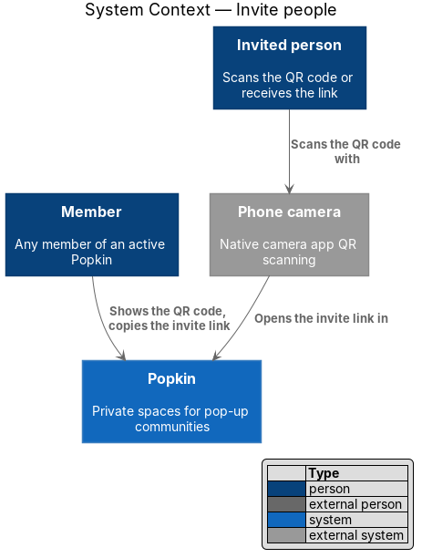
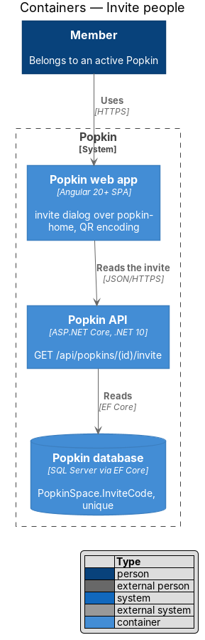
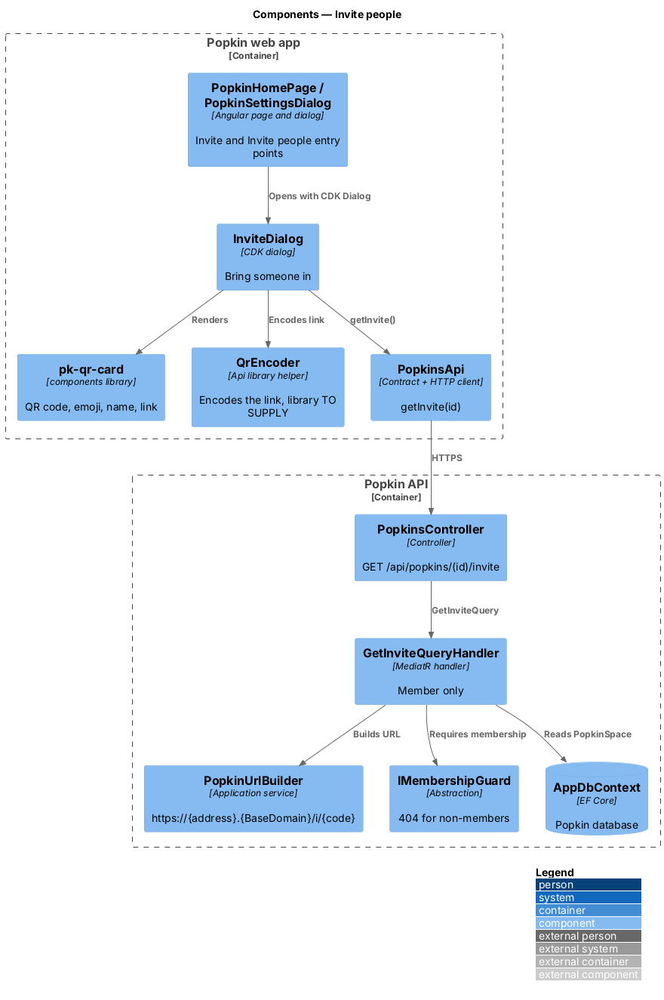
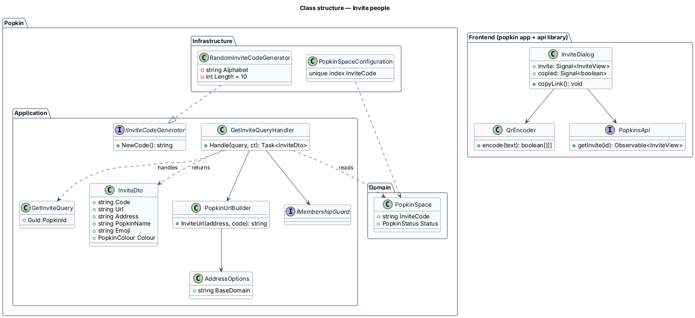
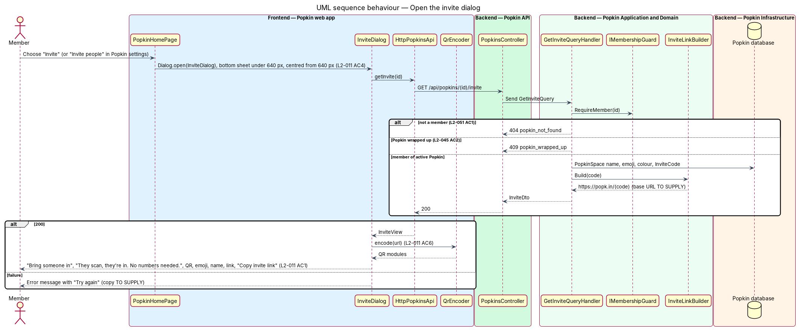
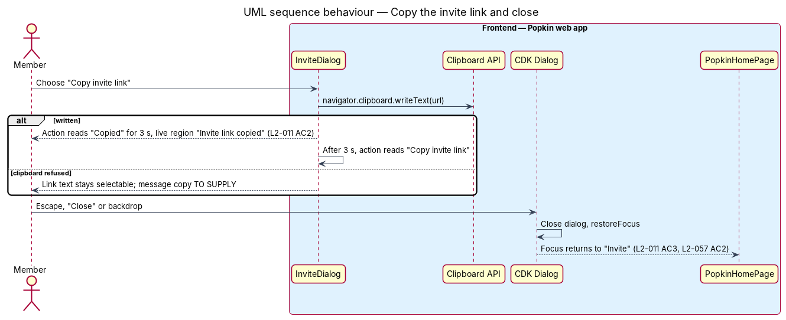

# Invite people

## Overview

Popkin grows by invitation. Any member of an active Popkin can bring someone in without knowing
their phone number: they show a QR code to scan, or copy an invite link to send.

- **invite code** — short unguessable string that identifies one Popkin's invite
- **address** — web address that belongs to one Popkin, `https://{address}.popkin.community`
- **invite link** — URL made of the Popkin's address, the path `/i/` and the invite code, such as `https://lakeside-weekend.popkin.community/i/7kq2mxr9ta`
- **QR code** — two-dimensional barcode that encodes the invite link

This feature covers the "Bring someone in" dialog, opened by "Invite" on the Popkin home or by
"Invite people" in Popkin settings. The invite code itself is made when the Popkin is created
(`popkins/start-popkin`); the dialog reads it. What happens when someone opens the link belongs
to `invitations/preview-invite`.

The invite link is built on the Popkin's address (L2-065), so the person invited sees where they
are going. The address shows which Popkin; the code is what lets a person in. A bare address
admits nobody ([Open a Popkin by its address](../../popkins/open-by-address/README.md)).

## Description

### Screens and states

- `docs/mocks/dialogs/invite/default.html` — "Bring someone in", "They scan, they're in. No
  numbers needed.", QR code, emoji and name, `popk.in/lakeside`, "Copy invite link".
- The mocks write the link as `popk.in/lakeside`, the short form that L2-065 replaces. The dialog
  shows the link on the address; the mock needs the new link before implementation, and how a
  long link fits the card at 360 px is `<TO SUPPLY>`.
- `docs/mocks/dialogs/invite/copied.html` — the action reads "Copied", live announcement "Invite
  link copied".
- The mocks draw no loading or failure state for the dialog (the manifest marks busy and invalid
  as not applicable). When the invite cannot be read the dialog says "We couldn’t load the
  invite." with "Try again", which reads it again; this state has no mock.

### API

- `GET /api/popkins/{popkinId}/invite` — `200` `InviteDto`. Failures: `404` `popkin_not_found`;
  `409` `popkin_wrapped_up`; `401` without a session.

### Frontend (Popkin web app)

- **`InviteDialog`** (`dialogs/invite/invite.dialog.ts`) — CDK dialog in `pk-dialog`. Under
  640 px it is a sheet fixed to the bottom of the screen; from 640 px it is centred
  (L2-011 AC4). It loads the invite with `PopkinsApi.getInvite(popkinId)` and renders
  `pk-qr-card` with the QR code, the Popkin's emoji and name and the link (L2-011 AC1).
  "Copy invite link" writes the link with `navigator.clipboard.writeText`, reads "Copied" for
  3 s and announces "Invite link copied" in a visually hidden live region (L2-011 AC2). When
  the clipboard is refused, the link text stays selectable; the message for that case is
  `<TO SUPPLY>`.
- **Closing** — Escape, "Close" and the backdrop close the dialog; CDK `restoreFocus` returns
  focus to "Invite", or to "Popkin settings" when opened from the menu (L2-011 AC3,
  L2-057 AC2).
- **`QrEncoder`** (`api` library helper) — `encode(text)` returns the module matrix that
  `pk-qr-card` draws; the matrix encodes the full invite link, so a phone camera opens it
  (L2-011 AC6). The QR encoding library is `<TO SUPPLY>`. The same helper serves
  `PopkinCreatedPage`.
- **`PopkinsApi.getInvite(popkinId)`** — `HttpPopkinsApi`, injected through `POPKINS_API`;
  returns an `InviteView`.
- **Entry points** — "Invite" on `PopkinHomePage` and "Invite people" in
  `PopkinSettingsDialog`, both shown only for an active Popkin.

### Backend

- **`PopkinsController.GetInvite`** — `GET /api/popkins/{popkinId}/invite`; sends
  `GetInviteQuery`.
- **`GetInviteQueryHandler`** — calls `IMembershipGuard.RequireMemberAsync` (`404`
  `popkin_not_found` for anyone else, L2-051 AC1), refuses a wrapped-up Popkin with
  `PopkinWrappedUpException` (`409` `popkin_wrapped_up`), and returns `InviteDto`: `Code`,
  `Url`, `Address`, `PopkinName`, `Emoji`, `Colour`. Any member may read it; the invite is not Host-only
  (L2-011).
- **`PopkinUrlBuilder`** (replaces `InviteLinkBuilder`) — `InviteUrl(address, code)` builds
  `https://{address}.{BaseDomain}/i/{code}` from `AddressOptions` (configuration
  `Addresses:BaseDomain`). The link is the Popkin's address followed by a path that ends in the
  code, and the QR code holds that link (L2-065 AC1). The dialog shows and copies the same link
  (L2-065 AC3). The route `/i/:code` is served on the address host by the same web app
  ([Open a Popkin by its address](../../popkins/open-by-address/README.md)), so the link needs no
  redirect. `Invites:BaseUrl` is retired.
- **Invite code rules (L2-011 AC5)** — `RandomInviteCodeGenerator` draws 10 characters from
  `abcdefghjkmnpqrstuvwxyz23456789` with `RandomNumberGenerator`, which leaves out characters
  that read alike. `PopkinSpaceConfiguration` puts a unique index on `InviteCode`, and creation
  retries on a collision. L2-011 AC5 now reads that the link begins with the Popkin's address and
  that the code is at least 8 characters from an unguessable source; a code the Host chooses is
  no longer allowed. The Host chooses the address instead.
- **Lookups by code** — the code is matched exactly after lower-casing; the anonymous lookup and
  its rate limit live in `invitations/preview-invite`.

### Open questions settled in journey 1

- **QR encoding library** — `qrcode-generator` (MIT), at error correction H so the mark over the
  centre does not stop a camera reading it. `encodeQr()` in the `api` library wraps it.
- **Quiet zone** — the QR code's own padding is white in both themes (the design system's `.qr`
  now carries it), and a behaviour spec decodes the code from its pixels in both themes.
- **`Invites:BaseUrl`** — configuration; `https://popk.in/` locally and in tests. Retired by
  L2-065: `Addresses:BaseDomain` takes its place, and the invite link is built on the address.

### Settled when the wide layouts were built

- **`pk-qr-card` sizes** — the card gained `size="lg"`. `PopkinCreatedPage` uses it from 768 px,
  where the QR code is the picture half of the split screen
  ([Start a Popkin](../../popkins/start-popkin/README.md), L2-058 AC10); a behaviour spec scans
  the code from there too (L2-011 AC6). The invite dialog keeps the base size.

### Built in steps

Journeys 1 and 2 built the endpoint, the invite code rules, `encodeQr()` and `pk-qr-card`.
Journey 4, Popkin home, built `InviteDialog` (`dialogs/invite/`), opened by "Invite" in the
home's header and by "Invite people" in the empty Chat card:

- a CDK dialog in `pk-dialog` with its own backdrop, a sheet below 640 px and centred from
  640 px (L2-011 AC4);
- it reads `PopkinsApi.getInvite` and shows `pk-qr-card`: the QR code of the full link, the
  emoji, the name and the link without its scheme (L2-011 AC1, AC6);
- "Copy invite link" reads "Copied" for 3 s, with "Invite link copied" in a live region
  (L2-011 AC2);
- the copy button takes focus once the invite has loaded; Escape, "Close" and the backdrop close
  the dialog, and focus returns to what opened it (L2-011 AC3, L2-057 AC2);
- when the invite cannot be read: "We couldn’t load the invite." with "Try again".

What waits, and for what:

- the entry "Invite people" in the Popkin settings menu was built in journey 9, Wrap up, which
  added the menu ([Popkin settings](../../popkins/popkin-settings/README.md));
- the link on the Popkin's address (L2-065 AC1, AC3): `Addresses:BaseDomain` and
  `PopkinUrlBuilder` are not built. The endpoint still builds the link from `Invites:BaseUrl`,
  and the dialog shows and copies that link. It waits for addresses (known gaps 18 and 20);
- the message when the clipboard is refused: still `<TO SUPPLY>`. Until then nothing happens and
  the link stays selectable.

Tests: `e2e/tests/invite-dialog.spec.ts`.

## Requirements

| L2 ID | Refines (L1) | Requirement |
|-------|--------------|-------------|
| `L2-011` | `L1-004` | Invite with a QR code or a link: Any member invites people from the Popkin home. |
| `L2-065` | `L1-016` | Invites carry the address: The invite link and the QR code are built on the Popkin's address, so the person invited sees where they are going. The address shows which Popkin; the code is what lets a person in. This feature realises AC1 and AC3. |
| `L2-051` | `L1-012` | Popkins are private to their members: Membership decides everything a person sees. |
| `L2-057` | `L1-014` | Accessible to WCAG 2.2 AA: Everyone can use every screen. |

## Diagrams

### System context

A member shows the QR code or copies the link; the invited person's phone camera opens the link
in Popkin.

### Containers

The web app reads the invite from the Popkin API, which reads the Popkin's invite code from the
database; the QR code is drawn on the device.

### Components

`InviteDialog` reads through `PopkinsApi` and draws with `QrEncoder` and `pk-qr-card`;
`GetInviteQueryHandler` checks membership and builds the link on the address with `PopkinUrlBuilder`.

### Class structure

`InviteDto` is built from `PopkinSpace` and `AddressOptions`; `RandomInviteCodeGenerator` and the
unique index carry the code rules.

### Behaviour — open the invite dialog

The dialog opens as a sheet or a centred dialog by width, loads the invite for a member of an
active Popkin, and draws the QR code.

### Behaviour — copy the invite link and close

Copying confirms for 3 s and is announced; closing returns focus to the control that opened the
dialog.

