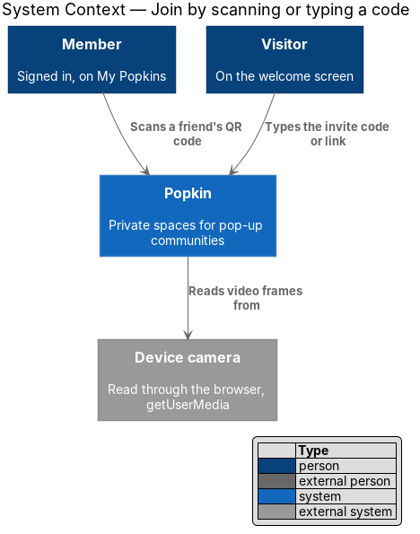
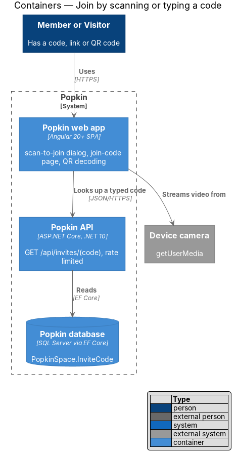
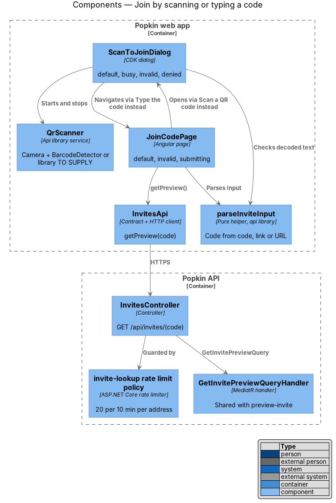
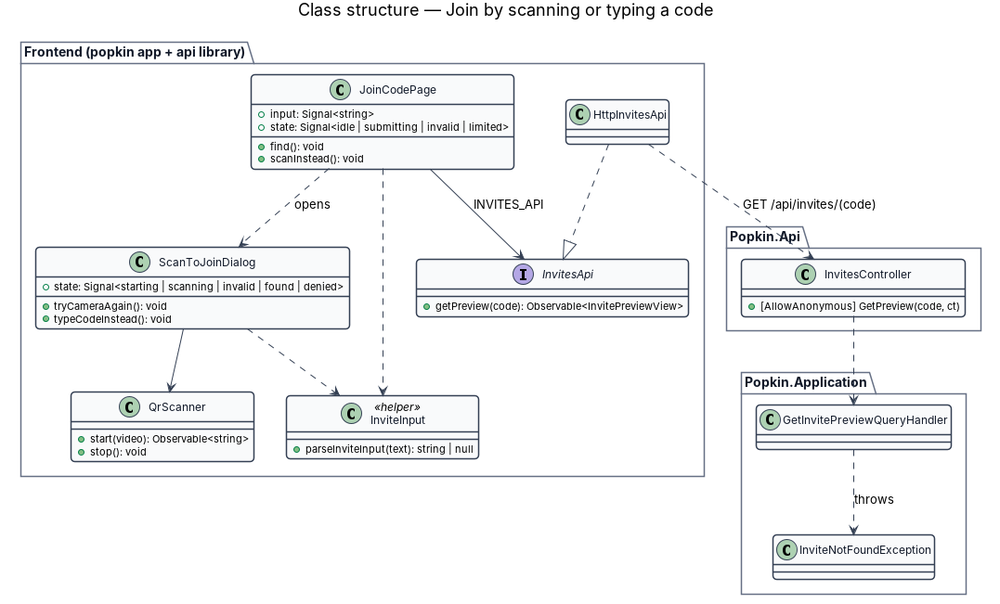
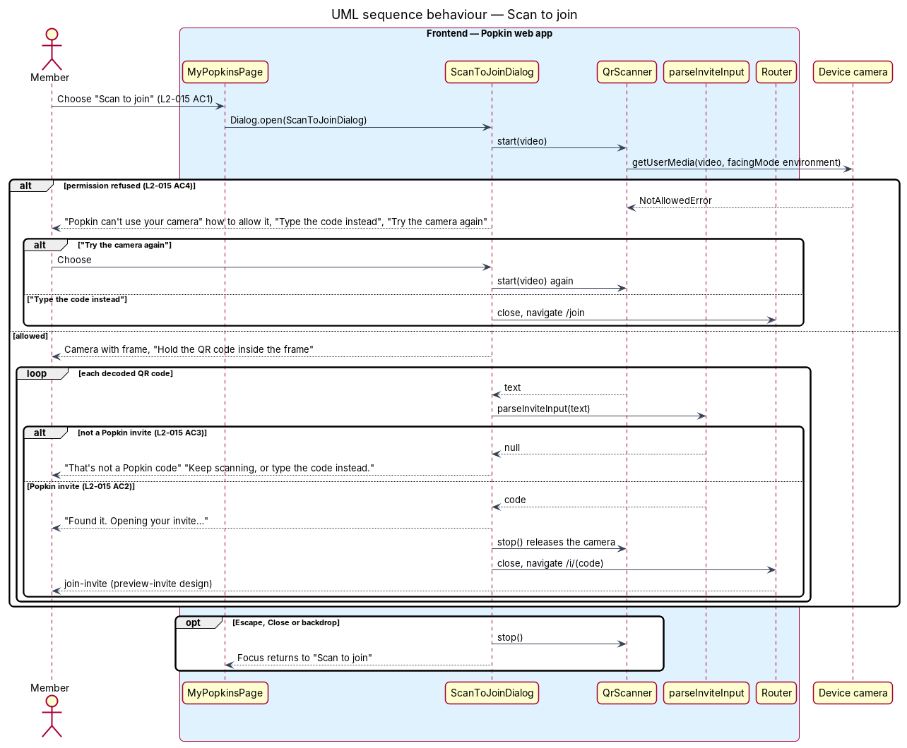
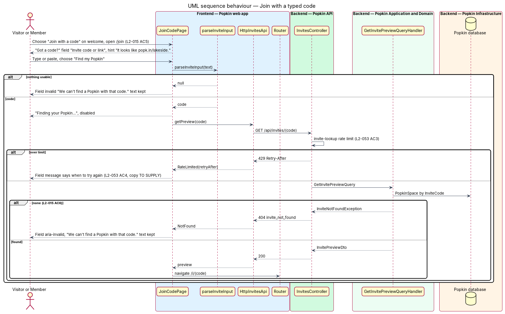

# Join by scanning or typing a code

## Overview

Not every invite arrives as a tapped link. A friend may hold up their phone with the QR code, or
read out the code. This feature gives two ways in from inside Popkin: a scanner that reads the QR
code with the device camera, and a screen to type the code or paste the link. Both end on the
invite preview (`invitations/preview-invite`), which handles everything after.

- **scanner** — dialog that streams the device camera and decodes QR codes in a frame
- **Popkin invite text** — decoded or typed text that yields an invite code: a bare code, an invite link on a Popkin's address (`lakeside-weekend.popkin.community/i/{code}`) or an apex URL `/i/{code}`
- **camera permission** — browser grant that lets a site read the camera

A signed-in member reaches the scanner from My Popkins ("Scan to join"). A visitor reaches the
code screen from the welcome screen ("Join with a code"). Each offers the other: "Type the code
instead" and "Scan a QR code instead".

## Description

### Screens and states

- `docs/mocks/dialogs/scan-to-join/default.html` — "Scan to join", "Point your camera at the code
  on a friend's phone.", frame with "Hold the QR code inside the frame", "Type the code instead".
- `docs/mocks/dialogs/scan-to-join/busy.html` — "Found it. Opening your invite…".
- `docs/mocks/dialogs/scan-to-join/invalid.html` — "That's not a Popkin code", "Keep scanning, or
  type the code instead."
- `docs/mocks/dialogs/scan-to-join/denied.html` — "Popkin can't use your camera", "Allow the
  camera for Popkin in your browser's site settings, or type the code instead.", "Type the code
  instead", "Try the camera again".
- `docs/mocks/pages/join-code/default.html` — "Got a code?", "Invite code or link", hint "It
  looks like popk.in/lakeside.", "Find my Popkin", "Scan a QR code instead".
- `docs/mocks/pages/join-code/invalid.html` — "We can't find a Popkin with that code."
- `docs/mocks/pages/join-code/submitting.html` — "Finding your Popkin…".

### API

- `GET /api/invites/{code}` — shared with `invitations/preview-invite`; `[AllowAnonymous]`,
  `invite-codes` rate limit. `200` `InvitePreviewDto`; `404` `invite_not_found`; `429` with
  `Retry-After`.

The scanner calls no endpoint: it opens the invite link on the Popkin's address, or the apex
`/i/{code}` for a bare code, and the preview there does the lookup
([Preview an invite](../preview-invite/README.md)).

### Frontend (Popkin web app)

- **`ScanToJoinDialog`** (`dialogs/scan-to-join/scan-to-join.dialog.ts`, built in journey 6) —
  CDK dialog in `pk-dialog`, opened from My Popkins, by the "Scan to join" button of its top bar
  and of its empty state; `JoinCodePage` will open it too. It provides `ScanToJoin`. The camera
  view and frame are `pk-scanner`, the `scanner` block of the mock
  (`docs/design-system/components/scanner.html`); when its video is ready the dialog starts the
  scan on it. States:
  - **starting / scanning** — the camera with the frame (L2-015 AC1);
  - **denied** — `pk-alert` with the `camera-off` icon explaining how to allow the camera, with
    "Type the code instead" (to `/join`) and "Try the camera again" (L2-015 AC4). Every way the
    camera does not start shows this state with this copy: a refusal, a device with no camera,
    and a camera that fails;
  - **invalid** — decoded text that `parseInviteInput` rejects shows "That's not a Popkin code"
    while scanning continues (L2-015 AC3);
  - **found** — a Popkin invite shows "Found it. Opening your invite…", stops the camera, opens
    `/i/{code}` in the app and then closes (L2-015 AC2). The design opens the decoded link itself
    as a full page load when it is on an address; that arrives when addresses are built.
  Closing by Escape, "Close" or the backdrop stops every camera track and returns focus to the
  opener. "Type the code instead" closes the dialog and goes to `/join`, the screen of
  journey 15; until that journey the link reaches the not-found screen.
- **`ScanToJoin`** (`api` library, `invites/scan-to-join.ts`, with unit tests) — one per dialog.
  Its `state` is `starting`, `scanning`, `invalid`, `found` or `denied`, and `code` holds the
  invite code that was found. `retry()` goes back to waiting for the camera; `stop()` stops it,
  and so does the end of the dialog.
- **`QrScanner`** / **`QR_SCANNER`** / **`BrowserQrScanner`** (`api` library,
  `invites/qr-scanner.ts`) — `start(video)` returns an observable: subscribing calls
  `navigator.mediaDevices.getUserMedia({ video: { facingMode: 'environment' }, audio: false })`,
  shows the camera in the video and emits `started`, then each decoded text; unsubscribing stops
  every track. It fails with `denied`, `no-camera` or `failed`. It reads a frame every 200 ms
  with the browser's `BarcodeDetector` where present; elsewhere it draws the frame, at most
  640 px on its longest side, and reads it with the `jsqr` package (`invites/qr-pixels.ts`),
  loaded only when it is needed. Frames are decoded on the device and never sent anywhere.
- **`JoinCodePage`** (`pages/join-code/join-code.page.ts`, route `/join`,
  `data-page="join-code"`, public) — composes `pk-top-bar`, `pk-text-field` "Invite code or
  link" with its hint, `pk-button` "Find my Popkin" and `pk-link` "Scan a QR code instead"
  (opens `ScanToJoinDialog`) (L2-015 AC5). "Find my Popkin":
  - parses the text with `parseInviteInput`; text that yields no code is shown as not found;
  - reads "Finding your Popkin…" and is disabled while the lookup runs (L2-056 AC3);
  - sends the address with the lookup when the text carried one, so a code pasted on another
    Popkin's address is not found (L2-065 AC4);
  - on `200` loads `InvitePreviewDto.InviteUrl`, the link on the Popkin's address, as a full page
    load (L2-065 AC6);
  - on `404` marks the field `aria-invalid` with "We can't find a Popkin with that code." and
    keeps what was typed (L2-015 AC6);
  - on `429` says when the person may try again (L2-053 AC4); the copy is `<TO SUPPLY>`.
  What a blank submit shows is `<TO SUPPLY>`; the design sends nothing for it.
- **`parseInviteInput` as built in journey 6** (`invites/invite-input.ts`, with unit tests) —
  `parseInviteInput(text, origin)` returns the invite code, or `null`. It accepts a bare code
  and an invite link of the app itself, `{origin}/i/{code}`, with or without the scheme, and
  nothing else: a link on any other host is refused, `popk.in` included. Links on a Popkin's
  address are not accepted yet, because addresses are not built; the form below is the design
  for when they are.
- **`parseInviteInput(text, baseDomain)`** (pure helper, `api` library, changed) — trims and
  lower-cases the text and returns `{ code, address? }` from a bare code, from an invite link on
  an address (`{address}.{baseDomain}/i/{code}`, with or without a scheme), or from the apex path
  `/i/{code}`. A pasted invite link on an address is accepted as the code alone is
  (L2-065 AC6). It returns `null` for any other host or path, for a host more than one label deep,
  for a label `addressProblem` refuses, and for a code outside the invite alphabet. The short
  form `popk.in/{code}` is no longer accepted: L2-065 replaced it before any link was given out.
  The hint "It looks like popk.in/lakeside." needs new copy in the mock, `<TO SUPPLY>`.
- **`InvitesApi.getPreview(code, address?)`** — shared with `invitations/preview-invite`.

### Backend

- **`InvitesController.GetPreview`** and **`GetInvitePreviewQueryHandler`** — as described in
  `invitations/preview-invite`. The `invite-codes` policy counts every lookup from one client
  address, typed or opened by link, and refuses the 21st within 10 minutes with `429` and
  `Retry-After` (L2-053 AC3), which bounds guessing of codes.

## Requirements

| L2 ID | Refines (L1) | Requirement |
|-------|--------------|-------------|
| `L2-015` | `L1-004` | Join by scanning or typing a code: A person without the link joins by scanning the QR code inside Popkin or typing its code. |
| `L2-065` | `L1-016` | Invites carry the address: The invite link and the QR code are built on the Popkin's address, so the person invited sees where they are going. The address shows which Popkin; the code is what lets a person in. This feature realises AC6. |
| `L2-053` | `L1-012` | Abuse is limited: One person cannot flood the system or another person. |

## Diagrams

### System context

Members scan a QR code with the device camera through the browser; visitors type the code. Both
reach the Popkin through its invite.

### Containers

The web app reads the camera and decodes on the device; only a typed code needs the Popkin
API's lookup.

### Components

`ScanToJoinDialog` and `JoinCodePage` share `parseInviteInput`; the page alone calls
`InvitesApi`, behind the API's rate limit.

### Class structure

Two containers and two helpers on the frontend; the backend part is the preview handler shared
with `invitations/preview-invite`.

### Behaviour — scan to join

The dialog asks for the camera, explains a refusal, ignores QR codes that are not invites, and
opens the invite when it finds one.

### Behaviour — join with a typed code

The page parses the text, looks it up, and either opens the invite or marks the field invalid
with the text kept.

