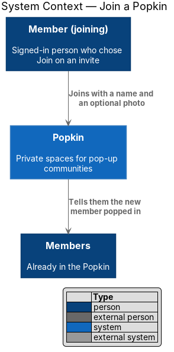
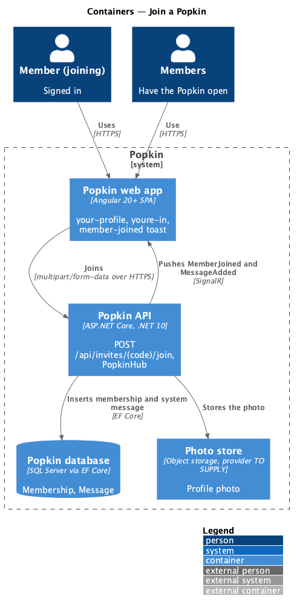
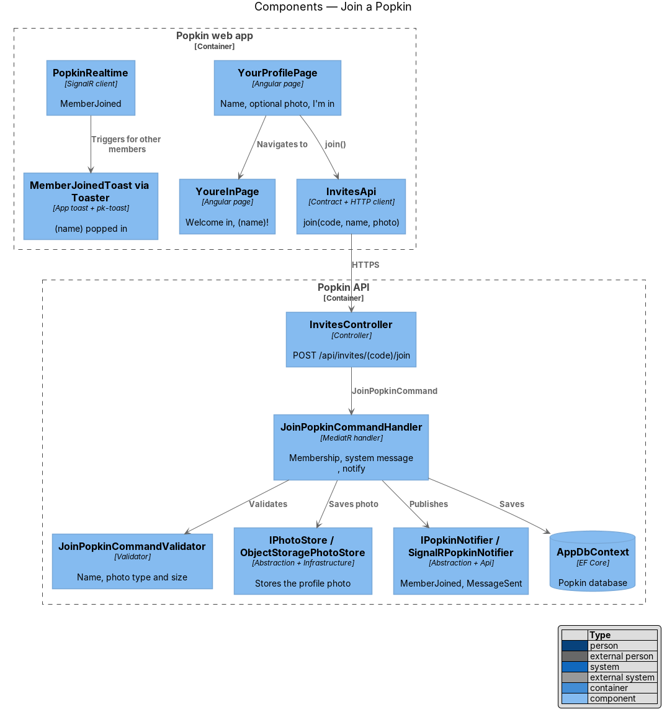
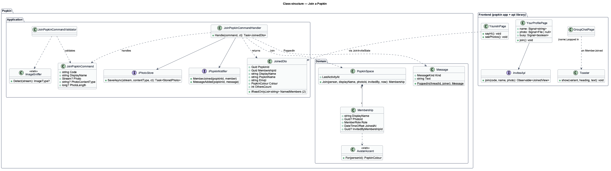
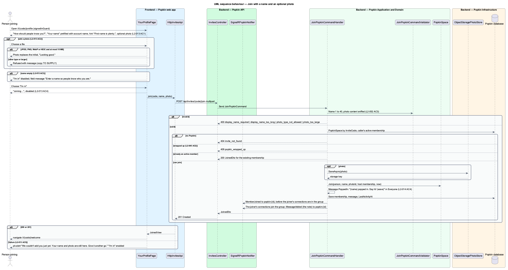
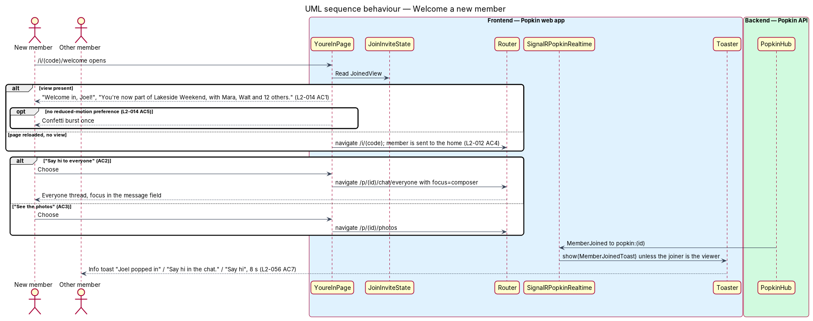

# Join a Popkin

## Overview

Joining a Popkin asks one thing: how the person wants to be known in it. After choosing "Join"
on an invite preview (`invitations/preview-invite`), a signed-in person gives a display name and,
if they like, a photo, and becomes a member. A welcome screen greets them, and the members
already inside are told.

- **display name** — name a member goes by inside one Popkin, stored on their `Membership`
- **profile photo** — optional picture shown as the member's avatar inside that Popkin
- **system message** — chat message written by Popkin, not by a member (`MessageKind.System`)
- **popped in** — Popkin's word for a person joining

The joiner's display name starts as their account name and may differ from it. A member without
a photo appears everywhere as initials on a colour that stays the same for them. The group learns
of the newcomer twice: a system message in the Everyone thread at the time they joined, and an
info toast for members who have the Popkin open.

## Description

### Screens and states

- `docs/mocks/pages/your-profile/default.html` — Popkin tile and name, "How should people know
  you?", initial avatar, "A photo is optional", "Your name" with hint "First name is plenty.",
  "I'm in".
- `docs/mocks/pages/your-profile/with-photo.html` — photo replaces the initial, "Looking good."
- `docs/mocks/pages/your-profile/invalid.html` — "Enter a name so people know who you are."
- `docs/mocks/pages/your-profile/submitting.html` — "Joining…".
- `docs/mocks/pages/your-profile/error.html` — "We couldn't add you just yet. Your name and photo
  are still here. Give it another go."
- `docs/mocks/pages/youre-in/default.html` — "Welcome in, Joel!", "You're now part of Lakeside
  Weekend, with Mara, Walt and 12 others.", "Say hi to everyone", "See the photos".
- `docs/mocks/notifications/toast/info.html` — "Joel popped in", "Say hi in the chat.", "Say hi".

### API

- `POST /api/invites/{code}/join` — `multipart/form-data` with `displayName` and an optional
  `photo`. `201 Created` with `JoinedDto`, or `200` with `JoinedDto` when the caller is already an
  active member. Failures: `400` `display_name_required`, `display_name_too_long`,
  `photo_type_not_allowed`, `photo_too_large`; `404` `invite_not_found`; `409`
  `popkin_wrapped_up`; `401` without a session.
- `GET /api/invites/{code}/members` — authenticated. `200` `InviteMembersDto`: up to 8 members
  (Host first, then by when they joined) as display name and `AvatarDto`, and `OthersCount`. It
  feeds "Already in {Popkin}" beside the profile step (L2-058 AC10). It is separate from the
  preview so the preview, which needs no session, stays free of member names (L2-012 AC5).
  Failures: `404` `invite_not_found`; `401` without a session.
- `GET /api/files/{key}?expires=&signature=` — anonymous; the address is the permission. It
  serves a stored photo when the signature matches and the time has not passed, else `404`
  `file_not_found` (L2-051 AC6, L2-054 AC2).
- Real time: `MemberJoined` and `MessageSent` to group `popkin:{popkinId}`, from the first
  change that brings the hub (see "Built in steps").

### Frontend (Popkin web app)

- **`YourProfilePage`** (`pages/your-profile/your-profile.page.ts`, route `/i/:code/profile`,
  `data-page="your-profile"`, `signedInGuard`) — reads the Popkin's name and look from
  `JoinInviteState`, or loads the preview again when it holds none; a member is sent to their
  Popkin and anything that is not an open invite back to `/i/:code`, which says why. It composes
  `pk-top-bar` with the Popkin's `pk-popkin-tile` and name, `pk-photo-picker` (marked optional)
  with `pk-avatar`, `pk-text-field` "Your name" prefilled with the session's account name
  (L2-013 AC1), `pk-alert` and `pk-button` "I'm in".
  - The photo picker accepts JPEG, PNG, WebP or HEIC up to 10 MB and refuses anything else with a
    message under it (L2-013 AC2): "That file isn't a photo we can use. Choose a JPEG, PNG, WebP
    or HEIC." or "That photo is over 10 MB. Choose a smaller one."; the mocks draw no such
    state. The rule is `photoProblem` (`api` library, `profile-photo.ts`, unit tested by
    ADR 0011), and the API's refusal of a photo shows the same two messages. A photo already
    chosen stays when a later choice is refused. The chosen photo replaces the initial in the
    preview; one the browser cannot draw (a HEIC, outside Safari) leaves the initial and still
    reads "Looking good.".
  - From 768 px a `pk-split-aside` reads "Already in {Popkin}" over a `pk-people-list` of up to
    8 members and "and N more", from `InvitesApi.getMembers` (L2-058 AC10). Joining does not
    wait for it, and works when it cannot be loaded.
  - "I'm in" is disabled while the trimmed name is empty, and the field shows the `invalid` mock
    message (L2-013 AC3).
  - While joining, the button reads "Joining…" and is disabled (L2-013 AC4); on success the page
    stores the `JoinedView` in `JoinInviteState` and opens `/i/:code/welcome`.
  - On failure the name and photo stay, `pk-alert` shows the `error` mock message, and "I'm in"
    is enabled again (L2-013 AC5). `409` `popkin_wrapped_up` and `404` open `/i/:code` instead.
- **`YoureInPage`** (`pages/youre-in/youre-in.page.ts`, route `/i/:code/welcome`, as the mock
  manifest gives it) — "Welcome in, {name}!" and the sentence that names two members and counts
  the rest (L2-014 AC1, worded by `welcomeLine`), drawn by `pk-arrival`: up to 6 `pk-avatar`s of
  the people already in, held by `JoinInviteState` from the profile step, around the Popkin's
  `pk-popkin-tile`. The two actions stack on a phone and sit side by side from 640 px
  (`pk-screen` `layout="arrival"`). "Say hi to everyone" opens
  `/p/:popkinId/chat/everyone` with router state `focus: 'composer'`, which the group chat page
  uses to focus the message field (AC2). "See the photos" opens `/p/:popkinId/photos` (AC3).
  The confetti burst plays only under `prefers-reduced-motion: no-preference` (AC5, L2-060).
  After a reload, with no `JoinedView` held, the page opens `/i/:code`, which sends a member to
  the Popkin home (L2-012 AC4).
- **`MemberJoinedToast`** (`toasts/`) — shown by `Toaster` through `pk-toast` (info) when
  `PopkinRealtime` delivers `MemberJoined` on any screen of that Popkin, except to the joiner. It
  reads "{name} popped in", "Say hi in the chat." with action "Say hi" (opens the Everyone
  thread) and dismisses after 8 s, pausing on hover or focus (L2-056 AC7).
- **`InvitesApi.join(code, displayName, photo)`** — `HttpInvitesApi` sends `FormData`;
  `getMembers(code)` reads who is already in.

### Built in steps

Joining was built before the chat and the hub exist, so three parts of this design wait for the
change that brings what they stand on:

- the "popped in" system message (L2-014 AC4), `MessageSent` and the focus in the message field
  that "Say hi to everyone" asks for (L2-014 AC2): with the Everyone thread, which adds the
  `Message` entity. The welcome already hands on `focus: 'composer'` in the router state;
- `MemberJoined` and the "popped in" toast: with the hub (`PopkinRealtime`);
- the recap a member of a wrapped-up Popkin is sent to (L2-016 AC3): with wrapping up.

Steps 5 and 6 of `JoinPopkinCommandHandler` below are those parts.

### Backend

- **`InvitesController.Join`** — authenticated (not anonymous); request size limit above 10 MB
  for the multipart body; sends `JoinPopkinCommand`.
- **`JoinPopkinCommandValidator`** — trims `DisplayName`; refuses it empty or longer than 40
  characters. The 40-character limit follows the account name of L2-048; L2-013 states none, so
  confirmation is `<TO SUPPLY>`. The photo is refused above 10 MB, and its type is decided by
  `ImageSniffer` from the file's leading bytes, whatever its name or declared type says
  (L2-052 AC3).
- **`JoinPopkinCommandHandler`**:
  1. loads the `PopkinSpace` by `InviteCode` (`404` `invite_not_found`) and refuses a wrapped-up
     one with `409` `popkin_wrapped_up` (L2-045 AC2);
  2. returns `200` with the existing membership when the caller is already an active member, so
     a retried "I'm in" after a lost response does not fail;
  3. turns the photo into an avatar with `IPhotoProcessor.MakeAvatar` and stores it through
     `IPhotoStore.SaveAsync`; when saving the membership then fails, the stored photo is deleted;
  4. calls `PopkinSpace.Join`, which adds a `Membership` with `Role = Member`, the display name,
     `JoinedAt` = now from `TimeProvider`, and `InvitedByMembershipId` = the Host's membership;
     a former member (`LeftAt` set) gets a new `Membership`;
  5. adds `Message.PoppedIn` to the Everyone thread: `Kind = System`, text "{name} popped in.
     Say hi! 👋", `SentAt` = `JoinedAt` (L2-014 AC4), and sets `LastActivityAt`;
  6. saves in one unit of work, then calls `IPopkinNotifier.MemberJoined` and `MessageSent`.
- **Profile photo storage** — the photo is stored through `IPhotoStore` under an avatar key and
  is not added to the album. `Membership.PhotoKey` holds that key; there is no `Photo` row for
  an avatar, which is not a photo of the Popkin.
- **`IPhotoProcessor`** (`MagickPhotoProcessor`, Magick.NET) — reads the upload by its real
  type, turns it upright, fits it within 512 px, strips its metadata, location and device
  included (L2-054 AC1), and writes a JPEG. The original is not kept.
- **`IPhotoStore`** — `SaveAsync`, `OpenAsync`, `DeleteAsync` and `GetReadUrl`. In Development
  it is `LocalPhotoStore`, files under `Photos:Root`; elsewhere a store must be configured, and
  `UnconfiguredPhotoStore` refuses until one is (`docs/deployment.md`). `GetReadUrl` answers an
  address signed by `PhotoUrlSigner` (HMAC over the key and the expiry, `Photos:SigningKey`)
  that lasts one hour and that `FilesController` checks, so a photo's address expires and cannot
  be guessed (L2-051 AC6).
- **`AvatarAccent.For(personId)`** (`Popkin.Domain`) — maps a person to one of the seven
  colours with a stable hash; every `AvatarDto` carries it with the initials, so a member without
  a photo keeps one colour everywhere (L2-013 AC6).
- **`JoinedDto`** — `PopkinId`, `MembershipId`, `DisplayName`, `PopkinName`, `Emoji`, `Colour`,
  `NamedMembers` (two other members' first names, Host first) and `OthersCount`.

## Requirements

| L2 ID | Refines (L1) | Requirement |
|-------|--------------|-------------|
| `L2-013` | `L1-004` | Join with a name and an optional photo: Joining asks only how the person wants to be known in this Popkin. |
| `L2-014` | `L1-004` | Welcome a new member: A new member is welcomed and the group is told. |
| `L2-045` | `L1-011` | A wrapped-up Popkin is read-only: Nothing new is added to a Popkin that has ended. |
| `L2-052` | `L1-012` | Input is validated and output is encoded: Nothing a person types can harm another person or the system. |

## Diagrams

### System context

The person joins through Popkin, and Popkin tells the members already there.

### Containers

The web app sends the name and photo; the Popkin API stores the photo in the photo store, writes
the membership and system message, and pushes events to the other members' web apps.

### Components

`YourProfilePage` calls `InvitesApi`; `JoinPopkinCommandHandler` validates, stores the photo,
saves and notifies; `PopkinRealtime` raises the toast for other members.

### Class structure

`PopkinSpace.Join` creates the `Membership`, `Message.PoppedIn` creates the system message, and
`ImageSniffer` decides the photo's real type.

### Behaviour — join with a name and an optional photo

The page validates on the device, the handler validates again, refuses a wrapped-up Popkin,
returns an existing membership unchanged, and otherwise creates the membership and the "popped
in" note.

### Behaviour — welcome a new member

The new member is greeted and offered the Everyone thread or Photos; other members receive the
"popped in" toast.

