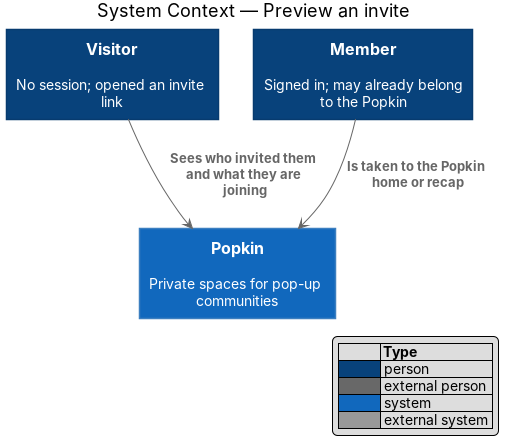
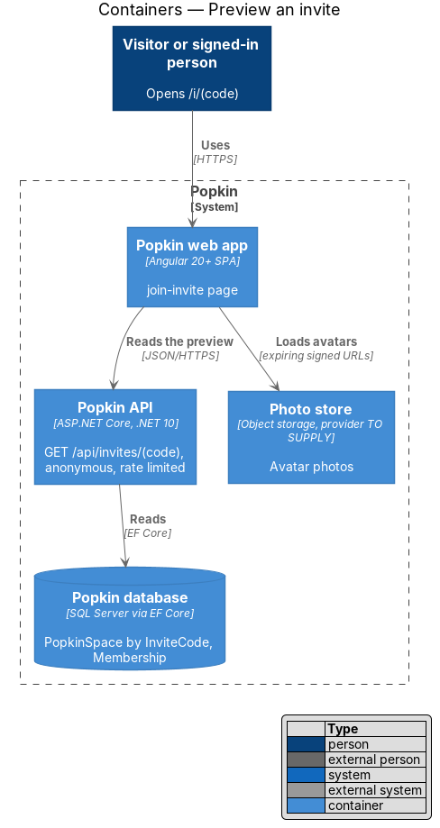
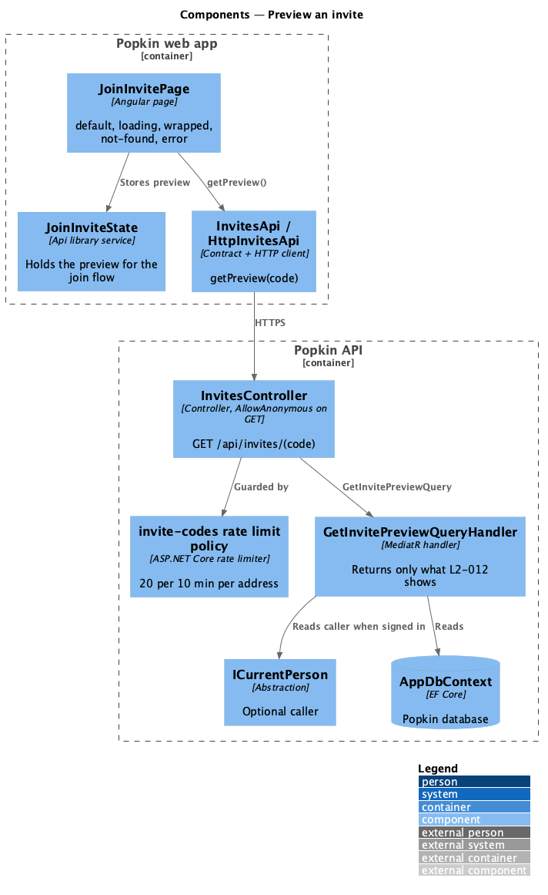
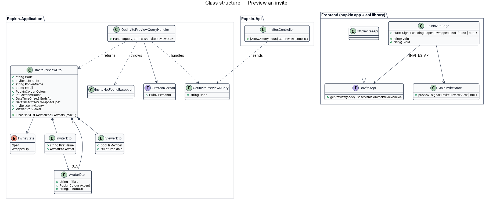
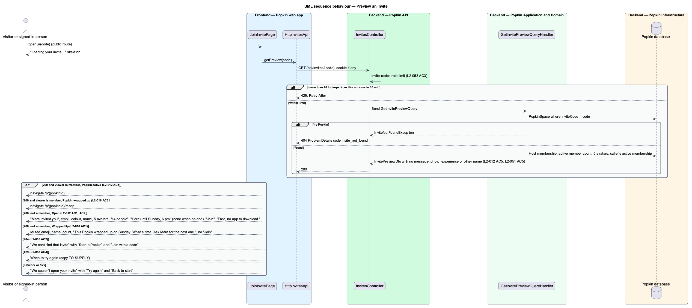
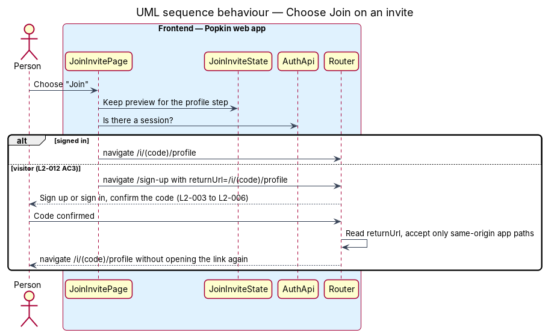

# Preview an invite

## Overview

An invite link leads first to a preview: a screen that shows what the person is about to join
and who invited them, before they commit or even have an account. The preview is the only part
of a Popkin that a non-member can see, so it shows a fixed, small set of facts and nothing from
inside the Popkin.

- **invite preview** — public summary of one Popkin, reached through its invite code
- **inviter** — member shown as having invited the person; in this design, the Popkin's Host
- **visitor** — person without a session

The same screen handles the invites that cannot be joined: a Popkin that has wrapped up, and a
code that matches no Popkin. A signed-in person who already belongs to the Popkin skips the
preview and lands on the Popkin home, or on its recap when it has wrapped up. Choosing "Join"
leads to the profile step (`invitations/join-popkin`), through sign-up or sign-in first for a
visitor.

## Description

### Screens and states

- `docs/mocks/pages/join-invite/default.html` — "Mara invited you", tile, "Lakeside Weekend", 5
  avatars with "+9", "14 people", "Here until Sunday, 6 pm", "Join", "Free, no app to download."
- `docs/mocks/pages/join-invite/loading.html` — "Loading your invite…".
- `docs/mocks/pages/join-invite/wrapped.html` — muted tile, "This Popkin wrapped up on Sunday.
  What a time. Ask Mara for the next one.", "Start your own Popkin", no "Join".
- `docs/mocks/pages/join-invite/not-found.html` — "We can't find that invite", "Start a Popkin"
  and "Join with a code".
- `docs/mocks/pages/join-invite/error.html` — "We couldn't open your invite", "Try again" and
  "Back to start".

### API

- `GET /api/invites/{code}` — `[AllowAnonymous]`, rate-limited by the `invite-codes` policy.
  `200` `InvitePreviewDto`. Failures: `404` `invite_not_found`; `429` with `Retry-After`.

### Frontend (Popkin web app)

- **`JoinInvitePage`** (`pages/join-invite/join-invite.page.ts`, route `/i/:code`,
  `data-page="join-invite"`, `shell: 'bare'`, public, L2-007 AC3) — loads the preview with
  `InvitesApi.getPreview(code)` and renders by result:
  - **member, active** — navigates to `/p/:popkinId` (L2-012 AC4);
  - **member, wrapped up** — navigates to `/p/:popkinId/recap` (L2-016 AC3). The recap is built
    with wrapping up; until then a member of a wrapped-up Popkin goes to `/p/:popkinId` like any
    other member;
  - **open** — `pk-wordmark`, then `pk-invite-preview`: a `pk-pill` "{first name} invited you"
    with the inviter's `pk-avatar`, `pk-popkin-tile` in the Popkin's colour, the name as the
    screen's `h1`, a `pk-avatar-stack` of up to 5 with "+N", "{n} people", and `pk-time-left`
    "Here until {day}, {time}" only when `endsAt` is set (L2-012 AC1, AC2); then `pk-button`
    "Join" and the line "Free, no app to download." (`pk-legal` as a note);
  - **wrapped up** — the same with a muted `pk-popkin-tile`, the wrapped-up sentence naming the
    inviter in place of the time, `pk-button` "Start your own Popkin" (to `/new`, or `/sign-up`
    for a visitor) and no "Join" (L2-016 AC1);
  - **not found** — `pk-empty-state` with "Start a Popkin" and "Join with a code" (`/join`)
    (L2-016 AC2);
  - **rate limited** — `pk-empty-state` "That's a lot of invites" with the time the person may
    try again, "Try again in 5 minutes." (L2-053 AC4), and "Back to start". The mocks draw no
    such state; the copy follows "That's a lot of codes." of sign up;
  - **failure** — `pk-empty-state`, announced as an alert, with "Try again", which loads the
    preview again in place, and "Back to start" (`/welcome`) (L2-056 AC2);
  - **loading** — `pk-skeleton`s shaped like the preview, hidden from assistive technology
    beside the status line "Loading your invite…" (L2-056 AC1).
- **Days and times** — `hereUntil` and `wrappedUpLine` (`api` library, `invite-text.ts`, unit
  tested by ADR 0011) word the end and the wrap-up on the device's clock: "today", the weekday
  within a week, else "19 Sep", with the year when it differs; "6 pm", "9:05 am".
- **Wide layouts** (L2-058 AC10) — from 768 px a `pk-split-aside` holds a photograph beside the
  invite (`/images/lake.jpg`, greyed when the Popkin has wrapped up). It is a stock picture and
  not one of the Popkin's photos: a visitor is shown nothing from inside the Popkin
  (L2-012 AC5). "Join" stays no wider than a button.
- **"Join"** — stores the preview in `JoinInviteState`. A signed-in person goes to
  `/i/:code/profile`. A visitor goes to `/sign-up?returnUrl=/i/{code}/profile`; after the code is
  confirmed, the auth flow navigates to the return URL, accepting only same-origin app paths, so
  the person reaches the profile step without opening the link again (L2-012 AC3). A visitor
  who already has an account uses "sign in instead" on that screen once signing in is built;
  the invite itself offers one way in.
- **`InvitesApi` / `INVITES_API` / `HttpInvitesApi`** — `getPreview(code)`; the page reads the
  refusal with `toApiProblem`: `404` is not found, `429` is rate limited with its
  `retryAfterSeconds`, anything else a failure.
- **`JoinInviteState`** (`api` library) — holds the preview and, later, the join result for the
  profile and welcome steps.
- The page's text is bound as text, never as HTML, so a Popkin or member name cannot run script
  (L2-052 AC2).

### Backend

- **`InvitesController.GetPreview`** — `[AllowAnonymous]`, the only Popkin read open without a
  session (L2-050 AC1). It carries `[EnableRateLimiting("invite-codes")]`: a fixed window of 20
  requests per client address per 10 minutes, answering `429` with `Retry-After`
  (L2-053 AC3). `invitations/join-by-code` shares the policy.
- **`GetInvitePreviewQueryHandler`** — finds the `PopkinSpace` by `InviteCode` or throws
  `InviteNotFoundException` (`404` `invite_not_found`). It reads `ICurrentPerson` when a session
  exists. It returns `InvitePreviewDto` with only what L2-012 shows (L2-012 AC5, L2-051 AC5):
  `State` (`Open` or `WrappedUp`, from the Popkin's status; a Popkin whose time is up but which
  has not been wrapped up yet is decided with wrapping up), name, emoji, colour, active member
  count, `EndsAt`,
  `WrappedUpAt`, up to 5 `AvatarDto`s carrying initials, accent and an expiring photo URL but no
  names, the inviter's first name and avatar, and `Viewer { IsMember, PopkinId }`. `PopkinId` is
  filled only for a member; a non-member never learns it.
- **Inviter** — the Popkin has one invite code, so the link does not say which member shared it.
  The preview names the Host. Crediting the member who shared the link would need a
  per-member reference in the link; that is `<TO SUPPLY>`.
- **No disclosure** — the DTO carries no message, photo, experience, member name (other than the
  inviter's first name), phone number or email.

## Requirements

| L2 ID | Refines (L1) | Requirement |
|-------|--------------|-------------|
| `L2-012` | `L1-004` | See the invite before joining: An invite link shows what the person is joining before they commit. |
| `L2-016` | `L1-004` | Invites that cannot be joined: An invite to a wrapped-up Popkin, or one that does not exist, says so and offers a way forward. |
| `L2-051` | `L1-012` | Popkins are private to their members: Membership decides everything a person sees. |
| `L2-053` | `L1-012` | Abuse is limited: One person cannot flood the system or another person. |

## Diagrams

### System context

A visitor or signed-in person opens the invite in Popkin; a member is taken to the Popkin
itself.

### Containers

The web app reads the preview from the Popkin API without needing a session; avatar photos come
from the photo store through expiring URLs.

### Components

`JoinInvitePage` reads through `InvitesApi`; `InvitesController` is anonymous and rate-limited,
and `GetInvitePreviewQueryHandler` builds the limited preview.

### Class structure

`InvitePreviewDto` composes the inviter, up to five avatars and the viewer's membership; nothing
else from the Popkin is in it.

### Behaviour — preview an invite

One lookup decides among seven outcomes: home, recap, open preview, wrapped-up preview, not
found, rate limited and failure.

### Behaviour — choose Join on an invite

A signed-in person goes straight to the profile step; a visitor signs up or signs in and returns
to it.

