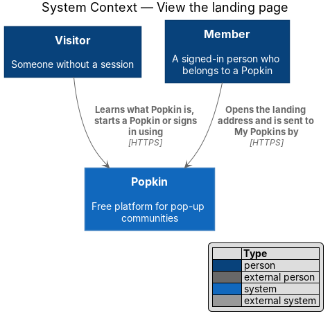
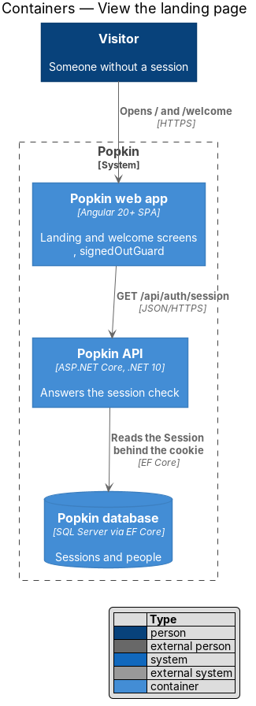
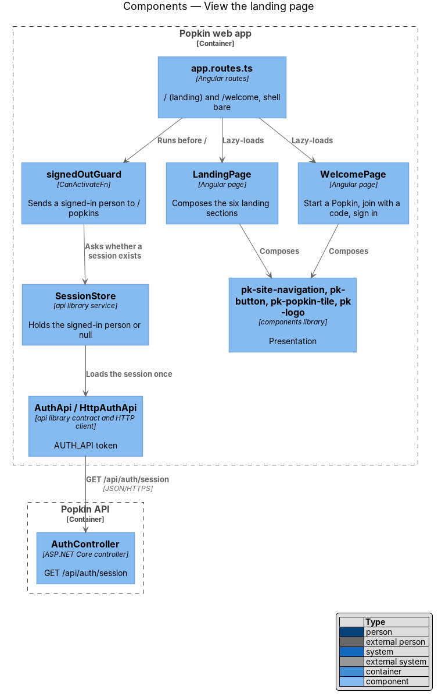
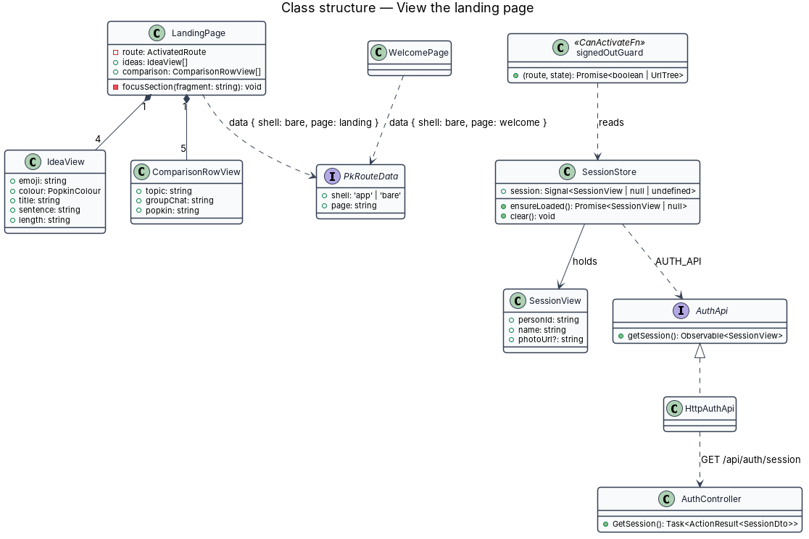
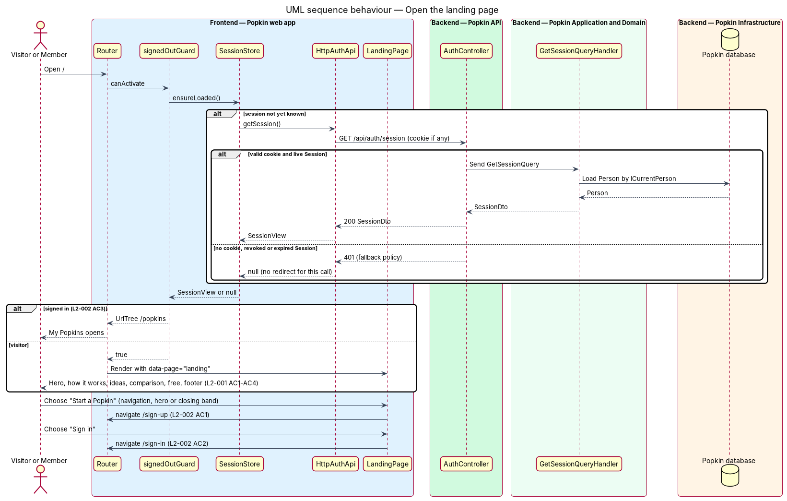
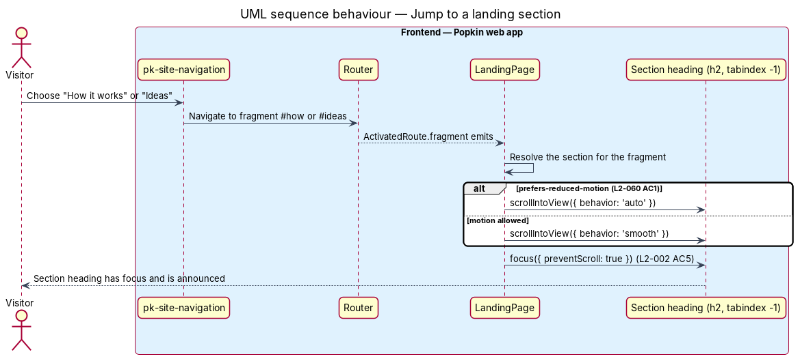

# View the landing page

## Overview

Popkin is a free platform for pop-up communities. A *Popkin* is a private space for one group,
with a name, an emoji, a colour, members and a length. Before a person has an account, the only
parts of Popkin they reach are public screens. This feature covers the two public screens that
introduce Popkin and send a person onward: the landing page and the welcome screen.

- **landing page** — public page at `/` that explains Popkin in six sections and offers "Start a Popkin" and "Sign in"
- **welcome screen** — public phone-width screen at `/welcome` with "Start a Popkin", "Join with a code" and "Already have an account? Sign in"; the screen a person sees after signing out (L2-048 AC5)
- **Visitor** — someone without a session, as defined in `docs/specs/L1.md`
- **section** — one band of the landing page: the hero, how it works, ideas, the comparison with a group chat, the statement that it is free, and the footer

The landing page is the front door of the *landing* subsystem. It loads no data of its own: every
word, idea and comparison row is fixed copy taken from the mock. The only request it depends on
is the session check that decides whether a signed-in person is sent to My Popkins instead
(L2-002 AC3). The page also carries Popkin's promise to stay free, with no ads and no premium
tier (L2-061 AC3), and loads no third-party advertising or tracking script (L2-061 AC2).

Journey 10, Discover Popkin, built this design. The sections below say what was built, and
[Built in journey 10](#built-in-journey-10) lists what differs from the design as it first stood
and what waits. The scaffold's placeholder `HomePage`, which answered `/` until then, is gone,
with its spec and its page object: `/` is the landing page.

## Description

The slice is front-end heavy. The backend contributes only the session check, which the sessions
feature (`docs/detailed-designs/accounts/sessions`) owns.

- **Screens and states**
  - `docs/mocks/pages/landing/default.html` — the only landing state; the manifest marks loading, empty and error as not applicable because the page loads no data.
  - `docs/mocks/pages/welcome/default.html` — the only welcome state.
- **API**
  - `GET /api/auth/session` — 200 `SessionDto` for a live session; 401 otherwise (no `code`; the fallback policy answers). Owned by the sessions feature and called here only through `SessionStore`.

### Front end (introduced)

- **Routes** — `app.routes.ts` has `{ path: '', canActivate: [signedOutGuard], data: { shell: 'bare', page: 'landing' } }` for `LandingPage` and `{ path: 'welcome', data: { shell: 'bare', page: 'welcome' } }` for `WelcomePage`, both lazy-loaded with `loadComponent`. Both routes stay public (L2-007 AC3).
- **`LandingPage`** — `pages/landing/landing.page.ts` and `landing.page.html`, selector `pk-landing-page`, OnPush, no stylesheet. It composes the six sections in the order L2-001 states and holds their fixed copy: the preview of the hero (a `HeroPreview`), the three steps (`StepView`), the four ideas (Small group 🕯️ amber "Keeps going", Hackathon 💻 sky "One weekend", Team ⚽ leaf "One season", Family trip 🏖️ berry "Ten days") and the five comparison rows as `CompareRow` values (Joining, Photos, Plans, Video, The end). It reads nothing. It jumps to a section, as [Jump to a section](#behaviour-rules) says.
- **`WelcomePage`** — `pages/welcome/welcome.page.ts` and `.html`, selector `pk-welcome-page`, OnPush, no stylesheet. It shows the wordmark, the headline "Your people, popped up in seconds.", and three actions: "Start a Popkin" (`/sign-up`), "Join with a code" (`/join`), "Already have an account? Sign in" (`/sign-in`). No guard runs before it.
- **`signedOutGuard`** — `guards/signed-out.guard.ts`, a `CanActivateFn` on the landing route only. It awaits `SessionStore.ensureLoaded()` and returns a `UrlTree` for `/popkins` when a session exists (L2-002 AC3); otherwise it allows the route.
- **`SessionStore`**, **`AuthApi`** / **`AUTH_API`** / **`HttpAuthApi`** — introduced by the sessions feature; this slice reads them only.
- **Landing blocks** — each block of the mock has a page in `docs/design-system/components/` and a `pk-*` component of the same name in the `components` library:
  - the site's frame: `pk-site-nav` (the header, with `pk-logo` and the navigation its links are projected into), `pk-site-nav-link` (a link of it; `from="m"` shows from 768 px, `from="s"` from 640 px), `pk-site-main`, `pk-site-footer` (the logo, the blurb, the links and the legal line) and `pk-site-footer-link`;
  - `pk-hero`, with the preview: it composes `pk-popkin-tile`, `pk-avatar-stack`, `pk-time-left` and `pk-qr`;
  - `pk-band`, a section with its heading; given an `anchor`, its heading has the id `{anchor}-h` and can take focus, and it is the place a navigation link jumps to;
  - `pk-steps`; `pk-uses` and `pk-use`, the idea cards, each with a `pk-popkin-tile`; `pk-compare`, the comparison table, with `pk-icon` and `pk-mark`; and `pk-cta-band`, the closing band;
  - `pk-qr`, the QR code alone, taken out of `pk-qr-card`, which composes it now. The hero's code is the real code of `https://popk.in/lakeside`, encoded by `encodeQr` of the `api` library.
- **The welcome screen's components** — `pk-screen` (`layout="split"`, `body="middle"`), `pk-split-aside` with `surface="brand"` and the mark as a picture (`mark`), and `pk-welcome`, which holds the large wordmark (`pk-wordmark` with `size="lg"`), the mark as a picture on a phone (`pk-mark-picture`) and the two buttons in `pk-action-pair`; the page gives it two `pk-button` links and one `pk-link`.
- **Also changed** — the icon set gained `minus`, the icon of the group chat column. The skip link is the app root's (`pk-skip-link` in `app.html`), as on every screen.

### Behaviour rules

- **Section order and copy** — the hero ("Your people, popped up in seconds.", one paragraph, "Start a Popkin", "Free. Takes about a minute.", a Lakeside Weekend preview), "Scan. Join. You're in." with three numbered steps, the ideas, "Better than a group chat.", "Free. Like, actually free.", and the footer (L2-001 AC1–AC3).
- **Comparison table** — a `table` with a visually hidden caption. The group chat and Popkin columns are told apart by an icon and a column heading, never by colour alone (L2-001 AC4, L2-057 AC5).
- **Hero preview** — illustrative fixed content, as in the mock: the tile emoji, avatars and photos are hidden from assistive technology (empty `alt`, `aria-hidden`), the name "Lakeside Weekend", "14 here" and "Wraps up Sunday" stay readable, and the QR is an image named "QR code for popk.in/lakeside" (L2-057 AC6).
- **Responsive layout** — below 768 px the hero, steps and ideas stack in one column with no sideways scroll (L2-001 AC5). The hero places its text beside the preview and the ideas show four across from 992 px, as the mock's CSS does, which satisfies "at least 1024 px" (L2-001 AC6). Columns live inside a container no wider than 72 rem (L2-058 AC5).
- **Navigation below 640 px** — the header shows the logo and "Start a Popkin"; "Sign in" shows in the navigation from 640 px and is in the footer at every width (L2-002 AC4). "How it works" and "Ideas" show in the navigation from 768 px. `pk-site-nav-link` hides a link below its width in its own stylesheet; the page writes no utility class for it.
- **Actions** — every "Start a Popkin" (navigation, hero, closing band) routes to `/sign-up` (L2-002 AC1). "Sign in" routes to `/sign-in` (L2-002 AC2).
- **Jump to a section** — "How it works" and "Ideas", in the navigation and in the footer, are links to `/#how` and `/#ideas`. Each sets the fragment and also calls the jump directly, so a link chosen a second time jumps again, although the fragment did not change. The page also jumps when it opens on an address that names a section. The jump brings the section's heading into view (`scrollIntoView`), smoothly, or at once when reduced motion is preferred (L2-060), and the heading takes focus (L2-002 AC5). The router's own anchor scrolling is not used.
- **Footer links** — Safety, Privacy and Help link to `/safety`, `/privacy` and `/help`, which have no screen; they show the not-found screen until they do, as the mock notes (known gap 54).
- **"Join with a code"** — the welcome screen links to `/join`, the screen of journey 15, which shows the not-found screen until then (known gap 26).
- **Free and ad-free** — the closing band states "No ads, no premium tier" (L2-061 AC3). The page loads only first-party scripts, self-hosted fonts and pictures the app serves; a behaviour spec proves the landing page requests nothing from another origin (L2-061 AC2). The content security policy of L2-054 AC1 forbids third-party script sources besides.
- **Signed-in redirect on other public screens** — whether `/welcome`, `/sign-up` and `/sign-in` also redirect a signed-in person to My Popkins is `<TO SUPPLY>`; the specs require it for the landing address only, and that is what is built (known gap 55).

### Tests

- Playwright behaviour specs, `e2e/tests/landing.spec.ts` and `e2e/tests/welcome.spec.ts`, 22 in all, drive `LandingPage` and `WelcomePage` through the page objects `e2e/pages/landing.page.ts` and `e2e/pages/welcome.page.ts`: each section and its copy, one column on a phone, the hero side by side and four ideas across from 1024 px, every "Start a Popkin", "Sign in" in the navigation and in the footer, both jumps and the jump from the keyboard, My Popkins for a signed-in person, and the three actions of the welcome screen. One spec proves L2-061 AC2: the landing page requests nothing from another origin.
- `GET /api/auth/session` is answered 401 for a visitor and 200 for a signed-in person.
- `routes.ts` has the `landing` and `welcome` keys, and both screens are in the sweeps' lists.
- Each new component has a parity spec in `e2e/tests/parity/`, except `pk-qr` (known gap 56). The parity specs open the landing page as a visitor.

### Built in journey 10

What differs from the design as it first stood:

- **Component names.** The design named one `pk-site-navigation` for the header and the footer. The build follows the blocks of the mock and of the design system: `pk-site-nav`, `pk-site-nav-link`, `pk-site-main`, `pk-site-footer` and `pk-site-footer-link`. The view models are `HeroPreview`, `StepView` and `CompareRow`, exported by the components that draw them; there is no `IdeaView` and no `ComparisonRowView`.
- **The jump.** The design had the page react to the fragment alone. A link chosen twice does not change the fragment, so each link calls the jump as well.
- **"Sign in" from 640 px.** The design system's responsive page said 576 px; it was corrected to the requirement, which the mock already followed.
- **No utility classes for the navigation.** The page writes no `only-md` or `only-sm`; `pk-site-nav-link` owns that.
- **`pk-qr`.** The code was drawn inside `pk-qr-card`; the hero needs it without the card.

What waits, each a known gap in [the register](../../README.md#known-gaps):

- `/safety`, `/privacy` and `/help` have no screen (gap 54).
- Whether the other public screens send a signed-in person to My Popkins (gap 55).
- `pk-qr` has no parity spec, and the hero's parity leaves the code out at 1280 px (gap 56).
- Three oddities of the mock were reproduced, not fixed: the mock changes first (gap 57).
- The diagrams below were not redrawn (gap 58).

## Requirements

| L2 ID | Refines (L1) | Requirement |
|-------|--------------|-------------|
| `L2-001` | `L1-001` | Landing page content: The landing page explains Popkin to a visitor in six sections, in this order: the hero, how it works, ideas, the comparison with a group chat, the statement that it is free, and the footer. |
| `L2-002` | `L1-001` | Landing page actions: The landing page offers one primary action, starting a Popkin, and a way in for people who have an account. |
| `L2-061` | `L1-015` | No payment and no advertising: Popkin costs nothing and sells nothing. |

## Diagrams

The diagrams below were not redrawn (gap 58). They show `pk-site-navigation`, `IdeaView` and
`ComparisonRowView`, and a jump that the fragment alone starts.

### System context

A Visitor reaches the landing page without an account. A Member who opens the same address is
sent on to My Popkins.

### Containers

The Popkin web app serves both screens. Its only call to the Popkin API is the session check
that the guard needs.

### Components

The routes run `signedOutGuard` before `LandingPage`. The guard reads `SessionStore`, which
loads the session once through `AuthApi`. Both pages compose `pk-*` components only.

### Class structure

`LandingPage` owns the fixed idea and comparison view models. The guard depends on
`SessionStore`, which reaches `AuthController` through the `AuthApi` contract.

### Behaviour — open the landing page

The guard resolves the session first. A live session redirects to `/popkins` (L2-002 AC3); a 401
renders the six sections. Each "Start a Popkin" and "Sign in" routes onward (L2-002 AC1, AC2).

### Behaviour — jump to a section

A navigation link sets the fragment and calls the jump. `LandingPage` scrolls the section's
heading into view, without animation when reduced motion is preferred, and moves focus to it
(L2-002 AC5).

