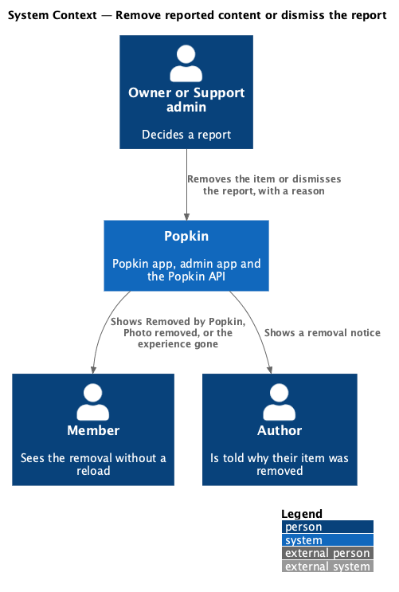
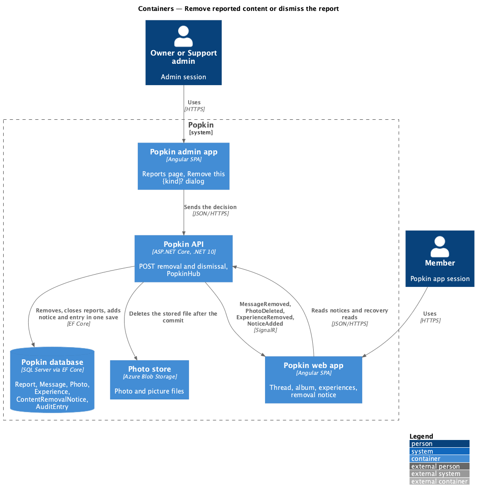
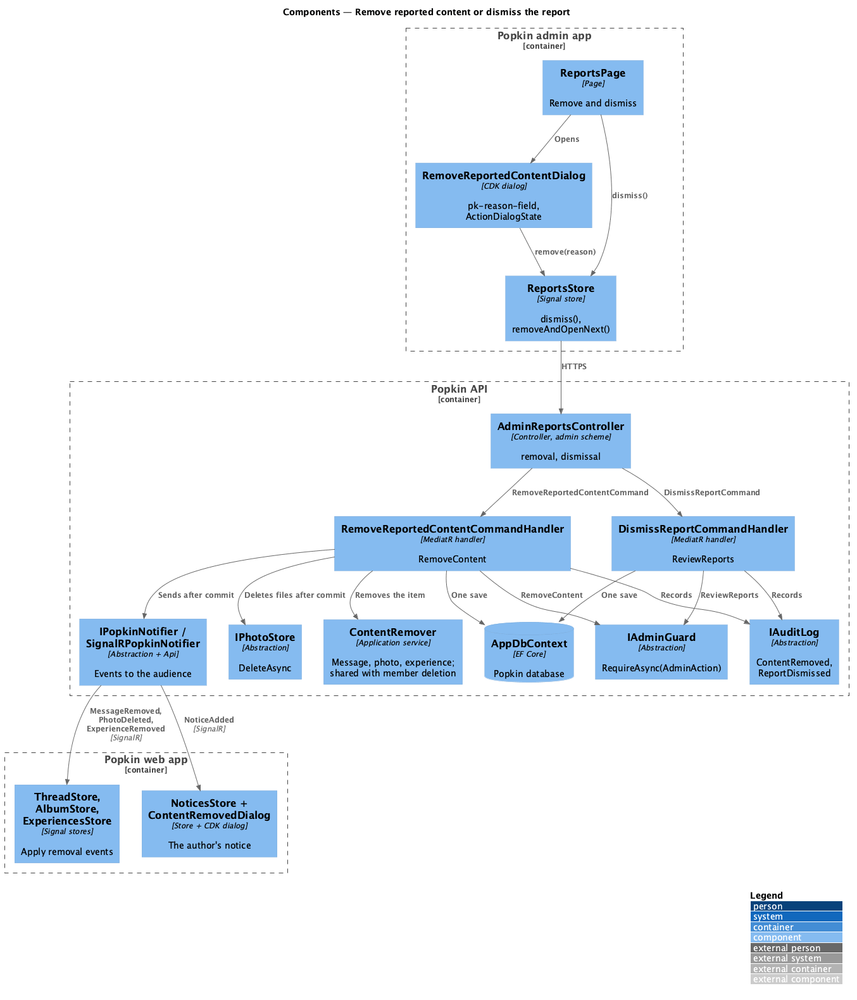
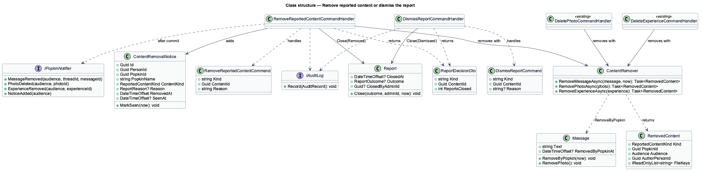
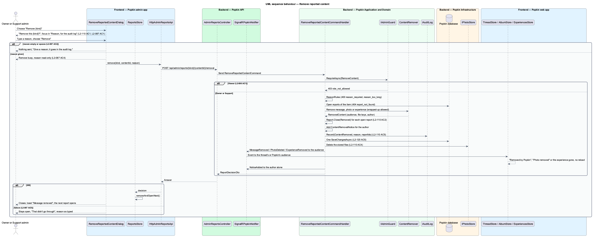
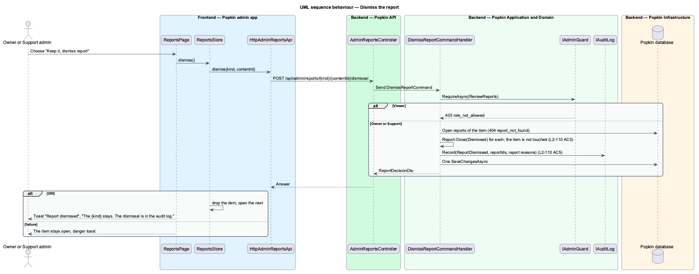
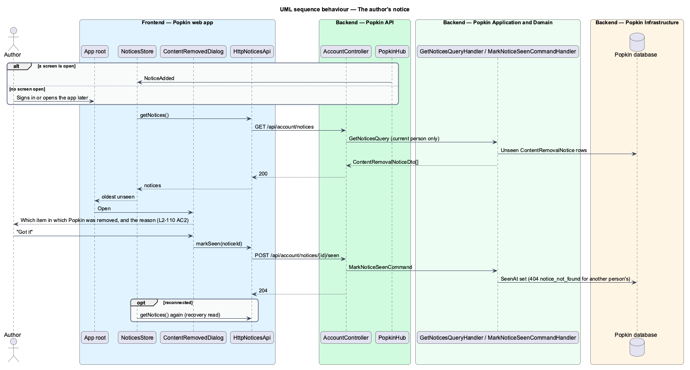

# Remove reported content or dismiss the report

## Overview

An admin who has read a report ([Reports](../review-reports/README.md)) makes one of two
decisions. *Remove* takes the item away from every member of its Popkin at once and tells its
author why. *Dismiss* keeps the item and closes the reports. Either decision closes every open
report on the item and is written in the audit log with the reports it closed (L2-110 AC5).

- **removal** — Popkin's decision to take a reported item away: a message reads "Removed by
  Popkin" in its place, a photo reads "Photo removed" where it was sent and leaves the album, an
  experience is gone
- **dismissal** — Popkin's decision to keep a reported item and close its reports
- **removal notice** — message the author sees in the Popkin app once their item is removed,
  naming why

Removal reaches every open screen without a reload, through the hub events of the shared
real-time rules: the existing `PhotoDeleted` for a photo, and two new events, `MessageRemoved`
and `ExperienceRemoved`. A removed item is never returned again, and its stored files are deleted
(L2-110 AC4). The same removal is offered inside a [Moderation view](../moderation-view/README.md)
for an item nobody reported (L2-111 AC3).

Only an Owner or a Support admin decides (L2-086). Removal and dismissal still apply in a
wrapped-up Popkin, because reports are still taken there (L2-108 AC7).

This feature is designed, not built.

## Description

### Screens and states

Admin app, from `docs/mocks/admin/manifest.json`:

- `docs/mocks/admin/dialogs/report-remove/default.html` — "Remove this message?", "It disappears
  for everyone in Class of 2015 Reunion and is replaced with “Removed by Popkin”. Tomás is told
  why. The report closes.", the field "Reason, for the audit log" with focus, "Remove" (danger)
  and "Cancel".
- `busy.html` — "Remove" busy and disabled, "Cancel" disabled, the reason read-only (L2-087 AC4).
- `invalid.html` — the field invalid.
- `failed.html` — the alert "That didn't go through" with the reason kept.
- `docs/mocks/admin/pages/reports/removed.html` — the next item open, the toast "Message removed",
  "It shows as “Removed by Popkin” in Class of 2015 Reunion; Tomás has been told why."
- `docs/mocks/admin/pages/reports/dismissed.html` — the next item open, the toast "Report
  dismissed", "The message stays. The dismissal is in the audit log."

The mocks differ from the requirements, and the requirements stand (conflicts, reported to the
index):

- `invalid.html` reads "Say why, in a few words. The reason goes in the audit log."; L2-087 AC2
  gives "Give a reason; it goes in the audit log."
- `failed.html` reads "Nothing changed: the message is still there. Check your connection and try
  again."; L2-087 AC5 gives "Nothing has changed. Your reason is kept; try again."
- No mock shows the hint "Other admins see it in the audit log." beneath the field (L2-087 AC1).
- "Keep it, dismiss report" acts at once in the mock, with no dialog and no reason, while L2-110
  AC5 records a dismissal "with its reason" and L2-087 AC1 does not list dismissal among the
  dialogs that ask for one. The design takes an optional reason, sends none from the page, and
  records the reports' reasons in the entry's details. Whether dismissal asks for a reason is
  `<TO SUPPLY>`.
- The removal sentence of L2-110 AC1 names "Removed by Popkin" for every kind; for a photo the
  members see "Photo removed" and for an experience nothing. The dialog's copy per kind is
  `<TO SUPPLY>`, as are the toasts after removing a photo and an experience.

Popkin web app. No mock draws these states (known gap). The design expects:

- `docs/mocks/pages/group-chat/removed-by-popkin.html` — a message in Everyone reading "Removed
  by Popkin" in its place, and a reply whose quote reads the same; the same state for a direct
  message.
- `docs/mocks/pages/experience-detail/removed.html` — the experience page when its experience is
  removed while open (copy `<TO SUPPLY>`). The existing `docs/mocks/pages/photo-view/removed.html`
  serves a removed photo.
- `docs/mocks/dialogs/content-removed/default.html` — the removal notice: which item was removed
  in which Popkin, the reason, and "Got it" (copy `<TO SUPPLY>`).

### API

Admin endpoints, `AdminReportsController` (route `api/admin/reports`, admin scheme):

- `POST /api/admin/reports/{kind}/{contentId}/removal` — body `{ reason }`. `200`
  `ReportDecisionDto { kind, contentId, reportsClosed }`. Failures: `400` `reason_required`,
  `reason_too_long` (`ReasonRules`); `403` `role_not_allowed` (`AdminAction.RemoveContent`);
  `404` `report_not_found` when the item has no open report, which also answers a second removal
  of the same item.
- `POST /api/admin/reports/{kind}/{contentId}/dismissal` — body `{ reason? }`. `200`
  `ReportDecisionDto`. Failures: `400` `reason_too_long`; `403` `role_not_allowed`
  (`AdminAction.ReviewReports`); `404` `report_not_found`.

Popkin app endpoints (default policy, a Popkin app session):

- `GET /api/account/notices` — `200` `ContentRemovalNoticeDto[] { id, kind, popkin { id, name },
  reason, removedAt }`, the notices the person has not marked seen.
- `POST /api/account/notices/{noticeId}/seen` — `204`; `404` `notice_not_found` for another
  person's notice.

Changed reads (L2-110 AC4):

- `MessageDto` gains `bool RemovedByPopkin`; a removed message carries no text, no photo and no
  reactions. A reply's quote of it reads "Removed by Popkin", and so do the previews of the
  Popkin home, My Popkins and the Chat tab.
- A removed photo answers `404` `photo_not_found`, as a deleted one does, and leaves the album.
- A removed experience answers `404` `experience_not_found` and leaves the list and the home's
  summary.
- `ChatThreads.RequireMessageAsync` refuses a removed message as it refuses a deleted one, so
  nobody reacts to it, replies to it or reports it.

Real time (shared real-time rules; the API sends every event, after the commit, awaited):

| Event | Audience | Kind | Recovery read |
|---|---|---|---|
| `MessageRemoved(threadId, messageId)` (new) | the thread's `Audience` | fact | the thread's messages |
| `PhotoDeleted(photoId)` (existing) | the photo's `Audience` | fact | the album, the photo, the thread |
| `ExperienceRemoved(experienceId)` (new) | `Audience.Popkin` | fact | the experiences list, the experience |
| `NoticeAdded()` (new) | `Audience.People` with the author alone | fact | `GET /api/account/notices` |

### Backend (`backend/src/`)

- **`RemoveReportedContentCommand`** (Application, `Admin/Moderation/RemoveReportedContent.cs`,
  new) — `Kind`, `ContentId`, `Reason`. The handler calls
  `IAdminGuard.RequireAsync(AdminAction.RemoveContent)`, validates the reason with `ReasonRules`,
  loads the item's open reports, removes the item through `ContentRemover`, closes each report
  with `Report.Close(ReportOutcome.Removed, adminId, now)`, adds a `ContentRemovalNotice` for the
  author, and records the entry. One `SaveChangesAsync` writes all of it (L2-120 AC5). After the
  commit it deletes the stored files and sends the events.
- **`DismissReportCommand`** (Application, new) — `Kind`, `ContentId`, `Reason?`. The handler
  calls `IAdminGuard.RequireAsync(AdminAction.ReviewReports)`, closes each open report with
  `ReportOutcome.Dismissed`, and records the entry in the same save. The item is not touched and
  no event is sent (L2-110 AC3).
- **`ContentRemover`** (Application, `Moderation/ContentRemover.cs`, new) — one home for taking
  an item away, shared by the member's own deletion and by Popkin's removal. It does not check
  `popkin_wrapped_up`; its callers decide that.
  - `RemoveMessageAsync` — `Message.RemoveByPopkin(now)` (new: sets `RemovedByPopkinAt`, clears
    `Text`), removes its reactions, and removes the photo it carries with `RemovePhotoAsync`, so
    an Everyone photo leaves the album too. The message's audience is
    `ChatThreads.AudienceAsync`.
  - `RemovePhotoAsync` — the steps `DeletePhotoCommandHandler` takes today, moved here: its
    reactions and comments go, each message that carried it calls `Message.RemovePhoto()` ("Photo
    removed"), the `Photo` row goes; the file keys are returned for deletion after the commit.
    `DeletePhotoCommandHandler` then calls it.
  - `RemoveExperienceAsync` — the steps of `DeleteExperienceCommandHandler`, moved here: its
    ratings, their comments and its keen go with it; its picture keys are returned.
    `DeleteExperienceCommandHandler` then calls it and, from then on, sends `ExperienceRemoved` as
    well, so a member's own deletion also reaches open screens.
  - Each returns a `RemovedContent { kind, popkinId, audience, authorPersonId, fileKeys }`.
- **Files** — after the commit, `PhotoFiles.DeleteAsync(IPhotoStore, keys)` and
  `ExperiencePictures.DeleteAsync` delete the stored files (L2-110 AC4). A file that cannot be
  deleted is logged by the item's id alone, as `DeletePhotoCommandHandler` logs today; the gap of
  files left behind with no sweep stays as it is.
- **`ContentRemovalNotice`** (Domain, new) — `Id`, `PersonId`, `PopkinId`, `PopkinName`,
  `ContentKind`, `Reason` (`ReportReason?`), `RemovedAt`, `SeenAt?`; `MarkSeen(now)`.
  `IAppDbContext.ContentRemovalNotices`. The notice names the report reason the queue shows for
  the item (one of the five), not the admin's audit reason, which is written for other admins
  (L2-087 AC1). Whether the author is shown the admin's own words instead is `<TO SUPPLY>`.
- **`GetNoticesQuery`** and **`MarkNoticeSeenCommand`** (Application, `Account/Notices.cs`, new)
  behind `AccountController`; each reads only the current person's notices.
- **`IPopkinNotifier`** and **`IPopkinClient`** gain `MessageRemoved`, `ExperienceRemoved` and
  `NoticeAdded`; `SignalRPopkinNotifier` sends them to the named audience.
- **Audit** — `AuditAction.ContentRemoved` or `AuditAction.ReportDismissed`; `TargetKind.Report`;
  `TargetId` the earliest closed report; `TargetName` "{Kind} in {Popkin}"; `Reason` the admin's
  reason; `Details { kind, contentId, reportIds, reportsClosed, reasons }` (the report reasons as
  codes). No text, photo or caption of the item (L2-120 AC7).
- **Telemetry** — the counter `popkin.moderation.decisions` on `PopkinMetrics`, dimensions `kind`
  and `outcome` only.

### Frontend (Popkin admin app)

- **`RemoveReportedContentDialog`** (`frontend/projects/admin/src/app/dialogs/report-remove/`,
  `.ts` + `.html`) — `pk-dialog` titled "Remove this {kind}?", the sentence of L2-110 AC1 with the
  Popkin's name and the author's first name, `pk-reason-field`, "Remove" (danger) and "Cancel".
  It runs `ActionDialogState` (idle → busy → failed, the reason kept). An empty reason sends
  nothing and marks the field with "Give a reason; it goes in the audit log." (L2-087 AC2).
- **`ReportsPage`** — "Remove {kind}" opens the dialog; on success the page shows the toast and
  `ReportsStore.removeAndOpenNext()` opens the next item (L2-110 AC2). "Keep it, dismiss report"
  calls `ReportsStore.dismiss()`, which sends the dismissal, shows "Report dismissed" and "The
  {kind} stays. The dismissal is in the audit log.", and opens the next item (L2-110 AC3). A
  failed dismissal keeps the item open with a danger toast (copy `<TO SUPPLY>`).
- **`AdminReportsApi`** gains `remove(kind, contentId, reason)` and `dismiss(kind, contentId)`.

### Frontend (Popkin web app)

- **`ThreadStore`** — handles `MessageRemoved` by marking the message removed: no text, no
  photo, no reactions, its row reading "Removed by Popkin", and any quote of it the same. Its
  message actions no longer open. `thread-text.ts` and `conversation-text.ts` gain the text.
- **`pk-message`** — a `removed` state reading "Removed by Popkin" in place of the bubble's text,
  next to its existing "Photo removed". Its parity spec gains the case once the mock exists.
- **`AlbumStore`** and **`PhotoViewStore`** already apply `PhotoDeleted`; nothing changes there.
- **`ExperiencesStore`** and **`ExperienceStore`** — handle `ExperienceRemoved`: the list drops
  it; an open experience page shows its removed state.
- **`NoticesStore`** (new, `api` library, `account/notices-store.ts`, `NOTICES_API`) — reads the
  notices once a person is signed in, on `NoticeAdded` and on `reconnected$`. The app root opens
  **`ContentRemovedDialog`** (new, `dialogs/content-removed/`) for the oldest unseen notice;
  "Got it" marks it seen and the next one, if any, opens. Unit-tested (ADR 0011).
- **`HUB_EVENTS`** gains `messageRemoved`, `experienceRemoved` and `noticeAdded`.

### Decisions

- A removed message is kept as a row with no text, so a reply's quote and the thread's order
  still hold; a removed photo and a removed experience are deleted rows, as a member's deletion
  deletes them.
- A removed message takes its photo with it, from the album too. What was reported is what the
  message showed, photo included.
- Removal and dismissal close every open report on the item at once (L2-110 AC2, AC3). A later
  report of a dismissed item opens a new queue item.
- The author's notice is a stored row read on sign-in as well as an event, because the author may
  have no screen open when the removal is made.

### Testing

- API: `Popkin.Api.Tests/Admin/Moderation/RemoveReportedContentTests` (a message, a photo, an
  experience; every report closed; the notice; the entry and the change in one save, and no entry
  when the save fails through an injected fault in `IAppDbContext`; the stored file deleted;
  a wrapped-up Popkin; `403` for a Viewer; `400` for an empty reason; `404` the second time),
  `DismissReportTests`, `LiveRemovalTests` (a real SignalR client in memory receives
  `MessageRemoved`, `PhotoDeleted`, `ExperienceRemoved` in its audience alone, and the author
  `NoticeAdded`), `NoticesTests`. Reads after removal: `MessagesTests` shows `removedByPopkin`,
  `GetPhoto` and `GetExperience` answer `404`.
- Application: `ContentRemoverTests` for each kind, and the existing deletion tests kept green
  after the steps move into `ContentRemover`.
- Frontend unit: `reports-store.spec.ts` (next item after each decision), `thread-store.spec.ts`
  (`MessageRemoved`), `experiences-store.spec.ts`, `notices-store.spec.ts`.
- Playwright: `e2e/tests/admin/decide-report.spec.ts` and `e2e/tests/removed-content.spec.ts`
  (the hub fixture pushes each event; the notice dialog opens and closes).

## Requirements

| L2 ID | Refines (L1) | Requirement |
|-------|--------------|-------------|
| `L2-110` | `L1-024` | Remove reported content or dismiss the report: An admin decides. (AC1–AC5) |
| `L2-087` | `L1-028` | A reason for every change: An admin says why they change something, and the audit log keeps it. (AC1, AC2, AC4, AC5, AC7 for removal) |
| `L2-086` | `L1-028` | Admin roles: Every admin has one role, and the API, not the screen, decides what it allows. (AC1, AC2: review reports and remove content) |
| `L2-120` | `L1-028` | Audit log: Every action in the console, with who did it and why. (AC5, AC7) |

## Diagrams

### System context

An admin decides in the admin app; every member of the Popkin sees a removal, and its author is
told why.

### Containers

The admin app sends the decision to the Popkin API, which changes the database, deletes the
stored file, and pushes the removal to the Popkin web app of every member concerned.

### Components

Two admin handlers share `ContentRemover` with the members' own deletions; `IAuditLog` adds the
entry to the same save, and `IPopkinNotifier` sends the events after it.

### Class structure

`ContentRemover` removes each kind and returns what to delete and whom to tell; `Report.Close`
records the outcome; `ContentRemovalNotice` waits for the author.

### Behaviour — remove reported content

The admin confirms with a reason; the item goes, every report on it closes, the entry is written,
the members' screens change without a reload and the author is told (L2-110 AC1, AC2, AC4, AC5).

### Behaviour — dismiss the report

The reports close and the item stays; the next report opens (L2-110 AC3, AC5).

### Behaviour — the author's notice

The author learns of the removal through `NoticeAdded` or, with no screen open, at the next read
of the notices.

